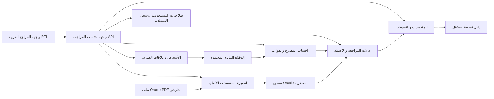

# المخطط المعماري الشامل — الإصدار التصوري v0.1

**الحالة: تصميم قابل للمراجعة فقط.** ليست هذه مخططات SQL منفذة، ولا كلاسات C# جاهزة، ولا قواعد قانونية معتمدة. أسماء الكيانات التقنية بالإنجليزية عمدًا لضمان مطابقة الكود مستقبلًا، وكل الشرح بالعربية.

## نطاق العمل المتفق عليه
الوحدة الحسابية للمجمع الطبي `30200105` تخدم الطب والأسنان والصيدلة. المراجعون يراجعون الموظفين وأعضاء هيئة التدريس والمتعاقدين وأصحاب المكافآت. البيانات المالية المعتمدة تأتي من المراجع، بينما مستندات Oracle دليل للمقارنة لا يجوز أن يغير بيانات الموظف تلقائيًا.

الأحداث بعد اعتماد الصرفية — وفاة، إعارة، جزء من الشهر أو تصحيح — تفتح **مراجعة جديدة موثقة** دون مسح الاعتماد السابق. لا دفع ولا إيقاف بنكي تلقائي. البنود ذات الكود المتكرر والأسماء العربية المعكوسة تبقى سطورًا مستقلة.

التأمينات وصندوق دعم المعاقين وصندوق الشهداء تُؤخذ قيمتها من المركزية دون إعادة احتساب، مع رقابة سلامة المصدر؛ حالة جزء الوقت لها فحص استثنائي على الوعاء بعد تحقق السند. المطابقة داخل باب الصرف لا تعني تطابق كل بند.

## خريطة ملفات التصميم
| ما تريد رؤيته؟ | المستند |
| --- | --- |
| الأشخاص والكليات والعلاقات الوظيفية والمبالغ المعتمدة | [ERD للهوية والوقائع](ERD-CORE.md) |
| PDF وظهور البنود المتكررة وربط الأكواد | [ERD للمصادر](ERD-IMPORT-AND-AUDIT.md) |
| الحساب والمراجع والاعتماد والمتجمدات | [ERD للمراجعة](ERD-REVIEW-AND-RETRO.md) |
| الكلاسات والخدمات والعلاقات | [UML للكلاسات](UML-CLASSES.md) |
| خطوات الإدخال والمراجعة والحالات | [UML للتسلسل والحالات](UML-WORKFLOWS.md) |
| الشبكة الداخلية وقيود SQL والأمان | [التشغيل والعقود](DEPLOYMENT-AND-CONTRACTS.md) |
| ترتيب عمل Gemini والمسائل المعلقة | [خطة التنفيذ](IMPLEMENTATION-SLICES.md) |
| **مثال جدول بإدخال فعلي افتراضي ومخرجات** | [مثال ERD عملي](../examples/01-ERD-INPUT-OUTPUT.md) |
| **مثال طلب API ونتيجة UML وحالات المراجع** | [مثال UML عملي](../examples/02-UML-REVIEW-EXAMPLES.md) |

## وحدة اختيار القواعد الزمنية
- [التحليل المقترح لتداخل القوانين والقرارات والدرجات](../specs/TEMPORAL-RULE-RESOLUTION-AND-CONFLICTS.md).
- [ERD وUML لغياب متداخل مع ترقية وإجازة](../examples/03-TEMPORAL-RULE-CONFLICT-EXAMPLE.md).
- [بوابة التحقق من انطباق وتركيب القواعد المتداخلة](../specs/RULE-INTERACTION-AND-VALIDATION.md).
- **مبدأ التصميم:** يتم الحل لكل بند/علاقة صرف/مقطع مؤثر، وتظل نتيجة المراجعة السابقة ثابتة إذا وصل قرار متأخر.

## المكونات المنطقية الرئيسية

هذا تنظيم منطقي وليس مجموعة Microservices مستقلة. تعتمد البنية التحتية على واجهات التطبيق، ويعتمد التطبيق على الدومين؛ لا يعرف الدومين شيئًا عن PDFium أو SQL Server أو Angular.

## الفرق بين أنواع القيم
| نوع المبلغ | مصدره | هل يثبت الدفع؟ |
| --- | --- | --- |
| `SourceAmount` | Oracle الأصلي | لا |
| `ExpectedAmount` | قاعدة مستقلة معتمدة ومدخلات موظف معتمدة | لا |
| `ReviewedAmount` | قرار مراجع مسجل | لا |
| `OfficialCorrectionAmount` | نسخة رسمية مصححة لاحقة | لا |
| `ReportedDisbursementAmount` | كشف صرف لاحق | لا يلزم |
| `VerifiedPaidAmount` | إثبات تسوية مستقل | فقط وفق قوة الإثبات |

## حدود هذا الإصدار
لا تفترض أن كل كيان في ERD جدول واحد، أو أن `decimal` له سياسة تقريب عامة، أو أن الرقم القومي هو المفتاح الداخلي. يجب اعتماد ADR لتقنية التنفيذ والعلاقات الفيزيائية والصلاحيات والأدلة وسعة الاستخدام أولًا.

## تتبع القرار
متطلب المالك ← ADR/تصميم مقترح ← Issue تنفيذ معتمدة ← فرع وPR واختبارات اصطناعية ← مراجعة ChatGPT ← اعتماد المالك للكود.

## شرح الرموز
`||` واحد لازم، `o|` صفر أو واحد، `o{` صفر أو أكثر، `|{` واحد أو أكثر. `ValidFrom/ValidTo` تعني فترة سريان بنهاية غير مشمولة؛ `RecordedAt` يعبّر عن وقت تسجيل المعرفة. أسماء الكيانات بالإنجليزية معرفات تقنية وليست لغة الشرح.
