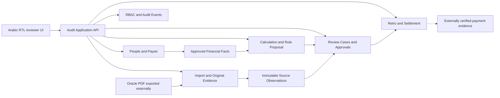

# Architecture Blueprint v0.1 — PayrollReviewSystem

> **Status: DRAFT ARCHITECTURE / DOCUMENTATION ONLY.** This is a coherent *conceptual* design, not an approved physical SQL schema, ORM entity set, verified legal calculation or implementation authorization. Owner-confirmed requirements are separated from proposed engineering decisions. Mermaid is stored as Markdown and rendered by GitHub.

## System boundary and known owner requirements
- Independent review and evidence management for Alexandria University Medical Complex **accounting unit 30200105**, covering **Medicine, Dentistry, Pharmacy**.
- Reviewers cover employees, faculty, contractual staff and reward/honorarium payees. One **Person** can have zero/many employments and payment relationships.
- Routine approval **before payout**; a later death, secondment, part-month event or correction can trigger **documented reopening** of an approval. Do not equate review approval with bank settlement or automatically stop payments.
- Reviewers provide approved base salary/history/financial facts; imported Oracle data are not allowed to overwrite them.
- Calculation engines propose financial changes for explicit human acceptance/adjustment.
- PDF input starts from `OraclePdfParser` + layout-table evidence from `PDF-EXTRACTOR`. Repeated Oracle account codes, imperfect Arabic RTL names and duplicate-looking source rows remain **separate source occurrences**.
- Centrally calculated funds (**صندوق دعم المعاقين** / **صندوق الشهداء**) and generally pensions/insurance are *source-accepted*, not independently recomputed. Part-time/full insured-wage base discrepancy is a narrow, legally source-gated **exception**.
- Expenditure chapter aggregation can be reviewer-accepted with stated conditions, not treated as detailed line matching.
- Multiple group-assigned payroll reviewers, shared access to authorized non-payroll disbursements, tamper-evident attribution, secure **internal network** deployment.

## Blueprint source files
| View | File | Engineering question |
| --- | --- | --- |
| Business/identity & rules ERD | [ERD-CORE.md](ERD-CORE.md) | Who may be entitled, under which status, period and approved reference data? |
| Source evidence/Oracle ERD | [ERD-IMPORT-AND-AUDIT.md](ERD-IMPORT-AND-AUDIT.md) | How do PDF, parse versions, repeated rows and source mapping remain separate? |
| Review/retro/control ERD | [ERD-REVIEW-AND-RETRO.md](ERD-REVIEW-AND-RETRO.md) | What is independently expected, accepted, questioned, corrected and actually paid? |
| UML class & service model | [UML-CLASSES.md](UML-CLASSES.md) | Which classes own rules and which interfaces provide dependencies? |
| UML sequences & states | [UML-WORKFLOWS.md](UML-WORKFLOWS.md) | How do import, calculation, approval, reopening and retro matching work? |
| Deployment/technical rules | [DEPLOYMENT-AND-CONTRACTS.md](DEPLOYMENT-AND-CONTRACTS.md) | How does the internal app run securely, and which constraints prevent silent corruption? |
| Phased implementation | [IMPLEMENTATION-SLICES.md](IMPLEMENTATION-SLICES.md) | How Gemini should implement and test while preserving review gates. |

## Conceptual component context

*Logical boundaries, **not** deployed microservices.*

## Dependency direction
Infrastructure adapters depend on **application ports**; application services depend on **domain models** and approved rules. Domain objects know nothing about web/Oracle/PDF libraries. Source observations and immutable calculations are not the same entity as an approved employee financial fact.

## Traceability contract
Requirement -> approved Owner decision -> blueprint entity/sequence -> GitHub implementation Issue -> PR -> synthetic and confidential-in-environment verification -> architect review -> Owner merge for code.

## Scope of **v0.1**
- Entity names, key and cardinality hypotheses and class interfaces are **proposals**. Some one-to-many rules, enum names, physical schema definitions and SQL indexes require an ADR and first schema Issue.
- The 30-Jun-2015 historical basic is a **reference fact** and NOT an automatic payable line.
- No legislation, statutory percentages, contribution rates, payment action or cancellation is activated by an architecture diagram.
- This repo is still public at the time of this documentation change. No sensitive source, salary, personal ID or employee list may be placed here.
- Do not execute DB migrations based on Mermaid. Resolve [open questions](IMPLEMENTATION-SLICES.md#decisions-that-must-precede-specific-code) with Owner and verifiable primary documents.

## Notation
Mermaid `erDiagram`: `||` exactly one; `o|` zero-or-one; `o{` zero-or-many; `|{` one-or-many. Tables list illustrative fields, not definitive SQL data types. `? ` or `nullable` in prose means no inferred default value. Date intervals follow `[ValidFrom, ValidTo)` when domain meaning allows; `RecordedAt`/supersession supports history of what was known at the time.
