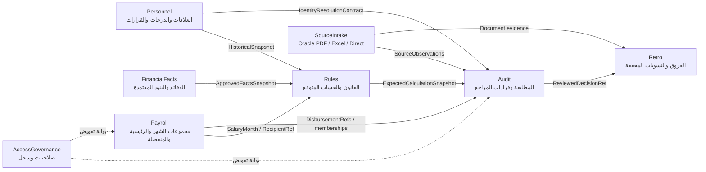
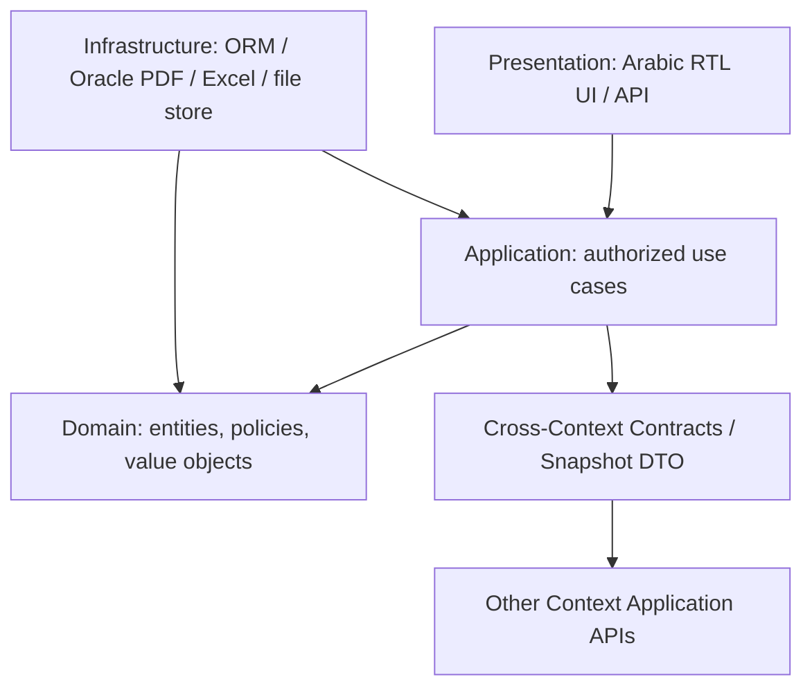

# تصور الـDDD: Bounded Contexts وAggregate Roots وحدود التكامل

> **المنهجية معتمدة** في [ADR-003](../decisions/ADR-003-ddd-modular-monolith-clean-architecture.md). أما أسماء السياقات وملكياتها وAggregate Roots والعمليات التالية **فمقترحات تصميم قيد مراجعة Goldfish**، وليست SQL Schema أو عقود API منفذة. التزامات المالك الحالية في المواصفات السابقة تحكم التناقض، وتحتاج مسائل التوظيف والقانون المفتوحة قرارًا منفصلًا.

## 1. لغة النظام الحاكمة Ubiquitous Language
| المصطلح | المعنى | الممنوع الخلط به |
| --- | --- | --- |
| `Person` | شخص بشري مستفيد، قد تكون له علاقات عمل/صرف متعددة | `EmploymentRelationship` |
| `EmploymentRelationship` | صلة عمل نظامية مؤرخة مع الجهة | `PayeeRelationship` أو رقم Oracle |
| `PayeeRelationship` | صفة مالية تلقي المبلغ؛ قد تكون مكافأة بلا توظيف | علاقة تعيين بالضرورة |
| `SalaryEntitlementMonth` | شهر استحقاق المرتب الرئيسي ومرجع فرادته | `PayrollProcessingPeriod` |
| `PayrollProcessingPeriod` | شهر ظهور/معالجة الصرفية | تاريخ الدفع البنكي المثبت |
| `MonthlyMainSalarySlot` | سجل واحد منطقي لمرتب العلاقة والجهة والشهر | تقرير PDF أو دفع منفصل |
| `MAIN_SALARY` | نوع الصرفية الرئيسية المرتبطة بالسجل المنطقي | `SEPARATE` مكافأة أو حافز أو متجمد |
| `SourceFinancialOccurrence` | ظهور **واحد مستقل** لسطر بالمصدر حتى لو تكرر الكود | بند محاسبي داخلي أو استحقاق معتمد |
| `ApprovedFinancialFact` | واقعة مرجعية مصدرها قرار/مراجع مخول | القيمة المستخرجة من Oracle |
| `ExpectedCalculationLine` | مبلغ حساب مستحق **مقترح** بقاعدة موثقة وSnapshot | مبلغ أصل المصدر أو قرار المراجع |
| `ReviewAdjustment` | قرار تغيير/إضافة/استبعاد أثناء المراجعة، مع أثر محفوظ | تعديل التاريخ أو ملف Oracle |
| `RetroEntitlement` | فرق استحقاق مؤرخ محتمل/محسوم حسب حالته | `DeductionObligation` |
| `DeductionObligation` | التزام استقطاع لا ينشأ من مجرد فرق مقترح | فرق استخراج ناقص |
| `VerifiedPaidAmount` | مبلغ ترتبط به **أدلة تسوية مستقلة ومحققة** | ظهوره في كشف البنك أو Oracle فقط |

## 2. خريطة Bounded Contexts — مقترحة لا تجعل كل صف Microservice
| Context منطقي | مالك الحقيقة داخله | من يستهلك بياناته؟ | الحدود |
| --- | --- | --- | --- |
| `Personnel` | `Person`, `EmploymentRelationship`, `PayeeRelationship`, `GradeHistory`, `StatusHistory`, `AdministrativeDecision` | `Payroll`, `Rules`, `Audit` | لا يحق لمصدر Oracle تعديل ملف الشخص أو القرار |
| `Payroll` | `PayrollCycle`, `PayrollRun`, `PayrollDisbursement`, `MonthlyMainSalarySlot`, `MainSalaryRevision`, `PayrollGroup`, `MonthlyGroupMembership` | `Audit`, `Rules` | فرادة الرئيسي وتعدد المنفصلة وإسناد الشهر؛ ليس أمر دفع |
| `FinancialFacts` | `FinancialComponent`, `ApprovedFinancialFact`, `ComponentAssignment` | `Rules`, `Audit` | يصدر الوقائع المعتمدة، ولا يستهلك المستورد كحقيقة تلقائية |
| `Rules` | `LegalProvisionVersion`, `FinancialRuleVersion`, `RuleSetVersion`, `RuleEffect`, `ExpectedCalculationRun/Line` | `Audit`, `Retro` | تفسير القاعدة وسريانها عبر Snapshot لا اعتماد مبلغ |
| `SourceIntake` | `SourceDocument`, `SourceCaptureSession`, `SourceFinancialOccurrence`, `SourceReportedTotal` | `Audit`, `Payroll` | توثيق ما ظهر، لا منح صحة مالية أو قانونية |
| `Audit` | `AuditCase`, `Finding`, `ComponentMappingDecision`, `ReviewAdjustment`, `ReviewApproval` | `Retro`, التقارير | قرار مراجع مستقل عن أصل المصدر والتصحيح المركزي |
| `Retro` | `RetroEntitlement`, `DeductionObligation`, `SettlementEvidence`, `SettlementAllocation` | `Audit`, التقارير | لا خصم فعلي أو ادعاء دفع دون مستند |
| `AccessGovernance` (داعم) | `SystemUser`, `Role`, `PermissionPolicy`, `AuditEvent` التقني | كل السياقات | يفحص صلاحية المجموعة عبر عقد Payroll؛ لا يملك مبلغ المرتب |

**تقسيم سياق البيانات المالية عن القواعد مقترح قابل للدمج أو الفصل** بناءً على حالات الاستخدام الحقيقية؛ لا ننشئ قاعدة بيانات مستقلة لكل Context. مجموعة المراجع والعضوية الشهرية تخص `Payroll`، بينما إثبات سلطة المراجع الفعالة يفحصه `AccessGovernance` بمعلومات تكليف لا تنسخ دون تزامن. `AuditEvent` سجل أمني/تشغيلي مشترك، لا يحل محل سجل قرارات الدومين.

## 3. Context Map — الملكية واتجاه تدفق المعلومات



الأسهم تمثل **عقود قراءة/تكامل**، وليست صلاحية جدول أو Foreign Key منشأ. قد ينسق `Application` حالة استخدام تستدعي أكثر من Context. لا تستخدم `Rules` مستند Oracle مباشرةً لتقرير الحقيقة المعتمدة.

## 4. Aggregate Roots مرشحة، مع الثابت وحدود الكتابة
| Context | Aggregate Root أو صاحب الأمر | الثابت والقرار داخل حد الاتساق | ما لا يملك تعديله |
| --- | --- | --- | --- |
| `Personnel` | `EmploymentRelationship`، `PayeeRelationship`؛ `Person` له ملكية هوية منفصلة | تعديل حالة وظيفية/درجة يتطلب قرارًا وسريانًا وإصدارًا | السطور المستوردة أو المبالغ المقترحة |
| `FinancialFacts` | `ApprovedFinancialFact` بنطاق النسخة المؤرخة؛ `FinancialComponent` مرجع مستقل | لا استبدال تاريخي صامت، وربط الاعتماد بسند وتاريخ أثر | مستند Oracle أو الحساب |
| `Payroll` | **`MonthlyMainSalarySlot`** للرئيسية؛ `PayrollDisbursement` للصرفية؛ `PayrollGroup`/عضويتها حد اتساق يُحسم | `UNIQUE(UnitId,EmploymentRelationshipId,SalaryEntitlementMonth)` على الـSlot فقط + نسخ `MainSalaryRevision`؛ `SEPARATE` متعددة؛ العضوية الفعالة واحدة داخل نطاق القرار | سطور المصدر الأصلية، والحقائق المعتمدة، وإثبات الدفع |
| `Rules` | `FinancialRuleVersion` أو `RuleSetVersion` كتعريف مجمّد؛ `ExpectedCalculationRun` كنسخة حساب | `TRUE/FALSE/UNKNOWN`، `RuleTrace`، منع تركيب تناقض، Snapshot ثابت، عدة `RuleEffect` حسب الوعاء | الاعتماد القانوني دون مستند أو نتيجة المراجع |
| `SourceIntake` | `SourceCaptureSession` (دورة تجميع/اعتماد مصدر) و`SourceDocument` (ملف الأصل) | لكل ظهور سطر هوية مستقلة؛ المصدر الأصلي immutable؛ لا اعتبار لصورة/Excel/يدوي بوصفه PDF رسميًا | `ApprovedFinancialFact` |
| `Audit` | `AuditCase` (قرار وملاحظات وإصدارات مراجعة) | لا تعديل أصل/الحساب الأصلي؛ كل Adjustment بدليل ومراجع وقرار؛ فصل مراجعة المصدر عن صحة الاستحقاق | `VerifiedPaidAmount` دون تحقق خارجي |
| `Retro` | `RetroEntitlement` و`DeductionObligation` كالتزامين مختلفين؛ `SettlementAllocation` بضابط إثبات | لا تخصيص يتجاوز رصيد التزام مؤكد أو مصدر تسوية مثبت؛ منع الازدواج والسباق | إصدار خصم بنكي أو صرف مباشر |
| `AccessGovernance` | `UserAuthorization` أو سياسة صلاحية نسخة | منع وصول مراجع خارج نطاق إسناده وتاريخ تكليفه، مع أثر تدقيق | تحويل السلطة إلى تغيير مبلغ بلا AuditCase |

**تنبيه:** توصيف الـAggregate هنا مرشح فقط؛ هل `MonthlyGroupMembership` جزء من `PayrollGroup` أم Aggregate مستقل يحتاج اختبار تنافس النقل وتعدد عضويات الشهر. وكبر حجم ملفات PDF يجعل تحميل كل `SourceFinancialOccurrence` داخل Aggregate واحد في الذاكرة **غير مطلوب**؛ سلامة النسخ والهوية تُضمن بتصميم Aggregate وحدود كتابة دفعات مناسبة. `SettlementAllocation` قد يحتاج Transaction/قيد توزيع داخل نطاق `DeductionObligation` و`VerifiedSettlement` بدل استقلال جذره؛ القرار لاحق.

### 4.1 ثبات فرادة الرئيسي رغم تعدد المصدر والتصحيح
- تنشأ `MonthlyMainSalarySlot` واحدة **بعد تحديد علاقة العمل**. عملية `RegisterMainSalaryCandidate` تحاول الربط بالـSlot وتكتشف `DUPLICATE_MAIN_CANDIDATE` بدل إنشاء مرتب معتمد ثانٍ.
- `MainSalaryRevision` تحافظ على النسخ والتصحيحات والإلغاء، **ولا تنشئ Slot آخر**.
- عند طلبين متزامنين يجب أن تمنع قاعدة البيانات **التكرار المنطقي المزدوج** بإجراء ذري وقيد فريد، لا الاعتماد على `if not exists` فقط.
- `PayrollDisbursement.Kind=SEPARATE` لها استقلال وتعدد حقيقي؛ `Idempotency` يوقف تكرار نفس الإدخال التقني، لا مكافأتين مستقلتين.
- فرادة الرئيسي عبر علاقتَي عمل حقيقيتين **غير محسومة تجاريًا**. لا تحلها بإلغاء المفتاح أو افتراض `UNIQUE(PersonId,Month)`.

## 5. Use Cases وعقود تكامل مبدئية
| حالة استخدام Application | المداخل | القراءة والتدقيق | المخرجات والنتيجة |
| --- | --- | --- | --- |
| `RegisterMainSalaryCandidate` | `UnitId, EmploymentRelationshipId, SalaryEntitlementMonth, SourceRef` | `Payroll` يثبت فرادة الـSlot، ويطلب إثبات الهوية من `Personnel` وعقد المصدر من `SourceIntake` | `MainSlotId` أو `DUPLICATE_MAIN_CANDIDATE`/طلب تحقيق، لا اعتماد آلي |
| `RegisterSeparateDisbursement` | `PayeeRelationshipId, DisbursementRef, Kind=SEPARATE` | `Personnel` هوية + `SourceIntake` أصل المصدر + `Payroll` صرفية | `DisbursementId` مستقل دون حظر صرفية ثانية صحيحة |
| `ImportEmployeeExcel` / `SaveManualLines` | ملف موظف أو إدخال مباشر، بنود مكررة | `SourceIntake` يحفظ `SourceCaptureSession` وكل `SourceFinancialOccurrence` | ملاحظات مصدر تتطلب مراجعة، لا نسخة Oracle رسمية |
| `CalculateExpected` | `PayeeRelationshipId, ComponentId, TimeSlice, SnapshotVersion` | `Rules` يقرأ تاريخ الموظف و`ApprovedFactsSnapshot` ونصوص قانونية معتمدة | `ExpectedCalculationRun/Line` مع `RuleTrace` أو `INPUT_MISSING` / `RULE_CONFLICT` |
| `ReviewDisbursement` | `AuditCaseId, SourceRefs, ExpectedRunId, ReviewerId` | `Audit` يأخذ Source/Expected منفصلين ويفحص `AccessGovernance` | ملاحظات، `ReviewAdjustment` ونسخ `ReviewApproval` بدون تعديل الأصل |
| `ProposeRetroOrDeductionCarry` | `ReviewedDecisionId, EntitlementPeriod, ComponentId` | `Retro` يراجع دليل الواجب وأصل الفترة، ولا يعتبر فرقًا دينًا تلقائيًا | مطالبة/فرق مرشح أو التزام مثبت مع حالة منفصلة |
| `VerifySettlement` | `SettlementEvidenceRef, ObligationId, Amount` | `Retro` يثبت مصدرًا خارجيًا وسند الربط وسياسة الموافقة | `VerifiedSettlement` أو `BLOCKED_EVIDENCE`، بلا تنفيذ دفع |

## 6. قواعد Clean Architecture وModular Monolith


- **مسموح:** `Domain` يحتوي المبلغ `Money(decimal)`، `Month`، `DateRange`، `SourceRef`، `RuleVersionRef`، والـInvariants؛ عقود `Application` تستقبل IDs/Value Objects وإصدارات مُعرّفة؛ `Infrastructure` ينفذ interfaces ويحول البيانات الخارجية عبر **Anti-Corruption Layer**.
- **ممنوع:** `Domain` يقرأ `DbContext` أو `Pdfium` أو `HttpClient` أو `Angular`؛ خدمة مصدر تعدل جدول موظف؛ Aggregate يحمل كل كيانات المشروع أو علاقات ORM تتجاوز الوحدات بلا عقد.
- **الـShared Kernel محدود:** مفاهيم عامة صغيرة ومستقرة كـ`Money` و`Month` أو `Result` بعد التأكد من توافق معناها؛ لا تشارك `EmployeeEntity` أو `AuditCaseEntity` بين جميع الوحدات.
- **المعاملات:** كتابة Aggregate واحد تُنجز بصورة ذرية. اختلاف سياقين يُدار بعقد Use Case وحالات Pending/Compensating حسب التأثير؛ لا تعد بحتمية الاتساق الفوري عبر كل السياقات دون تصميم. الثوابت التي لا تتحمل تأخيرًا (فرادة رئيسية، عدم تجاوز مبلغ مثبت) تحتاج ضمانًا **داخل قاعدة البيانات أو Transaction معتمدة**.
- **أحداث Domain/Integration:** `SourceCaptured`, `MainSalaryRevisionAdded`, `AuditDecisionApproved` أمثلة *مرشحة* لأحداث تخبر لا تعطي إذنًا بالدفع. تُنشر بعد نجاح المعاملة إذا قررنا استخدامها؛ `Outbox` خيار لاحق فقط إذا ثبت احتياج التسليم الموثوق.
- **CQRS:** فصل نموذج عرض للقراءة جائز عند الحاجة؛ لا نفرض إطار CQRS أو Event Sourcing كامل.
- **الزمن:** ضع `ValidTime` و`RecordedAt/KnownAt` و`SalaryEntitlementMonth` و`PayrollProcessingPeriod` في العقود عند اللزوم؛ إسقاطها يغير معنى الحساب.

## 7. مثال متكامل اصطناعي يختبر الحدود
### طلب Application، وليس API منفذًا
```json
{
  "operation": "RegisterMainSalaryCandidate",
  "unitId": "UNIT-30200105",
  "employmentRelationshipId": "EMP-DEMO-1",
  "salaryEntitlementMonth": "2026-11",
  "sourceCaptureSessionId": "SRC-DEMO-3",
  "sourceOccurrenceIds": ["LINE-001", "LINE-002"],
  "requestedBy": "REVIEWER-A"
}
```

**سياق Payroll** يطلب كشف هوية `EmploymentRelationshipId` من `Personnel` ومراجع السطور من `SourceIntake` دون إنشاء علاقة ORM مباشرة إلى جداول المصدر. إذا كانت `MonthlyMainSalarySlot` للشهر والوحدة والعلاقة موجودة وكانت هذه نسخة ثانية:

```json
{
  "status": "DUPLICATE_MAIN_CANDIDATE",
  "mainSalarySlotId": "MAIN-DEMO-11",
  "newApprovedMainSalaryCreated": false,
  "sourceObservationsPreserved": true,
  "requiresReviewerDecision": true,
  "verifiedPaidAmount": null
}
```

إن ثبت أن المصدر تصحيح رسمي، يضاف `MainSalaryRevision` مرتبطة بالـSlot القديم؛ **لا** يحدث `Update Person.Grade`، ولا `Update SourceFinancialOccurrence.Amount`. لنفس الشخص يمكن إدخال مكافأتين حقيقيتين في `SEPARATE` برقمَي مرجع مستقلين. هذا مثال توضيحي وليس قرارًا بمرجع قانوني أو شرط دفع.

## 8. اختبارات تصميم ينبغي تشغيلها بعد EGM
| ID | اختبار فشل/نجاح | الحد المطلوب |
| --- | --- | --- |
| `DDD-001` | استيراد MAIN مرتين في الشهر نفسه | مصدران محفوظان وSlot واحد، دون اعتماد رئيسية ثانية |
| `DDD-002` | عمليتا MAIN متزامنتان عبر مراجعَين | قيد ذري يمنع إدراج Slot ثانٍ |
| `DDD-003` | تصحيح رسمي عبر شهر معالجة تالٍ | Revision للمصدر الأصلي لا راتب رئيسي جديد |
| `DDD-004` | مكافأتان منفصلتان لنفس الموظف/الشهر | تسمح Payroll بهما إذا هويتاهما مختلفتان |
| `DDD-005` | موظف انتقل بين مجموعتي مراجعين | لا تتكرر Slot وتطبق صلاحيات الشهر الصحيح |
| `DDD-006` | شخص له علاقتا توظيف فعليتان | `OWNER_DECISION_REQUIRED` حتى تتحدد السياسة |
| `DDD-007` | سطران Oracle بنفس AccountCode | `SourceIntake` يحتفظ بهويتين مستقلتين |
| `DDD-008` | Excel أو إدخال مباشر دون PDF | لا تُصطنع وثيقة Oracle أو حالة Verified |
| `DDD-009` | مصدر Oracle يختلف عن درجة موظف معتمدة | لا يغير `Personnel` أو `FinancialFacts` |
| `DDD-010` | إجازة تاريخية بعد ترقية | `Rules` يستخدم Snapshot تاريخيًا بمرجع قانوني، لا الدرجة الحالية |
| `DDD-011` | عدم توافر مرجع قانوني | `UNKNOWN/INPUT_MISSING`، لا نسبة أو صفر مفترضان |
| `DDD-012` | قاعدة بثلاث خصومات | RuleEffects على أوعية مستقلة، لا جمع النسب على وعاء واحد |
| `DDD-013` | تعديل مراجع لمبلغ متوقع | إصدار `ReviewAdjustment` ولا تعديل الحساب الأصلي |
| `DDD-014` | مبلغ ظاهر في Oracle دون دليل دفع | لا `VerifiedSettlement` |
| `DDD-015` | فرق خصم 200 وظهور مبلغ مماثل في بند آخر | لا دين أو تخصيص تلقائي؛ دليل وموافقة وسياسة توافق |
| `DDD-016` | تحديث قرار تاريخي بعد اعتماد المراجعة | حالة مراجعة جديدة وSnapshot جديدة، لا محو قرار قديم |
| `DDD-017` | تحميل Domain في اختبارات دون PDFium أو ORM | اختبار خالص لمنطق القاعدة لا يحتاج IO |
| `DDD-018` | محاولة وحدة Intake تعديل ApprovedFinancialFact | رفض معماري واختبار حدود تكامل |
| `DDD-019` | صلاحيات مراجع انتهت داخل الشهر | لا اعتماد خارج الفترة رغم استمرار عرض المصدر المسموح |
| `DDD-020` | تسويتان متزامنتان تتجاوزان رصيد التزام مثبت | ضمان ذري لعدم تجاوز الرصيد أو تخصيصه مرتين |

هذه **معايير قبول تصميم مقترحة**، وليست نتائج اختبارات منفذة. اربط عند البرمجة باختبارات `PG-001..022`, `TR-001..030`, `FL-001..018`, `EX/DF`, `HR/OV/DD` الأصلية، ولا تعتبر تغيير التسمية بديلًا من تغطيتها.

## 9. أسئلة مفتوحة قبل Physical Schema والتنفيذ
1. متى تعد علاقتا خدمة لنفس الشخص مصدرَين مشروعَين لمرتب رئيسي واحد أو اثنين؟ وما أثر النقل بين وحدتين أثناء الشهر؟
2. هل `PayrollCycle` تستخدم شهر الاستحقاق أم شهر معالجة الدفعات لكل نوع كشف؟ وما أثر ذلك على `PayrollRun`؟
3. ما Aggregate الملائم لنقل `MonthlyGroupMembership` مع ضمان عضوية نشطة واحدة ومع مراجعين مختلفين؟
4. هل `RuleSetVersion` تجمع `RuleEffects` قليلة أم عددًا كبيرًا يستوجب حدود نشر منفصلة؟
5. هل قرار المراجع على سطر Oracle يتبع `AuditCase` أو سياق `SourceIntake` بعد إثبات دقة النقل؟
6. ما شروط إثبات أصل `DeductionObligation` وربط تسوية عبر بنود مختلفة ومن يجيز التوافق؟
7. هل هناك احتياج حقيقي لقراءة Snapshot متسقة عبر Personnel/FinancialFacts/Rules من نفس لحظة العلم؟
8. أين تُطبق السياسات الحصرية التي تتجاوز Aggregate واحدًا، وما القيود الفيزيائية المطلوبة؟
9. ما أعداد الملفات والمراجعين وحالات التزامن وتأثيرها على أحجام Aggregates؟
10. من يصادق على النصوص القانونية والتقريب والتاريخ لكل بند، وكيف تثبت نسخة الاعتماد؟

**هذه ليست فجوات مسموح لGemini ملؤها تلقائيًا؛ يجب توثيقها ثم تحكيم Goldfish والمالك، ومصادر القانون الأصلية.**

## 10. مراجع العمل
- [ADR-003 القرار المعماري](../decisions/ADR-003-ddd-modular-monolith-clean-architecture.md)
- [Blueprint الحالي](BLUEPRINT-V1.md)
- [ERD الأشخاص والوقائع](ERD-CORE.md)
- [ERD مصادر Oracle والصرفيات](ERD-IMPORT-AND-AUDIT.md)
- [ERD مراجعة البنود والمتجمدات](ERD-REVIEW-AND-RETRO.md)
- [UML الكلاسات](UML-CLASSES.md)
- [مواصفة مرتب رئيسي ومنفصلة متعددة](../specs/MONTHLY-PAYROLL-GROUPS-AND-DISBURSEMENT-TYPES.md)
- [القواعد الزمنية](../specs/TEMPORAL-RULE-RESOLUTION-AND-CONFLICTS.md)
- [حدود تعديل المراجع والترحيل](../specs/HISTORICAL-LEAVE-REVIEW-ADJUSTMENTS-AND-DEDUCTION-CARRY.md)
- [مدخل Excel والشاشة](../specs/EXCEL-AND-DIRECT-EMPLOYEE-PAYROLL-INTAKE.md)
- [مراجعة Goldfish الأولى الجاري تنفيذها خارج هذا التغيير](../egm/01-DOMAIN-AND-PAYROLL-DESIGN-DRAFT.md)
