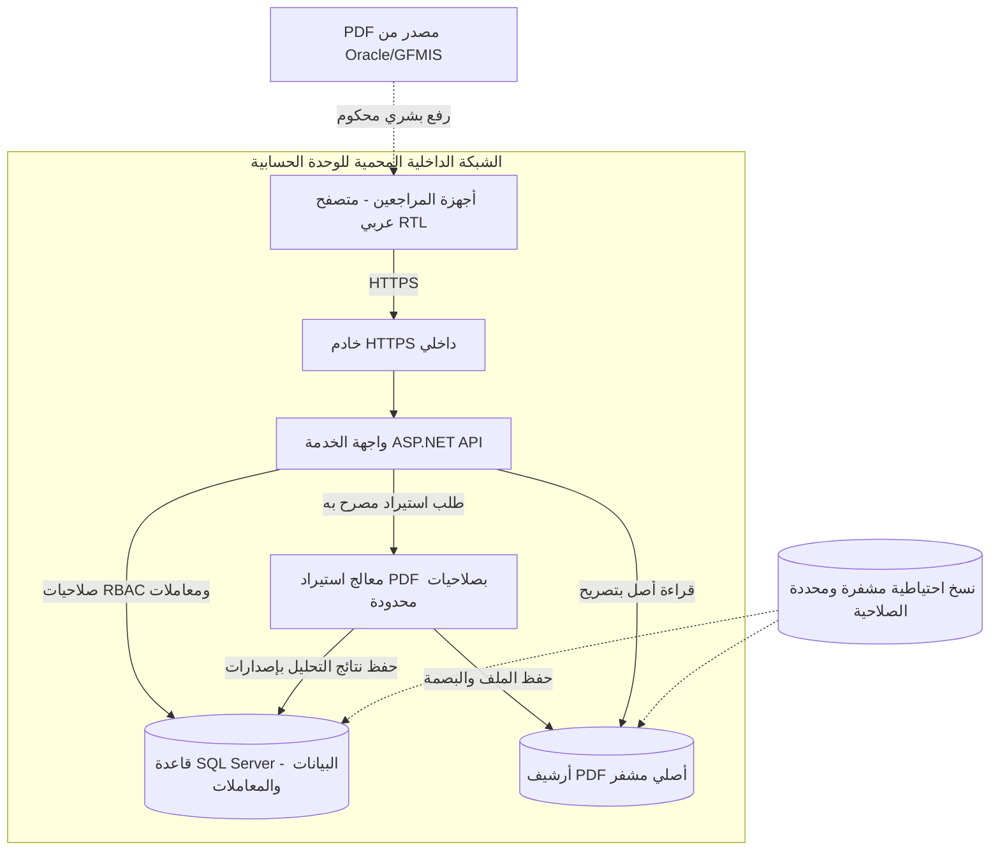

# التشغيل على الشبكة الداخلية وعقود البيانات والقيود

**مقترح لا يخول إنشاء قاعدة بيانات أو نشر البرنامج.** تقنية `.NET/ASP.NET Core + Angular RTL + SQL Server` و`Modular Monolith` مقترحة وتحتاج ADR. يُستخدم PDFium وخدمة جداول مادية خلف Adapter مناسب.

## الشكل المقترح للتشغيل

هذا ليس اتصالًا مباشرًا بمنظومة Oracle. الشبكة الداخلية لا تعفي من التوثيق والصلاحيات وHTTPS والحماية والنسخ الاحتياطي.

## الوحدات التي تملك البيانات
| الوحدة المنطقية | مسؤوليتها | ضابط الثقة |
| --- | --- | --- |
| المؤسسات والهوية | الجهات والأشخاص وعلاقات العمل والصرف | اسم Oracle لا يحدد الشخص وحده |
| الوقائع المالية المعتمدة | القيم التاريخية والقرارات والوقائع وتواريخها | لا تعدّلها ملفات المصدر تلقائيًا |
| القواعد القانونية | نسخ النصوص وشروط السريان | لا نسب قانونية مخترعة |
| الاستيراد والمستندات | PDF الأصلي والسطور وجودة الاستخراج | الأصل لا يتغير بعد تصحيحه رسميًا |
| حساب المستحقات المقترحة | حسابات بإصدارات وأثر قابل للتفسير | لا تنفيذ صرف |
| ملف المراجعة | الملاحظات والإجراءات والاعتماد وإعادة فتحه | لا تعديل Oracle |
| المتجمدات والتسوية | حق كل شهر وبند وما ظهر وما ثبت صرفه | لا افتراض دفع أو استرداد |
| المستخدمون والتدقيق | توزيع مجموعات وصلاحيات وسجل كامل | لا وصول لمجموعة مرتبات بلا تفويض |

## قيود قاعدة البيانات التي يجب اختبارها
1. مفاتيح داخلية غير كاشفة للهوية؛ الرقم القومي وكود Oracle واسم الموظف **ليست مفاتيح أساسية**.
2. Foreign Keys بين الأشخاص وعلاقاتهم، والوحدات والدورات، والمستند ومحاولات التحليل والسطور، وحالة المراجع واعتماده، والمتجمد والدليل.
3. يسمح تخزين الكائن الأصلي مرة لكل بصمة محتوى مع الاحتفاظ **بتاريخ كل عملية استيراد** حتى إن تكرر الملف.
4. ممنوع `UNIQUE(RawAccountCode)` أو `UNIQUE(Kind,RawAccountCode,RawLabel)` على الأسطر؛ قد يتكرر البند رسميًا.
5. لا تحذف صفًا مكررًا ولا تجمعه دون التحقق من مصدره ومجاميعه.
6. `decimal` مع تقريب معتمد لكل قاعدة، لا سماح عام `0.02` لكل النماذج.
7. `[ValidFrom,ValidTo)` و`RecordedAt` يحفظان تاريخ السريان وتاريخ العلم بالواقعة بصورة مستقلة.
8. الأصل والوقائع المعتمدة ونسخ الحساب والاعتماد والتدقيق لا تتغير تاريخيًا؛ التصحيح نسخة جديدة.
9. استخدم `rowversion` أو بديل موثوق على حالات المراجعة القابلة للتغيير لمنع `last-write-wins`.
10. ربط الاعتماد بالـCase والنسخة وبصمة المدخلات؛ أي تعديل بعد الاعتماد يفتح نسخة جديدة.
11. المتجمد يمنع ازدواج المطالبة لنفس المستفيد والبند والشهر والسبب والإصدار، مع إبقاء النسخ التاريخية.
12. مجموع التسويات المثبتة لا يتجاوز دليله، ولا توزع دفعة مجمعة على الشهور بالحدس.
13. صلاحيات المراجع ومانح الاعتماد تُفحص على الخادم، وبحسب مجموعة المرتب ودور المستخدم.
14. سياسة `CentralSourceAmount` تمنع إعادة الحساب فقط، ولا تمنع كشف تكرار أو خطأ قراءة المبلغ.
15. تعيين الكود الخارجي لبند داخلي يتم بسياق الاسم العربي والجانب والفترة والكادر ومراجعة الاسم غير المؤكد.
16. الاحتفاظ بالنص الأصلي وأسماء مرشحة وتفاصيل الصفحة والصف والخلية.
17. قيود حجم PDF ونوع الملف وتوقيعه والوقت والعزل عن النظام عند التحليل.
18. تصدير Excel يحافظ على الأرقام النصية ذات الأصفار الأولى ويمنع Formula Injection ولا يسرب ملاحظات موظفين آخرين.
19. فصل `PayrollPeriod` عن `EntitlementPeriod` و`SettlementPeriod` و`RecordedAt`.
20. ممنوع وضع مستندات رواتب أو أسرار إنتاج في GitHub حتى لو أصبح Private دون اعتماد سياسة الحفظ.

## واجهات API المقترحة — ليست Routes موجودة
- `SourceUpload`: رفع ملف، فترة، وبصمة وفكرة عدم الازدواج.
- `ImportPreview`: نوع التقرير والصفحات والسطور والتحذيرات.
- `ReviewMapping`: ربط الشخص والبند مع إصدار ومراجع.
- `CalculationProposal`: قيم مستقلة مقترحة وتفسيرها، مع تمييز البنود المصدرية.
- `Reconcile`: فروق على مستوى السطر والمجموع والموظف والمجموعة.
- `ReviewDecision` و`ReviewApproval`: قرار واعتماد مرتبطان بنسخة ومستخدم.
- `ReviewAmendment`: فتح مراجعة معتمدة لأسباب جديدة دون مسحها.
- `RetroClaims`: المتجمدات وظهور الصرف والدليل المثبت.
- `AuditLog/Exports`: تقارير مفلترة بالصلاحيات.

## توجيهات التصميم الفيزيائي
يمكن تقسيم SQL Schemas إلى `identity` و`source` و`finance` و`audit` وغيرها بعد ADR؛ ممنوع `CascadeDelete` على أصل المستند وقرارات الاعتماد والمتجمدات. فهارس على المستفيد/الشهر/المجموعة/البصمة/مواضع السطور/الحالة. سجلات التدقيق تحتاج حماية من تعديل المسؤول نفسه إذا كان ذلك ضمن المتطلبات.

اختبارات Migration النهائية يجب أن تعمل على قاعدة البيانات **الحقيقية المختارة**، لا InMemory فقط. توليد Class وSQL والفهارس يحصل من مخطط فيزيائي واحد بعد اعتماد المعايير.

## مسائل تشغيل لم تُحسم
هل الاعتماد عبر Windows/Active Directory أم حسابات التطبيق؟ أين أرشيف PDF المشفر؟ كم مستخدم وموظف وصفحة سنويًا؟ ما سياسة النسخ الاحتياطي والاستعادة والاحتفاظ؟ ومن يسمح له بإعادة فتح اعتماد أو إيقاف صرفية عبر الجهة المختصة؟

[مثال تطبيقي للمدخلات والمخرجات](../examples/01-ERD-INPUT-OUTPUT.md).
