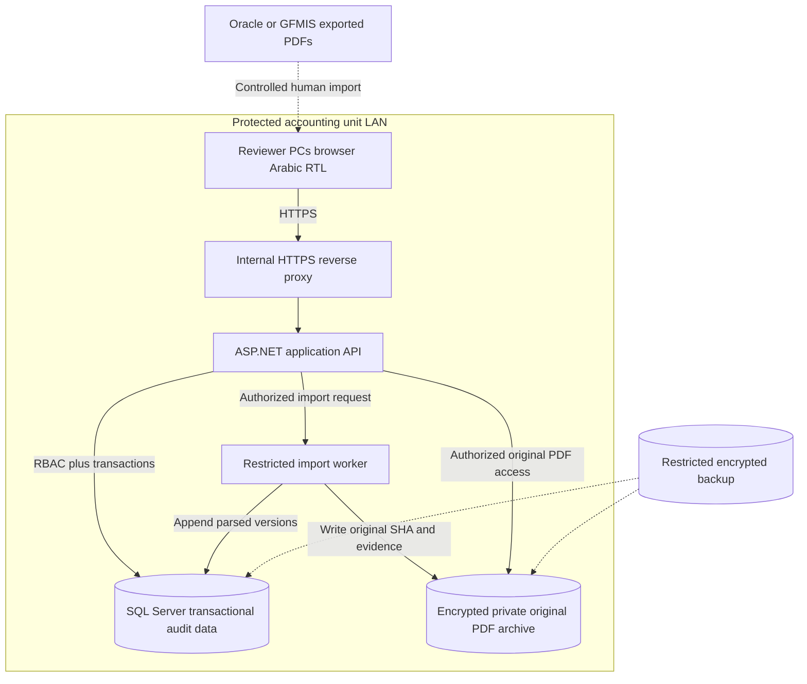

# Deployment, data contracts, relational integrity and operational constraints

**Draft proposal, not approval to deploy or create schemas.** Actual stack chosen by an ADR. Candidate implementation: ASP.NET Core on .NET, Angular RTL, SQL Server, modular monolith for single-accounting-unit network scope; PDFium + selected physical-table adapter behind interfaces.

## Internal-network deployment view

This is **not** an Oracle/GFMIS direct integration. A local network alone does not remove authentication, TLS or file access control requirements. A server/service identity and physical archive permissions must be specified in security ADR.

## Proposed bounded contexts
| Bounded context | Owns truth of | External-read-only relationship |
| --- | --- | --- |
| Organization and Identity | units, protected persons, employment and payee relationships | source names and numbers are never identities by themselves |
| Approved Financial Facts | historical factual bases, approved assignments, dates and documents | Oracle source can raise a mismatch, not overwrite facts |
| Rule Catalogue | verified rule versions, legal sources and applicability | no AI-generated statutory rate or guessed 2015 base |
| Intake & Evidence | original PDFs, parsers, source rows, mapping and validation status | source is immutable even if corrected officially |
| Financial Proposals | versioned expected calculations and traces | no direct payment |
| Audit Workbench | review cases, findings, approved overlays and amendments | no Oracle edits |
| Retro & Proof | component/month claim revisions, reported payments and independently verified settlement | no autopayment or recovery |
| Identity, Access & Logging | users, rights, group assignments, audit events | no reviewer cross-group access unless authorized |

## Critical database constraints to design and test
1. Opaque primary keys; external national ID, employee code and Oracle account code are **not** canonical PKs. Protect sensitive identity data and use access-limited lookup/index methods.
2. Referential integrity for person -> employment/payee, org -> cycle, cycle -> import/review, source document -> parse attempt -> source financial occurrence, review -> approval revision, retro -> payment allocation.
3. Exactly one immutable source PDF byte stream per unique stored evidence object hash where content deduplication makes sense; **do not lose import history** when the same hash appears in multiple batches.
4. **NO UNIQUE** `(RawAccountCode)` or `(Kind,RawAccountCode,RawLabel)` on original lines. Uniqueness applies to internal `SourceLineId` and to *confirmed physical occurrence keys within a specific parse attempt only when stable coordinates exist*.
5. Duplicate physical or logical source rows should trigger detection and reviewer intervention, not arbitrary sum/deduplication.
6. `decimal` for all money and rule-defined rounding. Never globally apply an unexplained 0.02 tolerance to separate document types.
7. Date ranges use `[from,to)` semantics where appropriate; flags and revised records must preserve both **effective date** and **knowledge/recording date**. Exclusion/overlap policies require an ADR per fact/assignment type.
8. Approved financial data, legal rule versions, source PDFs, signed review snapshots and review actions are immutable-by-version; proposed changes create new revisions and supersession references.
9. Pessimistic or optimistic concurrency (suggest `rowversion` for mutable review cases and assignments) prevents two reviewers silently overwriting each other.
10. Unique `ApprovalId` plus `AuditCaseId, ReviewRevision, SnapshotHash`; a prior approved revision cannot be rewritten by new event.
11. Retro claims: uniqueness and idempotency on **payee + component + entitlement period + causing event + calculation revision**; prevent claiming the same entitlement twice across reruns.
12. Retro allocation: signed numeric sum and proof caps, no guessed division of one unallocated lump sum into salary items and months; proof must be independently verified.
13. Reporter/approver segregation of duties enforced by API, not just Angular buttons; role rights scoped by payroll group and cycle.
14. Financial status `SourceTrusted` means no local recomputation, **not** extraction acceptance without numeric and identity checks.
15. Semantic mappings of repeated Oracle codes are versioned and reviewer-approved. Map by context, side, Arabic alias, period, payee category and observed evidence; do not equate account code with expenditure chapter.
16. Original/raw Arabic label text and normalized variants stored distinctly, with extraction confidence and page/cell, not rewritten in place.
17. Apply per-file upload size/content validation, safe PDF parser isolation, timeouts/resource limits and anti-malware processes where authorized.
18. Excel exports must sanitize formula injection and preserve leading-zero IDs, RTL display, and selected-user permission scope; do not leak global report warnings with unrelated employee PII.
19. `PayrollPeriod`, `EntitlementPeriod`, `SettlementPeriod`, `RecordedAt`, `DecisionIssuedAt` have different meaning and cannot be collapsed.
20. Never expose production secrets or salary reports to the repository, even after repository is made Private unless legally approved storage/retention policy explicitly permits use.

## API contract groups (conceptual, not routes implemented)
- `SourceUpload`: secure import and idempotency token -> `DocumentId`, `ImportBatchId`.
- `ImportPreview`: source kind, parsing status and verified source-page references.
- `ReviewMapping`: proposed identity/component mapping, decision, concurrency token.
- `CalculationProposal`: input snapshot version, proposed lines and non-calculated source-trusted lines.
- `Reconcile`: structured differences, reports, group and item validation traces.
- `ReviewDecision`: case revision, reviewer, status, evidence, optimistic token.
- `ReviewApproval`: snapshot hash and approver action; no payment side effect.
- `ReviewAmendment`: cause/evidence/date; creates new review revision, not update to old.
- `RetroClaims`: claims with original month/item and cause, observed later movement, proven payment allocation.
- `AuditLog/Exports`: permission-filtered evidence and audit views.

## Physical design guidance — not DDL
- Split SQL schemas logically (e.g. `identity`, `payroll`, `source`, `finance`, `audit`, `security`) only after ADR and ORM/migration provider choice.
- Avoid ORM `CascadeDelete` on evidence/approval/financial claims; make retention/purge policy explicit and legally reviewed.
- Plan indexes for `PayeeRelationshipId + period`, `PayrollCycleId + group`, source hash, `ParseAttemptId + page/row/pane`, component mappings by scope, `CaseId + revision`, retro `payee + component + original month`.
- Audit event rows should reference only necessary masked claims/IDs. Consider event hash chain/WORM storage for independent tamper resistance; DB append-only alone is not anti-admin-tampering.
- Tests for first SQLite/SQL migration should run against chosen real DB provider. Do not trust unit tests with an in-memory store to prove referential and concurrency constraints.
- After final approval, generate **true SQL ERD, migrations and ORM class mappings from one authoritative physical model**; keep diagram/schema drift checked by CI in a later authorized implementation.

## Security and operations open decisions
Authentication integration (Windows/AD or app accounts); server OS and managed security configuration; secure archive location and retention; official original/legal file permissions; role approval hierarchy; backup restore objectives; exact expected concurrent reviewers/annual document volume; whether an asynchronous import worker is needed for large files.
