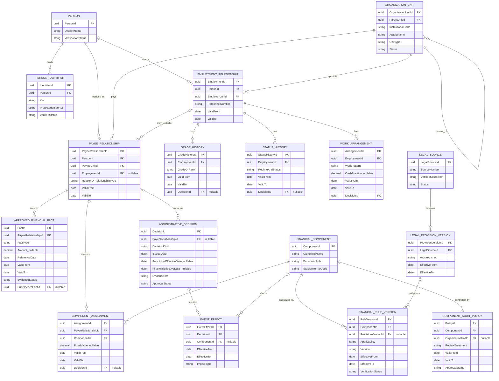

# ERD رقم 1 — الوحدات والأشخاص والعلاقات الوظيفية والقواعد المالية

**مخطط تصوري وليس تعليمات إنشاء SQL.** المجمع الطبي هو الجهة الحسابية التي تخدم كليات الطب وطب الأسنان والصيدلة، ولا نحدد الكادر القانوني تلقائيًا من اسم الكلية.

## العلاقات المرسومة

## معنى العلاقات
- `Person` كيان للشخص، وقد يمتلك أكثر من `EmploymentRelationship` عبر الزمن وأكثر من `PayeeRelationship`، بما فيها مكافأة لمستفيد غير موظف.
- `OrganizationUnit` تنظم الجهة الحسابية والكليات، و`EmploymentRelationship` تحفظ جهة التعيين وتواريخها.
- `GradeHistory` و`StatusHistory` و`WorkArrangement` تحفظ الدرجة والكادر والانتداب/جزء الوقت **بحسب الفترة**.
- `ApprovedFinancialFact` تحفظ قيم المراجع المعتمدة: أساسي مرجعي تاريخي، وعاء معاشات موثق، ثابت مالي وغير ذلك. ليس كل Fact بندًا نقديًا.
- `FinancialComponent` اسم البند الداخلي، و`ComponentAssignment` إسناده إلى علاقة صرف. `ComponentAuditPolicy` تحدد هل يحسب مستقلاً أو يأخذ مبلغ المركزية.
- `FinancialRuleVersion` يربط القاعدة بالبند والفئات وفترة السريان والمادة القانونية الأصلية؛ لا يُفعل قبل اعتماد المصدر.
- `AdministrativeDecision` يحتفظ بتاريخ القرار والسريان الإداري والأثر المالي، ويحدد `EventEffect` الأثر لكل بند وفترة.

## قواعد مهمّة
1. لا تجعل `PersonId` مساويًا للرقم القومي أو كود الجهة أو رقم الصرف.
2. قد يكون ارتباط `PayeeRelationship` بعلاقة العمل اختياريًا؛ فصاحب المكافأة قد لا يكون موظفًا.
3. انخفاض استحقاق جزء الوقت إلى 65% في مثال معين لا يعني انخفاض **وعاء المعاشات المعتمد**؛ الوعاء Fact مستقل عن الأجر النقدي.
4. المرجع المؤرخ في 30 يونيو 2015 ليس استحقاقًا جديدًا ولا يضاف للإجمالي.
5. بعض الصناديق والتأمينات مصدرها المركزية ولا تُحسب مجددًا؛ الرقابة الاستثنائية تحتاج إثباتًا.
6. يمكن أن يحتوي `FinancialComponent` على تصنيف محاسبي وباب صرف مختلفين عن كود Oracle الخارجي.
7. احتفظ بتواريخ السريان ووقت التسجيل وأسباب التصحيح، وأسماء من يعتمدون التعديلات؛ أضف الحقول في التصميم الفيزيائي بعد ADR.
8. لا تفرض قاعدة منع التداخل الزمني على كل العلاقات دون دراسة نوعها؛ لبعض الوقائع أكثر من أثر متزامن مشروع.

## مثال بيانات ومخرجات
راجع [مثال ERD للبيانات الفعلية الافتراضية](../examples/01-ERD-INPUT-OUTPUT.md) الذي يوضح Person وعلاقة العمل والصرف والمبالغ المعتمدة والأسطر المستخرجة.
