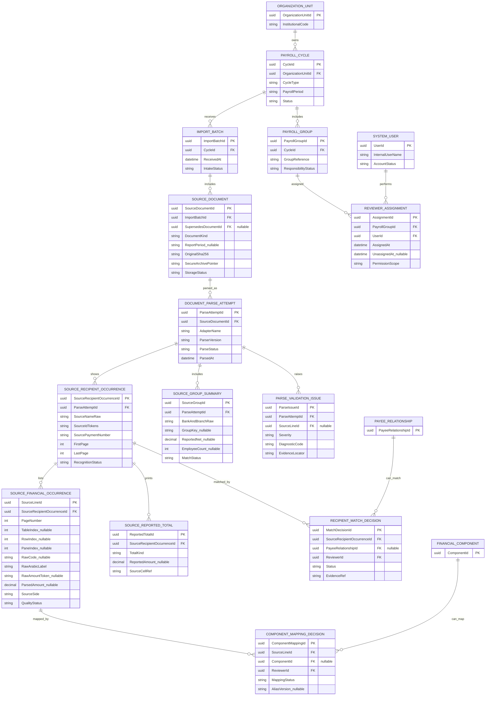

# Conceptual ERD 2 — Immutable Oracle evidence, import quality, repeated financial lines and reviewer assignments

**Draft, non-executable**. This view is source-focused: import values and labels are **observations**, not approved entitlements or canonical employee facts.

## Non-negotiable parser and source rules
- **No unique constraint on `RawCode`, `RawArabicLabel`, their concatenation, or amount**. Even identical code/label/amount can denote two physical occurrences, or double extraction; validate with source coordinates and official totals before deciding.
- `SourceLineId` identifies a **specific extraction occurrence**. Re-parsing the same original with another adapter/version generates separately traceable candidates, then comparison/staging decides accepted interpretation. Do not double-post their amounts.
- Persist the **original immutable PDF** securely with hash; never commit real files to GitHub. The parsed text, glyph order, normalized display candidates, coordinates and source page form a chain of evidence.
- Some report types display no employee detail and only source bank groups/summary. The `SOURCE_RECIPIENT_OCCURRENCE` relation is optional.
- No mapping decision can silently mutate PERSON/EMPLOYMENT/APPROVED_FINANCIAL_FACT or the imported original string.
- Work assignment is by **payroll cycle and group**, with recorded reassignment dates. Other disbursement types use authorized access rules; shared access does not imply concurrent writes without optimistic concurrency.
- Name conflicts and duplicate employee identity are review cases; a payslip with `ReviewRequired` cannot overwrite a verified source's name.
- Group matching depends on period, institutional scope, bank and branch and verified group identifier, **not array index**.
- Partial reports (missing cover/payment sheet) cannot be called fully cross-reconciled. A `Rejected` classification cannot be downgraded by subsequent review.
- `COMPONENT_MAPPING_DECISION` may be one-to-many over time as proposed/approved/rejected **decisions**; only one currently authoritative mapping may be active for an occurrence at a given decision revision.

## Trust statuses are separate
`ParseStatus` = structural readable/rejected/review; `SourceLine.QualityStatus` = item extraction confidence; `MatchDecision` = verified person/component match; `AuditReviewStatus` = financial review by a human; `PaidStatus` = proof of financial settlement.

## Interfaces to detailed audit ERD
`PayeeRelationshipId` and `SourceLineId` are referenced from reconciliation and follow-up design. The diagrams are separated to remain readable.
