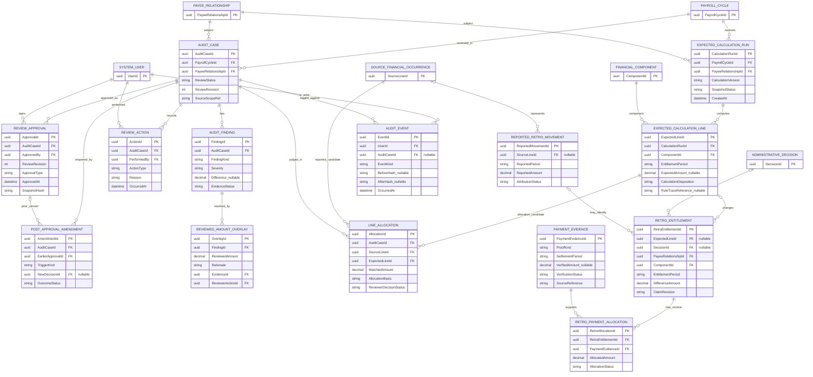

# ERD رقم 3 — محرك الحساب والمراجعة والاعتماد والمتجمدات

**مخطط تصوري.** يحفظ الفرق بين المبلغ الوارد من Oracle، والحساب المقترح، وقرار المراجع، والتصحيح الرسمي، وما ظهر في كشف الصرف، وما ثبت صرفه.

## العلاقات المرسومة

## مسؤولية كل مجموعة
- `ExpectedCalculationRun` و`ExpectedCalculationLine`: نتيجة حساب مستقلة **مقترحة** لكل بند وشهر ونسخة قاعدة، مع الأثر الحسابي.
- `AuditCase` يجمع مراجعة علاقة صرف في دورة محددة، و`AuditFinding` يسجل الفرق أو نقص الهوية/المستند حتى لو لم نستطع وضع مبلغ له.
- `ReviewAction` يسجل ما فعله المراجع وسببه. `ReviewedAmountOverlay` نتيجة مراجعة منفصلة لا تعدّل `SourceFinancialOccurrence`.
- `ReviewApproval` يعتمد **نسخة ثابتة** من البيانات والقواعد والحسابات، و`PostApprovalAmendment` يفتح إصدارًا جديدًا لقرار لاحق مثل وفاة أو إعارة أو عمل بجزء الشهر.
- `LineAllocation` جسر ربط محتمل **متعدد لمتعدد** بين السطور المستوردة والمتوقعة؛ يحتاج مراجعة قبل اعتماد التجميع.
- `RetroEntitlement` فرق عن شهر أصلي وبند وسبب وإصدار. `ReportedRetroMovement` ظهور مبلغ لاحقًا في كشف الصرف، لا يعني تسوية.
- `PaymentEvidence` إثبات فعلي مستقل؛ `RetroPaymentAllocation` يوزع مبلغًا مثبتًا على مستحقات أصلية إن تسمح الأدلة.
- `AuditEvent` يربط المستخدم والوقت والمصدر والقرار والقيمة السابقة واللاحقة.

## قواعد عدم التلاعب والازدواج
1. بند يُؤخذ من المركزية وفق `CentralSourceAmount` قد لا يكون له `ExpectedAmount` مستقل. لا تملأه بصفر ولا تدّع حسابه.
2. إذا جمعت المركزية عدة بنود في سطر واحد، اعرض كل المتوقع وكل المصدر، واسمح بقبول استثنائي موثق فقط إذا تحققت شروط باب الصرف والصلاحية.
3. المبلغ المتجمد يرتبط بالمستفيد والبند والشهر الأصلي والقرار وإصدار الحساب؛ لا تكرر المطالبة عند تشغيل الحساب مرة أخرى.
4. صرف مبلغ متجمد مجمع لا يعني معرفة توزيعه على الأشهر تلقائيًا؛ يبقى `Unallocated` حتى يثبت الربط.
5. اعتماد المراجعة ليس إثباتًا للسداد، وانتهاء الفحص لا يغلق طلب التصحيح أو متابعة التسوية.
6. بعد الاعتماد، يحتفظ النظام بالنسخة السابقة، ولا يغيرها القرار الجديد.
7. لا يسمح بإجمالي تخصيص أكبر من المبلغ المثبت، مع مراعاة إشارة الفروق السالبة وضوابطها.
8. الفصل بين من يقترح قاعدة ومن يعتمد أثرها يتم بالخادم وليس واجهة المستخدم فقط.

## مثال لمقارنة المصدر والمتوقع
راجع [المثال العملي للـERD](../examples/01-ERD-INPUT-OUTPUT.md) و[سيناريوهات المراجعة في UML](../examples/02-UML-REVIEW-EXAMPLES.md).
