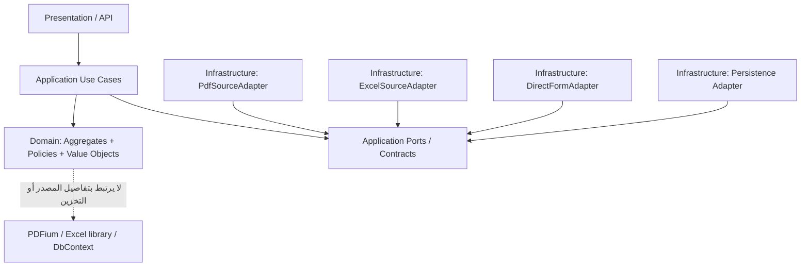

# المعايير العملية لـOOP وSOLID في PayrollReviewSystem

> **الحالة:** المنهجية `OOP + SOLID` معتمدة في [ADR-004](../decisions/ADR-004-object-oriented-and-solid-principles.md)، بينما تفاصيل الواجهات والكلاسات وأسماء الطرق هنا **أمثلة تصميمية مقترحة وليست C# أو API أو SQL منفذًا**. تُراجع مع [خريطة DDD](DDD-BOUNDED-CONTEXTS-AND-AGGREGATES.md) بمرحلة Goldfish مستقلة قبل اعتماد تنفيذ جوهري. لا تستخدم أمثلة قانونية غير مثبتة على أنها نسب تشغيل.

## 1. العلاقة بين المعماريات الأربع
- **DDD:** يحدد *ماذا تعني* علاقة العمل والصرفية والمراجعة، من يملك الحقيقة، وأين تكون حدود `Bounded Context`.
- **Modular Monolith:** يحدد *كيف ننظم ونشغّل* الوحدات في تطبيق واحد دون اقتران دائم بين قواعد بيانات وجداول الوحدات.
- **Clean Architecture:** يحدد *اتجاه التبعية*؛ الـ`Domain` لا يعرف نوع قاعدة البيانات أو قارئ Oracle.
- **OOP + SOLID:** يحدد *كيف نصمم الكائنات والتعاون والعقود* لتبقى القواعد قابلة للاختبار والتغيير دون كسر سلوك مالي سابق.

هذه المبادئ تكمل بعضها ولا تشترط `Microservices` أو `Event Sourcing` أو `CQRS` شامل. الالتزام بصحة القرار المالي أعلى من عدد طبقات التجريد.

## 2. ركائز OOP

| المبدأ | تطبيق صحيح على النظام | Anti-pattern يجب منعه |
| --- | --- | --- |
| **Encapsulation — التغليف** | `MonthlyMainSalarySlot` يُعدّل نسخة المرتب عبر عملية `AddRevision` تتحقق من الشروط وتحفظ النسخة والسبب، و`AuditCase` يعتمد `ReviewAdjustment` من خلال انتقال حالة مصرح | `set; public` مفتوح لتبديل مبلغ أو حالة اعتماد بلا سبب أو توثيق |
| **Abstraction — التجريد** | `ICentralPayrollSourceIntake` يستقبل بيانات المصدر عبر عقد واضح ويصدر ملاحظات مصدر مستقلة عن طريقة استخراجها | جعل `Rules` يعتمد على جداول PDF أو Excel بعينها |
| **Polymorphism — تعدد الأشكال** | `PdfSourceAdapter`, `ExcelSourceAdapter`, `DirectFormAdapter` تحقق نفس التوقعات على `SourceFinancialOccurrence` مع اختلاف طريقة القراءة والضمانات | `switch` موزع في كل شاشة وخدمة ليعيد تفسير أنواع الملفات بمعانٍ مختلفة |
| **Inheritance — الوراثة** | عند وجود `is-a` حقيقي مع ثبات ضمانات العقد؛ غالبًا `composition` أنسب لاختلاف قنوات المصدر | `ExcelOracleDocument : OfficialOraclePdf` لتوريث ثقة رسمية غير صحيحة |

**Value Objects** مقترحة: `Money` يحتفظ بالمبلغ العشري/العملة وسياسة التقريب؛ `YearMonth` يميز شهر الاستحقاق عن شهر المعالجة؛ `EffectiveDateRange` بفترات `[from,to)`؛ `SourceOccurrenceId` لا يعتمد على AccountCode وحده؛ `FinancialComponentId` هوية بند مالي. لا تخلط `Money` بسعر عملة غير معرف أو `Nullable` مع الصفر.

**Domain Model غني بما يكفي فقط:** منع تمرير كل سلوك الدومين إلى `ManagerService` ضخم مع تحويل الكيانات إلى حقائب `get/set`. بالمقابل، لا تضع IO أو مسارات API أو التوثيق القانوني الخارجي داخل كائن الدومين.

## 3. معايير SOLID الخمسة مع أمثلة مضادة

### S — Single Responsibility Principle
**المطلوب:** سبب تغير مستقل لكل مكون؛ فصل `SourceDocumentParser` عن `RuleResolver` وعن `AuditApprovalPolicy` وعن `SettlementVerifier`.

**مضاد:** `PayrollService` واحد يقرأ PDF ويحسب النسب ويعدل الملف الوظيفي ويعتمد الصرفية. تغيير تنسيق Oracle سيعرّض قواعد الحساب المالية للكسر.

### O — Open/Closed Principle
**المطلوب:** `SourceIntake` قابل لإضافة Adapter لملف رسمي جديد مع نفس `SourceOccurrence` وعقود الجودة؛ `FinancialRuleVersion/RuleEffect` تتيح تعريف قاعدة جديدة وفق Version/Validation وLegalSource **معتمدة**.

**مضاد:** تعديل سلسلة شروط `if/else` في `AuditCase` عند كل مصدر أو نسبة، أو استخدام OCP لإدخال نسبة 156% كحقيقة قانونية دون مصدر. ليس كل تغيير في شروط الأعمال ممكنًا دون تعديل كود، ولا تفترض إطار Plugins لقاعدتين بسيطتين.

### L — Liskov Substitution Principle
**المطلوب:** كل تنفيذ `ISourceIntake` يحفظ كل سطر مستقلًا ويعيد حالة الثقة/اكتمال المصدر بصدق، ويحقق نفس شروط ما قبل/بعد العملية المعلنة. مصدر Excel أو شاشة لا يزعم `OfficialOracleVerified` لمجرد أن PDF Adapter يستطيع ذلك.

**مضاد:** `ExcelSourceAdapter` يدمج أسطر الكود المتكرر، أو `DirectFormAdapter` يرمي استثناء `NotSupported` في عملية إلزامية دون إعلان القدرة؛ أو تنفيذ `ICalculationStrategy` يُرجع صفرًا عند `UNKNOWN` بدل `INPUT_MISSING`.

### I — Interface Segregation Principle
**المطلوب:** عقود صغيرة تعبر عن استخدام حقيقي، مثل `ISourceCaptureReader`، `IExpectedCalculationService`، `IReviewerAuthorization`، `ISettlementEvidenceVerifier` **إذا ثبت أن فصلها مفيد**. لا تعتمد `Rules` على واجهة استيراد/اعتماد موحدة كبيرة.

**مضاد:** `IPayrollEverything` فيه `ParsePdf`, `Calculate`, `Approve`, `Settle`, `Export`، وتجبر أي تنفيذ على عمليات لا تخصه.

### D — Dependency Inversion Principle
**المطلوب:** `Application/Domain` تعتمد على عقود وسياسات مستقرة في الطبقة الداخلية وفق الحاجة، و`Infrastructure` تحقق هذه العقود؛ `Pdfium` و`EF DbContext` و`SQL Server` تفاصيل خارجية. **DI Container** وسيلة ربط وقت التشغيل وليست تعريفًا لـDIP.

**مضاد:** `RuleResolver` يبني `new SqlConnection` أو يقرأ PDF مباشرة، أو نموذج `Person` يعرف جدول EF ويستدعي API خارجيًا أثناء حساب الدرجة.

## 4. رسم التبعية والتعاون — تصوري



الرسم يوضح اتجاه تبعية كود؛ الوصول إلى مورد حقيقي يتم من خلال تنفيذ `Port` يُحقن في `Use Case` حسب التقنية المعتمدة. لا تُعطى وحدة `SourceIntake` تصريح كتابة لحقائق `Personnel` عن طريق `Dependency Injection`.

## 5. ثلاثة سيناريوهات عملية

### أ — تعدد قنوات إدخال الموظف (Polymorphism + LSP + OCP)
**مدخل اصطناعي**:
```json
{
  "sourceMethod": "EXCEL_IMPORT",
  "employeeRef": "EMP-DEMO-1",
  "month": "2026-11",
  "sourceLines": [
    {"row": 1, "code": "21110505", "amount": "50.00"},
    {"row": 2, "code": "21110505", "amount": "75.00"}
  ]
}
```

**ناتج مقبول من عقد المصدر**:
```json
{
  "sourceOccurrencesCount": 2,
  "duplicateAccountCodeMerged": false,
  "isOfficialOraclePdf": false,
  "reportedTotal": null,
  "sourceReviewStatus": "SOURCE_REVIEW_REQUIRED"
}
```

سواء `EXCEL_IMPORT` أو `DIRECT_FORM`، السطران يظلان مستقلين. النقل غير المثبت `SOURCE_REVIEW_REQUIRED` لا يمنع حفظ مسودة مصدر لكنه لا يمنحها شهادة Oracle.

### ب — مرتب رئيسي واحد وشهر واحد (Encapsulation + SRP)
- **مدخل:** محاولة تسجيل `MAIN_SALARY` عن علاقة العمل `EMP-1` والوحدة `30200105` وشهر `2026-11` مرتين، إحداهما من المجموعة B والأخرى من A.
- **متوقع:** `MonthlyMainSalarySlot` واحد؛ مصدران لا يمحَيان؛ المرشح الآخر `DUPLICATE_MAIN_CANDIDATE`، أو `MainSalaryRevision` إذا ثبت التصحيح الرسمي. `SEPARATE` متعددة.
- **حد المسؤولية:** Aggregate يمنع حالة غير صالحة أثناء انتقاله، والتزامن بين عمليتي إنشاء منفصلتين يحتاج ضمان `UNIQUE(UnitId,EmploymentRelationshipId,SalaryEntitlementMonth)` ذرّيًا في قاعدة البيانات المعتمدة لاحقًا.
- **لا تخلط:** `PayrollDisbursement` سجل للصرفية و`SourceDocument` دليل ظهور، ولا تجعل `SourceFinancialOccurrence` جزءًا من Object واحد ضخم مطلوب تحميله كاملًا عند اعتماد مرتب.

### ج — تبديل سياسة حساب تاريخية (DIP + OCP + Domain)
- **مدخل:** تاريخ إجازة قديم، `GradeHistory` تمت ترقيته لاحقًا، بند مالي مشروط بقاعدة تصنيفها `UNKNOWN` لغياب نص قانوني.
- **متوقع:** `RuleResolver` يفصل الحصول على `HistoricalSnapshot` و`RuleVersion` عن القراءة الخارجية؛ `UNKNOWN/INPUT_MISSING` تمنع ادعاء `ExpectedAmount=0`. إن وُجدت قاعدة معتمدة يمكنها إنتاج عدة `RuleEffect` مستقلة لكل وعاء وفترة، وتحفظ `RuleTrace`.
- **لا تخلط:** `ReviewAdjustment` تعديل بموافقة المراجع خارج `ExpectedCalculationRun`؛ وفرق الخصم في Oracle ليس التزامًا محققًا ولا تسوية تلقائية.

## 6. القواعد العملية لتنظيم كود Gemini مستقبلًا
1. **لغة الـDomain:** أسماء الكلاسات وEnums وطرق الأعمال من المصطلحات الموثقة، لا `Data1` و`Utils` و`Manager` عام.
2. **Encapsulation:** كل عملية تعديل بيانات تؤثر ماليًا تمر عبر عملية `Domain/Application` معلنة تفحص الهوية والفترة والصلاحية والثابت، وتحفظ قرارًا أو إصدارًا. الـDTOs للنقل يمكن أن تكون بسيطة؛ ليست Aggregate.
3. **Composition:** اجمع سياسات الحساب/المصدر/التقريب بدل سلاسل وراثة متعددة للمصادر والكادر؛ أي استراتيجية لها عقد واختبارات سلوك، لا نسخة مطابقة بلا داعٍ.
4. **Invariants:** افحص داخل Domain + ضمن قاعدة البيانات عند شروط التزامن. لا تجعل Validation في Angular وحده حارسًا للمرتب الشهري.
5. **Separation:** محرك حساب القوانين لا يعتمد على PDFium/Excel أو صلاحية مستخدم من شاشة، ويحتفظ بسبب `UNKNOWN` والـ`RuleTrace`.
6. **Versioning:** نسخة المصدر والقاعدة ولقطة التاريخ وقرار المراجع منفصلة؛ الكائن القابل للتحديث لا يطمس السجلات المعتمدة.
7. **Transactions:** حد الـAggregate لا يعني بالضرورة معاملة SQL واحدة لكل النظام؛ العمليات العابرة للمجالات تحتاج سياسة Consistency صريحة وتقارير أخطاء.
8. **Testability:** اختبارات الـDomain دون DB/HTTP/PDF ممكنة؛ اختبارات Integration لاحقة تتحقق من المحولات والـConstraints والـConcurrency على التخزين الحقيقي.
9. **No premature abstraction:** لا تُنشئ `Interface` لكل نوع، ولا `Repository` عامًا لكل جدول، ولا `Factory` لكل DTO؛ برر كل تجريد بتغيير متوقع أو حد اختبار أو عقد مستقل.
10. **Security:** Dependency injection لا يتجاوز RBAC أو قيود الخصوصية؛ أي `Use Case` حساس يعيد التحقق من صلاحيات الشهر والمراجع.
11. **Backward compatibility:** فتح PR لتعديل Adapter أو RuleVersion لا يمحو نتائج مراجعة سابقة أو يغير API مشتركة دون تحليل أثر واختبارات.
12. **Architecture checks:** عندما يبدأ الكود بتصريح المالك، أضف اختبار منع مراجع `Domain` إلى `Infrastructure`, والتحقق من حدود Modules؛ لا تنفذ CI الآن.

## 7. اختبارات قبول تصميم مقترحة — ليست اختبارات منفذة

| ID | التجربة | نتيجة متوقعة |
| --- | --- | --- |
| `SOLID-001` | ParsePdf مضمّن في RuleResolver | يفشل فحص فصل المسؤولية |
| `SOLID-002` | Adapter جديد لنوع تقرير مصدر دون تغيير RuleResolver | ينجح التمديد بعقد مضبوط |
| `SOLID-003` | Excel وPDF يعيدان السطرين مكرري AccountCode | لا دمج؛ LSP |
| `SOLID-004` | Direct Form يبلّغ OfficialOraclePdf=true | يُرفض ادعاء المصدر |
| `SOLID-005` | Rule Resolver يرجع 0 في حالة UNKNOWN | يفشل عقد المجال |
| `SOLID-006` | RuleResolver يعتمد على DbContext أو PDFium | يفشل فحص DIP/Architecture |
| `SOLID-007` | Use Case للمرتبات يعتمد على واجهة ضخمة لـImport/Settle/Approve | يُعاد تصميم ISP عند عدم الحاجة |
| `SOLID-008` | محاولة تغيير ReviewApproval بمُحدد property عام | تُرفض؛ انتقال حالة موثق |
| `SOLID-009` | إنشاء مرتب MAIN مرتين بالتزامن | Slot واحد بضمان DB ذري |
| `SOLID-010` | مصدر صرفية MAIN مصحح | MainSalaryRevision لا MainSlot جديد |
| `SOLID-011` | صرفيتا SEPARATE مستقلتان | تُحفظان دون قيد MAIN |
| `SOLID-012` | تغيير مصدر Oracle يغيّر GradeHistory | يُمنع من جهة الملكية |
| `SOLID-013` | قاعدة متعددة RuleEffect بأوعية مختلفة | تحفظ الآثار منفصلة ومصدرها |
| `SOLID-014` | قاعدة قانونية ناقصة تُدخل تحت OCP | تمنع التفعيل وتطلب سندًا |
| `SOLID-015` | الفرق في بند الخصم يعتبر دينًا دون إثبات | يُرفض قرار الترحيل/التسوية |
| `SOLID-016` | تشغيل اختبارات Domain دون ORM أو PDF | تنجح اختبارات الدومين المعزولة |
| `SOLID-017` | تنفيذ Adapter يرمي NotSupported لعملية لازمة في العقد | يفشل اختبار استبدال الواجهة أو تُعلن القدرة بوضوح |
| `SOLID-018` | تحديث كود من دون فحص أي اختبارات حقوق المستخدم التاريخية | لا يمر Review Gate |

**تفسير مهم:** هذه اختبارات *منطقية ومعايير مراجعة مقترحة*؛ بعضها لا يتحول إلى Unit Test واحد آلي دون قرار التصميم الفيزيائي والإطار الفعلي. لا تدّعِ تنفيذها قبل كتابة كود مصرح به.

## 8. قرار المالك وحدود التنفيذ
المالك وافق على `OOP/SOLID` كمعيار؛ لم يصرح بأن كل `Proposed Interface` أو نوع كائن في هذا الملف نهائي أو أن Gemini يبدأ C# أو SQL. يُراجع تقسيم `Bounded Contexts` والـAggregate Roots وطرق التكامل داخل [خريطة DDD](DDD-BOUNDED-CONTEXTS-AND-AGGREGATES.md) مع Goldfish مستقلة في Issue [#30](https://github.com/AlexandriaDeveloper/PayrollReviewSystem/issues/30)، ويمكن تضمين هذا الملف في نفس الجولة. استمر في فصل أدلة المراجعة عن نتائجها؛ المراجعة الأولى [#27](https://github.com/AlexandriaDeveloper/PayrollReviewSystem/issues/27) لا تعتمد هذه الإضافة بأثر رجعي.

## 9. مراجع
- [ADR-003 الأساس المعماري](../decisions/ADR-003-ddd-modular-monolith-clean-architecture.md).
- [ADR-004 قرار OOP وSOLID](../decisions/ADR-004-object-oriented-and-solid-principles.md).
- [خريطة DDD والـAggregates المقترحة](DDD-BOUNDED-CONTEXTS-AND-AGGREGATES.md).
- [ERD للكائنات والعلاقات والوقائع](ERD-CORE.md).
- [UML للكلاسات](UML-CLASSES.md).
- [مواصفة الصرفيات الشهرية](../specs/MONTHLY-PAYROLL-GROUPS-AND-DISBURSEMENT-TYPES.md).
- [قواعد التداخل](../specs/RULE-INTERACTION-AND-VALIDATION.md).
- [بوابات مراجعة التصميم والتسليم](../governance/REVIEW-GATES.md).
