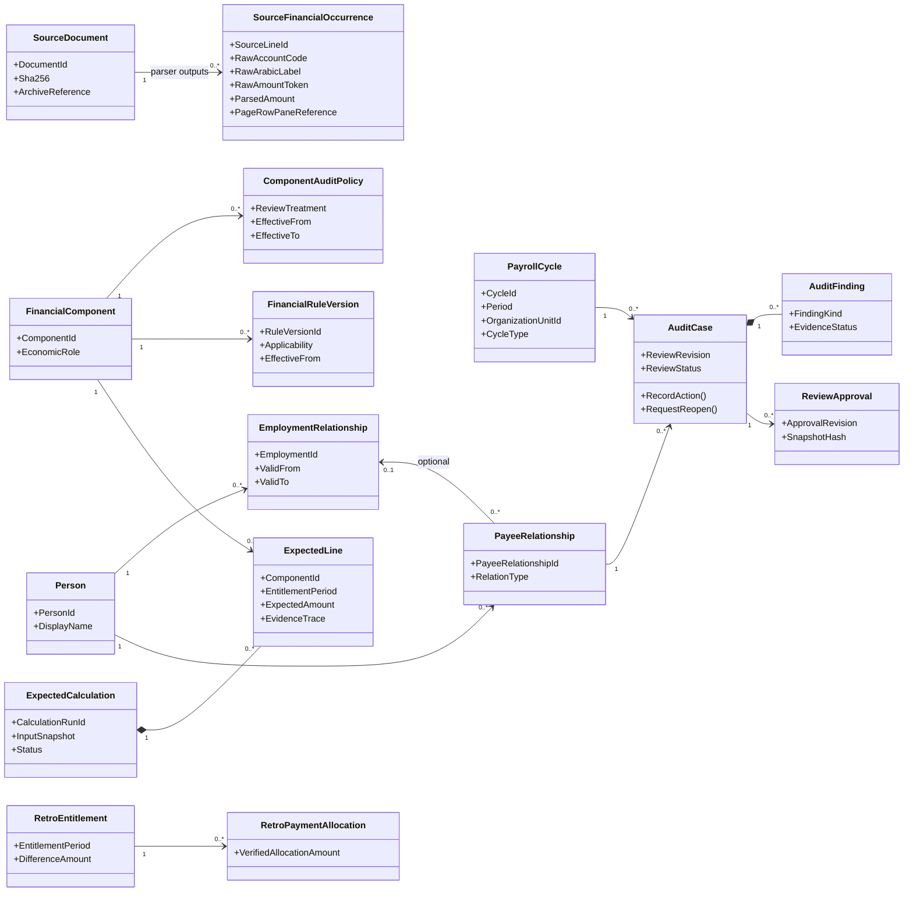

# UML class and dependency diagrams — candidate domain/application services

> **Conceptual UML, not C# class scaffolding.** The eventual stack is still proposed. Business boundaries and contracts are stable design intent; class names, constructors, precise methods and persistence are subject to an implementation ADR.

## Logical class architecture

## Ports and use-case interfaces

```mermaid
classDiagram
  direction TB

  class IPdfExtractionAdapter {
    <<interface>>
    +Extract(SourceDocument) ParsedDocument
  }
  class ISourceArchive {
    <<interface>>
    +StoreImmutable(bytes, metadata) SourceDocument
    +ReadByReference(id) Stream
  }
  class IImportQualityGate {
    <<interface>>
    +Validate(ParsedDocument) QualityReport
  }
  class IRecipientMatcher {
    <<interface>>
    +ProposeMatches(SourceRecipientOccurrence) MatchCandidates
  }
  class IComponentMapper {
    <<interface>>
    +ProposeMappings(SourceFinancialOccurrence) MappingCandidates
  }
  class IFinancialRuleResolver {
    <<interface>>
    +Resolve(PayeeRelationship, component, period) RuleEvidence
  }
  class IExpectedPayrollCalculator {
    <<interface>>
    +Propose(ApprovedFacts, Rules, Period) CalculationSnapshot
  }
  class IReconciliationService {
    <<interface>>
    +Compare(SourceSnapshot, ExpectedSnapshot) FindingCandidates
  }
  class IReviewWorkflowService {
    <<interface>>
    +RecordDecision(case, actor, evidence) ReviewRevision
    +RequestAmendment(approvedCase, cause) PendingAmendment
  }
  class IRetroEntitlementService {
    <<interface>>
    +RecalculateAffectedPeriods(approvedEvent) RetroProposal
  }
  class IPaymentEvidenceService {
    <<interface>>
    +VerifyPayment(proof) PaymentVerification
  }
  class IAuditTrail {
    <<interface>>
    +Append(actor, kind, refs, reason) AuditEvent
  }
  class ImportUseCase
  class ReviewUseCase
  class FinancialProposalUseCase
  class RetroReviewUseCase
  class PdfiumTextAdapter
  class PhysicalTableAdapter

  ImportUseCase ..> IPdfExtractionAdapter
  ImportUseCase ..> ISourceArchive
  ImportUseCase ..> IImportQualityGate
  ReviewUseCase ..> IRecipientMatcher
  ReviewUseCase ..> IComponentMapper
  ReviewUseCase ..> IReconciliationService
  ReviewUseCase ..> IReviewWorkflowService
  ReviewUseCase ..> IAuditTrail
  FinancialProposalUseCase ..> IFinancialRuleResolver
  FinancialProposalUseCase ..> IExpectedPayrollCalculator
  RetroReviewUseCase ..> IRetroEntitlementService
  RetroReviewUseCase ..> IPaymentEvidenceService
  PdfiumTextAdapter ..|> IPdfExtractionAdapter
  PhysicalTableAdapter ..|> IPdfExtractionAdapter
```

## Service responsibility / anti-corruption boundary
| Service | Owns | Must not do |
| --- | --- | --- |
| `ImportUseCase` | PDF hash, extraction attempts, diagnostics, report classification and source observations | Update approved employee grade, salary fact or legal rule |
| `RecipientMatcher` | Proposed identity candidates plus confidence/reasons | Convert similar name into approved canonical Person |
| `ComponentMapper` | Proposed canonical component & alias candidates using code + side + label + context + period | Merge all rows with same code or reverse entire page blindly |
| `FinancialRuleResolver` | Verified period/cadre/legal applicability, reference selection | Infer 2015 base/rate from old programs or invented defaults |
| `ExpectedPayrollCalculator` | Proposed per-component period amounts with explainable trace; excludes source-trusted calculations | Treat Oracle source as independently calculated expected amount |
| `ReconciliationService` | Item/total/group mismatches and candidate allocations | Silently overwrite source or mark paid by net match |
| `ReviewWorkflowService` | Reviewer decisions, versioned approval, reopening, conflict checks | Post payments, change Oracle or erase prior approval |
| `RetroEntitlementService` | Per-component/period recalculation and amounts due (proposal until approved) | Assume arrears will be disbursed immediately |
| `PaymentEvidenceService` | Independently verified settlement evidence and attributed allocations | Treat printed payroll amount as bank paid |
| `AuditTrail` | Evidence-linked append-only actions | Allow silent delete/edit of reviewed history |

## Domain types and enumeration proposals
`Money(decimal Amount, Currency)`, `Period(Year,Month)`, `EffectiveInterval(From,To?)`, `EvidenceRef(DocumentId,Page,Row,Cell?)`, `ExternalAccountCode(string)`, `SourceLineId(Guid)`, `ComponentId(Guid)`, `ReviewerDecisionId(Guid)`, `RuleTraceRef`, `AuditResult<T>`.

`ComponentAuditTreatment`: `IndependentCalculation`, `CentralSourceAmount`, `ReferenceOnly`, `ExceptionalCheck`; **policy is context/version-specific**.

`ExtractionQuality`, `ReviewerCaseStatus`, `ApprovalStatus`, `ReportedPaymentStatus`, `VerifiedSettlementStatus` are **different enums**. Do not use one global `Approved` or `Verified` flag.

## Engineering rules
- Domain projects depend on no PDF library, database provider, web server, Excel exporter or UI framework.
- Place contracts in application/domain interfaces and implementations in infrastructure. Adapter design should permit PDFium, cell-aware parser, new Oracle layout and synthetic fixtures.
- `decimal` and explicit rule-specific rounding are mandatory; never binary floating point for money.
- A repository interface does not imply a physical table per class. Value objects and projections need not be tables.
- Financial facts and calculations are **versioned**; source PDF bytes and approved historical snapshots are immutable.
- Class names are hypotheses; exact aggregate boundaries, event persistence, concurrency tokens and custom value object SQL mapping need technical ADR and review.
