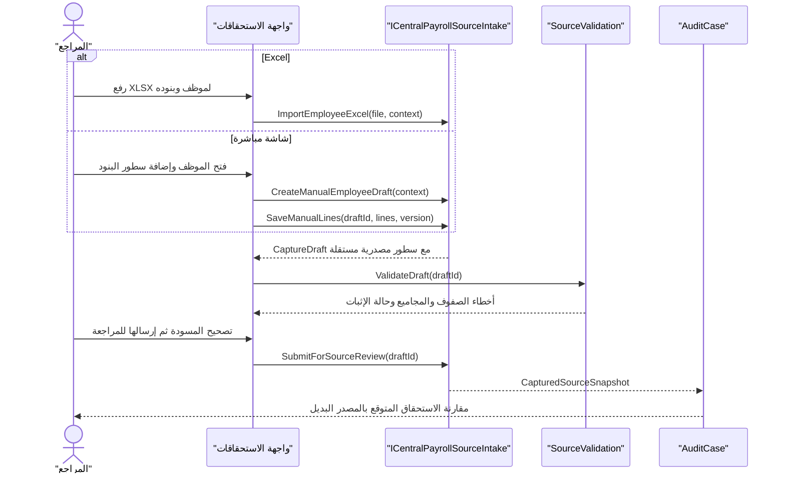
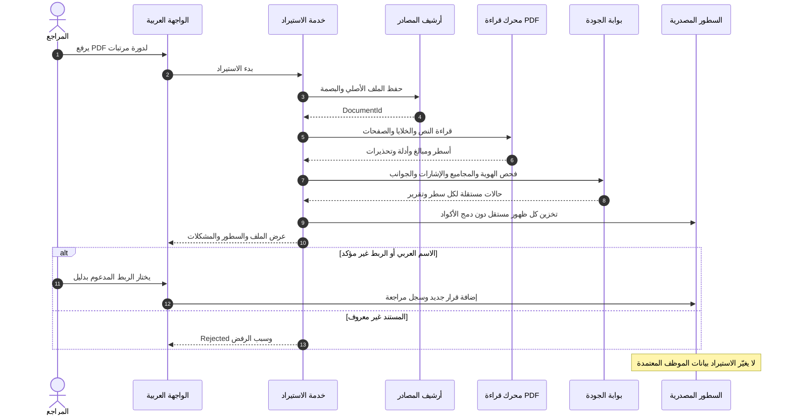
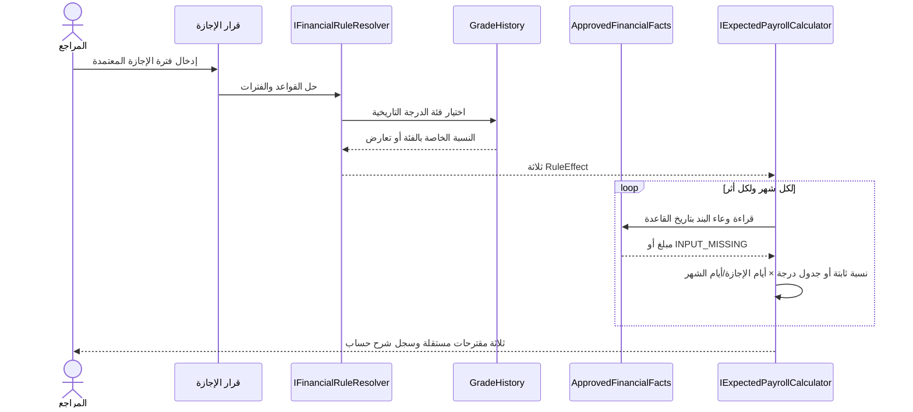
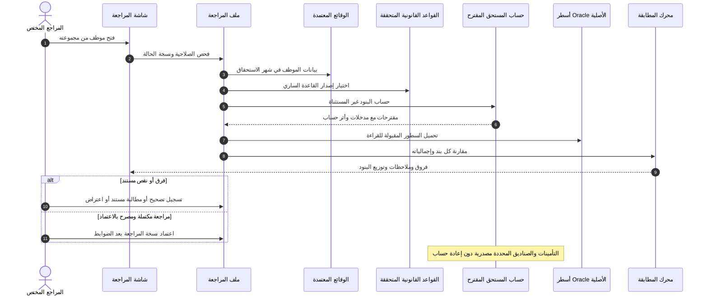
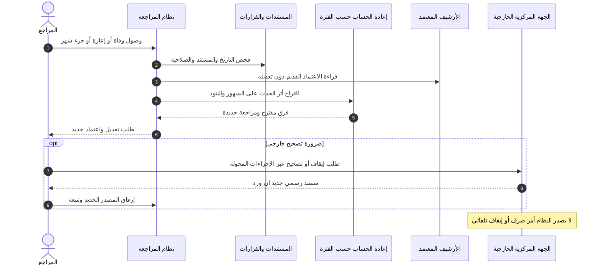
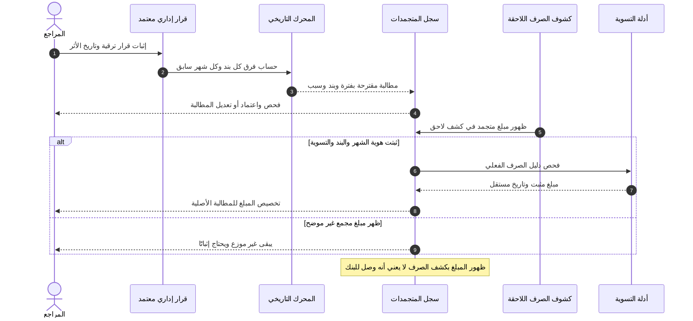
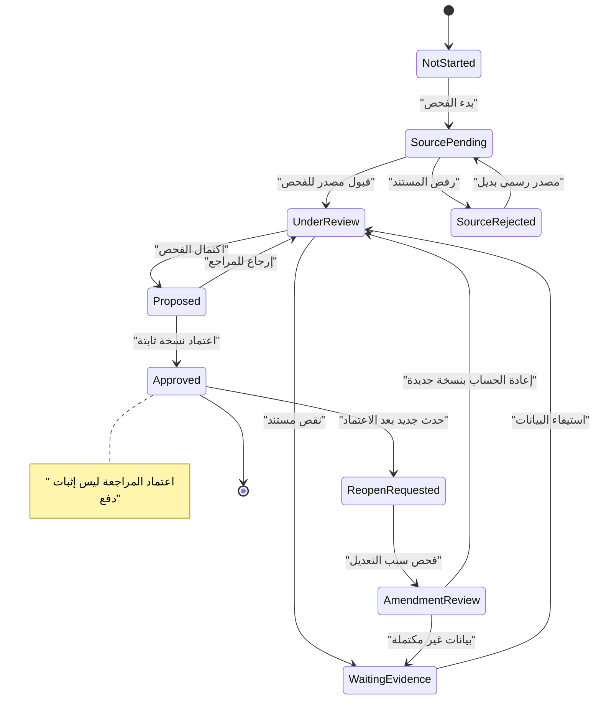
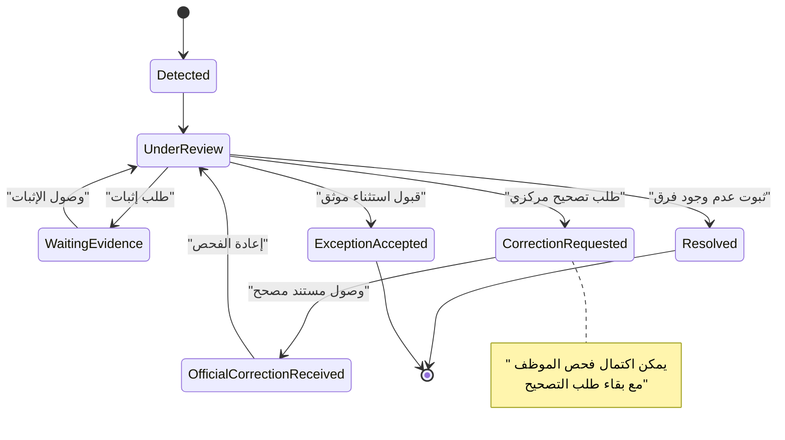

# UML — تتابع العمليات وحالات المراجعة

**مخططات مقترحة لا تعني وجود كود منفذ.** تُظهر الحركة بين المراجع والتطبيق وطبقة الدومين ومصدر Oracle، دون تنفيذ صرف أو استرداد.

## مسار بديل لاستيراد استحقاقات موظف من Excel أو إدخال مباشر

ملحوظة: لا يتطلب المسار صورة أو OCR، ولا يؤدي إدخال Excel أو الشاشة إلى اعتماد صرف أو تعديل بيانات Oracle. [تفاصيل ERD واختبارات EX وDF](../specs/EXCEL-AND-DIRECT-EMPLOYEE-PAYROLL-INTAKE.md).

## 1. تسلسل استيراد PDF والتحقق من البنود

## UML — قرار إجازة يخرج 3 استقطاعات

[مثال 6 أيام/30 يومًا وأربعة فحوص للتداخل والدرجة والوعاء](../specs/FACULTY-ANNUAL-LEAVE-MULTI-DEDUCTION-RULE.md). الحساب مقترح ولا ينفذ خصمًا.

## 2. الحساب المستقل وقرار المراجع

## 3. تعديل طارئ بعد اعتماد المراجعة

## 4. المتجمدات وظهور الصرف لاحقًا

## 5. مخطط حالات مراجعة المستفيد

## 6. مخطط حالات الملاحظة والمتابعة

## اختبارات السلوك المطلوبة
- تكرار كود بند داخل صفحة أو عبر صفحات لا يؤدي لدمج السطور.
- عدم وضوح الاسم أو فقد السالب يعطي مراجعة لازمة بدل اعتماد تلقائي.
- مراجعة يفتحها أكثر من شخص لا تمسح تغيرات أحدهما؛ هناك `ConcurrencyConflict`.
- اعتماد سابق لا يختفي بعد قرار وفاة/إعارة متأخر.
- المتجمد الظاهر في ديسمبر عن يوليو لا يسجل مدفوعًا بلا دليل تسوية.
- لا تُنشئ قيمة متوقعة مستقلة لبند صندوق يقبل من المركزية.
- في حالة جزء الوقت يكون وعاء المعاش مستقلًا عن الاستحقاق النقدي وتُتحقق قاعدة الاستثناء أولًا.

## مدخلات ومخرجات ملموسة
راجع [مثال UML التدريبي](../examples/02-UML-REVIEW-EXAMPLES.md) الذي يحتوي على طلب JSON ونتيجة تحليل PDF ومراجعة وتعديل بعد اعتماد.
