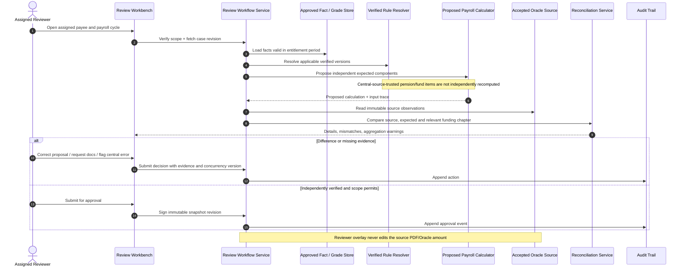
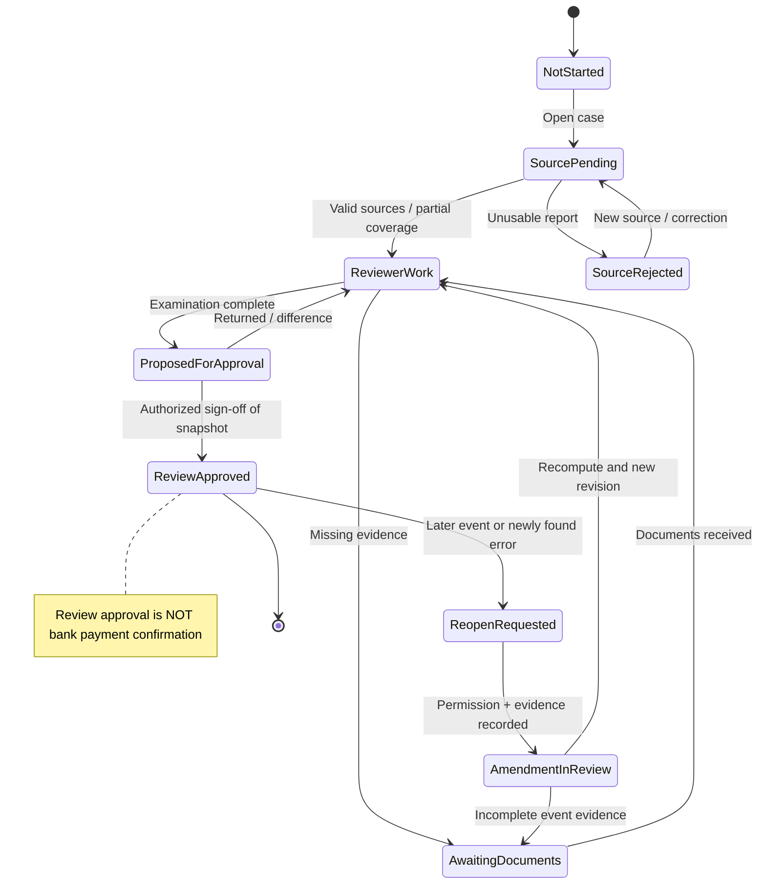
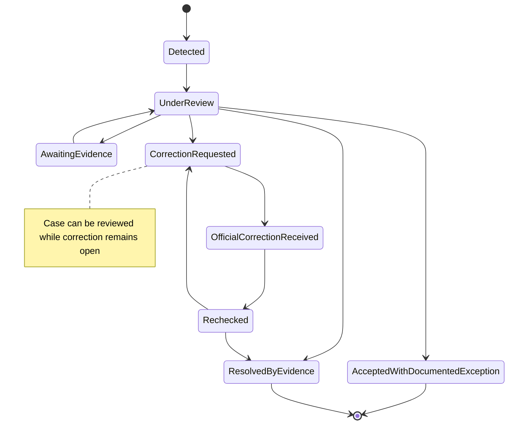

# UML sequences and state machines — major audit journeys

> **Status: design proposal.** These flows represent **what the system should support**, not a claim that current code implements them or that every step has an approved legal basis. No external Oracle edits or bank payment initiation.

## Sequence A: Import PDF, preserve physical rows and ask reviewer to validate
```mermaid
sequenceDiagram
  autonumber
  actor Operator as Intake Reviewer
  participant UI as RTL Review UI
  participant API as Import Use Case
  participant Archive as Private Evidence Archive
  participant Parser as PDFium / Table Adapter(s)
  participant Gate as Import Quality Gate
  participant DB as Source Observation Store
  Operator->>UI: Upload Oracle PDF
  UI->>API: Import(file, selected payroll cycle)
  API->>Archive: Store immutable original and SHA-256
  Archive-->>API: OriginalDocumentId
  API->>Parser: Extract original by document ID
  Parser-->>API: Source rows + raw Arabic + coordinates + issues
  API->>Gate: Validate identity, signs, columns, totals, report kind
  Gate-->>API: Per-field and per-report quality statuses
  API->>DB: Save parse attempt and immutable occurrences
  API-->>UI: Preview, warnings, original-page evidence
  alt Source row mapping uncertain
    Operator->>UI: Select verified recipient/item mapping
    UI->>API: Submit reviewer decision with reason
    API->>DB: Append mapping decision and audit event
  else Source report structurally rejected
    API-->>UI: Rejected with exact diagnostic
  end
  Note over Parser,DB: Same Oracle code/label may appear more than once; never collapse occurrences
  Note over API,DB: Import must never update approved employee financial facts
```

## Sequence B: Independent financial proposal and reviewer decision


## Sequence C: Event arrives AFTER approval — do not overwrite history
```mermaid
sequenceDiagram
  autonumber
  actor Reviewer
  participant Cases as Review Workflow
  participant Evidence as Decision Evidence
  participant Calc as Period-Aware Calculation
  participant Archive as Original Review Approvals
  participant Central as External Central-Entitlement Process
  Reviewer->>Cases: Submit late death / secondment / part-month event
  Cases->>Evidence: Check decision type, effective date, source
  Evidence-->>Cases: Verified or pending documents
  Cases->>Archive: Read previously signed review revision
  Cases->>Calc: Calculate affected entitlement periods and components
  Calc-->>Cases: Proposed delta and required follow-up
  Cases-->>Reviewer: New review revision; old approval retained
  alt Official correction required
    Reviewer->>Central: Request competent office to correct/stop payment
    Note over Central: External human-controlled process
    Central-->>Reviewer: Revised official file / confirmation if provided
    Reviewer->>Cases: Attach new independent source evidence
  else Documents incomplete
    Cases-->>Reviewer: Keep review amendment pending
  end
  Note over Cases,Archive: No automatic payment cancellation or changed Oracle file
```

## Sequence D: Promotion arrears across months and later payment
```mermaid
sequenceDiagram
  autonumber
  actor Reviewer
  participant Event as Approved Administrative Decision
  participant Engine as Historical Rule Engine
  participant Retro as Retro Entitlement Ledger
  participant Source as Later Payroll Source
  participant Proof as Verified Settlement Evidence
  Reviewer->>Event: Record promotion and financial effective date
  Event->>Engine: Recompute each historical component and month
  Engine-->>Retro: Proposed delta by component+period+event/version
  Retro-->>Reviewer: Review and approve/reject/adjust proposals
  Source->>Retro: Report later retroactive payroll line(s)
  alt Component and period mapping proven
    Retro->>Proof: Await separately verified payment proof
    Proof-->>Retro: Confirm paid amount/evidence
    Retro-->>Reviewer: Allocate supported partial/full settlement
  else Lump sum source unclear
    Retro-->>Reviewer: Keep reported amount unallocated, pending evidence
  end
  Note over Retro: Shown on payroll != verified paid; do not assume current-month retro payment
```

## State machine — payee review cycle


## State machine — finding and settlement tracking


## Special branch: part-time insured wage base
For an owner-approved part-time work arrangement: proposed reduced **cash** entitlement and independently approved **insured wage base** are separate. If a source actually documents use of the reduced amount as pension assessment base against a verified required full base, create exceptional reviewer finding. If the base or law applicability is unknown, request verification rather than assume a contribution rate. No general insurance calculation engine.

## Required acceptance tests
- Death/secondment effective after signed review does **not** mutate prior snapshot; triggers a new revision with cause/evidence.
- Same Oracle account code and Arabic label appears twice; each physical occurrence remains accessible through original-page evidence.
- Two reviewers edit same case revision: stale update conflicts, never last-write-wins.
- Payment line appears in December for July–September promotion but no bank proof: `ReportedInPayroll`, not `PaidVerified`.
- Central-source-accepted funds have no independent expected formula; missing local formula cannot become a false discrepancy.
- Unknown PDF report or missing signs: rejected or ReviewRequired, never silently approved.
