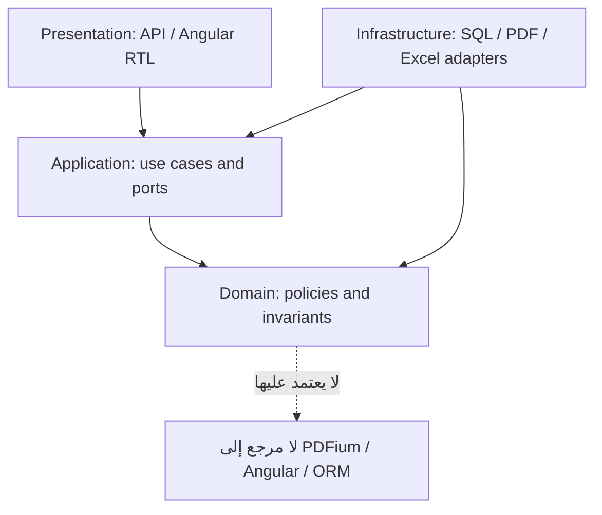

# ADR-003 — اعتماد DDD + Modular Monolith + Clean Architecture

**حالة القرار: ACCEPTED — اختيار معماري اعتمده المالك.**
**التاريخ:** 7 نوفمبر 2026.
**النطاق:** `PayrollReviewSystem` فقط.
**Issue:** [#28](https://github.com/AlexandriaDeveloper/PayrollReviewSystem/issues/28).
**مهم:** قرار اعتماد المنهجية لا يساوي اعتماد تفاصيل جميع الـBounded Contexts أو مخطط SQL أو إصدار تقنية أو بدء البرمجة.

## 1. السياق والمشكلة
نظام مراجعة الصرفيات مستقل عن تنفيذ الدفع المركزي، ويضم مجالات ذات قواعد متشابكة: الموظف وعلاقاته، مرتبات الشهر وتعدد الصرفيات، المستندات البديلة لـOracle، القوانين السارية تاريخيًا، حساب الفروق، تعديل المراجع، والمتجمدات والتسويات. خلط هذه المسؤوليات في جداول/خدمات عامة يجعل من السهل:
- تطبيق الدرجة الحالية على شهر تاريخي، أو تحويل قيمة مصدر Oracle إلى حقيقة مالية معتمدة.
- تكرار المرتب الرئيسي نتيجة وصول أكثر من تقرير أو مرور الموظف على مجموعتين.
- تحويل فرق استقطاع مرشح إلى دين أو تسوية بنكية موثقة دون سند.
- ربط أعمال Angular وPDFium وSQL Server بقواعد الاستحقاق المالية مباشرة.

## 2. القرار المعتمد من المالك
1. **DDD (Domain-Driven Design)** أساس تحليل نماذج الأعمال ولغتها، وفصل الـ`Bounded Contexts`، والملكية الحصرية للحقائق والقرارات. المصطلحات ذات معنى محدد داخل السياق، مع عقود تحويل صريحة بين السياقات.
2. **Modular Monolith** كأسلوب تنظيم وتشغيل أولي: تطبيق واحد قابل للنشر بوحدات ذات حدود واضحة، وليس شبكة Microservices افتراضية. كل وحدة مسؤولة عن نطاقها، ولا تعتمد الوحدة المالية على تفاصيل قراءة PDF أو واجهة Angular.
3. **Clean Architecture / Dependency Inversion** داخل الوحدات: `Domain` مستقل عن واجهات المستخدم والتخزين وقراءة الملفات؛ `Application` ينسق الحالات عبر Ports/Interfaces؛ `Infrastructure` تحقق التخزين وAdapters؛ `Presentation` تعالج API والواجهة.
4. **لا قراءة/كتابة مباشرة لجداول وحدة أخرى من منطق وحدة**. التكامل عبر عقود تطبيق موثقة، وقراءات Projection معلنة، وEvents بعد الحفظ حين تكون ضرورية، دون افتراض Event Bus خارجي أو Event Sourcing شامل.
5. الثوابت المالية ذات الأثر المباشر (مثل فرادة المرتب الرئيسي المنطقي) تحميها قواعد الـDomain و**قيود بيانات/تزامن مناسبة** عند اعتماد المخطط الفيزيائي، وليس فحص واجهة المستخدم فقط.
6. **المستند المالي الخارجي دليل** لا مالك للموظف أو لقيمة استحقاق مستقلة؛ الاختلاف بين `SourceAmount`, `ExpectedAmount`, `ReviewedAmount`, `OfficialCorrectionAmount`, `VerifiedPaidAmount` يبقى محفوظًا.

## 3. ما زال مقترحًا وليس جزءًا محسومًا من القرار
- التقسيم التفصيلي للـ`Bounded Contexts` و`Aggregate Roots` والواجهات المقترحة في [خريطة حدود الـDDD](../architecture/DDD-BOUNDED-CONTEXTS-AND-AGGREGATES.md). **حالتها: PROPOSED / PENDING_GOLDFISH_REVIEW**.
- اعتماد `.NET/ASP.NET Core` أو `Angular` أو `SQL Server` وإصداراتها أو تصميم `DB Schemas` أو هيكل مجلدات مشاريع C# النهائي.
- سياسات الموظف ذي علاقتي عمل فعليتين في نفس الشهر، وقواعد التسوية بين البنود، وأي حساب وفق نص قانوني غير موثق.
- طريقة توزيع الاتساق بين المجالات ومعاملات البيانات في SQL، وإطار Events أو Outbox إن احتجناه بالفعل، وقرارات الأداء والتوسع والاحتفاظ.

## 4. العواقب والفوائد والتكلفة
**الفوائد:** مفردات واضحة، حماية قواعد العمل من IO، إمكانية اختبارات دومين مالية دون PDF/HTTP/DB، وحصر تأثير تعديل قاعدة قانونية أو تقرير Oracle. **التكاليف:** مزيد من العقود والتحويل بين الوحدات، ومراقبة التزام المطور بحدود الـDomain، وحاجة لاختيار حدود Aggregate صغيرة تحفظ التزامن.

لا نفترض أن كل Entity هي Aggregate Root، ولا أن كل كلاس يمثل جدول SQL؛ التصميم الفيزيائي مرحلة مستقلة. لا يُستخدم Event Sourcing أو CQRS واسع أو Microservices لمجرد أن التصميم DDD؛ يُثبت الاحتياج أولًا ويُصدر ADR مستقلًا عند لزومها.

## 5. ترتيب التبعية للبرمجة عند التصريح

هذا رسم اعتماد مبدئي؛ تفاصيل المشاريع ومسارات DI/تجميع C# تُحسم عند تصميم التنفيذ. ملاحظة: عقد `Port` المستدعى من التطبيق يمكن أن يعرّفه `Application`، والتحقيق التنفيذي له في `Infrastructure`.

## 6. نتيجة القرار على عمل EGM الحالي
مراجعة Goldfish الأولى، الموجهة إلى `docs/egm/01-DOMAIN-AND-PAYROLL-DESIGN-DRAFT.md`، بدأت على سياق ملف ووثائق مرجعية سابقة. **لم نعدّل مستند المراجعة المستهدف أو الـ8 مراجع المرتبطة به في هذه المهمة**. هذا ADR **لا يجعل نتائج Goldfish الحالية مراجعةً للـDDD**، ولو أثار التصميم الجديد مسائل جوهرية نفتح جولة مراجعة مستقلة على [خريطة DDD](../architecture/DDD-BOUNDED-CONTEXTS-AND-AGGREGATES.md) وعلى التغييرات المتأثرة.

## 7. بوابات القبول المستقبلية
- كل Aggregate له مالك محدد وسبب لحمايته وحدود Transaction موثقة.
- الاختبارات تبرهن فرادة المرتب الرئيسي، وعدم دمج السطور المتكررة، وإعادة تطبيق قواعد التواريخ على لقطات ثابتة دون تغيير التاريخ السابق.
- عقود التكامل عبر السياقات تحافظ على `ID/Version/EffectiveTime` والمعنى المحاسبي؛ أحداث التكامل لا تعدّل قرار المراجع تلقائيًا.
- يظل تصريح المالك الصريح لنطاق كل Issue برمجية شرطًا مستقلًا.

**المراجع:** [خارطة الـDDD المفصلة](../architecture/DDD-BOUNDED-CONTEXTS-AND-AGGREGATES.md)، [ERD الهوية](../architecture/ERD-CORE.md)، [ERD المصادر](../architecture/ERD-IMPORT-AND-AUDIT.md)، [ERD المراجعة](../architecture/ERD-REVIEW-AND-RETRO.md)، [UML الخدمات](../architecture/UML-CLASSES.md)، [بوابة EGM](../egm/REVIEW-PROTOCOL.md).
