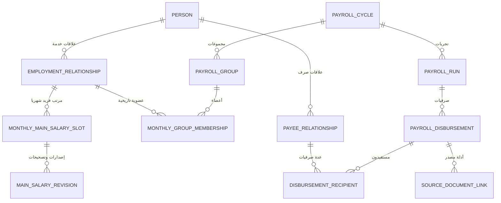

# حزمة Goldfish 1 — تصميم الهوية والمجموعات والصرفيات الشهرية

**المراجعة المطلوبة: NOT_RUN.** هذا Design Draft أعده Elephant وليس موافقة Goldfish، ولا يصرح بتنفيذ SQL أو كود. يُراجع مع **الملفات المرتبطة أدناه فقط** في جلسة Goldfish ذات سياق مستقل. بيانات الأمثلة اصطناعية.

## 1. المشكلة التي ينبغي فحصها
النظام يراجع مرتبات الوحدة الحسابية `30200105` (الطب، الأسنان، الصيدلة) لموظفين وأعضاء هيئة تدريس ومتعاقدين ومستفيدين خارجيين، ولا ينفذ الصرف أو يغير Oracle. تُقسّم ملفات مرتبات الشهر إلى مجموعات مراجع، وتوجد عدة تشغيلات/تجريات للصرف خلال الشهر. **الموظف لا يجوز قبوله في أكثر من مرتب رئيسي منطقي عن الشهر نفسه**، لكنه قد يظهر في **عدة صرفيات منفصلة** (مكافآت، حوافز، متجمدات)، مع تصحيحات ومستندات مصدر متعددة.

## 2. الكيانات وحدود الهوية
- `Person`: هوية بشرية، لا تفترض كل مستفيد موظفًا ولا رقمًا قوميًا للجميع.
- `EmploymentRelationship`: علاقة خدمة بكادر ودرجة وجهة وتاريخ؛ لا تساوي `Person`.
- `PayeeRelationship`: سبب استلام المبلغ؛ قد يخص موظفًا أو غير موظف.
- `PayrollCycle`: شهر التشغيل المرجعي في الوحدة و`PayrollRun`: تجريّة/محاولة/دفعة داخل الشهر.
- `PayrollGroup` و`MonthlyGroupMembership`: مجموعات موظفين **للمراجعة الشهرية** وتاريخ إسنادهم؛ ليست بالضرورة مجموعات البنوك في كشف Oracle.
- `PayrollDisbursement`: صرفية لها `Kind=MAIN_SALARY` أو `SEPARATE` وتاريخ إعداد/صرف مستقل عن أصل الاستحقاق.
- `MonthlyMainSalarySlot`: هوية منطقية ثابتة للمرتب الرئيسي. `MainSalaryRevision`: نسخة مصححة أو اعتماد من السجل نفسه.
- `SourceDocument` و`SourceCaptureSession`: أدلة الاستيراد (PDF/Excel/يدوي)؛ عدة مصادر قد ترتبط بنفس المرتب.

## 3. القيد الحاكم الذي نطلب نقده
**مقترح** `UNIQUE(UnitId, EmploymentRelationshipId, SalaryEntitlementMonth)` على `MonthlyMainSalarySlot` فقط. لا تضع `UNIQUE(PersonId, Month)` على جميع الصرفيات أو سطور المصدر. يجب حسم الحالات غير العادية: شخص له علاقتا خدمة في الوقت نفسه، نقل الوحدة داخل الشهر، مستفيد بدون علاقة تعيين، مصدران لمرتب واحد، تصحيح رسمي مقابل صرفية جديدة.

للسجل الرئيسي نسخ متعددة لكن **مرتب رئيسي منطقي واحد**: لا يؤدي استيراد MAIN مرتين أو نقل الموظف بين مجموعتين إلى إنشاء راتبين. أما `SEPARATE` فمتعددة بلا قيد موظف/شهر/غرض واحد عام؛ اكتشاف المستند المكرر `Idempotency` لا يعني إسقاط مكافأتين حقيقيتين لهما مراجع مختلفة.

## 4. رسم ERD للمراجعة النقدية



هذا رسم **تصوري**؛ اعترض إذا كان `MonthlyMainSalarySlot` يكرر كيانًا موجودًا، أو كان الربط بين `PayrollRun` والصرفية أو المجموعة غير حاسم. لا تفترض جاهزية SQL بسبب اكتمال الرسم.

## 5. Input/Output اصطناعي
**Input — موظف تجريبي نوفمبر 2026**:
```json
{
  "unit": "30200105",
  "employmentRef": "EMP-X",
  "salaryMonth": "2026-11",
  "reviewerGroup": "GROUP-B",
  "reportedDisbursements": [
    {"id": "MAIN-11", "kind": "MAIN_SALARY", "amount": "7000"},
    {"id": "BON-11A", "kind": "SEPARATE", "amount": "600"},
    {"id": "BON-11B", "kind": "SEPARATE", "amount": "300"},
    {"id": "MAIN-11-DUP", "kind": "MAIN_SALARY", "amount": "7000"},
    {"id": "MAIN-11-CORR", "kind": "MAIN_SALARY", "officialCorrectionOf": "MAIN-11", "amount": "7100"}
  ]
}
```
**Expected — لا تحذف المصادر وتوقف الاعتماد المزدوج**:
```json
{
  "acceptedLogicalMainSalaryCount": 1,
  "separateDisbursementCount": 2,
  "duplicateMainCandidate": "MAIN-11-DUP",
  "correctionAttachedToExistingMain": "MAIN-11-CORR",
  "realPaidAmount": null,
  "needsReviewerDecision": true
}
```

## 6. واجهات التصميم والمراجعة
- `IMainSalaryRegistry.GetOrCreateMainSlot(unit, employment, month)` يجب أن يمنع تنافس مراجعين/تشغيلين على إدراج رئيسية ثانية **على مستوى قاعدة البيانات**.
- `ISeparateDisbursementService.RegisterSeparate` يسمح بتعدد الصرفيات المنفصلة مع كشف تكرار الملف نفسه.
- `IReviewerAccessPolicy.CanReview(user, disbursement, group, month)`: صلاحيات المرتب الرئيسي حسب المجموعة والتكليف الزمني، والمنفصلة حسب نوع الصرفية ونطاق المراجع؛ لا يُمنح وصول عام لرواتب الآخرين.
- التصحيح `MainSalaryRevision` يحتاج `OfficialCorrectionEvidence` وحفظ النسخ السابقة.
- لا يجوز تصنيف رعاية الطفل «صرفية مرتبات رئيسية جديدة» بلا قراءة نوع التقرير القانوني/المحاسبي.

## 7. حالات قبول أساسية
يراجع Goldfish اختبارات `PG-001..PG-022` الأصلية، خصوصًا `PG-002`, `PG-004`, `PG-005`, `PG-007`, `PG-008`, `PG-013`, `PG-015`, `PG-020`, `PG-021`، و`AC-033`، و`AC-043/044`. ابحث عن ثغرات الهوية والتزامن ونقل الموظف بين مجموعات البنك ومجموعات المراجعة وحالات الإلغاء/المصدر الجزئي.

## 8. أسئلة مفتوحة **يجب ألا يخمن Goldfish إجاباتها**
1. هل فرادة الرئيسي تكون على **علاقة العمل** أم على الشخص في حالات تعدد علاقات التعيين؟
2. هل تصنيف `PayrollRun` تجريّة مرتب أو نسخة مصدر أو تشغيل Oracle في كل التقارير؟
3. هل كل `PayrollGroup` مرتبطة بشهر واحد أم توزيع دائم ينسخ للشهر؟
4. متى يصح اعتبار رئيسية ثانية «تصحيحًا» بدل «صرفية جديدة»؟ وما سندها؟
5. هل المستفيد المنفصل يمكنه الظهور خارج مجموعة المرتب التابعة له، وبأي صلاحيات؟

**استنتاج مطلوب من المراجع:** هل التصميم كافٍ للـSQL الفعلي؟ حدّد أي Constraints أو جداول أو فترات/واجهات مفقودة، وأي حالة ممنوعة تستمر ممكنة، وأي قيد يرفض حالة مشروعة. **لا تصلح الفجوات باختراع سياسة عمل أو قانون.**

## 9. المراجع التصميمية المحددة
- [نطاق المالك والصرفيات الشهرية](../governance/OWNER-OPERATING-REQUIREMENTS.md)
- [المواصفة الشاملة للمرتبات والمجموعات](../specs/MONTHLY-PAYROLL-GROUPS-AND-DISBURSEMENT-TYPES.md)
- [ERD الهوية](../architecture/ERD-CORE.md)
- [ERD الصرفيات والاستيراد](../architecture/ERD-IMPORT-AND-AUDIT.md)
- [UML الكلاسات](../architecture/UML-CLASSES.md)
- [مثال تفصيلي للمرتب والمنفصلة](../examples/06-MONTHLY-PAYROLL-GROUPS-AND-DISBURSEMENTS.md)
- [التشغيل والنطاق الأمني](../architecture/DEPLOYMENT-AND-CONTRACTS.md)
- [معايير القبول](../specs/REQUIREMENTS-AND-ACCEPTANCE.md)
