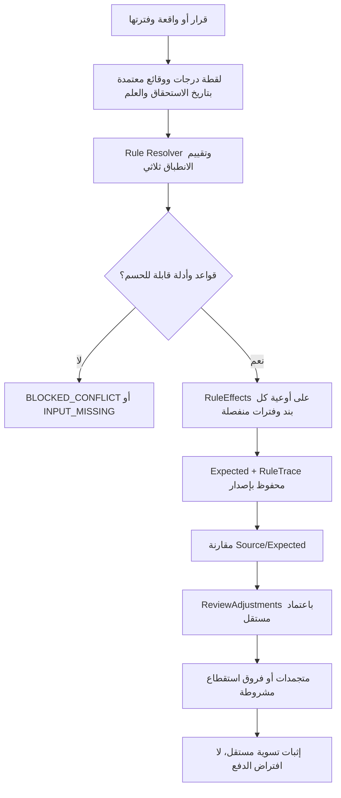

# حزمة Goldfish 2 — القواعد المالية الزمنية والمراجعة والتسويات

**الحالة: NOT_RUN.** هذا Design Draft لا يثبت صحة أحكام أو نسب قانونية ولا يسمح بتشغيل خصومات. كل الأرقام أدناه **مثال اصطناعي** وقد يختلف الحكم الحقيقي باختلاف الكادر والقرار والسريان.

## 1. نطاق المراجعة المستقلة
برنامج مراجعة يقرأ بيانات موظف موثقة ويحسب `Expected` مستقلًا عن Oracle، ثم يفصل `Source` عن `Reviewed` و`OfficialCorrection` و`VerifiedSettlement`. القواعد القانونية تتداخل عبر درجات تاريخية، ترقية متأخرة، إجازة اعتيادية، رعاية طفل، جزء وقت، إعارة/وفاة أو أحداث بعد الاعتماد. لا يغيّر البرنامج Oracle ولا يخصم أو يدفع تلقائيًا.

## 2. محرك القواعد وقواعد السلامة
- `LegalProvisionVersion` يربط مصدر النص والنطاق والكادر والنسخة والسريان.
- `FinancialRuleVersion` شروطها `TRUE/FALSE/UNKNOWN`؛ المجهول لا ينقلب إلى نفي أو صفر.
- `RuleEffect` يحدد بندًا مستهدفًا ووعاء ومعدلًا وتبعية وتقريبًا وفترة.
- `GradeHistory/StatusHistory/ApprovedFinancialFact` تُقرأ **بتاريخ الاستحقاق وبـKnownAt** حسب سياسة القاعدة؛ الدرجة الحالية ليست مرجعًا تلقائيًا.
- `RuleRelation/CompositionPlanVersion` تستبعد قاعدة أو تركب أثرين **فقط بسند ونطاق معتمدين**، لا بأحدث تاريخ أو أعلى أولوية رقمية.
- `CalculationRun/SnapshotHash/RuleTrace` تحفظ المراجع والبنود والقواعد التي جرى اختيارها ولماذا.
- ربط أثر القرار الإداري وتاريخ وصوله وتاريخ الصرف يحتاج فصل `ValidTime` عن `KnowledgeTime`.
- `CENTRAL_SOURCE_AMOUNT` للمعاشات والصناديق التي حددها المالك: لا تعِد حسابها مستقلًا، مع فحص القراءة والوعاء الاستثنائي لجزء الوقت بسند خاص.

## 3. حالات تكشف قصور تصميم قاعدة واحدة لكل حدث

### أ. إجازة قديمة بدرجة تاريخية
موظف كان مدرسًا في فبراير 2025، ثم أستاذًا مساعدًا حاليًا. إذا كانت قاعدة بند أبحاث **المعتمدة فعلًا** تربط النسبة بتاريخ الإجازة، يستخدم درجة مدرس، وليس أستاذ مساعد. وردت في الأمثلة نسب 60%/48%، لكنها **غير مثبتة في النص داخل المشروع**. إذا كان النص يستخدم درجة أخرى أو تاريخ صرف، يجب احترام `GradeReferenceDatePolicy`. لا يجوز استنتاج استحقاق نقدي بمجرد وجود نسبة.

### ب. قرار إجازة اعتيادية يسبب ثلاثة تأثيرات
قاعدة تجريبية بنسب: 156% من `BaseA=1000`، 91% من `BaseB=800`، وثالث 48%/60%/200% حسب فئة الدرجة التاريخية من `BaseC=500`. نموذج الأيام المعروض: 6 أيام من 30 يومًا.
- `EffectA=1000×1.56×6/30=312`
- `EffectB=800×0.91×6/30=145.60`
- `EffectC=500×0.60×6/30=60` في مثال فئة مدرس
- إجمالي الاختبار الحسابي 517.60، **ليس خصمًا رسميًا معتمدًا**. فئة 200% مجهولة إلى أن يحددها مصدر موثق.
- إذا تمتد الإجازة لشهرين تُقسم، ويختلف المقام 30 أو 31 أو 28/29 حسب `DayCountPolicy` المُجازة. دون سند لا تُفعَّل المعادلة أصلًا.

### ج. تعديل المراجع على بنود محسوبة
إذا اقترح النظام أبحاث 600 وبدلًا 300، قد يُعدّل المراجع المبلغ 600→550 ويستبعد 300 ويضيف 200 لبند معروف، فتكون نتيجة المراجعة التجريبية 750؛ **لا يمحو السطر الأصلي ولا الحساب السابق**. `ReviewAdjustment` إصدار مستقل بمستند وسبب وصلاحية، ويعاد التحقق عند وصول قرار تاريخي جديد.

### د. خصم جزئي ثم تسوية عبر بند آخر
أصل خصم **مثبت** 1000 ومبلغ Oracle ظاهر 800، فرق مرشح 200. لا تحول الفرق وحده إلى دين. ترحيل المراجعة للشهر التالي يتطلب `CarryForwardDecision` بسند، وربط مبلغ نوفمبر 200 **من بند آخر** يتطلب `SettlementCompatibilityPolicy` وأدلة رسمية، لا تطابق المبلغ أو باب الصرف فقط. `REPORTED_DEDUCTED` ≠ `SETTLED_VERIFIED`.

## 4. رسم التسلسل للمراجعة

## 5. حالات قبول تلزم قبل البرمجة
- `TR-001..TR-030`: تداخلات قرارات وقوانين وKnownAt والتبعيات وتركيب الآثار.
- `FL-001..FL-018`: ثلاث خصومات بوعاء مستقل، أيام أشهر، تغير درجات/أوعية، معدل 200%، منع التكرار والخصومات المركزية المستثناة.
- `HR-001..005`: اختيار تاريخ الدرجة/النسبة؛ `OV-001..007`: تعديل المراجع؛ `DD-001..015`: ترحيل وتخصيص خصم.
- `PT-001..009`: وعاء المعاش في جزء الوقت (ليس محرك تأمينات عام).
- `AC-034..042` و`AC-045..049`: أحداث بعد اعتماد وأثر الصناديق والدرجة والتاريخ.

## 6. أسئلة لا يجيب عنها Goldfish من نفسه
1. ما مصدر ونطاق وسريان نسب الإجازة 156% و91% و48/60/200%، وأسماء أوعية البنود والدرجات؟
2. هل الإجازة تؤثر في الأبحاث في الحالات المذكورة، وما مرجع الزمن المعتمد؟
3. ما السياسات الحقيقية للخصم بين بندين ولإثبات توريد الاستقطاع؟
4. ما ترتيب الاستثناء بين قانون عام وكادر عضو هيئة تدريس وقرارات الجامعة؟
5. ما حدود تعديل المراجع وإعادة اعتماد قرار عند تغيير درجة أو مصدر متأخر؟

**الطلب إلى Goldfish:** ابحث عن حساب يتغير بتغير ترتيب العمليات، أو عن نتيجة تظهر صحيحة رغم نص ناقص، وعن مسارات `UNKNOWN` تتحول إلى `0`، وعن تكوين جزاء/خصم مزدوج، وعن تخصيص متجمد مرتين أو مسح اعتماد. صَنّف الأخطاء المالية المانعة.

## 7. المراجع التصميمية
- [القواعد القانونية](../domain/LEGAL-AND-RULE-GOVERNANCE.md)
- [المحرك الزمني](../specs/TEMPORAL-RULE-RESOLUTION-AND-CONFLICTS.md)
- [بوابة تداخل القواعد وتركيب آثارها](../specs/RULE-INTERACTION-AND-VALIDATION.md)
- [ثلاثة خصومات للإجازة](../specs/FACULTY-ANNUAL-LEAVE-MULTI-DEDUCTION-RULE.md)
- [التعديل والترحيل](../specs/HISTORICAL-LEAVE-REVIEW-ADJUSTMENTS-AND-DEDUCTION-CARRY.md)
- [الاستقطاعات المركزية](../domain/CENTRAL-CALCULATED-ITEMS.md)
- [جزء الوقت](../domain/PART-TIME-INSURANCE-CONTROL.md)
- [ERD المراجعة والتسويات](../architecture/ERD-REVIEW-AND-RETRO.md)
- [مثال القواعد التاريخية](../examples/03-TEMPORAL-RULE-CONFLICT-EXAMPLE.md)
- [مثال تعديلات المراجع والتسوية](../examples/04-HISTORICAL-LEAVE-ADJUSTMENT-DEDUCTION-CARRY.md)
- [المتطلبات واختبارات القبول](../specs/REQUIREMENTS-AND-ACCEPTANCE.md)
