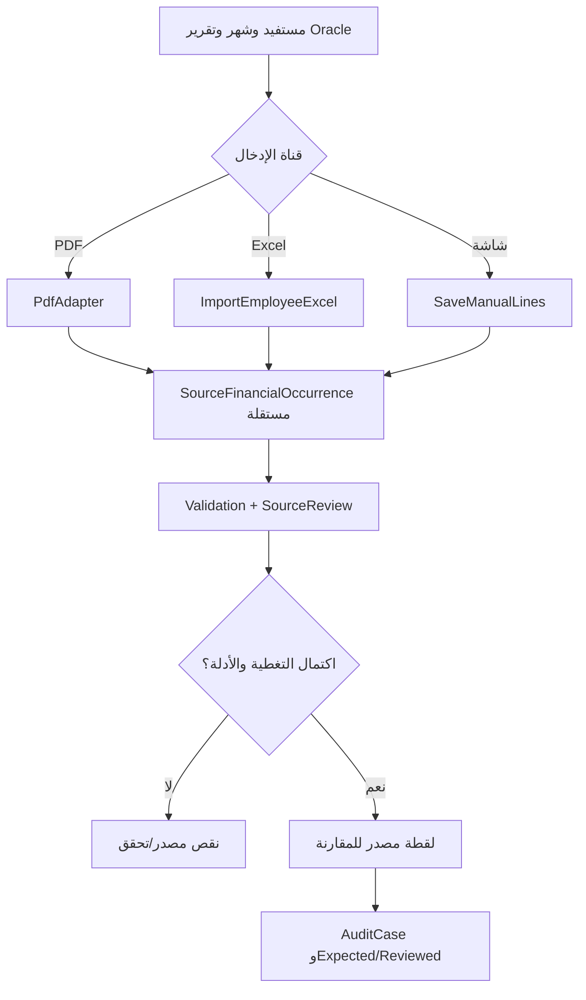

# حزمة Goldfish 3 — مصدر Oracle البديل، جودة الإدخال، ورعاية الطفل

**الحالة: NOT_RUN.** هذا ملف Review Target وليس تقرير Goldfish. الأمثلة اصطناعية ولا تتضمن بيانات موظفين أو كشوف رواتب فعلية.

## 1. نطاق التصميم
النظام لا يعدل Oracle ولا يعتمد صحة الحساب من مجرد قراءة PDF. مطلوب دعم ثلاث طرق لإحضار بيانات الاستحقاقات:
1. PDF رسمي عند توفره،
2. **Excel XLSX لموظف واحد مع مجموعة بنود**،
3. **إدخال مباشر من شاشة عربية** دون أي ملف.

المالك صرّح أن **قراءة الصور/OCR ليست البديل المطلوب** لعدم ضمان دقتها. أي أمثلة قديمة للصورة تظل تاريخية ولا تُفرض كمتطلب أو تبعية لـExcel أو الشاشة.

## 2. هوية السطر والمصدر
- `SourceDocument` أصل وحفظ بصمة ومصدر عندما يكون الملف موجودًا، وليس سجلًا وهميًا لملف PDF لم يُرفع.
- `SourceCaptureSession` تحدد `CaptureMethod=NATIVE_PDF/EXCEL_IMPORT/DIRECT_FORM`, الجهة، نوع التقرير، شهر المصدر، ومدى التغطية `Coverage`.
- `SourceRecipientOccurrence` هوية المستفيد **كما وردت بالمصدر**، ورابطه بالشخص/علاقة الصرف المعتمدة قد يبقى غير محسوم.
- `SourceFinancialOccurrence` **سطر لكل ظهور أصلي**، حتى مع تكرار كود الحساب والاسم والسالب والمبلغ؛ لا تستبدل صفوف الملف بجمع `Dictionary<AccountCode,Amount>`.
- `FinancialSide`: استحقاق، استقطاع، حصة جهة معلوماتية، وعاء مرجعي، مجموع، مجهول؛ لا تخلط حصة الحكومة بنقد الموظف.
- `SourceReportedTotal` قيمة **مطبوعة/منقولة من أصل ثابت**، و`CalculatedEnteredLinesTotal` قيمة حسابية مستقلة؛ غياب إجمالي المصدر لا يعني `0`.
- `SourceReviewDecision` يراجع دقة إدخال/استخراج المصدر، ثم `AuditCase` يفصل صحة استحقاق المراجع عن المصدر. `EvidenceAuthenticity` و`TranscriptionAccuracy` محوران مستقلان.

## 3. Excel + الشاشة
`ICentralPayrollSourceIntake.ImportEmployeeExcel(workbook,context)` يستقبل مصنفًا بورقتين مقترحتين: `Employee` لبيانات موظف واحد، و`Items` لسطور متعددة. `CreateManualEmployeeDraft` + `SaveManualLines` لنفس البيانات من شاشة بدون ملف. كلاهما يصدر `CaptureDraft` ثم `ValidateDraft` ثم لقطة مصدر للمراجعة. لا يؤدي نجاح الاستيراد إلى تأكيد أصالة Oracle أو تفعيل اعتماد مالي.

### مثال اصطناعي
```json
{
  "employeeRef": "EMP-DEMO",
  "payrollMonth": "2026-11",
  "reportType": "EMPLOYEE_ENTITLEMENTS",
  "sourceMethod": "DIRECT_FORM",
  "lines": [
    {"lineId": "1", "side": "EARNING", "code": "21110505", "label": "علاوة 2014", "amount": "40.00"},
    {"lineId": "2", "side": "EARNING", "code": "21110505", "label": "علاوة 2015", "amount": "60.00"},
    {"lineId": "3", "side": "DEDUCTION", "code": null, "label": "استقطاع تجريبي", "amount": "10.00"}
  ]
}
```

```json
{
  "acceptedForFinancialComparison": false,
  "sourceReviewStatus": "SOURCE_REVIEW_REQUIRED",
  "distinctSourceLineCount": 3,
  "computedEarnings": "100.00",
  "computedDeductions": "10.00",
  "officialPrintedNet": null,
  "isOracleOfficialDocument": false
}
```

## 4. رعاية الطفل: ثلاث وثائق متمايزة
- `ChildCareLeaveApplication`: طلب إداري وفق نموذج الجامعة؛ موافقة الشؤون الإدارية خارج البرنامج.
- `ChildCareCentralSettlement`: تسوية مالية من Oracle، **ليست أمر دفع مستقلًا** بحسب دليل التشغيل الموثق في المواصفة.
- `SalaryPaymentForm132`: إذا كان للموظفة أيام عمل فعلية ضمن شهر بدء أو نهاية الرعاية، قد يظهر كشف صرف مستقل عن أيام العمل.
- `InternalChildCareAuditSheet`: ورقة **مراجعة داخلية** ينشئها النظام؛ لا يزعم أنها استمارة رسمية من Oracle.

إذا بدأت رعاية طفل يوم 20 نوفمبر: من 1–19 فترة قبل الإجازة (العمل الفعلي يحتاج إثباتًا)، ومن 20–30 فترة رعاية. لا تجمع صافي 132 مع حصة جهة حكومية غير نقدية من تسوية الرعاية في إجمالي راتب واحد. ليست كل النصوص القانونية واحدة لكل كادر أو سنة.

## 5. رسم UML لتحديد مصادر الإدخال



## 6. كيف نعرف أن التصميم غير مكتمل؟
- يظهر المستفيد في الكافر وكشف الفرد بتواريخ مختلفة أو كود يتكرر عدة مرات: هل المراجعة تجمع خطأ؟
- ملف Excel به أكثر من موظف أو به أصفار بادئة للكود، أو formulas وnegative amounts: هل يبقى المصدر صالحًا دون تشغيل كود ضار؟
- إدخال شاشة لا يتوفر له مستند: هل النظام يسمح بالمقارنة من دون ادعاء أنه مصدر Oracle رسمي أو يرفضه دائمًا؟ هل هناك سياسة شهادة مستقلة؟
- تصحيح PDF لاحقًا بعد إدخال Excel: هل تتكرر السطور أو تختفي قرارات مراجعة سابقة؟
- تسوية رعاية الطفل وحصة جهة في وثيقة أخرى: هل يحصل تضاعف قيمة نقدية أو أمر دفع غير موجود؟
- المصدر جزئي/مجهول الإجمالي: هل `SourceCoverage` يوضح أن عدم ظهور بند لا يساوي `0`؟

## 7. معايير القبول
- `PDF-001..018` وأنواع `ID-/AR-`: قواعد جودة Oracle والنص العربي المقلوب.
- `EX-001..009` و`DF-001..009`: Excel والشاشة دون OCR.
- `CC-001..012`: رعاية الطفل والتسويات.
- `MI-001..016`: التصميم الأقدم لقنوات المصدر المختلفة؛ **لا تحول دعم الصور إلى شرط للتنفيذ**.
- `AC-016..026` و`AC-031/032`: مطابقة المصدر وحفظ الأصل ومجموعات المراجعة والتصدير.

**الطلب إلى Goldfish:** حدد فجوات مصدر الحقيقة والإثبات وقيمة الصفر والقيم المفقودة، والـFK/Idempotency والخصوصية، وعدم تمييز نوع تقرير الصرفية؛ لا تقترح بناء OCR كحل افتراضي لأن المالك رفض الاعتماد عليه.

## 8. الملفات المرجعية المحددة
- [المدخلات من Excel والشاشة](../specs/EXCEL-AND-DIRECT-EMPLOYEE-PAYROLL-INTAKE.md)
- [مصادر متعددة وتاريخ قرار المالك](../specs/MULTI-CHANNEL-CENTRAL-INTAKE.md)
- [استيراد Oracle PDF](../specs/ORACLE-PDF-ADAPTER-DESIGN.md)
- [هوية سطر Oracle](../specs/ORACLE-FINANCIAL-LINE-IDENTITY.md)
- [ERD استيراد](../architecture/ERD-IMPORT-AND-AUDIT.md)
- [رعاية الطفل](../specs/CHILD-CARE-LEAVE-AND-CENTRAL-SETTLEMENT.md)
- [مثال المصدر Excel والشاشة](../examples/05-CHILDCARE-AND-MANUAL-INTAKE.md)
- [توثيق النسخة القديمة ومشكلاتها](../reference/ORACLE-PARSER-FAILURE-AUDIT.md)
- [الخصوصية](../security/SECURITY-AND-PRIVACY.md)
- [اختبارات القبول](../specs/REQUIREMENTS-AND-ACCEPTANCE.md)
