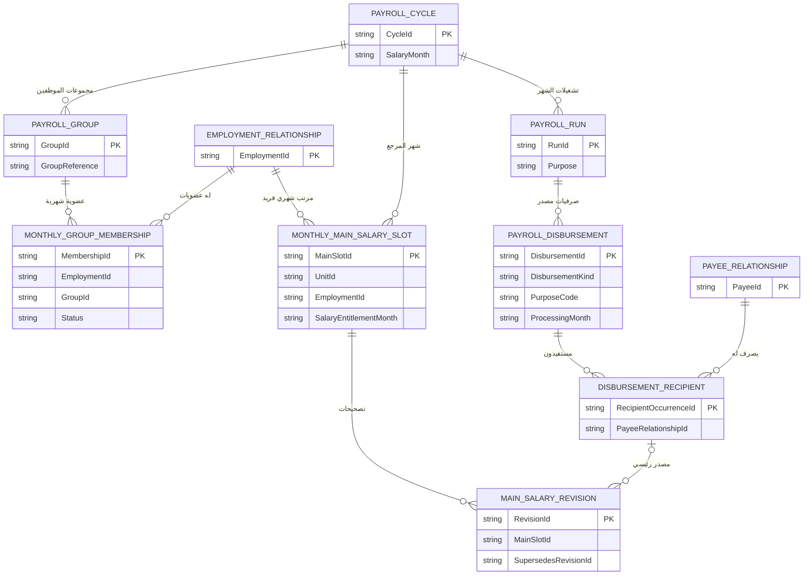
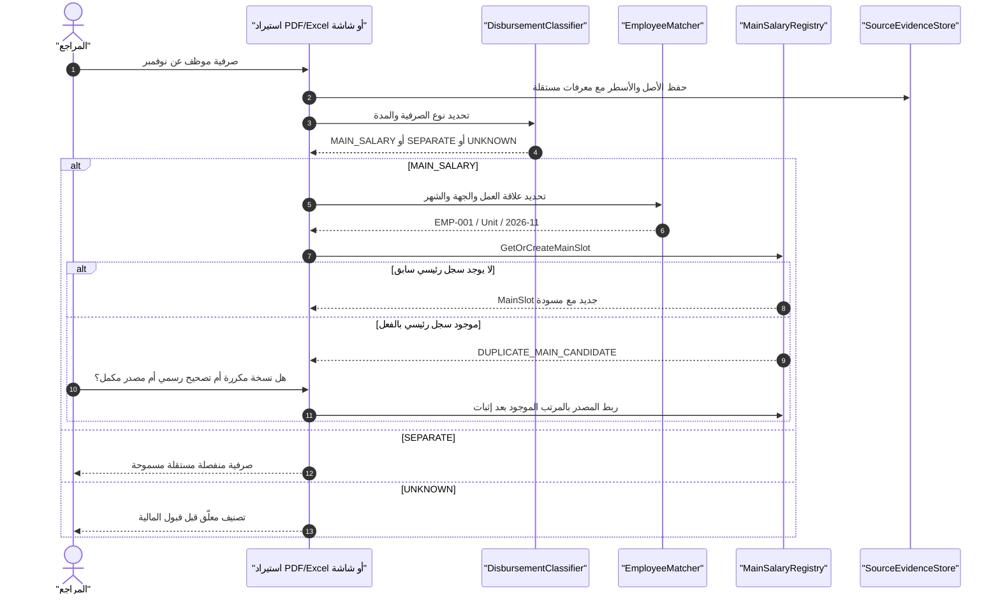
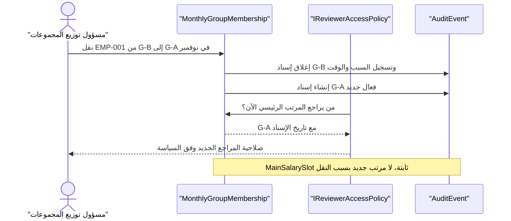

# مثال ERD وUML: مرتب رئيسي واحد وصرفيات منفصلة متعددة داخل مجموعات الشهر

> **كل البيانات اصطناعية**؛ لا تمثل موظفين حقيقيين أو ملفات Oracle رسمية. المخططات عقود مقترحة قبل SQL. المرجع: [مواصفة نوع الصرفية وقاعدة الفرادة](../specs/MONTHLY-PAYROLL-GROUPS-AND-DISBURSEMENT-TYPES.md).

## 1. الشهر والتشغيلات والمجموعات

الوحدة `30200105`، شهر مرتب `2026-11`. ثلاث مجموعات مراجعة: `G-A`، `G-B`، `G-C`. الموظف الافتراضي `EMP-001` في `G-B` بمرتبه الرئيسي في نوفمبر، وله ثلاث صرفيات أخرى.

| الموظف | المجموعة | شهر المرتب | الصرفية | النوع | قيمة مثال | قرار النظام |
| --- | --- | --- | --- | --- | ---: | --- |
| `EMP-001` | `G-B` | نوفمبر | `MAIN-01` | `MAIN_SALARY` | 7,000 | مرتب رئيسي واحد |
| `EMP-001` | - | نوفمبر | `BON-11` | `SEPARATE` | 600 | صرفية مكافأة منفصلة |
| `EMP-001` | - | نوفمبر | `INC-19` | `SEPARATE` | 300 | صرفية حافز منفصلة |
| `EMP-001` | - | أصل أكتوبر، ظهور نوفمبر | `RET-21` | `SEPARATE` | 400 | صرفية فروق/متجمدات منفصلة |
| `EMP-001` | `G-A` خطأً | نوفمبر | `MAIN-02` | `MAIN_SALARY` | 7,000 | `DUPLICATE_MAIN_CANDIDATE` |
| `EMP-001` | `G-B` | نوفمبر | `MAIN-CORRECTED-01` | `MAIN_SALARY` تصحيح | 7,100 | نسخة تصحيح **لنفس السجل الرئيسي** |

**المجاميع:** يوجد سجل مرتب رئيسي واحد، وثلاث صرفيات منفصلة، ومرشح تكرار رئيسي غير معتمد، ونسخة تصحيح مرتب. لا يُحسب وجود مستندات مرتب متعددة على أنه عدد مرتبات رئيسية متعددة.

## 2. ERD مبسط



## 3. UML — استقبال صرفية رئيسية ثانية في شهر واحد



## 4. Input — وصول صرفية مستقلة ثم تصحيح رئيسي

```json
{
  "unitId": "UNIT-30200105-TEST",
  "salaryEntitlementMonth": "2026-11",
  "processingMonth": "2026-11",
  "employmentRelationshipId": "EMP-001",
  "payeeRelationshipId": "PAY-001",
  "monthlyReviewerGroup": "G-B",
  "runs": [
    {"runId": "RUN-01", "disbursementId": "MAIN-01", "kind": "MAIN_SALARY", "amount": "7000.00"},
    {"runId": "RUN-02", "disbursementId": "BON-11", "kind": "SEPARATE", "purpose": "REWARD", "amount": "600.00"},
    {"runId": "RUN-03", "disbursementId": "INC-19", "kind": "SEPARATE", "purpose": "INCENTIVE", "amount": "300.00"},
    {"runId": "RUN-04", "disbursementId": "RET-21", "kind": "SEPARATE", "originMonth": "2026-10", "amount": "400.00"},
    {"runId": "RUN-05", "disbursementId": "MAIN-02", "kind": "MAIN_SALARY", "amount": "7000.00"},
    {"runId": "RUN-06", "disbursementId": "MAIN-CORRECTED-01", "kind": "MAIN_SALARY", "sourceCorrectionOf": "MAIN-01", "amount": "7100.00"}
  ]
}
```

## 5. Output — فرادة منطقية لا حذف للمصادر

```json
{
  "employee": "EMP-001",
  "salaryMonth": "2026-11",
  "monthlyMainSalary": {
    "mainSlotId": "MAIN-SLOT-2026-11-EMP-001",
    "mainCount": 1,
    "revisions": ["MAIN-01", "MAIN-CORRECTED-01"],
    "currentReviewedVersion": "MAIN-CORRECTED-01"
  },
  "separateDisbursements": [
    {"id": "BON-11", "purpose": "REWARD"},
    {"id": "INC-19", "purpose": "INCENTIVE"},
    {"id": "RET-21", "purpose": "ARREARS", "originMonth": "2026-10"}
  ],
  "separateCount": 3,
  "duplicateMainCandidates": [
    {"sourceDisbursementId": "MAIN-02", "state": "REVIEW_REQUIRED"}
  ],
  "sourceDocumentsPreserved": true,
  "verifiedPaidAmount": null
}
```

**تنبيه:** العرض يوضح منطق الربط بعد أن يثبت المستخدم أن `MAIN-CORRECTED-01` مصدر رسمي مصحح. أي نقص في مستند التصحيح يغيّر `currentReviewedVersion` إلى حالة معلقة ولا يُعتمد تلقائيًا. المبالغ ليست إثبات دفع.

## 6. UML — تغيير مجموعة المراجع أثناء الشهر



## 7. لماذا القيد ليس على كل مستند PDF؟
لو الملف نفسه أُعيد استيراده ثلاث مرات، تكون لنا ثلاث محاولات قراءة لكن **لا ثلاث صرفيات**. ولو ظهرت مكافأتان مختلفتان في شهر واحد، هما صرفيتان حتى لو كانتا تحت نفس `PurposeCode`. وإذا وصلت صرفية رئيسية ثانية للموظف في مجموعة أخرى، تعرض للمراجع كمرشح ازدواج بدل حذف ملف أو اعتماد مبلغ من دون إثبات. راجع اختبارات `PG-001..PG-022` في [المواصفة](../specs/MONTHLY-PAYROLL-GROUPS-AND-DISBURSEMENT-TYPES.md).
