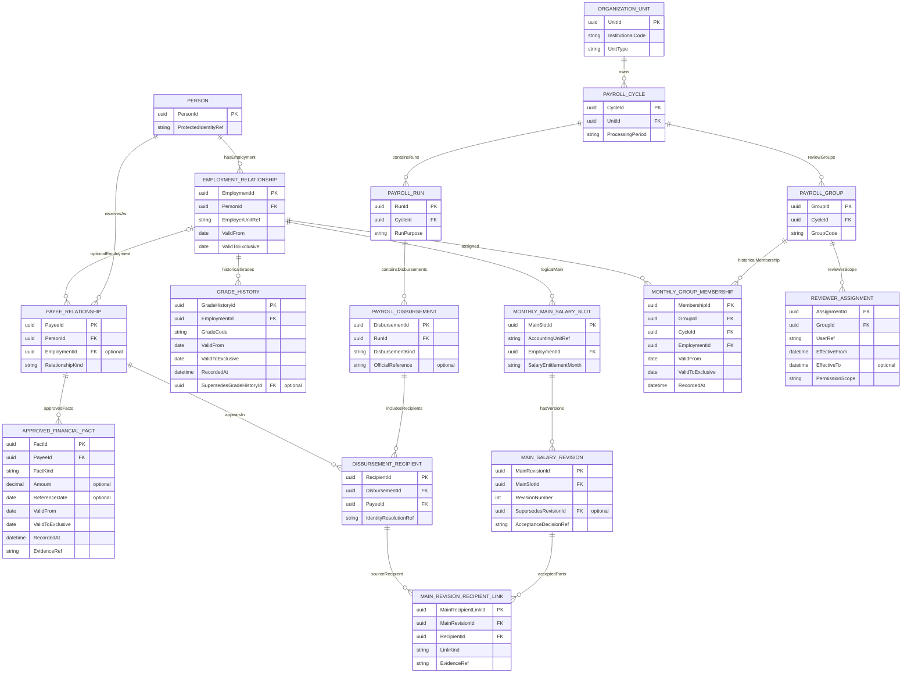
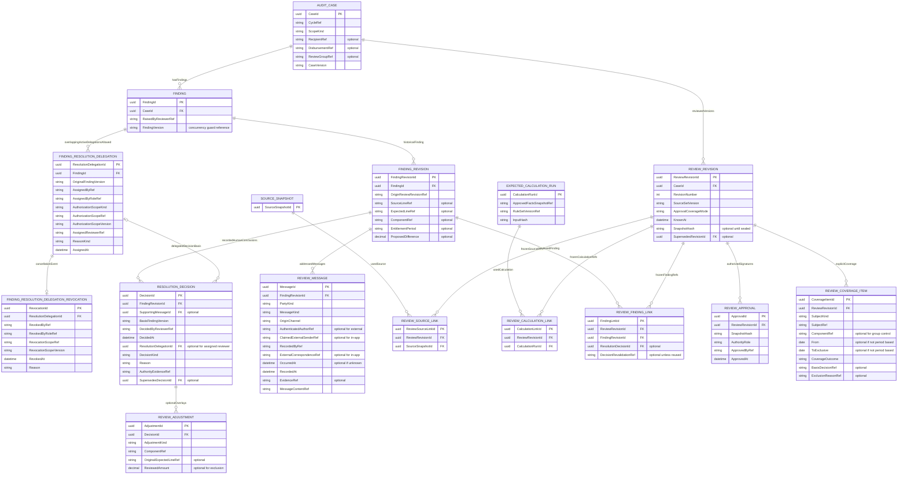
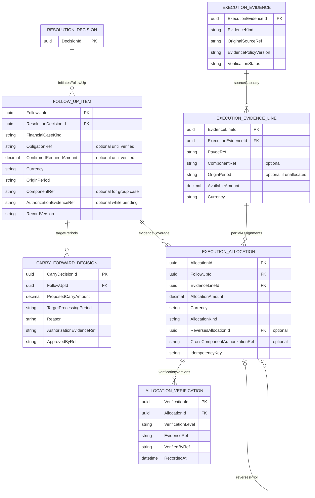
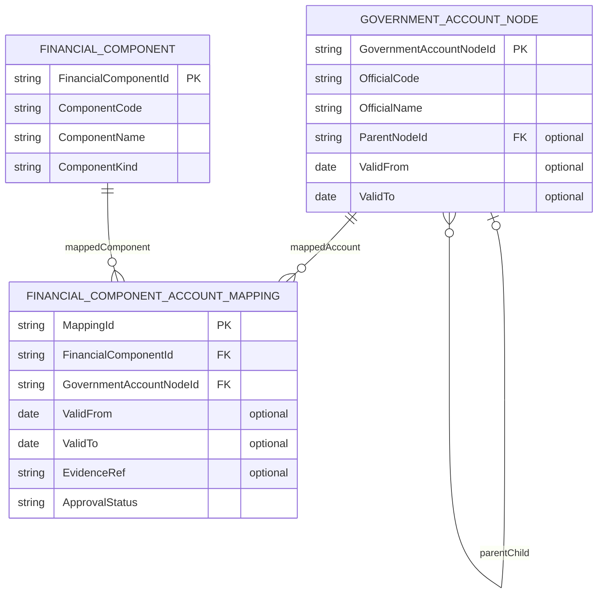

# مخطط قاعدة البيانات المنطقي وقاموسه

**الحالة: ERD منطقي مقترح v0.3 — تعديلات D-030 إلى D-039 وتبسيط التسجيل قيد المراجعة — لا DDL أو Migration أو اختيار محرك قاعدة بيانات.** يكمّل المخططات الحالية ويعيد استعمال مفاهيمها؛ اختلاف الاسم يحتاج توحيدًا عند اعتماد التصميم الفيزيائي، ولا يبرر إنشاء جدولين للمعنى نفسه.

PK هوية داخلية مقترحة، وFK علاقة مرشحة. `optional` تعني أن غيابها مقصود في الحالة المحددة. العلاقات بين مجالات DDD تمثل مراجع وعقودًا؛ لا تمنح وحدة حق كتابة جداول وحدة أخرى، ولا تقرر كل FK فيزيائي. `uuid` و`decimal` أسماء أنواع توضيحية، وتُعتمد أنواع التخزين والدقة والقيود مع التقنية.

## ERD-A — الهوية والتاريخ والشهر والصرفيات

الصرفية رأس يجمع مستفيدين؛ فرادة المرتب لا توضع عليه كأنه صف موظف. `MainRevisionRecipientLink` يوضح ربط الأجزاء أو المستندات المكملة المقبولة بنفس النسخة المنطقية، مع دليل يمنع اعتماد تكرار كامل كجزء مكمل. الهوية المصدرية غير المحسومة تحفظ في ERD-B؛ لا تُنشأ لها علاقة صرف معتمدة لمجرد نجاح الاستخراج.

### D-039 — إسقاط ملف الموظف التاريخي دون اختراع جدول شامل

- `PERSON` يحتفظ بهوية الشخص، و`EMPLOYMENT_RELATIONSHIP` يميز علاقات عمله، و`PAYEE_RELATIONSHIP` علاقات الصرف. شاشة قائمة الموظفين تفتح ملف شخص/علاقة محددة بدل افتراض أن كل مستفيد مكافأة موظف بدرجة وظيفية.
- تبويب الترقيات والدرجات يستعين بـ`GRADE_HISTORY` وبالوقائع الإدارية المؤرخة، وتبويب المال يعرض الوقائع المالية من `APPROVED_FINANCIAL_FACT` والبنود من `FinancialComponent` والأثر التاريخي للقاعدة/القرار، لا أحدث قيمة لجميع السنوات.
- **تاريخ الأقسام والتنقلات:** يجب توفير علاقة انتماء لقسم/جهة بفترتي السريان وسبب الحركة ومرجع سندها؛ المخطط الحالي يثبت تاريخ الدرجة وعلاقة الجهة لكنه لا يثبت بعد شكل كيان تفاصيل العمل في الأقسام. يُراجع `StatusHistory` و`WorkArrangement` والهيكل التنظيمي قبل اقتراح جدول جديد.
- **الأحكام القضائية:** يجب حفظ مرجع الحكم وتاريخه وتاريخ السريان/الأثر، والقرار أو واقعة التطبيق المرتبطة به، والعلاقة بين كل حكم والبند المالي وفترة تعديله؛ لا يُفترض أن `AdministrativeDecision` وحده يمثل الحكم القضائي. لا تُستنتج مبالغ تنفيذ أو فروق تلقائيًا من وجود حكم.
- `EmployeeProfileReadModel` المقترح في UML قراءة مركبة من المراجع التاريخية مع اختيار «كما في تاريخ»، **وليس جدول بيانات مكررًا أو ترخيصًا لإنشاء أعمدة أو كيانات في SQL**. تراعي القراءة الصلاحيات والهوية والأصل ووقت تسجيل المعرفة.

### قيود ERD-A التي تتطلب تصميمًا فيزيائيًا

- فرادة `AccountingUnitRef × EmploymentId × SalaryEntitlementMonth` مرشح يطابق النطاق المعتاد؛ تعدد التعيين والنقل بين وحدتين سؤال مالك قبل تعميمه. لا تستبدله بفرادة عالمية للشخص من نفسك.
- إصدارات الرئيسي فريدة حسب `MainSlotId × RevisionNumber`، وله نسخة مقبولة فعالة واحدة وفق قرار صريح، لا أحدث ملف وصولًا.
- المنفصلة متعددة بلا قيد عام للشخص والشهر والغرض. تكرار نفس طلب الإدخال يعالج بمفتاح العملية، لا بتشابه المبلغ.
- عضوية المجموعة وتكليف المراجع مؤرخان. يجب تطابق `CycleId` للعضوية مع مجموعة الشهر، ومنع الفترات المتداخلة غير المصرح بها وفق سياسة العضوية؛ فهرس صف نشط وحده لا يثبت عدم تداخل التاريخ.
- لكل صف تاريخي زمن سريان وزمن معرفة ونسخة تصحيح. الحقول المرسومة حد أدنى للشرح؛ `SupersedesId` وحده لا يغني عن تحديد سياسة KnowledgeTime وقراءة اللقطة قبل التنفيذ.

## ERD-B — المصدر والالتقاط والأسطر

```mermaid
erDiagram
  SOURCE_CAPTURE_SESSION ||--o{ SOURCE_SNAPSHOT : capturedVersions
  SOURCE_DOCUMENT ||--o{ CAPTURE_DOCUMENT_LINK : archivedFile
  SOURCE_CAPTURE_SESSION ||--o{ CAPTURE_DOCUMENT_LINK : optionalFiles
  SOURCE_SNAPSHOT ||--o{ SOURCE_RECIPIENT_OCCURRENCE : observedRecipients
  SOURCE_RECIPIENT_OCCURRENCE ||--o{ SOURCE_FINANCIAL_OCCURRENCE : observedLines
  SOURCE_SNAPSHOT ||--o{ SOURCE_REPORTED_TOTAL : printedTotals
  SOURCE_SNAPSHOT ||--o{ SOURCE_VALIDATION_ISSUE : diagnostics
  SOURCE_RECIPIENT_OCCURRENCE ||--o{ RECIPIENT_MATCH_DECISION : identityDecisions
  SOURCE_FINANCIAL_OCCURRENCE ||--o{ COMPONENT_MAPPING_DECISION : mappingDecisions
  SOURCE_DOCUMENT {
    uuid SourceDocumentId PK
    string Sha256
    string PrivateArchiveRef
    string DocumentKind
    uuid SupersedesDocumentId FK "optional"
  }
  SOURCE_CAPTURE_SESSION {
    uuid CaptureId PK
    string CaptureMethod
    string CycleRef
    string ReportType
    string EnteredByRef
    string ConcurrencyToken
  }
  CAPTURE_DOCUMENT_LINK {
    uuid DocumentLinkId PK
    uuid CaptureId FK
    uuid SourceDocumentId FK
  }
  SOURCE_SNAPSHOT {
    uuid SourceSnapshotId PK
    uuid CaptureId FK
    int SnapshotVersion
    string EvidenceAuthenticity
    string TranscriptionAccuracy
    string SourceCoverage
    string ContentHash
    datetime CapturedAt
  }
  SOURCE_RECIPIENT_OCCURRENCE {
    uuid OccurrenceId PK
    uuid SourceSnapshotId FK
    string RawIdentityRef
    string IdentityStatus
  }
  SOURCE_FINANCIAL_OCCURRENCE {
    uuid SourceLineId PK
    uuid OccurrenceId FK
    string RawCode "optional"
    string RawLabel
    string RawAmountToken "optional"
    decimal ParsedAmount "optional"
    string FinancialSide
    string EvidenceLocator "optional"
  }
  SOURCE_REPORTED_TOTAL {
    uuid TotalId PK
    uuid SourceSnapshotId FK
    uuid OccurrenceId FK "optional"
    string TotalKind
    decimal Amount "optional"
    string EvidenceLocator
  }
  SOURCE_VALIDATION_ISSUE {
    uuid ValidationIssueId PK
    uuid SourceSnapshotId FK
    uuid SourceLineId FK "optional"
    string DiagnosticCode
    string Severity
  }
  RECIPIENT_MATCH_DECISION {
    uuid MatchDecisionId PK
    uuid OccurrenceId FK
    string PayeeRef "optional"
    string DecisionStatus
    string ApprovedByRef
  }
  COMPONENT_MAPPING_DECISION {
    uuid MappingDecisionId PK
    uuid SourceLineId FK
    string ComponentRef "optional"
    string DecisionStatus
    string EvidenceRef
  }
```

قد تكون جلسة شاشة بلا `CaptureDocumentLink` أصلًا؛ لا ينشأ ملف وهمي. تحفظ محاولات قراءة ملف واحد وإصدارات المحلل في سجل الالتقاط، ولا يستبدل Snapshot معتمد بإعادة قراءة أحدث. كل موضع سطر مستقل، ولا فرادة للكود أو للاسم أو للمبلغ. الإجماليات المطبوعة مختلفة عن مجاميع الأسطر المحسوبة، ويمكن أن تبقى غير متاحة.

قبل المخطط الفيزيائي يجب تحديد ربط Snapshot بعين ملفاتها ومحاولتها ومحركها، وربط الإجماليات الفردية بمستفيد من Snapshot نفسها؛ لا يجيز وجود المرجعين منفصلين خلط مصدرين. الصف المصدر بلا هوية داخلية يظل محفوظًا وقابلًا للفحص في نطاق المستند.

## ERD-C — الملاحظة والرد ونسخة الاعتماد

### معنى النطاق واللقطة

- **D-030 — مصدر الرد:** `OriginChannel` يميز `IN_APP` (كتبه مستخدم المركزية بحسابه الموثق، بعد فحص سلطته) من `EXTERNAL_RECORDED` (وصل خارج التطبيق وسجله مستخدم الوحدة المخوّل). `RecordedByRef` هو حساب مَن أدخل السجل بالفعل، و`AuthenticatedAuthorRef` يشير إلى كاتب الرد الموثق داخل النظام فقط، بينما `ClaimedExternalSenderRef` و`ExternalCorrespondenceRef` يحفظان بيانات جهة الرد ومرجع مراسلته كما وردا دون ادعاء تحقق حساب مركزي. لا تستنتج قوة الإثبات من القناة وحدها.
- **قيود منطقية مقترحة:** في رد المركزية الداخلي لا يُقبل سجل بلا مرجع مستخدم موثق وصلاحية بالنطاق. في تسجيل الرد الخارجي لا يحل المرسل المنسوب محل `RecordedByRef` ولا يتحول إلى `AuthenticatedAuthorRef`. تظل متطلبات المرفق والتوقيع واعتماد التسجيل والصلاحيات التفصيلية قرارات مفتوحة؛ هذه ليست قيود DB منفذة.
- **D-031/D-032 — سلطة حسم الملاحظة والتكليف:** `FINDING.RaisedByReviewerRef` يبقى مرجع صاحب الملاحظة الأصلي. `RESOLUTION_DECISION.DecidedByReviewerRef` و`DecidedAt` يثبتان الشخص الذي حسمها وتوقيته: في المسار المعتاد يطابق الحاسم صاحبها؛ وعند غيابه أو نقله يجب أن يشير `ResolutionDelegationId` إلى تكليف صريح صالح يحدد `AssignedReviewerRef` و`AssignedByRef` و`ReasonKind` ومرجع الملاحظة الأصلي ونسختها. تُفحص هوية المسؤول المخوّل عند التكليف، وهوية البديل ونطاقه والإصدار عند الحسم. سجلات التكليف والقرارات تاريخية لا تستبدل بعضها، ولا تُنقل ملكية أصل الملاحظة إلى البديل. لا يلزم توقيع رئيس المراجعة **لحسم الملاحظة ذاته**؛ اعتماد `REVIEW_REVISION` وإثبات التسوية مستقلان. **D-033 حدد صفتَي المُصدر**: رئيس المراجعة أو رئيس الوحدة الحسابية، كلٌّ حسب اختصاصه. تحفظ `AssignedByRoleRef` الصفة التي مارس بها `AssignedByRef` سلطة التكليف، ويُحفظ `AuthorizationScopeRef` مرجع النطاق الذي أجاز التكليف وقت إصداره؛ يتحقق التطبيق من عضوية الملاحظة في هذا النطاق دون افتراض أن صلاحيات الوظيفتين متطابقة. **D-034 حسم حدود الإصدار:** `REVIEW_HEAD` يصدر التكليف فقط إن كانت الملاحظة داخل `PayrollGroup` تخضع لإشرافه في `PayrollCycle` المعنية، ويرفض التكليف خارج مجموعاته وللصرفيات المنفصلة التي لا تندرج في نطاق مجموعة مراجعة رئيسية؛ لا تُمنح سلطة على صرفية منفصلة بسبب عضوية مستفيدها في مجموعته. `ACCOUNTING_UNIT_HEAD` يصدر التكليف لملاحظات جميع مجموعات المراجعة والصرفيات التابعة للوحدة التي يرأسها، ويرفض ملاحظات أي وحدة أخرى. لتجنب اختيار صلاحية من لحظة غير صحيحة، تحفظ مسودة `FINDING_RESOLUTION_DELEGATION` نوع النطاق `AuthorizationScopeKind` ومرجعه `AuthorizationScopeRef` وإصداره `AuthorizationScopeVersion`، ويُحسم الربط المنطقي بمراجع `PayrollCycle` و`PayrollGroup` و`ReviewerAssignment` والكيان الفعلي للصرفية مع مراعاة سجل الإسناد الزمني. لا يغيّر هذا ملكية الملاحظة أو اعتماد `REVIEW_REVISION`. **D-035 حسم سلطة الإلغاء:** رئيس المراجعة يلغي أي تكليف داخل مجموعاته حتى لو أصدره رئيس الوحدة، ورئيس الوحدة يلغي أي تكليف داخل وحدته حتى لو أصدره رئيس المراجعة؛ لا يصح تجاوز هذه الحدود. `FINDING_RESOLUTION_DELEGATION_REVOCATION` سجل إلغاء مستقل يحفظ رابط التكليف، وهوية مُصدِر الإلغاء وصفته ونطاقه ووقت الإلغاء وسببه. حالة التكليف تُستنتج من وجود سجل الإلغاء الصالح لا من محو أو تحديث سجل التكليف التاريخي؛ يلزم ضمان عدم قبول حسم جديد بواسطة بديل بتكليف ألغي بالفعل، بما يشمل سباق طلبَي الحسم والإلغاء، دون إبطال `RESOLUTION_DECISION` صحيحة سابقة بأثر رجعي. **D-036/D-037 — التسجيل لا التحكيم:** يجوز تعدد التكليفات والآراء المختلفة للملاحظة/نسختها؛ لا قيد فريد على `FINDING_RESOLUTION_DELEGATION.FindingId` يمنعها. `REVIEW_MESSAGE.MessageKind` يميز رد المركزية عن رأي المراجع أو إفادة بالإجراء، ويحتفظ `RecordedByRef` وهوية قائله/كاتبه ووقت التسجيل ومرجع الدليل. `RESOLUTION_DECISION` يوثق خلاصة أو قرارًا بشريًا إذا ورد، مع حفظ الإصدارات السابقة؛ لا يرفض البرنامج تسجيل رأي مغاير لأن هناك رأيًا سابقًا. **التصرف الفعلي يُذكر فقط بقدر مصدره:** يظهر البلاغ أو كشف الصرف بوصفه `Reported`، وتُثبت التسوية أو الدفع فقط بدليل مستقل من طبقة `ExecutionEvidence/AllocationVerification` القائمة في ERD-D. لا يُنشأ محرك للتحكيم أو اختيار الرأي المفضل، ولا يُستنتج التنفيذ من اتفاق المراجعين. المتبقي من التزامن هو حماية سلامة التدوين من الكتابة فوق سجل آخر، لا فرض قرار نهائي آلي. لا DDL أو اختبار تشغيل حقيقي.
- `ScopeKind` يحدد مستفيدًا في صرفية أو صرفية كاملة أو مجموعة مراجعة. يجب وجود المرجع الموافق فقط، وانتماء المصادر والمستفيد والمجموعة للدورة والوحدة المصرح بهما. الحالة الجماعية لا تمنح مراجع مجموعة إذن الاطلاع على الجميع.
- `ReviewSourceLink` و`ReviewCalculationLink` و`ReviewFindingLink` تجمع النسخ التي يشملها اعتماد بعينه. تربط قرارات الحسم بنسخة الملاحظة الصحيحة؛ لا تستخدم أحدث رد بالوقت فقط.
- `ReviewCoverageItem` تحفظ مكونات النطاق التي فحصت والمعتمدة وغير المعتمدة والمستثناة وأسبابها، بما فيها البنود والمقاطع الزمنية. `ApprovalCoverageMode` يميز `WHOLE_SCOPE` عن `EXPLICIT_SUBSET` المسموح بسياسة مخولة. تدخل التغطية وأسبابها في البصمة وتظهر في التصدير، ولا يعرض مجموع أجزاء مقبولة باعتباره صافيًا معتمدًا كاملًا.
- كل SubjectRef وملاحظة وقرار في روابط اللقطة يجب أن ينتمي إلى الحالة ونطاقها. عند استمرار قرار قديم صالح في لقطة لاحقة، يبقى القرار القديم ثابتًا ويسجل `DecisionRevalidationRef` لفحص ملاءمته؛ لا ينقل من اللقطة السابقة ولا ينسخ تلقائيًا.
- الملاحظة قد تكون نقص دليل أو تصنيفًا أو فرقًا جماعيًا بلا مبلغ؛ الحقول المالية اختيارية بحسب نوعها، ولا تتحول `null` إلى صفر.
- عند اعتماد Revision تقفل مجموعة المراجع ومحتواها وتحفظ البصمة. الرسائل والقرارات والتعديلات المحفوظة ضمنها لا تتغير؛ تضاف نسخ أو عكس مسند. صلاحيات التوقيع الأول والثاني — إن تطلبتها سياسة الحالة — تحتاج مصفوفة معتمدة.
- يجب تنسيق تغييرات Finding وCaseVersion التي تؤثر في الاعتماد داخل حد اتساق معتمد. رد جديد لا يعاد استخدامه على مصدر لاحق بلا فحص صلاحية سنده والنطاق. لا يكفي فحص نسخة في الواجهة.
- عند مراجعة تعتمد كليًا على فحص يدوي مسند، قد لا يوجد CalculationRun؛ يجب إعلان ذلك وعدم تسميتها نتيجة حساب آلي. القبول الجزئي لا يختلق Expected للبنود المركزية أو المجهولة.

## ERD-D — الفروق والتأجيل ودليل التنفيذ

`FollowUpItem` سجل متابعة لا ينشئ دينًا. إذا كان أصل استقطاع مثبتًا يشار إلى `DeductionObligation` الموجودة في التصميم، وإذا كان حقًا للمستفيد يشار إلى `RetroEntitlement`؛ نوع المرجع والتحقق من صاحبه يثبتان قبل القبول. عند عدم ثبوت الأصل يبقى المبلغ غير محسوم ولا يعرض رصيدًا قانونيًا مؤكدًا.

### ضبط المبلغ والازدواج

1. الظهور في Oracle والتخصيص إلى فرق والتحقق من التنفيذ مستويات مختلفة. لا تجمع قيمة التخصيص مرة باعتبارها ظهورًا ومرة باعتبارها تحققًا في إجمالي واحد.
2. عند ثبوت أصل مطلوب، يعرض المتبقي المبلّغ والمتبقي المتحقق كل بحسب مستواه. لا يفترض أن طرح كل ما ظهر في الكشف ينتج متبقيًا ثبت تنفيذه.
3. تمنع معاملة قاعدة البيانات المعتمدة تخصيص أكثر من سعة سطر الدليل أو أصل الالتزام. يلزم حارس على الجانبين، واختبار عمليتين متزامنتين، لا فحص `sum` ثم حفظ منفصل.
4. المقارنة على المستفيد والعملة والفترة والغرض والبند وسياسة الدليل. اختلاف البند يحتاج سند توافق للفترة والنوع، ولا يحله تطابق المبلغ أو باب الصرف.
5. عكس تخصيص يربط بالأصل والسبب والجهة المخولة ويمنع عكس أكثر مما خصص. تبقى عمليات العكس تاريخية، ولا تحذف اعتمادًا أو دليلًا. المبالغ السالبة الأصلية لا تُحذف أو تُحوّل إلى موجبة أثناء القراءة.
6. يجب أن تشير `AllocationVerification` إلى تخصيص صالح ودليل مناسب لنوع التنفيذ، مع نسخة سياسة وهوية المعتمد. القبول بتأكيد تسوية يتبع سياسة الجهة؛ لا يفرض دليل بنك واحدًا على كل نوع عمل دون قرار.

## ERD-E — الشجرة الحكومية ودليل بنود المرتبات والربط (D-038)

هذا رسم منطقي **غير منفذ وغير معتمد كجدول جديد**. `FINANCIAL_COMPONENT` يعيد استعمال مفهوم `FinancialComponent` الموجود في المواصفات؛ `GOVERNMENT_ACCOUNT_NODE` و`FINANCIAL_COMPONENT_ACCOUNT_MAPPING` اقتراحان مبدئيان لحفظ تصنيف حكومي مستقل عن بنود المرتبات وروابطها. لا يقرر هذا الرسم عدد الروابط المسموح لكل بند أو نطاق استعمالها (جهة/فترة/نوع صرف) ولا تفاصيل مستويات دليل الحسابات الرسمي؛ تُثبت من مصدر محاسبي معتمد. `SourceLine` أو كود Oracle الخام يظل سجل مصدر مستقلًا، وقد يلزم جدول ربط له بالبند طبقًا لدليل البيانات القائم، **لا يُدمج آليًا مع عقدة الحساب**. مثال `PAY-ITEM-01` ⇄ `GOV-ACC-01` رموز تجريبية وليست أكوادًا حكومية حقيقية. عرض الرابط لا يعني صلاحية إنشاء أو تنفيذ قيد محاسبي.

## مرجع الحساب والتاريخ خارج الرسوم التفصيلية

يستعمل هذا النموذج كيانات `FinancialComponent`, `ComponentAuditPolicy`, `LegalProvisionVersion`, `FinancialRuleVersion`, `RuleEffect`, `ExpectedCalculationRun/Line`, `StatusHistory`, `WorkArrangement`, `AdministrativeDecision` الموجودة في ERD والمواصفات الأصلية. لا يعيد إنشاء بدائل لها. قائمة البنود ونتائج الحساب تحتاج مفتاح علاقة صرف وبند وفترة ومراجع قاعدة ووقائع وتقريب، وتبقى البنود المصدرية دون Expected مستقل.

## قاموس حقول مشترك وقرارات قبل SQL

| المفهوم | ما يحفظ | ما يجب حسمه قبل التنفيذ |
| --- | --- | --- |
| المبلغ | Decimal وعملة، والسالب الخام بجانبه ونوعه | الدقة ومقياس التخزين والتقريب لكل قاعدة وحدودها |
| التاريخ | السريان وفترة الاستحقاق والعلم والتسجيل والمعالجة والتنفيذ مستقلة | معنى الحدود والمنطقة الزمنية والدقة والفترات المفتوحة |
| الدليل | مرجع أصل مؤمن وبصمة وموضع، أو شهادة معاينة مخولة بمستواها | أنواع الأدلة المقبولة والاحتفاظ والمرفقات والسلطة |
| النسخة | رقم/رمز تزامن ومراجع منسوخة بالمعنى وبصمة لقطة | متى تقفل وكيف تقرأ كما كانت معلومة وتتعقب التصحيح |
| السلطة | مستخدم وفعل ونطاق ووقت وتفويض عند اللزوم | الأدوار والتوقيعات والفصل بين محرر ومعتمد |
| الهوية | معرف داخلي ومرجع هوية محمي وقرارات ربط | معيار المطابقة وعلاقات الصرف المشروعة والاستثناءات |
| العملية المتكررة | مفتاح طلب ونطاقه ونتيجة التنفيذ | مدة المفتاح وقواعد إعادة المحاولة واستئناف الفشل |

يلزم في التصميم الفيزيائي: عدم حذف أدلة واعتمادات بالتسلسل، والتحقق من FK المركبة التي تمنع خلط دورة أو مستفيد أو Snapshot، وفهارس للاستعلام والتفويض، وسياسة تشفير ونسخ احتياطي واستعادة، وحدود معاملات واختبارات تزامن. ترسم هذه الوثيقة العلاقات المطلوبة؛ لا تعلن أن القيود نافذة قبل تنفيذها واختبارها.
