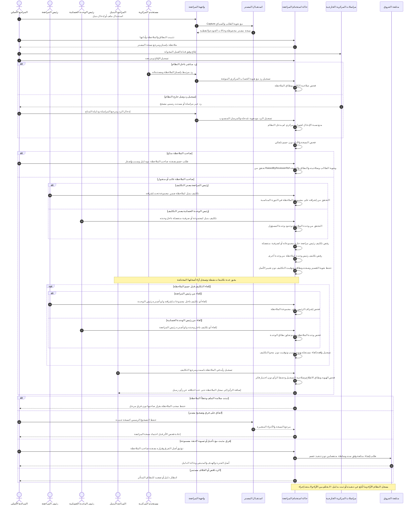
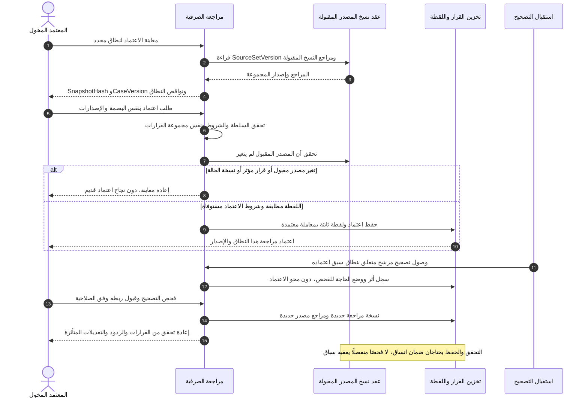
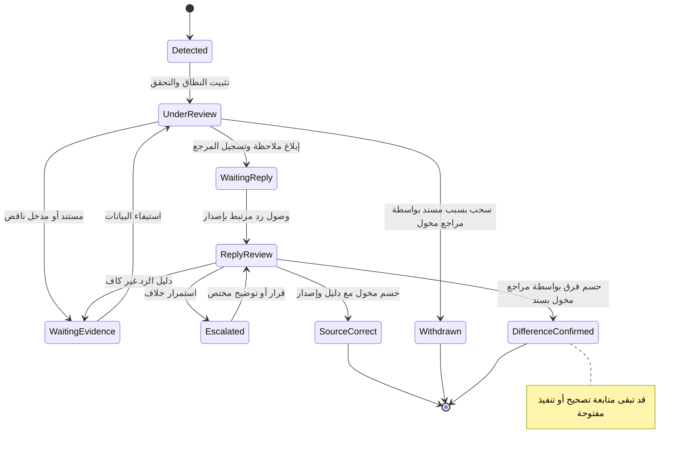
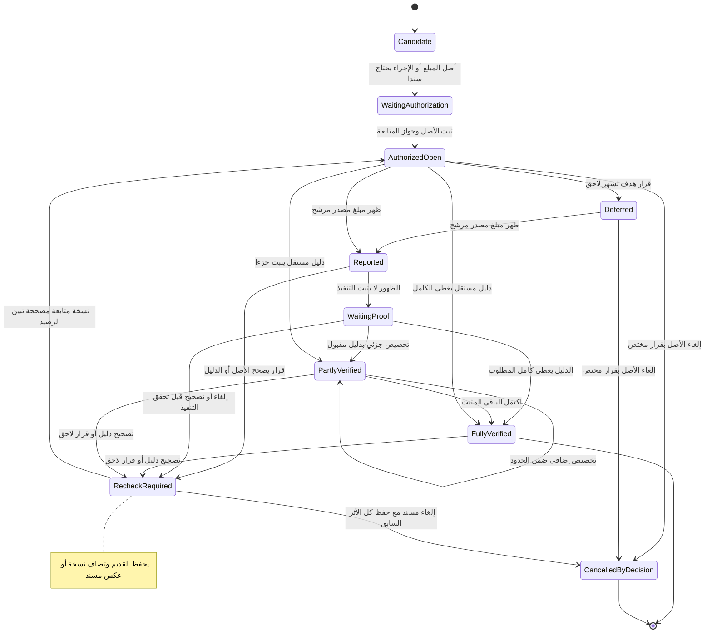

# مخططات UML لدورة مراجعة المرتبات

**الحالة: نموذج تصميم مقترح v0.3 — تعديلات D-030 إلى D-046 وتبسيط التسجيل، لا كود منفذ.** يكمّل [الخطة](COMPREHENSIVE-WORK-PLAN-AR.md) و[ERD](DATABASE-DIAGRAM-AR.md). الأسماء والعلاقات التالية تحتاج مراجعة وحدود معاملات وعقود قبل التنفيذ.

هذه رسوم Class وSequence وState. أسهم التعاون في Sequence تصف حالة استخدام مقترحة، ولا تعني اتصالًا فعليًا بـOracle أو تنفيذ دفع. القيم الاصطناعية الواردة في الشرح ليست أحكامًا مالية.

## UML-1 — الكيانات والعمليات والعقود

`AuditCase` يضبط نطاق الاعتماد ونسخه؛ `Finding` يضبط الملاحظة ونسخها والردود عليها؛ `FollowUpItem` يتابع أثرًا اتفق على متابعته. الفصل يمنع تحول حسم ملاحظة إلى إثبات تنفيذ. أسماء حدود Aggregates مرشحة وتخضع لاختبار الاتساق.

```mermaid
classDiagram
  direction TB
  class AuditCase {
    +CaseId
    +ScopeKind
    +CaseVersion
    +OpenRevision()
    +ApproveRevision(snapshotHash, expectedVersion)
    +RequestRevalidation(reason)
  }
  class ReviewRevision {
    +RevisionId
    +SourceSetVersion
    +CalculationSetRef
    +DecisionSetRef
    +CoverageSetRef
    +ApprovalCoverageMode
    +KnownAt
    +SnapshotHash
  }
  class Finding {
    +FindingId
    +CaseId
    +RaisedByReviewerRef
    +FindingVersion
    +RecordReply(command, expectedVersion)
    +RecordReviewerConclusion(command, expectedVersion)
  }
  class FindingRevision {
    +FindingRevisionId
    +ReviewRevisionId
    +ComponentRef
    +EntitlementPeriod
    +ProposedDifference
  }
  class FindingResolutionDelegation {
    +ResolutionDelegationId
    +FindingId
    +OriginalFindingVersion
    +AssignedByRef
    +AssignedByRoleRef
    +AuthorizationScopeKind
    +AuthorizationScopeRef
    +AuthorizationScopeVersion
    +AssignedReviewerRef
    +ReasonKind
    +AssignedAt
  }
  class FindingResolutionDelegationRevocation {
    +RevocationId
    +ResolutionDelegationId
    +RevokedByRef
    +RevokedByRoleRef
    +RevocationScopeRef
    +RevocationScopeVersion
    +RevokedAt
    +Reason
  }
  class ReviewMessage {
    +MessageId
    +RespondsToFindingRevisionId
    +PartyKind
    +MessageKind
    +OriginChannel
    +AuthenticatedAuthorRef_optional
    +ClaimedExternalSenderRef_optional
    +ExternalCorrespondenceRef_optional
    +RecordedByRef
    +OccurredAt_optional
    +RecordedAt
    +EvidenceRef_optional
  }
  class ResolutionDecision {
    +DecisionId
    +FindingRevisionId
    +DecidedByReviewerRef
    +DecidedAt
    +ResolutionDelegationId_optional
    +SupportingMessageId_optional
    +DecisionKind
    +Reason
    +EvidenceRef
    +SupersedesDecisionId
  }
  class ReviewApproval {
    +ApprovalId
    +ReviewRevisionId
    +SnapshotHash
    +ApprovedBy
    +ApprovedAt
  }
  class FollowUpItem {
    +FollowUpId
    +ResolutionDecisionId
    +ConfirmedAmount
    +OriginPeriod
    +RecordCarryForward()
    +AllocateEvidence(command, expectedVersion)
    +RequestRecheck(reason)
  }
  class ISourceIntake {
    <<interface>>
    +Capture(input, context) CapturedSource
  }
  class IReviewAuthorization {
    <<interface>>
    +CanPerform(actor, scope, action) PermissionResult
  }
  class IExpectedCalculator {
    <<interface>>
    +Propose(approvedSnapshot) CalculationResult
  }
  class IExecutionEvidenceVerifier {
    <<interface>>
    +Verify(evidence, policy) VerificationResult
  }
  class ReviewUseCase {
    +RecordReply(command)
    +AssignFindingResolutionDelegate(command)
    +RevokeFindingResolutionDelegation(command)
    +RecordReviewerConclusion(command)
    +ApproveReview(command)
  }
  class PdfSourceAdapter
  class ExcelSourceAdapter
  class DirectFormAdapter
  class Money {
    <<ValueObject>>
    +DecimalAmount
    +Currency
  }
  class EmployeeProfileReadModel {
    <<ReadModel>>
    +PersonRef
    +EmploymentRelationshipRefs
    +PayeeRelationshipRefs
    +RelationKindLabels
    +DistinctPersonSearchRow
    +RelationshipCards
    +SelectedRelationshipDetailPanel
    +SelectedEmploymentRelationshipRef_optional
    +SelectedPayeeRelationshipRef_optional
    +HasEmploymentRelationship
    +AsOfDate
    +AdministrativeHistory
    +DepartmentHistory
    +GradeAndPromotionHistory
    +FinancialComponentHistory
    +OrdersAndJudicialEffects
    +RelatedDisbursements
  }
  class IEmployeeProfileQuery {
    <<interface>>
    +SearchPersonsAndPayees(filters)
    +GetEmployeeProfile(personRef, asOfDate)
    +GetPersonRelationshipDetail(personRef, relationRef, asOfDate)
    +SearchPersonnelHistory(filters, period)
  }
  class PersonnelRecordUseCase {
    +RecordIndividualDecision(command)
    +RecordDecisionForSelectedEmployees(command, confirmedTargets)
    +RecordGradeOrDepartmentChange(command)
    +RecordPersonnelReportedAbsence(command)
    +RecordPersonnelReportedAbsencesFromDocument(command, confirmedOccurrences)
  }
  class GovernmentAccountNode {
    +GovernmentAccountNodeId
    +OfficialCode
    +OfficialName
    +ParentNodeId_optional
    +ValidFrom_optional
    +ValidTo_optional
  }
  class FinancialComponent {
    +FinancialComponentId
    +ComponentCode
    +ComponentName
    +ComponentKind
  }
  class DeductionFund {
    +FundId
    +CanonicalName
    +OfficialFundRef_optional
    +ValidFrom_optional
    +ValidTo_optional
  }
  class SourceLabelMappingRule {
    +RuleId
    +SourceLabelPattern
    +SourceCode_optional
    +FinancialSide
    +FinancialComponentId
    +FundId_optional
    +ValidFrom
    +ValidTo
    +MappingVersion
    +ApprovalStatus
  }
  class FinancialComponentAccountMapping {
    +MappingId
    +FinancialComponentId
    +GovernmentAccountNodeId
    +ValidFrom_optional
    +ValidTo_optional
    +EvidenceRef_optional
    +ApprovalStatus
  }
  AuditCase "1" *-- "1..*" ReviewRevision : versions
  AuditCase "1" --> "0..*" Finding : references
  Finding "1" *-- "1..*" FindingRevision : versions
  Finding "1" --> "0..*" FindingResolutionDelegation : simultaneousAssignmentsAllowed
  FindingResolutionDelegation "1" --> "0..1" FindingResolutionDelegationRevocation : appendOnlyCancellation
  FindingRevision "1" --> "0..*" ReviewMessage : addressedReplies
  FindingRevision "1" --> "0..*" ResolutionDecision : recordedHumanConclusions
  ResolutionDecision "0..*" --> "0..1" FindingResolutionDelegation : delegatedAuthority
  ReviewRevision "0..*" --> "0..*" ResolutionDecision : frozenDecisionRefs
  ReviewRevision "1" --> "0..*" ReviewApproval : approvals
  ResolutionDecision "1" --> "0..*" FollowUpItem : authorizedFollowUp
  FollowUpItem --> Money : amount
  EmployeeProfileReadModel ..> IEmployeeProfileQuery : projectionContract
  PersonnelRecordUseCase ..> IEmployeeProfileQuery : selectedTargetLookup
  GovernmentAccountNode "0..1" --> "0..*" GovernmentAccountNode : hierarchy
  FinancialComponent "1" --> "0..*" FinancialComponentAccountMapping : accountLinks
  GovernmentAccountNode "1" --> "0..*" FinancialComponentAccountMapping : receivingAccount
  FinancialComponent "1" --> "0..*" SourceLabelMappingRule : canonicalTargets
  DeductionFund "0..1" --> "0..*" SourceLabelMappingRule : fundDimension
  ReviewUseCase ..> IReviewAuthorization
  ReviewUseCase ..> IExpectedCalculator
  ReviewUseCase ..> IExecutionEvidenceVerifier
  ReviewUseCase ..> AuditCase
  ReviewUseCase ..> Finding
  PdfSourceAdapter ..|> ISourceIntake
  ExcelSourceAdapter ..|> ISourceIntake
  DirectFormAdapter ..|> ISourceIntake
```

**D-046 — تمييز الصناديق عن البنود والحسابات:** `SourceLabelMappingRule` سجل مرادفات/قواعد مطابقة مقترح مؤرخ بأصل اسم Oracle وسياقه وجانبه ونسخته والجهة المخولة؛ يربط الاسم بأحد `FinancialComponent` وبـ`DeductionFund` عند وجود صندوق. يظل `SourceFinancialOccurrence` والقرار `ComponentMappingDecision` أصلَي ظهور وربط منفصلين في ERD-B؛ لا يُخزن اسم Oracle الخام على أنه اسم رسمي دائم في الشجرة. يعرض التقرير جميع الاستقطاعات في الحساب المشترك مع **تفصيل مبلغ كل `FundId`**، وأي سطر لا يُحسم يبقى منفصلًا. `DeductionFund` و`SourceLabelMappingRule` **مفهومان مرشحان للنمذجة** لا كلاس أو جدول موجود، وتركيب البند الداخلي الواحد مقابل بنود فرعية بحسب سياسة كل صندوق لا يزال يحتاج قرارًا. يحتفظ التطبيق بتاريخ اعتماد المرادف ولا يعيد تصنيف الأشهر الماضية بصمت.

**D-045 — شكل الواجهة المدمجة:** رأس الملف يعرّف الشخص دون تغيير أثناء الاختيار؛ `RelationshipCards` تشير لعلاقات العمل/الاستحقاق الموجودة فعلًا، و`SelectedRelationshipDetailPanel` **إسقاط عرض** لتفاصيل العلاقة المختارة داخل نفس الصفحة مع تبويبات متناسبة مع نوعها. تبويب الدرجات والترقيات يخص ‏`EmploymentRelationship`، وتبويب البنود والصرفيات يخص ‏`PayeeRelationship` المناسب. اختيار بطاقة أخرى لا يدمج بياناتها في السابقة؛ ويُشترط عند التعديل مرجع العلاقة المستهدفة والصلاحية والسند. كلا الاسمين حقلا ReadModel مقترحان لا كيانين أو جدولين جديدين، ولا تُحوّل كل صرفية إلى بطاقة علاقة مستقلة.

**D-044 — قائمة أشخاص واحدة وعلاقات منفصلة داخل الملف:** نتائج `SearchPersonsAndPayees` تُجمع لأغراض **العرض فقط حسب `PersonId` مثبت** فتظهر نتيجة واحدة للشخص حتى لو له أكثر من علاقة عمل أو صرف؛ `GetPersonRelationshipDetail` مقترح لاستعراض علاقة بعينها مع تواريخها ووقائعها ولا يسمح بخلط القيم عند تغيير العلاقة. `DistinctPersonSearchRow` وحقلا `Selected*RelationshipRef` إشارات واجهة/ReadModel فقط، وليست أعمدة أو مفاتيح تخزين. تشابه الاسم بين شخصين لا يبرر الدمج، وتبقى صلاحيات العرض محددة لكل علاقة. تصحيح الموظف أو تسجيل واقعة مالية يستلزم اختيار العلاقة المستهدفة الصحيحة وفق D-040.

**D-043 — دليل الموظفين الشامل:** `SearchPersonsAndPayees` استعلام مفاهيمي مقترح لشاشة «الموظفون» التي تضم من له علاقة عمل ومن لا يملك إلا علاقة استحقاق، وتعيد **نوع علاقة العمل/الصرف** لا مجرد الاسم؛ يحتفظ `EmployeeProfileReadModel` بمراجع ‏`Person` و‏`EmploymentRelationship` و‏`PayeeRelationship` منفصلة. `HasEmploymentRelationship` يساعد العرض فقط: أقسام وترقيات ودرجات من علاقة عمل موجودة؛ لغير الموظف تُعرض «لا ينطبق» بدل توليد درجة أو تاريخ وظيفة. **D-044 حسم عرض صف واحد لكل شخص في نتائج البحث**؛ تُستعرض كل العلاقات منفصلة داخل صفحته ولا يُختزل بعضها في بعض. لا صلاحية إضافية على بيانات حساسة لمجرد وجودها في نتائج البحث.

**D-042 — شكلَا الورود:** تدعم شاشة «وقائع شؤون العاملين» المكاتبة الفردية والكشف المجمع. `RecordPersonnelReportedAbsencesFromDocument` **حالة استخدام منطقية مقترحة** لتسجيل عدة وقائع محددة ومُراجعة من **مستند واحد** ‏`sourceDocumentRef`، مع مراجع علاقات عمل مستقلة لكل واقعة وفترة ونوع؛ تتيح `RecordPersonnelReportedAbsence` المسار الفردي. لا يُنشأ قرار أو حكم مالي لكل سطر، ولا تُنسخ صورة المستند الأصلية عدة مرات، ولا يُفترض تفعيل استخراج آلي من ملف. قائمة `confirmedOccurrences` لا تربط سطرًا مجهول الهوية لموظف بالتخمين، ولا يُسمح لحضور/غياب يومي بالظهور من تلقاء نفسه.

**D-041 — استلام واقعة غياب من شؤون العاملين فقط:** عملية `RecordPersonnelReportedAbsence` مقترح منطقي لتسجيل واقعة غياب **وردت من شؤون العاملين** مع الموظف والفترة والنوع والمرجع وسند المصدر. يبحث المستخدم فيها من ملف الموظف أو من شاشة الاستعلامات العامة؛ **لا** يمتلك هذا المسار خدمة حضور وانصراف يومي أو حساب جزاءات أو خصم آلي، ولا يفترض أن يومًا بلا واقعة هو حضور أو غياب. لا تفرض عقود UML نوع الملف أو آلية الإدخال قبل معرفة مستندات شؤون العاملين.

**D-040 — واجهة تسجيل واحدة لمسارين:** `PersonnelRecordUseCase` مثال عقد منطقي مقترح، يعبّر عن تسجيل فردي من صفحة الموظف أو تسجيل قرار على مستهدفين محددين من شاشة القرارات والترقيات/التنقلات. `confirmedTargets` هي قائمة علاقات العمل التي عاينها المستخدم وثبّتها وقت التسجيل، لا فلتر يعاد تقييمه لاحقًا؛ يظهر **نفس مرجع الواقعة/القرار** في ملفات المشمولين دون نسخ أصل القرار في كل واجهة. `SearchPersonnelHistory` يعبر عن استعلام عام بفلاتر فترة وجهة/قسم وحالة واقعة مسجلة مثل الغياب دون إذن، بشرط وجود مصدر معتمد للواقعة؛ لا تُشتق منه مخالفة أو جزاء أو خصم. يجب مراجعة طريقة تمثيل مستهدفي القرار وتعارضات التواريخ والصلاحيات مع `Personnel` قبل أي DDL أو API. الرموز المقترحة ليست عقود تنفيذ معتمدة.

**D-039 — صفحة الموظف التاريخية:** `EmployeeProfileReadModel` و`IEmployeeProfileQuery` عقود **قراءة/عرض مقترحة**: البحث في دليل الموظفين ثم فتح ملف منفصل يضم فترات الأقسام والنقل والترقيات والدرجات والأوامر والقيم المالية عبر السنين والأحكام المرتبطة بتغيير بند، مع مصدر وتاريخ سريان/تسجيل وأثر. لا يحوّلان بيانات الموظف التاريخية إلى جدول شامل مكرر؛ علاقات الأحكام والأقسام تحتاج قرار نمذجة مستقل قبل SQL، ولا تُختزل أحكام القضاء تلقائيًا في أوامر إدارية.

**D-038 — مخطط العلاقات المقترح للشاشة:** `FinancialComponent` يمثل دليل البنود الموجود أصلًا في التصميم، و`GovernmentAccountNode` يمثل موضع الحساب داخل الشجرة الحكومية، والربط `FinancialComponentAccountMapping` ليس اعتمادًا بأن كل بند له حساب واحد دائمًا. يحتفظ `SourceLine` أو مرجع Oracle المناظر بكوده الخام مستقلًا؛ التفاصيل والعلاقة مع البنود في مستند المصدر لا تُختزل في كود حكومي واحد. أسماء العقد والربط مقترحات لتجنب تكرار الكيانات القائمة، وتحتاج فحص التصميم الأصلي.

التكوين `*--` يعني ملكية نسخة داخل الكيان، والسهم `-->` مرجع لا تصريح كتابة في سياق آخر، والسهم المنقط تبعية أو تحقيق عقد. لا تعني أي علاقة تحميل كل السجل في الذاكرة. يجوز أن تتضمن عدة لقطات قرار حسم ثابتًا من الحالة نفسها إذا أعيد التحقق من صلاحيته وسجل مرجع ذلك الفحص؛ يختلف ذلك عن نقل القرار من لقطة قديمة أو إعادة استعماله بصمت. تحوي CoverageSetRef البنود والمقاطع المعتمدة وغير المعتمدة وأسبابها ضمن البصمة؛ الاعتماد الجزئي يحتاج سياسة مخولة ولا يسمى اعتمادًا شاملًا. `Money` يحفظ القيمة والعملة؛ سياسة التقريب مؤرخة في عقد الحساب، ولا تُختزل في تقريب عام لكل المبالغ.

## UML-2 — الاستلام والملاحظة والرد والحسم

**ضبط D-030:** يُميز `OriginChannel=IN_APP` عن `EXTERNAL_RECORDED`. في الرد الداخلي تُحفظ هوية الحساب الذي كتب الرد بالفعل، وفي الرد الخارجي تُحفظ هوية مستخدم الوحدة الذي نقله وبيانات مرسله المنسوبة دون انتحال حسابه. لا تفرض هذه المسودة إتاحة كل ملاحظة لجميع مستخدمي المركزية؛ صلاحية الاطلاع والرد وشروط إثبات المراسلة مسائل مفتوحة. لا يغيّر هذا القرار حالات UML-4 أو UML-5: الحسم والتنفيذ لا يحدثان عند تسجيل رد.

**ضبط D-031/D-032:** الأصل أن يحسم صاحب الملاحظة برد مسند؛ عند الغياب أو النقل يختار المسؤول المخوّل مراجعًا بديلًا لملاحظة محددة، فيحسم البديل باسمه مستخدمًا تكليفًا صالحًا مع حفظ اسم صاحب الملاحظة. يفحص التطبيق `RaisedByReviewerRef` أو `FindingResolutionDelegation`، وهوية الحاسم، وسلطة مصدر التكليف، والنسخة والنطاق والدليل. التكليف لا يغير `RaisedByReviewerRef` ولا يمنح `ReviewApproval`. **D-033/D-034:** مُصدر التكليف هو رئيس المراجعة **في مجموعات إشرافه فقط** أو رئيس الوحدة الحسابية **في مجموعات المراجعة والصرفيات داخل وحدته**. يسجل التكليف الصفة و`AuthorizationScopeKind` و`AuthorizationScopeRef` و`AuthorizationScopeVersion` للتحقق من العلاقة المعتمدة عند الإصدار والاستعمال؛ لا يُسمح للرئيس الأول بتكليف صرفية منفصلة خارج نطاق المجموعات ولا للرئيس الثاني بتكليف وحدة أخرى. **D-035:** يملك رئيس المراجعة إلغاء أي تكليف داخل مجموعات إشرافه ويملك رئيس الوحدة إلغاء أي تكليف داخل وحدته، بصرف النظر عن مُصدِر التكليف الأصلي. يُنشأ `FindingResolutionDelegationRevocation` كواقعة جديدة غير ماسحة لملف التكليف، ويمنع استخدامها للحسم بعد الإلغاء؛ لا يبطل ذلك حسمًا صحيحًا صدر قبل الإلغاء. **D-036/D-037:** يجوز وجود عدة تكليفات نشطة وتسجَّل الآراء المختلفة باسم أصحابها دون منع الثاني أو تحكيم آلي. يُستخدم `ReviewMessage.MessageKind` لتمييز الرد عن رأي المراجع، و`ResolutionDecision` لتوثيق خلاصة بشرية إن صدرت؛ التنفيذ المبلغ عنه والمثبت بدليل يُوثقان في سجل المتابعة القائم، لا في حالة «فاز رأي فلان». لا حاجة إلى UML-6 أو شاشة نزاعات.

## UML-3 — اعتماد نسخة وتصحيح لاحق

إجراء المعاملة واتساق عقد المصدر والاعتماد لم يُحسم تقنيًا. قبل التنفيذ يلزم تصميم يضمن أن قبول مصدر جديد أو قرار مؤثر لا ينجح بين فحص النسخة وحفظ الاعتماد دون اكتشافه؛ يمكن أن يحتاج إجراء Application ومعاملة مشتركة معتمدة داخل التطبيق أو بروتوكول حجز/تحقق مكافئ. لا يفسر الرسم استدعاء `Check` ثم `Save` مستقلين بوصفه ضمانًا ذريًا.

## UML-4 — حالة حسم الملاحظة

تجتاز عمليات تسجيل الخلاصة البشرية فحص هوية صاحب الملاحظة `RaisedByReviewerRef` أو مرجع تكليف البديل وسلطة مُصدره عند الغياب/النقل، مع نطاق الصلاحية ونسخة الملاحظة؛ وتُحفظ الآراء المختلفة قبل أي خلاصة دون اختيار برمجي؛ لا يحتاج **حسم الملاحظة ذاته** إلى توقيع رئيس إضافي وفق D-031/D-032. النتائج تخص الحسم الموضوعي للملاحظة، وليست تصريح إغلاق كل مراجعة الصرفية. إذا وصل دليل يغير حسمًا قديمًا، تحفظ نسخة القرار السابقة وتفتح نسخة فحص جديدة مرتبطة بها؛ لا تُمسح النهاية التاريخية.

## UML-5 — حالة متابعة الفرق مستقلة

عند إثبات أصل مطلوب 200، وظهور 100 بلا دليل تنفيذ مقبول، لا يصبح المتبقي المثبت 100 تلقائيًا. يعرض البرنامج ما ظهر وما ثبت تنفيذه كلًا على حدة. الإلغاء أو عكس تخصيص بعد تحقق جزئي يحتاج معالجة نسخ وأثر المبالغ السابقة، ولا يستخدم لطمس ما ثبت وقوعه.
