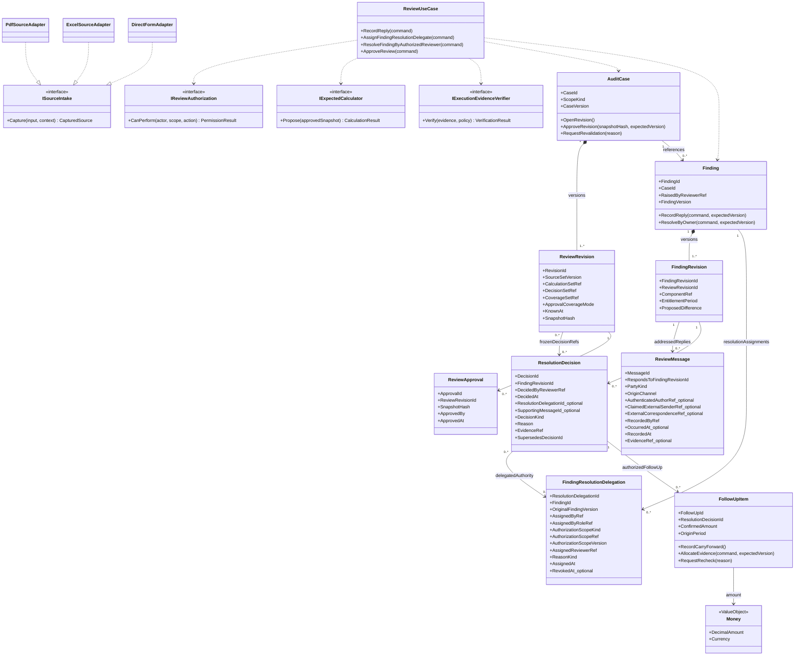
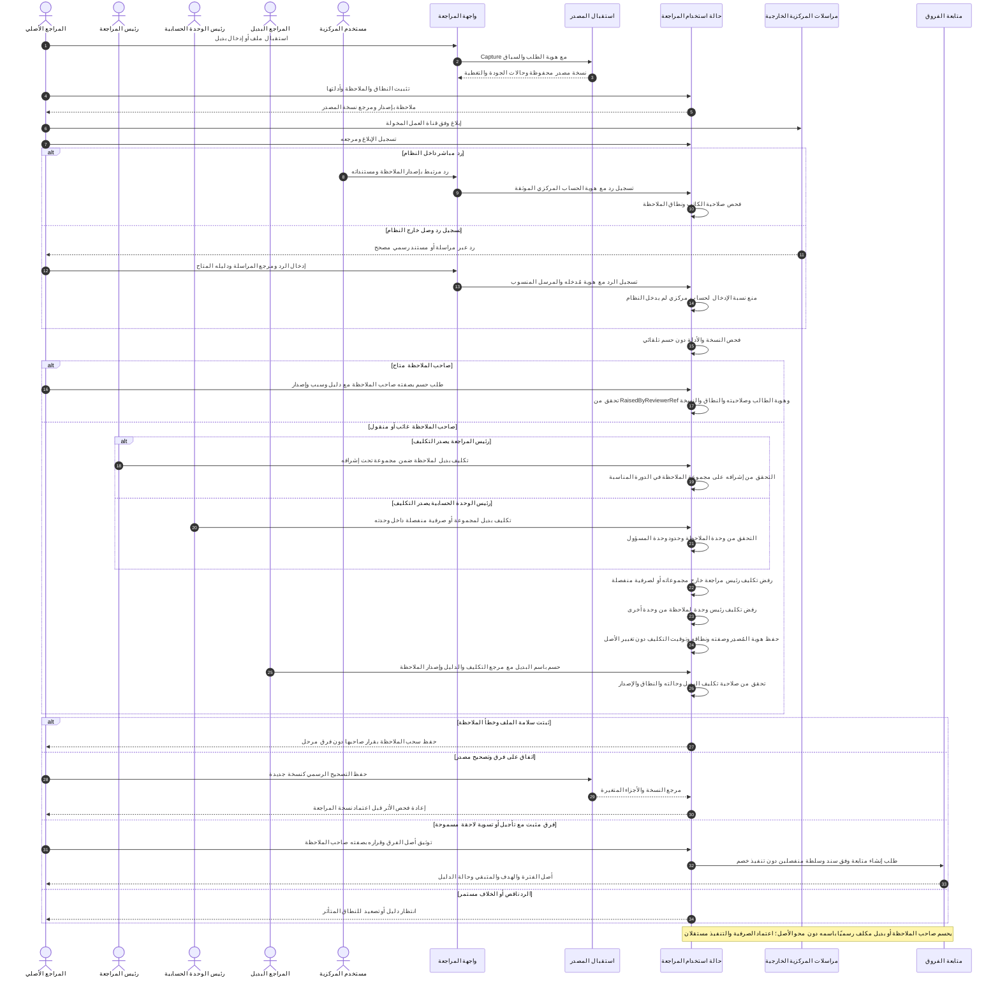
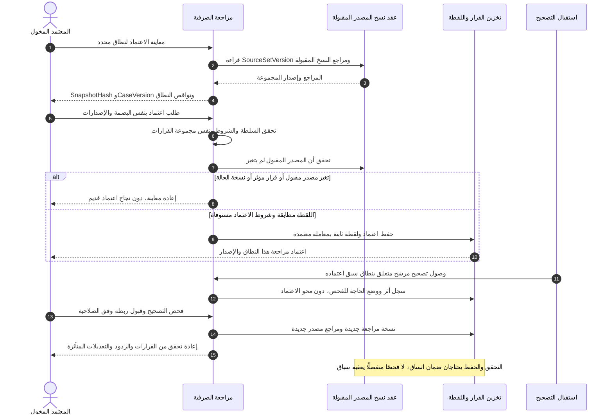
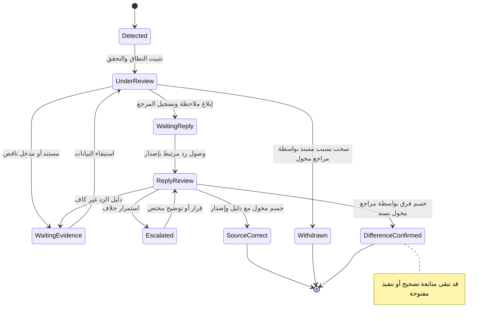
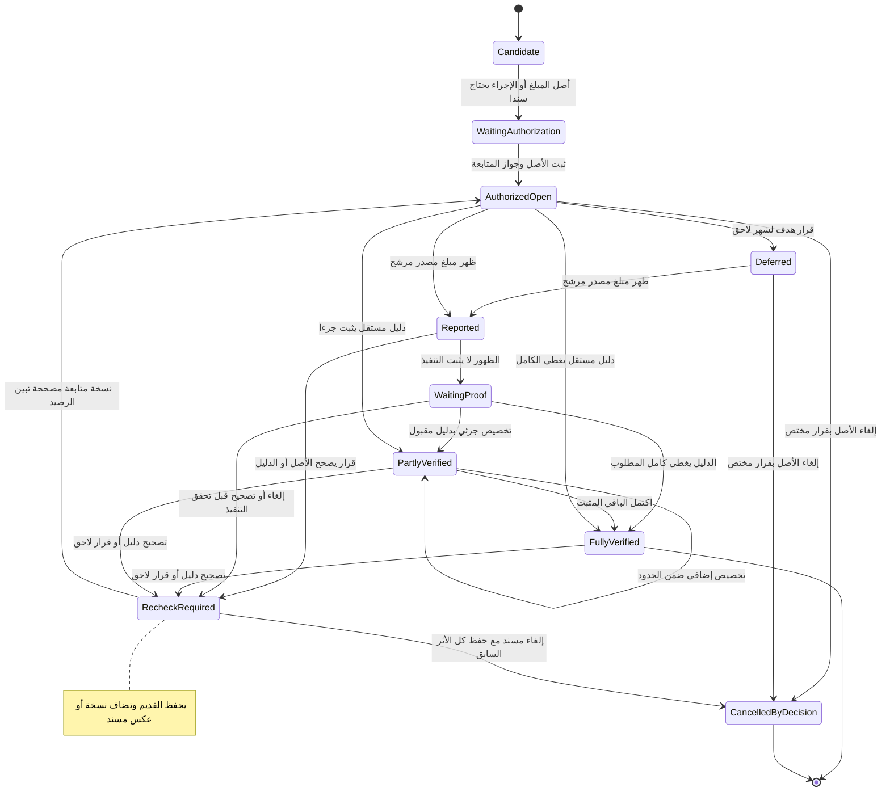

# مخططات UML لدورة مراجعة المرتبات

**الحالة: نموذج تصميم مقترح v0.3 — تعديلات D-030 إلى D-034 قيد المراجعة، لا كود منفذ.** يكمّل [الخطة](COMPREHENSIVE-WORK-PLAN-AR.md) و[ERD](DATABASE-DIAGRAM-AR.md). الأسماء والعلاقات التالية تحتاج مراجعة وحدود معاملات وعقود قبل التنفيذ.

هذه رسوم Class وSequence وState. أسهم التعاون في Sequence تصف حالة استخدام مقترحة، ولا تعني اتصالًا فعليًا بـOracle أو تنفيذ دفع. القيم الاصطناعية الواردة في الشرح ليست أحكامًا مالية.

## UML-1 — الكيانات والعمليات والعقود

`AuditCase` يضبط نطاق الاعتماد ونسخه؛ `Finding` يضبط الملاحظة ونسخها والردود عليها؛ `FollowUpItem` يتابع أثرًا اتفق على متابعته. الفصل يمنع تحول حسم ملاحظة إلى إثبات تنفيذ. أسماء حدود Aggregates مرشحة وتخضع لاختبار الاتساق.

التكوين `*--` يعني ملكية نسخة داخل الكيان، والسهم `-->` مرجع لا تصريح كتابة في سياق آخر، والسهم المنقط تبعية أو تحقيق عقد. لا تعني أي علاقة تحميل كل السجل في الذاكرة. يجوز أن تتضمن عدة لقطات قرار حسم ثابتًا من الحالة نفسها إذا أعيد التحقق من صلاحيته وسجل مرجع ذلك الفحص؛ يختلف ذلك عن نقل القرار من لقطة قديمة أو إعادة استعماله بصمت. تحوي CoverageSetRef البنود والمقاطع المعتمدة وغير المعتمدة وأسبابها ضمن البصمة؛ الاعتماد الجزئي يحتاج سياسة مخولة ولا يسمى اعتمادًا شاملًا. `Money` يحفظ القيمة والعملة؛ سياسة التقريب مؤرخة في عقد الحساب، ولا تُختزل في تقريب عام لكل المبالغ.

## UML-2 — الاستلام والملاحظة والرد والحسم

**ضبط D-030:** يُميز `OriginChannel=IN_APP` عن `EXTERNAL_RECORDED`. في الرد الداخلي تُحفظ هوية الحساب الذي كتب الرد بالفعل، وفي الرد الخارجي تُحفظ هوية مستخدم الوحدة الذي نقله وبيانات مرسله المنسوبة دون انتحال حسابه. لا تفرض هذه المسودة إتاحة كل ملاحظة لجميع مستخدمي المركزية؛ صلاحية الاطلاع والرد وشروط إثبات المراسلة مسائل مفتوحة. لا يغيّر هذا القرار حالات UML-4 أو UML-5: الحسم والتنفيذ لا يحدثان عند تسجيل رد.

**ضبط D-031/D-032:** الأصل أن يحسم صاحب الملاحظة برد مسند؛ عند الغياب أو النقل يختار المسؤول المخوّل مراجعًا بديلًا لملاحظة محددة، فيحسم البديل باسمه مستخدمًا تكليفًا صالحًا مع حفظ اسم صاحب الملاحظة. يفحص التطبيق `RaisedByReviewerRef` أو `FindingResolutionDelegation`، وهوية الحاسم، وسلطة مصدر التكليف، والنسخة والنطاق والدليل. التكليف لا يغير `RaisedByReviewerRef` ولا يمنح `ReviewApproval`. **D-033/D-034:** مُصدر التكليف هو رئيس المراجعة **في مجموعات إشرافه فقط** أو رئيس الوحدة الحسابية **في مجموعات المراجعة والصرفيات داخل وحدته**. يسجل التكليف الصفة و`AuthorizationScopeKind` و`AuthorizationScopeRef` و`AuthorizationScopeVersion` للتحقق من العلاقة المعتمدة عند الإصدار والاستعمال؛ لا يُسمح للرئيس الأول بتكليف صرفية منفصلة خارج نطاق المجموعات ولا للرئيس الثاني بتكليف وحدة أخرى. حدود إلغاء التكليف وإعادة إصداره ما زالت مفتوحة.

## UML-3 — اعتماد نسخة وتصحيح لاحق

إجراء المعاملة واتساق عقد المصدر والاعتماد لم يُحسم تقنيًا. قبل التنفيذ يلزم تصميم يضمن أن قبول مصدر جديد أو قرار مؤثر لا ينجح بين فحص النسخة وحفظ الاعتماد دون اكتشافه؛ يمكن أن يحتاج إجراء Application ومعاملة مشتركة معتمدة داخل التطبيق أو بروتوكول حجز/تحقق مكافئ. لا يفسر الرسم استدعاء `Check` ثم `Save` مستقلين بوصفه ضمانًا ذريًا.

## UML-4 — حالة حسم الملاحظة

تجتاز انتقالات الحسم فحص هوية صاحب الملاحظة `RaisedByReviewerRef` أو مرجع تكليف البديل وسلطة مُصدره عند الغياب/النقل، مع نطاق الصلاحية ونسخة الملاحظة؛ لا يحتاج **حسم الملاحظة ذاته** إلى توقيع رئيس إضافي وفق D-031/D-032. النتائج تخص الحسم الموضوعي للملاحظة، وليست تصريح إغلاق كل مراجعة الصرفية. إذا وصل دليل يغير حسمًا قديمًا، تحفظ نسخة القرار السابقة وتفتح نسخة فحص جديدة مرتبطة بها؛ لا تُمسح النهاية التاريخية.

## UML-5 — حالة متابعة الفرق مستقلة

عند إثبات أصل مطلوب 200، وظهور 100 بلا دليل تنفيذ مقبول، لا يصبح المتبقي المثبت 100 تلقائيًا. يعرض البرنامج ما ظهر وما ثبت تنفيذه كلًا على حدة. الإلغاء أو عكس تخصيص بعد تحقق جزئي يحتاج معالجة نسخ وأثر المبالغ السابقة، ولا يستخدم لطمس ما ثبت وقوعه.
