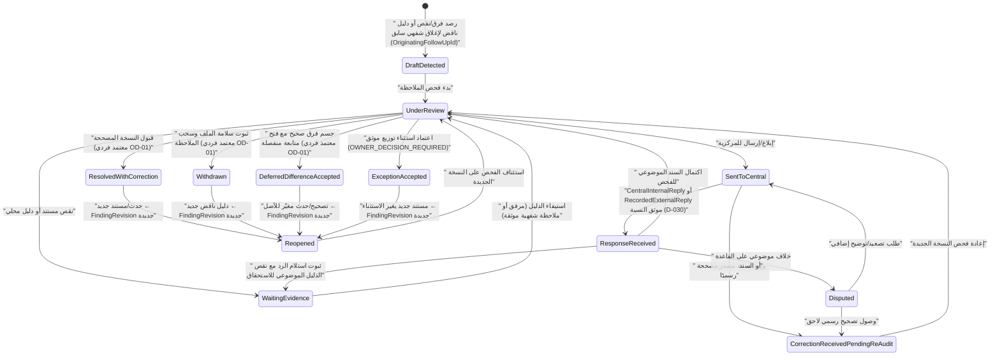
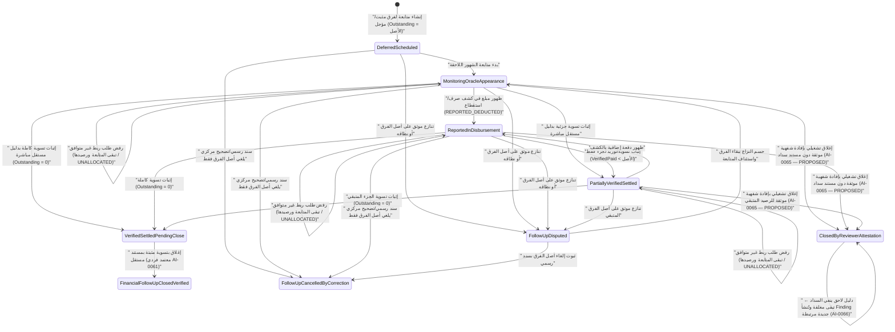
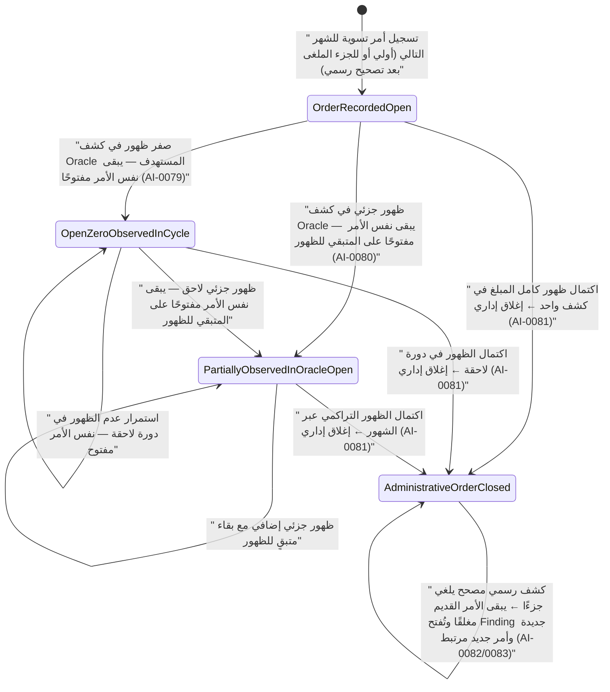

# مواصفة دورة الملاحظة والرد والحسم ومتابعة الفروق المالية (`D-029 / P-017 / D-030 / D-031..D-035`)

> **المرجع والتكليف:** [`Issue #59 — SPEC-029-001`](https://github.com/AlexandriaDeveloper/PayrollReviewSystem/issues/59) (مدمج عبر `PR #60` عند `fb0e511e7ba16559e3b0adbf205dfae47a3bf25d`)، ومحدّث عبر [`Issue #61 — SPEC-029-002`](https://github.com/AlexandriaDeveloper/PayrollReviewSystem/issues/61) (مدمج عبر [`PR #62`](https://github.com/AlexandriaDeveloper/PayrollReviewSystem/pull/62) عند `df57f10b2431b60d4c24f4975d8468c42440fbd5`)، ومحدّث عبر [`Issue #63 — SPEC-029-003`](https://github.com/AlexandriaDeveloper/PayrollReviewSystem/issues/63) (مدمج عبر [`PR #64`](https://github.com/AlexandriaDeveloper/PayrollReviewSystem/pull/64) عند `b415bb802645b80429c16bdeb35635ab4489bf77`)، ومحدّث بموجب [`Issue #65 — SPEC-029-004`](https://github.com/AlexandriaDeveloper/PayrollReviewSystem/issues/65) وقرارات المالك [`AI-0091..AI-0095`](https://github.com/AlexandriaDeveloper/PayrollReviewSystem/issues/41) (`D-035` — مرونة المراجعين وتسجيل العمليات باسم منفذها مع نسخ قيد الموافقة الإلزامية من `AI-0092` بموجب `AI-0093`)، استنادًا إلى [قاعدة العمل الموحدة](../WORKING-BASELINE-AR.md)، [سجل القرارات](../governance/DECISION-REGISTER.md)، و[مذكرة قرارات المراجعة](../domain/AUDIT-FINDINGS-AND-DECISIONS.md).  
> **الحالة:** `UPDATED_SPECIFICATION / SPEC_DOCS_ONLY / BUSINESS_DECISIONS_PARTLY_CONFIRMED_PARTLY_OPEN / NO_CODE / NO_DDL / NO_SQL / NO_MERGE`  
> **المرجع المستودعي (`main`):** `b415bb802645b80429c16bdeb35635ab4489bf77`

---

## 1. نطاق الشريحة الأولى وحدودها

### 1.1 ما تغطيه المواصفة
تحدد هذه المواصفة السلوك التشغيلي والتصوري لأول شريحة عمل في الوحدة الحسابية المركزية للمجمع الطبي (`30200105`):
1. فتح الملاحظة المالية (`Finding`) ضمن `AuditCase` مرتبط بـ: مستفيد/علاقة صرف (`PayeeRelationshipId` / `EmploymentRelationshipId`)، ودورة استحقاق (`PayrollCycle` / `SalaryEntitlementMonth`)، وصرفية محددة (`PayrollDisbursement` — رئيسية ضمن `MonthlyMainSalarySlot` + `MainSalaryRevision` أو منفصلة `SEPARATE`)، ونسخة مصدر محددة (`SourceVersion`).
2. إرسال الملاحظة أو إبلاغ الاستحقاقات المركزية بها ومتابعة حالتها، مع دعم استمرار **اعتماد البنود السليمة وملف مراجعة الموظف (`AuditCase`)** رغم وجود ملاحظة مفتوحة (`OD-02` — `AI-0062/0063`) بشرط بقاء الملاحظة مفتوحة وظهور تنبيه مستمر مرتبط بمعرّف الملاحظة الأصلية (`FindingId`) في الأشهر أو الصرفيات التالية حتى حسمها، ودون تكرار الفروق المالية ودون اعتبار اعتماد المراجعة إذنًا بالصرف البنكي.
3. دعم **قناتَي رد المركزية المؤكدتين بقرار المالك `D-030`** في [`Issue #39`](https://github.com/AlexandriaDeveloper/PayrollReviewSystem/issues/39) كإمكانية متاحة عند ورود رد مركزي (مع مراعاة قرار [`AI-0091`](https://github.com/AlexandriaDeveloper/PayrollReviewSystem/issues/41#issuecomment-6858512530) الذي يزيل افتراض إلزامية سير عمل رد مركزي لكل مراجعة ويكتفي بتقدير المراجع دون حذف تاريخ `D-030`):
   - **رد مركزي داخلي (`CentralInternalReply`):** يقدمه حساب مركزي مُصرَّح له داخل النظام بعد اعتماد صلاحياته.
   - **رد مركزي خارجي مسجَّل (`RecordedExternalReply`):** يسجله مستخدم الوحدة المخوّل نيابةً عن استلام رد رسمي/خارجي، مع فصل هوية المسجِّل (`RecordedBy`) عن صاحب الرد المنسوب (`AttributedRespondent`) وإرفاق دليل الإثبات.
4. حسم صحة الملاحظة (`ReviewDecision`) ضمن إحدى النتائج المعتمدة، مع دعم **قناتَي توثيق أسباب الحسم** (`AttachmentEvidence` مرفق أو `ReviewerRecordedOralExplanation` ملاحظة مكتوبة من المراجع توثق سببًا شفهيًا اقتنع به — `OD-03` / `AI-0064`)، وتطبيق **قاعدة المعتمد الفردي (`D-031 / OD-01` — `AI-0057..AI-0061`)** لتحديد **من يعتمد** (شخص واحد مخوّل من: `UnitReviewer` أو `ChiefReviewer` أو `AccountingUnitHead` ضمن نطاق مجموعته دون اشتراط توقيع ثانٍ) على **العمليات الأربع المعتمدة فقط** (`WithdrawFinding`, `ResolveWithCorrection`, `ApproveDeferredDifference`, `CloseFinancialFollowUp` بمسارَي `D-033`)؛ مع بقاء `AcceptDocumentedException` و`ReopenFinding` و`VerifyPartialSettlement` و`VerifyFullSettlement` و`DisputeFollowUpOrigin` و`ResolveFollowUpDispute` و`CancelFollowUpByOfficialCorrection` مفتوحةً لقرار المالك (`OWNER_DECISION_REQUIRED`).
5. **فصل حسم الملاحظة عن متابعة الفرق المالي (`FollowUp`) وفصل مسارَي الإغلاق (`OD-03` — `AI-0065 / AI-0066`):** عند ثبوت فرق حقيقي مؤجل أو قابل للمتابعة، تُفتح له دورة متابعة مستقلة تراقب ظهوره في كشوف لاحقة (`REPORTED_DEDUCTED` / `Reporting of Deduction`) وتتحقق من تسويته. وتُفصل **التسوية المثبتة بمستند مالي مستقل** (`FinancialFollowUpClosedVerified` حيث `OutstandingAmount == 0`) عن **الإغلاق التشغيلي بناءً على إفادة شفهية يقتنع بها المراجع** (`ClosedByReviewerAttestation` — اسم حالة مقترح `PROPOSED`) الذي لا يرفع `VerifiedPaidAmount` ولا يصفّر الرصيد كسداد مثبت بمستند. وعند ظهور مستند لاحق ينفي السداد بعد إغلاقٍ شفهي، **لا يُعاد فتح المتابعة القديمة**، بل تظل مغلقة بتاريخها الأصلي وتُنشأ **ملاحظة رقابية جديدة (`Finding`)** بتاريخ اكتشاف الدليل الناقض مرتبطة بالمتابعة والملاحظة السابقتين دون تكرار المبلغ المالي.
6. **دورة استقلال مراجعة الصرفيات وأوامر التسوية للشهر التالي (`OD-04 / D-034` — `AI-0075..AI-0083`):** استقلال اعتماد مراجعة كل صرفية (`MAIN_SALARY` أو `SEPARATE`) ومعاملة استمارة `132 ع.ح` كمعاملة مراجعة مستقلة بلا تأثير آلي على المرتب الرئيسي، مع إنشاء **أمر تسوية مسجل للشهر التالي** (`SettlementOrder` — اسم تصوري `PROPOSED`) عند الحاجة لتسوية مبلغ مصروف في المرتب، حيث **تنفذه المركزية ويراجع المراجع ظهوره في كشف Oracle للشهر التالي** (استمرار نفس الأمر مفتوحًا عند صفر ظهور أو ظهور جزئي، وإغلاقه **إداريًا** عند اكتمال الظهور التراكمي، وبقاء الإغلاق القديم مع فتح `Finding` جديدة وأمر تسوية جديد للجزء الملغى فقط عند ورود كشف مصحح لاحق — دون مساواة الظهور أو الإغلاق الإداري بإثبات السداد المالي المستقل `VerifiedPaidAmount`).
7. **نظام المراجعين المرن والمساءلة الفردية (`OD-05 / D-035` — `AI-0091..AI-0093`):** يحق لأي مراجع مخوّل ضمن نطاق عمله إدخال المتغيرات وتعديلها وتسجيل التسويات والتصحيحات التشغيلية المسموحة **دون انتظار موافقة مسبقة من «المراجع الأساسي» ودون تعليق العمل على غياب شخص بعينه** (إلغاء شرط الموافقة الأساسي من `AI-0092` بحكم `AI-0093` مع حفظ `AI-0092` تاريخيًا بوسم `SUPERSEDED_BY_AI-0093`)، مع نسبة كل فعل إلى المراجع المنفذ فعلًا وتاريخه ووقته وقيم قبل/بعد غير مدمّرة، ودون خلط التسجيل التشغيلي بإثبات السداد المالي المستقل (`D-033`) أو توسيع `D-031`.

### 1.2 ما يخرج عن نطاق هذه المواصفة
- **ليس نظام صرف أو `ERP` أو مقاصة بنكية ولا يُرسل أوامر تسوية إلى Oracle:** لا يوقف البرنامج صرفًا في البنك، ولا يرسل أو يُنفّذ أوامر تسوية في Oracle إلكترونيًا أو آليًا، ولا يعدّل ملفات الموظفين أو كشوف المصدر الأصلية، ولا يدفع أموالًا؛ واعتماد مراجعة `AuditCase` لمرتب رئيسي مع تعليق صرفية منفصلة أو مع ملاحظة مفتوحة ليس تفويضًا بصرف بنكي.
- **البيئة والتخزين مؤجلان:** لا تحدد هذه الوثيقة جداول `SQL Server 2014` أو `ORM` أو `DbContext` أو كود C#/Angular، وتلتزم بترتيب [`Issue #56`](https://github.com/AlexandriaDeveloper/PayrollReviewSystem/issues/56) وتأجيل `Phase B`.
- **مسائل حدودية ما زالت مفتوحة (`OPEN / OWNER_DECISION_REQUIRED`):** تفاصيل مصفوفة الصلاحيات عبر الأدوار والمجموعات عند اختلاف نطاقات المراجعين (`D-035`) وأثر تعديل متغير بعد اعتماد سابق وحدود التزامن ونسخ البيانات، وصلاحيات وتفويضات أوامر التسوية، قناة إيصال الأمر للمركزية والمهل الزمنية (`SLA`)، حالات ظهور مبالغ أكبر من أصل أمر التسوية أو التصحيحات المتعددة/المتعارضة أو غياب كشف الشهر، الشكل النهائي لـ`132 ع.ح` وآثارها القانونية على وعاء الاستحقاق، نقل الموظف بين وحدتين حسابيتين أو علاقات تعيين متعددة، وتحديد أنواع مستندات التسوية المستقلة المعتمدة والمعالجة المحاسبية/الختامية للأرصدة المغلقة بإفادة شفهية، والقوانين غير الموثقة السند.

---

## 2. قاموس المفاهيم والأدوار التصورية

> **تنبيه تعاقدي:** الأسماء أدناه مفاهيم مجال/تطبيق مرشحة تصوريًا وليست فئات C# منشأة ولا أسماء جداول قاعدة بيانات معتمدة.

### 2.1 المفاهيم الرئيسية
| المفهوم المرشح | الدور المالي والرقابي | ما يُمنع عليه |
| :--- | :--- | :--- |
| `AuditCase` | حاوية مراجعة مستفيد/صرفية في دورة ونسخة مصدر محددة، تجمع الملاحظات وتُصدر حالة مراجعة البنود السليمة والملف؛ **ويمكن اعتماد مراجعته حتى مع بقاء ملاحظة مفتوحة (`OD-02` — `AI-0062/0063`)** بشرط استمرار تنبيهها (`PersistentFindingNotice` — اسم مقترح `PROPOSED`) مرتبطًا بـ `FindingId` الأصلي دون تطابق تلقائي مع حالة الملاحظة أو الدفع. | محو نسخ سابقة، أو إغلاق الملاحظات المفتوحة ضمنيًا عند اعتماد المراجعة، أو اعتبار اعتماد المراجعة إذنًا بالصرف البنكي أو تسوية مالية. |
| `SourceVersion` | إشارة ثابتة (`Immutable`) إلى مستند المصدر ونسخته (`SourceDocument`، `SourceCaptureSession`، كشف رسمي مصحح، أو إدخال بديل Excel/شاشة) وبصمته/قناته. | التعديل المباشر في مكان السجل عند وصول تصحيح رسمي. |
| `Finding` | سجل ملاحظة مالية على بند أو مقارنة مجمّعة أو هوية/وعاء ضمن `AuditCase`، له معرف مستقل ونوع خطورة وقيمة مقارنة مرجعية؛ وقد ينشأ إما عند الرصد الأولي أو **كملاحظة رقابية جديدة مرتبطة بمتابعة مغلقة بإفادة شفهية (`OriginatingFollowUpId`, `RelatedPreviousFindingId` — مقترح `PROPOSED`)** عند اكتشاف مستند لاحق ينفي السداد (`AI-0066`). | أن ينشئ تلقائيًا مديونية أو استقطاعًا في Oracle، أو يضاعف رصيد فرق متكرر عبر التنبيهات المتتالية. |
| `FindingRevision` | لقطة إصدارية مرقّمة للملاحظة تُحفظ عند فتح الملاحظة أو تعديل نطاقها أو **إعادة فتحها (`Reopened`)**، مع ربطها بالنسخة السابقة وسبب الفتح. | استبدال أو مسح `FindingRevision` السابقة. |
| `PersistentFindingNotice` *(`PROPOSED`)* | تنبيه رقابي متكرر ينعكس في الشهر التالي أو الصرفية التالية عند اعتماد `AuditCase` مع بقاء ملاحظة غير محسومة أو استمرار ملاحظة مرتبطة بإغلاق شفهي نقضه مستند، ويرتبط بـ `(OriginalFindingId, LatestFindingRevisionId, PayeeRelationshipId, OriginatingPayrollCycle)` حتى حل المشكلة (`OD-02` / `AI-0063` و`AI-0066`). | إنشاء فرق مالي جديد أو خصم مكرر للمبلغ ذاته في الأشهر اللاحقة، أو محو تاريخ الملاحظة الأصلية عند حلها. |
| `CentralResponse` | رد من الاستحقاقات المركزية مرتبط بإصدار ملاحظة محدد (`FindingRevisionId`) عبر إحدى القناتين المؤكدتين بـ `D-030`: `CentralInternalReply` أو `RecordedExternalReply`، مع الفصل بين دليل نسبة/استلام الرد (`ReplyAttributionEvidenceRef`) والدليل الموضوعي للاستحقاق (`SubstantiveEntitlementEvidenceRef`). | القبول الآلي للرد، أو الخلط بين إثبات استلام الرد وبين صحة الاستحقاق المالي أو دليل التوريد البنكي. |
| `ReviewDecision` | قرار الحسم الرقابي المسبب على الملاحظة (إعادة فحص نسخة مصححة، سحب الملاحظة، تأجيل فرق، اعتماد استثناء موثق، أو استبقاء خلاف/نقص دليل) مع المعتمد والوقت والأدلة (سواء مرفقًا أو ملاحظة مكتوبة تشرح سببًا شفهيًا اقتنع به المراجع وفق `AI-0064`). | تغيير `SourceAmount` أو `ExpectedAmount` التاريخي، أو إغلاق `FollowUp` المالي ضمنيًا، أو اعتبار التوضيح الشفهي تلقائيًا إثبات سداد مالي مستقل. |
| `FollowUp` | سجل متابعة مستقل لفرق مالي ثابت السند ومُرحّل/مؤجّل (`FollowUpObligation` / `FollowUpAllocation` كوصف متابعة غير تنفيذي)، يحفظ أصل الفرق والمخصصات والمتبقي. يُغلق إما **بتسوية مثبتة بمستند مستقل** (`FinancialFollowUpClosedVerified`، `OutstandingAmount == 0`) أو **تشغيليًا بإفادة شفهية يقتنع بها المراجع** (`ClosedByReviewerAttestation` — `PROPOSED`، `AI-0065`) دون مساس بـ `VerifiedPaidAmount`. وإذا ظهر مستند ينفي السداد بعد إغلاق شفهي، تظل المتابعة القديمة مغلقة وتُفتح `Finding` جديدة مرتبطة بها (`AI-0066`). | تنفيذ مقاصة مالية تلقائية، أو إنشاؤه من مجرد فرق مصدر غير مثبت، أو إنشاؤه لملاحظة مسحوبة (`Withdrawn`)، أو إلغاؤه لمجرد رفض ربط بند آخر، أو إعادة فتح متابعة مغلقة بإفادة شفهية بعد ظهور دليل ناقض. |
| `SettlementOrder` *(`PROPOSED`)* | سجل أمر تسوية صريح ينشئه المراجع للشهر التالي عند صرف مبلغ في صرفية منفصلة يلزم تسويته في المرتب (`AI-0077..AI-0083`)، يربط الواقعة الأصلية (`OriginDisbursementRef`) والسبب والشهر المستهدف ويتابع الظهور التراكمي في كشوف Oracle اللاحقة (`CumulativeReportedInOracle`, `RemainingToBeObservedInOracle` — `PROPOSED`) حتى الإغلاق الإداري (`AdministrativeOrderClosed` — `PROPOSED`) أو إنشاء أمر جديد مرتبط للجزء الملغى بعد تصحيح رسمي (`RelatedPreviousOrderId` — `PROPOSED`). | إرسال/تنفيذ آلي في Oracle، أو تعديل المرتب الرئيسي آليًا، أو مساواة `OrderRecorded`/`AdministrativeOrderClosed` بإثبات السداد المالي المستقل `VerifiedPaidAmount`، أو إعادة فتح أمر مغلق إداريًا عند التصحيح، أو مضاعفة الالتزام المالي. |
| `VariableChangeAuditEntry` *(`PROPOSED`)* | سجل غير مدمّر لكل عملية إدخال أو تعديل متغير مراجعة أو تسجيل تسوية تشغيلية باسم المراجع الذي نفّذ الفعل فعلًا (`PerformedByActorId`, `PerformedAt`, `OldValue`, `NewValue`, `ActionReason/SourceRef` — مقترح `PROPOSED` لقرار `AI-0093`). | نسبة الفعل لمراجع غائب أو مستخدم افتراضي، أو محو القيمة السابقة، أو اشتراط انتظار موافقة «مراجع أساسي»، أو اعتبار التسجيل إثبات دفع بنكي مستقل (`D-033`). |
| `Evidence` | حزمة الإثبات المرجعية (`EvidenceRef`) المميِّزة لأربع فئات: (1) `ReplyAttributionEvidenceRef` لإثبات نسبة واستلام الرد الخارجي؛ (2) `SubstantiveEntitlementEvidenceRef` لحسم الملاحظة ويدعم **إما `AttachmentEvidence` (ملف/مستند مرفق) أو `ReviewerRecordedOralExplanation` (ملاحظة مكتوبة من المراجع توثق سببًا شفهيًا اقتنع به مع النص والسبب والهوية والتاريخ — `OWNER_CONFIRMED` بـ `AI-0064`)**؛ (3) `SettlementEvidenceRef` مستند مالي مستقل يثبت التسوية الفعلية (`VerifiedPaidAmount`)؛ (4) `RecordedOralSettlementAttestation` (`PROPOSED` لقرار `AI-0065`) لتوثيق إفادة شفهية بالسداد يقتنع بها المراجع عند غياب مستند السداد (`EvidenceConfidence = UnverifiedExternally`). | ادعاء مستند Oracle رسمي لمدخل بديل، أو الاكتفاء بدليل الاستلام لإثبات الاستحقاق، أو رفع `VerifiedPaidAmount` استنادًا إلى `RecordedOralSettlementAttestation` أو `ReviewerRecordedOralExplanation`. |

### 2.2 الأدوار والصلاحيات (`Actor / RBAC`)
| الدور التصوري (`Actor`) | المسؤوليات المسموحة تصوريًا | قيود الحوكمة وحالة الاعتماد |
| :--- | :--- | :--- |
| `UnitReviewer` *(المراجع المختص)* | فتح `Finding` داخل مجموعته، إرسال للمركزية (اختياريًا حسب الحاجة وفق `AI-0091`)، تسجيل `RecordedExternalReply` مع `RecordedBy` و`AttributedRespondent`، اعتماد مراجعة `AuditCase` وفق `OD-02`، **وإدخال وتعديل متغيرات المراجعة وتسجيل التسويات التشغيلية باسمه مباشرةً ضمن نطاق عمله دون انتظار مراجع أساسي (`D-035 / AI-0093`)**، وتوثيق المرفقات أو الملاحظات الشفهية المقنعة؛ وبقرار المالك (`D-031 / OD-01` — `AI-0057..AI-0061`) **يكتفي باعتماد شخص واحد مخوّل منه (أو من `ChiefReviewer` أو `AccountingUnitHead`)** لإجراءات: `WithdrawFinding` و`ResolveWithCorrection` و`ApproveDeferredDifference` و`CloseFinancialFollowUp` (بمسارَي الإغلاق المحددين في `D-033`). | يمارس الصلاحية فقط **ضمن نطاق مجموعته/صلاحياته المعتمدة** مع حفظ كامل للأدلة والسبب وهوية المنفّذ الفعلية والتوقيت وقيم قبل/بعد؛ لا يعتمد قاعدة مالية عامة أنشأها بنفسه، ولا تتوسع مرونة `AI-0093` إلى مستخدم غير مخوّل أو خارج النطاق. **تظل `OWNER_DECISION_REQUIRED`:** مصفوفة الصلاحيات الدقيقة بين الأدوار والمجموعات وإبطال اعتماد سابق عند التعديل، إضافةً إلى `AcceptDocumentedException`، `ReopenFinding`، `VerifyPartialSettlement`، `VerifyFullSettlement`، `DisputeFollowUpOrigin`، `ResolveFollowUpDispute`، و`CancelFollowUpByOfficialCorrection`. |
| `ChiefReviewer` *(رئيس المراجعين)* | أحد الأدوار الثلاثة المؤكدة (`D-031 / OD-01`) المخوّلة بالاعتماد الفردي دون توقيع ثانٍ **للعمليات الأربع المعتمدة فقط**: `WithdrawFinding` و`ResolveWithCorrection` و`ApproveDeferredDifference` و`CloseFinancialFollowUp` (بمسارَي `D-033`) ضمن نطاقه الإشرافي، بالإضافة إلى مراجعة حالات الخلاف وتوجيه التنبيهات المستمرة. | نطاق المجموعة وحدود الصلاحية الإضافية على العمليات غير المشمولة بتفويض `D-031` (`AcceptDocumentedException`، `ReopenFinding`، `VerifyPartialSettlement`، `VerifyFullSettlement`، `DisputeFollowUpOrigin`، `ResolveFollowUpDispute`، `CancelFollowUpByOfficialCorrection`): **`OWNER_DECISION_REQUIRED`**. |
| `AccountingUnitHead` *(رئيس الوحدة الحسابية)* | أحد الأدوار الثلاثة المؤكدة (`D-031 / OD-01`) المخوّل بالاعتماد الفردي دون توقيع ثانٍ **للعمليات الأربع المعتمدة فقط**: `WithdrawFinding` و`ResolveWithCorrection` و`ApproveDeferredDifference` و`CloseFinancialFollowUp` (بمسارَي `D-033`). | فصل المهام (`Separation of Duties`) ونطاق التفويض على العمليات غير المفوضة في `D-031` وأثر الاعتماد على الصرف البنكي النهائي: **`OWNER_DECISION_REQUIRED`**. |
| `AuthorizingReviewer / UnitSupervisor` | الدور الحارس التصوري للعمليات التي لم يُعتمد تفويضها الفردي بعد (`AcceptDocumentedException`، `ReopenFinding`، إثبات/منازعة المتابعة `DisputeFollowUpOrigin`، حسم النزاع `ResolveFollowUpDispute`، وإلغاء المتابعة `CancelFollowUpByOfficialCorrection`). | **غير مفوضة في `D-031` وتبقى `OWNER_DECISION_REQUIRED`:** تحديد أي مستوى إشرافي يتولاها والحدود المالية لكل مستوى لم يُحسم بعد. |
| `CentralAccountResponder` | إدخال `CentralInternalReply` وإرفاق مستندات أو إشعار تصحيح مركزي على الملاحظات المرسلة لجهته (`D-030` عند ورود رد أو إرساله؛ مع تخفيف إلزامية هذا المسار لكل مراجعة بموجب `AI-0091`). | وجود القناة مؤكد (`OWNER_CONFIRMED` بـ `#39`) ولا تُحذف من التاريخ؛ **منح الحساب وصلاحياته ونطاق رؤيته ومهل رده: `OWNER_DECISION_REQUIRED`** (ولا يُعد حسابًا مُنشأً الآن، ولا يُفرض كمدخل إلزامي في كل مراجعة). |
| `SourceIntakeOperator` | رفع واستيراد نسخ المصادر والتصحيحات الرسمية دون تعديل قرارات المراجعة أو منح اعتماد مالي لنفسه. | لا يغلق ملاحظة ولا يعتمد صرفية أو متابعة مالية. |

---

## 3. آلتا الحالات المنفصلتان وجداول الانتقالات

**مبدأ الفصل الإلزامي ([مذكرة المراجعة §2](../domain/AUDIT-FINDINGS-AND-DECISIONS.md#L30)):**  
`حالة الملاحظة` ≠ `حالة مراجعة المستفيد (AuditCase)` ≠ `حالة اعتماد الصرفية` ≠ `حالة إصدار المستند المركزي` ≠ `حالة متابعة الفرق وإثبات الدفع الفعلي`.

### 3.1 الآلة (أ): دورة الملاحظة والرد والحسم وإعادة الفتح (`FindingStateMachine`)

#### جدول انتقالات الآلة (أ) — الملاحظة والرد والحسم

| From | Event | Guard | Actor | To | Evidence | Failure |
| :--- | :--- | :--- | :--- | :--- | :--- | :--- |
| `[*]` | `CreateFinding` | `AuditCase` غير مغلق، بند/موضع محدد، `IdempotencyKey` وفق قاعدة النطاق والحمولة* | `UnitReviewer` | `DraftDetected` | ربط `SourceVersion` ونتيجة مقارنة (`Expected/Source`) | `IdempotencyConflict` / `PermissionDenied` |
| `[*]` | `RegisterContraryEvidenceFinding` *(مقترح `PROPOSED` لتطبيق `AI-0066`)* | ظهور مستند لاحق ينفي السداد بعد متابعة مغلقة في `ClosedByReviewerAttestation`؛ **ممنوع إعادة فتح المتابعة القديمة** وممنوع مضاعفة الفرق المالي | `UnitReviewer` | `DraftDetected` *(ملاحظة جديدة مستقلة)* | `OriginatingFollowUpId` + `RelatedPreviousFindingId` + `DiscoveredAt` + `ContraryEvidenceRef` *(تبقى المتابعة القديمة مغلقة)* | `InvalidTransition` / `EvidenceRequired` / `IdempotencyConflict` |
| `DraftDetected` | `StartFindingReview` | `ExpectedVersion` مطابق | `UnitReviewer` | `UnderReview` | تسجيل نسخة `FindingRevision = 1` | `VersionConflict` |
| `UnderReview` | `RequestEvidence` | تحديد المستند الموضوعي الناقص صراحةً | `UnitReviewer` | `WaitingEvidence` | وصف الدليل الموضوعي المطلوب | `EvidenceRequired` / `InvalidTransition` |
| `WaitingEvidence` | `AttachEvidence` | إرفاق دليل موضوعي صالح (`AttachmentEvidence` أو `ReviewerRecordedOralExplanation` وفق `AI-0064` عندما يكون السبب توضيحًا شفهيًا اقتنع به المراجع) | `UnitReviewer` | `UnderReview` | `SubstantiveEntitlementEvidenceRef` (نوع الدليل + النص/المرفق + هوية المراجع + التوقيت) | `EvidenceRequired` |
| `UnderReview` | `SendToCentral` | توصيف الفجوة مسببًا، تحديد جهة/قناة الإبلاغ | `UnitReviewer` | `SentToCentral` | مرجع الإبلاغ والإصدار | `InvalidTransition` / `VersionConflict` |
| `SentToCentral` | `SubmitCentralInternalReply` | `D-030`: حساب مركزي مصرح له + نص رد + ربط `FindingRevisionId` + `IdempotencyKey` وفق قاعدة البصمة* | `CentralAccountResponder` | `ResponseReceived` | `CentralInternalReply` + `SubstantiveEntitlementEvidenceRef` إن وجد | `PermissionDenied` / `IdempotencyConflict` |
| `SentToCentral` | `RecordCentralExternalReply` | `D-030`: فصل `RecordedBy` عن `AttributedRespondent` + توفر **`ReplyAttributionEvidenceRef`** (دليل استلام/نسبة الرد)، و`IdempotencyKey` وفق قاعدة البصمة* (إن غاب الإسناد أو دليل الاستلام يُرفض التسجيل وتبقى الحالة `SentToCentral`) | `UnitReviewer` (المخول) | `ResponseReceived` | `RecordedExternalReply` + `ReplyAttributionEvidenceRef` (+ `SubstantiveEntitlementEvidenceRef?`) | `EvidenceRequired` / `PermissionDenied` / `IdempotencyConflict` |
| `ResponseReceived` | `EvaluateCentralReply` | فحص المراجع لمحتوى الرد والتمييز بين ثبوت استلامه وكفاية دليله الموضوعي: (1) دليل موضوعي مكتمل ← `UnderReview`؛ (2) ثبوت الاستلام مع نقص `SubstantiveEntitlementEvidenceRef` وتحديد المطلوب ← `WaitingEvidence`؛ (3) خلاف على القاعدة/الدرجة ← `Disputed` | `UnitReviewer` | `UnderReview` أو `WaitingEvidence` أو `Disputed` | محضر تقييم الرد (`Rationale`) + توصيف النقص الموضوعي عند الانتقال إلى `WaitingEvidence` | `InvalidTransition` / `VersionConflict` / `EvidenceRequired` |
| `SentToCentral` / `Disputed` | `LinkOfficialCorrectionSource` | وصول `SourceVersion` جديدة مصححة رسميًا ومطابقة للهوية والفترة | `SourceIntakeOperator` / `UnitReviewer` | `CorrectionReceivedPendingReAudit` | `SourceVersionId` الجديد (`OfficialCorrectionAmount`) | `EvidenceRequired` / `InvalidTransition` |
| `CorrectionReceivedPendingReAudit` | `ReauditCorrectedSource` | إتمام إعادة المقارنة على النسخة الجديدة دون محو الأصل | `UnitReviewer` | `UnderReview` | لقطة مقارنة قبل/بعد | `VersionConflict` |
| `UnderReview` | `ResolveWithCorrection` | تطابق النسخة المصححة الرسمية والتحقق من صحتها + اعتماد **شخص واحد مخوّل** ضمن نطاق مجموعته (`OWNER_CONFIRMED`: `AI-0059`؛ لا يُشترط توقيع ثانٍ) | **شخص واحد من:** `UnitReviewer` \| `ChiefReviewer` \| `AccountingUnitHead` | `ResolvedWithCorrection` | مرجع النسخة المصححة + دليل السبب (`AttachmentEvidence` أو `ReviewerRecordedOralExplanation`) + هوية المعتمد والتاريخ | `PermissionDenied` / `EvidenceRequired` / `IdempotencyConflict` |
| `UnderReview` | `WithdrawFinding` | إثبات خطأ الملاحظة وسلامة الملف + حفظ السبب والأدلة + اعتماد **شخص واحد مخوّل** ضمن نطاق مجموعته (`OWNER_CONFIRMED`: `AI-0057`, `AI-0059`؛ لا يُشترط توقيع ثانٍ) | **شخص واحد من:** `UnitReviewer` \| `ChiefReviewer` \| `AccountingUnitHead` | `Withdrawn` | `SubstantiveEntitlementEvidenceRef` (`AttachmentEvidence` أو `ReviewerRecordedOralExplanation` وفق `AI-0064`) + سبب السحب + هوية المعتمد والتاريخ (لا ينشأ `FollowUp`) | `EvidenceRequired` / `PermissionDenied` / `IdempotencyConflict` |
| `UnderReview` | `ApproveDeferredDifference` | إثبات أصل الفرق + توثيق اتفاق التأجيل مع المركزية + تحديد الشهر المستهدف + اعتماد **شخص واحد مخوّل** ضمن نطاق مجموعته (`OWNER_CONFIRMED`: `AI-0060`؛ لا يُشترط توقيع ثانٍ) | **شخص واحد من:** `UnitReviewer` \| `ChiefReviewer` \| `AccountingUnitHead` | `DeferredDifferenceAccepted` | مستند/توضيح اتفاق التأجيل + الشهر المستهدف + هوية المعتمد والتاريخ (يحفّز فتح `FollowUp`) | `EvidenceRequired` / `PermissionDenied` / `IdempotencyConflict` |
| `UnderReview` | `AcceptDocumentedException` | في نفس باب الصرف وشروط التجميع المعتمدة وبسند استثناء (`OD-01` لم يعمّم الاعتماد الفردي عليها بعد) | `AuthorizingReviewer` (`OWNER_DECISION_REQUIRED`) | `ExceptionAccepted` | سند الاستثناء (لا يصبح «متطابقًا») | `PermissionDenied` / `InvalidTransition` / `IdempotencyConflict` |
| `Resolved*` / `Withdrawn` / `Deferred*` / `Exception*` | `ReopenFinding` | وجود مستند جديد أو تصحيح أو حدث بعد الاعتماد + سبب وإصدار جديد *(لا يُستخدم لإعادة فتح `FollowUp` مغلقة بإفادة شفهية عند ظهور دليل ناقض؛ بل تُفتح `Finding` جديدة via `RegisterContraryEvidenceFinding`)* | `AuthorizingReviewer` (`OWNER_DECISION_REQUIRED`) | `Reopened` ← `UnderReview` | إنشاء `FindingRevision + 1` وحفظ الاعتماد السابق كاملًا | `EvidenceRequired` / `PermissionDenied` / `VersionConflict` / `IdempotencyConflict` |

*\* قاعدة الـ`Idempotency` القياسية لجميع أوامر الآلتين: نفس `(OperationType, TargetAggregateId, ActorScope, IdempotencyKey)` مع **نفس بصمة الطلب** يُعيد النتيجة الأصلية دون أثر ثانٍ؛ أما نفس المفتاح مع **حمولة مختلفة** فيُرفض فورًا بـ`IdempotencyConflict` دون تغيير الحالة (انظر القسم 4 والقسم 5.1).*  

#### 3.1.1 فصل اعتماد `AuditCase` واستمرار التنبيهات المتكررة (`OD-02` — `AI-0062 / AI-0063`)
- **القاعدة المؤكدة من المالك:** يجوز اعتماد مراجعة مرتب الموظف (`AuditCase`) والبنود السليمة فيه حتى مع بقاء بند واحد أو أكثر عليه ملاحظة غير محسومة (`DraftDetected` / `UnderReview` / `WaitingEvidence` / `SentToCentral` / `ResponseReceived` / `Disputed`) أو حالة `UNKNOWN`، بشرط تحقق القواعد الأربع التالية:
  1. بقاء الملاحظة مفتوحة دون تسوية ضمنية أو تحويل `UNKNOWN` إلى `0`.
  2. استمرار ظهور تنبيه متكرر (`PersistentFindingNotice` — مقترح `PROPOSED`) في الشهر التالي أو الصرفية التالية إذا لم تُحل الملاحظة، **مرتبطًا بمعرّف الملاحظة الأصلية (`FindingId`)** دون إنشاء فروق مالية مكررة أو التزام خصم جديد.
  3. استمرار التنبيه في الظهور عبر الأشهر/الصرفيات المتتالية حتى حسم المشكلة نهائيًا.
  4. الاحتفاظ الكامل بتاريخ الملاحظة والأدلة والقرارات بعد حلها (`Audit Trail`).
- **حدود الفصل:** لا يُعد اعتماد مراجعة `AuditCase` في أي حالة إذنًا بالصرف البنكي (`PayrollDisbursement`) ولا تسوية مالية تلقائية ولا تعديلًا لـOracle؛ كما يظل أثر تعليق صرفية `SEPARATE` أو `132 ع.ح` خارج هذا الحسم وفق `OD-04`.

### 3.2 الآلة (ب): دورة متابعة الفرق والتأجيل والتسوية والإغلاق (`FinancialFollowUpStateMachine`)

> **حاجز التفعيل الحتمي وفصل الإغلاق:** لا يُنشأ سجل `FollowUp` عند سحب الملاحظة (`Withdrawn`) ولا عند مجرد فرق مصدر غير مثبت؛ بل يُنشأ فقط عندما يُثبت قرار الحسم فرقًا حقيقيًا مستحق المتابعة (`DeferredDifferenceAccepted` أو فرق تسوية معتمد السند)، وتبقى `Reporting of Deduction` منفصلة تمامًا عن `Verified Settlement`. وبموجب قرارات المالك (`OD-01 / AI-0061` و`OD-03 / AI-0065..0066`) ينقسم الإغلاق إلى حالتين غير متداخلتين: (1) **`FinancialFollowUpClosedVerified`** عند تحقق `OutstandingAmount == 0` بدليل تسوية مستقل؛ و(2) **`ClosedByReviewerAttestation`** (`PROPOSED` اسم حالة مقترح) لإغلاق المتابعة تشغيليًا بناءً على إفادة شفهية يقتنع بها المراجع دون زيادة `VerifiedPaidAmount`. وإذا ظهر لاحقًا مستند ينفي السداد بعد `ClosedByReviewerAttestation`، تظل المتابعة القديمة مغلقة وتُنشأ `Finding` جديدة مرتبطة بها (`AI-0066`).

#### جدول انتقالات الآلة (ب) — متابعة الفرق والتسوية المالية

| From | Event | Guard | Actor | To | Evidence | Failure |
| :--- | :--- | :--- | :--- | :--- | :--- | :--- |
| `[*]` | `OpenFollowUpForApprovedDifference` | وجود `FindingRevision` محسوم بفرق مثبت أو تأجيل معتمد (محظور مع `Withdrawn` أو `CENTRAL_SOURCE_AMOUNT` بلا التزام ثابت) | `AuthorizingReviewer` / `Application` *(بعد صدور قرار الحسم)* | `DeferredScheduled` | أصل الفرق + الشهر الأصلي والمستهدف + السند | `InvalidTransition` / `EvidenceRequired` / `IdempotencyConflict` |
| `DeferredScheduled` | `ActivateMonitoring` | تهيئة رصيد متابعة: `VerifiedPaid = 0`, `Outstanding = OriginalAmount` | `UnitReviewer` | `MonitoringOracleAppearance` | مرجع جدول المتابعة الدوري | `VersionConflict` / `IdempotencyConflict` |
| `MonitoringOracleAppearance` / `PartiallyVerifiedSettled` | `RecordReportedAppearance` | ربط `SourceFinancialOccurrence` ظهر في كشف لاحق؛ وإذا اختلف كود البند: تحقق `SettlementCompatibilityPolicy` + `CrossComponentAuthRef`، وعدم تجاوز الرصيد المتاح | `UnitReviewer` | `ReportedInDisbursement` (`REPORTED_DEDUCTED`) | `SourceFinancialOccurrenceId` + تحديث `ReportedDisbursementAmount` فقط (**لا يغلق المتابعة ولا يرفع `VerifiedPaidAmount`**) | `IncompatibleFollowUpAllocation` / `ExceededRemainingBalance` / `IdempotencyConflict` |
| `MonitoringOracleAppearance` / `ReportedInDisbursement` / `PartiallyVerifiedSettled` | `RejectIncompatibleAllocationAttempt` *(رفض طلب ربط غير متوافق)* | محاولة إسناد بند آخر لا يستوفي `SettlementCompatibilityPolicy` أو يفتقر إلى `CrossComponentAuthRef` | `Application` / `UnitReviewer` | **نفس الحالة دون تغيير** *(لا ينتقل `FollowUp` إلى نزاع أو إلغاء ويبقى `OutstandingAmount` ثابتًا)* | تسجيل محاولة الربط المرفوضة بحالة `UNALLOCATED / NOT_AUTHORIZED` مع طلب الإثبات | `IncompatibleFollowUpAllocation` / `EvidenceRequired` |
| `ReportedInDisbursement` / `MonitoringOracleAppearance` | `VerifyPartialSettlement` | دليل توريد/تسوية مستقل (`SettlementEvidenceRef`) يثبت تنفيذ جزء (`0 < Sum(VerifiedPaid) < OriginalAmount` و`Amount <= OutstandingAmount`) — *(التحقق من السداد يختلف عن اعتماد إغلاق المتابعة ولم يشمله `D-031`)* | `UnitReviewer` / `AuthorizingReviewer` (`OWNER_DECISION_REQUIRED` لصلاحية اعتماد الإثبات) | `PartiallyVerifiedSettled` (`SETTLED_VERIFIED` جزئي) | `SettlementEvidenceRef` (`DeductionSettlementEvidence`) + بقاء `OutstandingAmount > 0` | `EvidenceRequired` / `ExceededRemainingBalance` / `VersionConflict` / `IdempotencyConflict` |
| `MonitoringOracleAppearance` / `ReportedInDisbursement` / `PartiallyVerifiedSettled` | `VerifyFullSettlement` | أصل الفرق مثبت ومفعّل، ودليل تسوية مستقل صالح (`SettlementEvidenceRef`) يغطي كامل الرصيد المتبقي (`Amount == OutstandingAmount`، أي `Sum(VerifiedPaid) == OriginalAmount` ← `OutstandingAmount = 0`)، مع استيفاء حواجز التحقق والتوافق؛ **ولا يُشترط سبق ظهور في كشف Oracle** *(التحقق من السداد يختلف عن اعتماد إغلاق المتابعة ولم يشمله `D-031`)* | `UnitReviewer` / `AuthorizingReviewer` (`OWNER_DECISION_REQUIRED` لصلاحية اعتماد الإثبات) | `VerifiedSettledPendingClose` | حزمة `SettlementEvidenceRef` مكتملة + `OutstandingAmount = 0` (وقد يبقى `ReportedDisbursementAmount = 0` عند التسوية المستقلة المباشرة) | `EvidenceRequired` / `ExceededRemainingBalance` / `VersionConflict` / `IdempotencyConflict` |
| `VerifiedSettledPendingClose` | `CloseFinancialFollowUp` | مسار التسوية المثبتة (`D-033 (أ)`): `OutstandingAmount == 0` + إثبات التسوية الفعلية بمستند مستقل (`SettlementEvidenceRef`) + عدم وجود مراجعة تصحيح مفتوحة + اعتماد **شخص واحد مخوّل** ضمن نطاق مجموعته (`D-031`: `AI-0061`؛ لا يُشترط توقيع ثانٍ) | **شخص واحد من:** `UnitReviewer` \| `ChiefReviewer` \| `AccountingUnitHead` | `FinancialFollowUpClosedVerified` | `SettlementEvidenceRef` + سبب الإغلاق + هوية المعتمد والتاريخ (`ClosureBasis = VerifiedIndependentDocument`) | `PermissionDenied` / `InvalidTransition` / `EvidenceRequired` / `IdempotencyConflict` |
| `MonitoringOracleAppearance` / `ReportedInDisbursement` / `PartiallyVerifiedSettled` | `CloseFollowUpByOralAttestation` *(مقترح `PROPOSED` لمسار `D-033 (ب)` — `AI-0065`)* | المسار التشغيلي عند غياب مستند سداد مستقل (`D-033 (ب)`): وجود إفادة شفهية يقتنع بها المراجع (`RecordedOralSettlementAttestation`) + نص الإفادة وسبب الاقتناع والمبلغ المرتبط + اعتماد **شخص واحد مخوّل** ضمن نطاق مجموعته (`D-031`)؛ **يُحظر رفع `VerifiedPaidAmount` أو تصفير `OutstandingAmount` كسداد مثبت بمستند** | **شخص واحد من:** `UnitReviewer` \| `ChiefReviewer` \| `AccountingUnitHead` | `ClosedByReviewerAttestation` *(مقترح `PROPOSED`)* | `RecordedOralSettlementAttestation` + `ReviewerConvictionReason` + `RelatedFindingAmount` + هوية المعتمد والتاريخ (`EvidenceConfidence = UnverifiedExternally`) | `PermissionDenied` / `EvidenceRequired` / `InvalidTransition` / `IdempotencyConflict` |
| `ClosedByReviewerAttestation` | `RegisterContraryEvidenceAgainstAttestedClosure` *(مقترح `PROPOSED` لتطبيق `AI-0066`)* | ظهور مستند لاحق ينفي السداد (`ContraryDocumentEvidence`) بعد إغلاقٍ بإفادة شفهية؛ **ممنوع إعادة فتح المتابعة القديمة** أو تكرار المبلغ المالي أو اعتبار الإغلاق الشفهي السابق دليل توريد مثبت | `UnitReviewer` | **`ClosedByReviewerAttestation` كما هي دون إعادة فتح** *(مع حفظ تاريخ الإغلاق الأصلي)* | ربط حدث اكتشاف الدليل الناقض وإنشاء `Finding` جديدة (`OriginatingFollowUpId`, `RelatedPreviousFindingId`, `DiscoveredAt`) وفق الآلة (أ) | `InvalidTransition` / `EvidenceRequired` / `IdempotencyConflict` |
| `DeferredScheduled` / `MonitoringOracleAppearance` / `ReportedInDisbursement` / `PartiallyVerifiedSettled` | `DisputeFollowUpOrigin` | وجود سند/اعتراض موثق يطعن في أصل الفرق نفسه أو نطاق متابعته (وليس مجرد رفض ربط بند آخر) | `AuthorizingReviewer` / `UnitReviewer` (`OWNER_DECISION_REQUIRED`) | `FollowUpDisputed` | محضر النزاع ومرجع الاعتراض مع حفظ الأرصدة الحالية | `EvidenceRequired` / `PermissionDenied` / `VersionConflict` / `IdempotencyConflict` |
| `FollowUpDisputed` | `ResolveFollowUpDispute` | حسم النزاع ببقاء أصل الفرق مستحق المتابعة | `AuthorizingReviewer` (`OWNER_DECISION_REQUIRED`) | `MonitoringOracleAppearance` | سند حسم النزاع واستئناف الرصيد المتبقي | `EvidenceRequired` / `PermissionDenied` / `VersionConflict` |
| `DeferredScheduled` / `MonitoringOracleAppearance` / `ReportedInDisbursement` / `FollowUpDisputed` | `CancelFollowUpByOfficialCorrection` | حصرًا عند وصول **تصحيح مركزي رسمي أو قرار إعادة فتح/سحب** يُلغي أصل الفرق ذاته | `AuthorizingReviewer` (`OWNER_DECISION_REQUIRED`) | `FollowUpCancelledByCorrection` | مستند الإلغاء/التصحيح الرسمي لأصل الفرق (+ فتح نسخة متابعة جديدة عند إعادة التقدير بمبلغ مختلف) | `EvidenceRequired` / `PermissionDenied` / `IdempotencyConflict` |

### 3.3 الآلة (ج): استقلال مراجعة الصرفيات ودورة أوامر التسوية للشهر التالي (`OD-04 / D-034` — `AI-0075..AI-0083`)

> **تنبيه حوكمة صارم:** تحافظ هذه الدورة تمامًا على حالات وصلاحيات `OD-01..OD-03` (`§3.1` و`§3.2`) دون تعديلها أو تعميمها. أسماء الكيانات والحالات والحقول التقنية أدناه (`SettlementOrder`, `OrderRecordedOpen`, `OpenZeroObservedInCycle`, `PartiallyObservedInOracleOpen`, `AdministrativeOrderClosed`, `OriginDisbursementRef`, `RelatedPreviousOrderId`, `CumulativeReportedInOracle`, `RemainingToBeObservedInOracle`) هي **`PROPOSED`** لتمثيل قواعد العمل المؤكدة من المالك في `AI-0075..AI-0083` وليست `DB Schema` معتمدًا.

#### 3.3.1 استقلال مراجعة الصرفيات واستمارة `132 ع.ح` وعدم التأثير الآلي (`AI-0075..AI-0077`)
1. **استقلال اعتماد مراجعة كل صرفية (`AI-0075`):** لكل `PayrollDisbursement` (`MAIN_SALARY` أو `SEPARATE`) قرار مراجعة/اعتماد مستقل ضمن `AuditCase` مرتبط بمعرّف الصرفية؛ **وجود ملاحظة أو تعليق على صرفية منفصلة لا يمنع اعتماد مراجعة المرتب الرئيسي السليم** للمستفيد نفسه، وبالمثل لا يعني اعتماد المرتب الرئيسي اعتماد الصرفية المنفصلة ضمنيًا، ولا يُعد اعتماد المراجعة إذنًا بالصرف البنكي أو تعديل Oracle.
2. **استقلالية استمارة `132 ع.ح` لرعاية الطفل (`AI-0076`):** تُعامل استمارة `132 ع.ح` الخاصة برعاية الطفل بوصفها **معاملة مراجعة مستقلة** عن مراجعة المرتب الرئيسي؛ ولا يُفترض تلقائيًا تصنيفها الفني ضمن `PayrollDisbursement.Kind` أو طريقة الصرف البنكي أو تغيّر أوعية الاستحقاق القانونية ما لم يُحسم بسند مستقل.
3. **لا أثر آلي من الصرفية المنفصلة على المرتب الرئيسي وأمر التسوية الصريح (`AI-0077`, `AI-0078`):** لا ينتج عن صرفية منفصلة أو خطأ فيها أي تعديل أو ملاحظة آلية على المرتب الرئيسي. وإذا صُرف مبلغ فعلًا في صرفية منفصلة واحتاج المراجع تسويته في المرتب، ينشئ صراحةً من قائمة «الأوامر» **أمر تسوية للشهر التالي** (`SettlementOrder` — `PROPOSED`). **المركزية هي الجهة التي تنفذ الأمر**، والبرنامج يسجل الأمر ويراجعه المراجع عند ورود كشف Oracle للشهر التالي **دون إرسال إلكتروني أو تنفيذ آلي في Oracle**.

#### 3.3.2 آلة حالات أمر التسوية الإداري (`SettlementOrderStateMachine` — `PROPOSED`)

##### جدول انتقالات الآلة (ج) — أوامر التسوية الإدارية ومراجعة ظهورها في Oracle

| From | Event | Guard | Actor | To | Evidence | Failure |
| :--- | :--- | :--- | :--- | :--- | :--- | :--- |
| `[*]` | `CreateNextMonthSettlementOrder` *(مقترح `PROPOSED`)* | وجود واقعة صرف أصلية (`OriginDisbursementRef`) + سبب التسوية + مبلغ موجب (`OrderOriginalAmount > 0`) + الشهر المستهدف التالي + `IdempotencyKey`؛ وعند إنشائه بعد تصحيح لاحق لإغلاق إداري (`AI-0083`): ربطه بـ `RelatedPreviousOrderId` و`TriggeringFindingId` وقيمة الجزء الملغى فقط مع منع تكرار الالتزام الأصلي *(صلاحيات اعتماد الأمر: `OWNER_DECISION_REQUIRED`)* | `UnitReviewer` / `OWNER_DECISION_REQUIRED` *(لتفويض الاعتماد وقناة التبليغ)* | `OrderRecordedOpen` | مرجع الصرفية الأصلية + سبب التسوية + الشهر المستهدف + تاريخ الإنشاء (`CumulativeReportedInOracle = 0`, `RemainingToBeObservedInOracle = OrderOriginalAmount`) | `EvidenceRequired` / `InvalidTransition` / `IdempotencyConflict` / `DuplicateFinancialObligationPrevented` |
| `OrderRecordedOpen` / `OpenZeroObservedInCycle` | `RecordZeroOracleObservation` *(مقترح `PROPOSED` — `AI-0079`)* | ورود كشف Oracle للشهر المستهدف/اللاحق بنتيجة `0` لهذا الأمر؛ **يمنع إنشاء أمر جديد للواقعة ذاتها** | `UnitReviewer` | `OpenZeroObservedInCycle` | توثيق فحص الدورة (`SourceVersionId` + «لم يظهر في كشف Oracle» + حفظ تاريخ كل شهر دون محو التاريخ السابق) | `VersionConflict` / `IdempotencyConflict` |
| `OrderRecordedOpen` / `OpenZeroObservedInCycle` / `PartiallyObservedInOracleOpen` | `RecordPartialOracleObservation` *(مقترح `PROPOSED` — `AI-0080`)* | ربط ظهور جزئي صالح من نسخة كشف Oracle (`0 < ObservedDelta < RemainingToBeObservedInOracle`)؛ **منع احتساب نفس كشف المصدر مرتين** ومنع إنشاء أمر جديد للمتبقي ما دام الأمر مفتوحًا *(صلاحية زيادة المبلغ عن الأصل: `OPEN / OWNER_DECISION_REQUIRED`)* | `UnitReviewer` | `PartiallyObservedInOracleOpen` | `SourceVersionId` + قيمة الدفعة الظاهرة وتاريخها + تحديث `CumulativeReportedInOracle` و`RemainingToBeObservedInOracle` (**لا يرفع `VerifiedPaidAmount`**) | `DuplicateOracleObservationPrevented` / `IdempotencyConflict` / `VersionConflict` |
| `OrderRecordedOpen` / `OpenZeroObservedInCycle` / `PartiallyObservedInOracleOpen` | `RecordFullCumulativeOracleObservationAndCloseAdmin` *(مقترح `PROPOSED` — `AI-0081`)* | تحقق المراجع من اكتمال الظهور التراكمي لمبلغ الأمر في كشف واحد أو عبر الشهور (`CumulativeReportedInOracle == OrderOriginalAmount` ← `RemainingToBeObservedInOracle = 0`) دون إعادة احتساب نسخة مكررة؛ **الإغلاق إداري فقط** ولا يُشترط له مستند تسوية مالي مستقل ولا يُصفّر `VerifiedPaidAmount` / `OutstandingAmount` المثبتين | `UnitReviewer` / `OWNER_DECISION_REQUIRED` *(للاعتماد الإداري النهائي إن استقل لاحقًا)* | `AdministrativeOrderClosed` | سلسلة نسخ Oracle المرتبطة + تاريخ الإغلاق الإداري وهوية المراجع (**لا يثبت `VerifiedPaidAmount`**) | `InvalidTransition` / `DuplicateOracleObservationPrevented` / `VersionConflict` / `IdempotencyConflict` |
| `AdministrativeOrderClosed` | `RegisterOfficialOracleReversalAfterAdminClose` *(مقترح `PROPOSED` — `AI-0082`, `AI-0083`)* | وصول كشف Oracle **رسمي مصحح** يلغي جزءًا من الظهور بعد `AdministrativeOrderClosed`؛ **يُحظر إعادة فتح الأمر القديم أو تعديل تاريخ إغلاقه**؛ ويحفز فتح **`Finding` جديدة** بتاريخ اكتشاف التصحيح ثم إنشاء **أمر تسوية جديد** بقيمة الجزء الملغى فقط عبر `CreateNextMonthSettlementOrder` مرتبطًا بـ `RelatedPreviousOrderId` دون تكرار المديونية الأصلية | `UnitReviewer` | **`AdministrativeOrderClosed` كما هي دون إعادة فتح** *(مع حفظ تاريخ الإغلاق الأصلي)* | نسختا Oracle (الأصلية والمصححة) + قيمة الجزء الملغى + تاريخ الاكتشاف + إنشاء `Finding` جديدة (`§3.1`) وأمر جديد مرتبط | `InvalidTransition` / `EvidenceRequired` / `IdempotencyConflict` / `DuplicateFinancialObligationPrevented` |

#### 3.3.3 مصفوفة الفصل المحاسبي بين أوامر التسوية وظهور Oracle والإثبات المالي (`OD-04` مقابل `D-033`)

| المفهوم / الرصيد | دلالته المعتمدة | ما يُحظر مساواته به |
| :--- | :--- | :--- |
| `OrderRecorded` *(تسجيل الأمر — `PROPOSED`)* | طلب/أمر تسوية إداري مسجل يستهدف الشهر التالي لتنفذه المركزية (`AI-0077/0078`). | لا يساوي تنفيذ المركزية، ولا يساوي `ReportedDisbursementAmount`، ولا يساوي `VerifiedPaidAmount`. |
| `CumulativeReportedInOracle` / `RemainingToBeObservedInOracle` *(`PROPOSED`)* | ما ظهر تراكميًا مقابل المتبقي **للملاحظة في كشوف Oracle** ضمن أمر التسوية الإداري (`AI-0080`). | **ليس هو** `OutstandingAmount` المالي المحقق ولا `VerifiedPaidAmount`؛ لا تُدمج المعادلتان أو التسميتان. |
| `AdministrativeOrderClosed` *(`PROPOSED` — `AI-0081`)* | اكتمال ظهور كامل مبلغ الأمر في كشوف Oracle وإقفال متابعة الأمر إداريًا. | **لا يساوي** `FinancialFollowUpClosedVerified` ولا `ClosedByReviewerAttestation`، ولا يثبت سدادًا/توريدًا بنكيًا مستقلًا. |
| استمرار الأمر المفتوح (`AI-0079/0080`) مقابل التصحيح بعد الإغلاق الإداري (`AI-0082/0083`) | عند `0` ظهور أو ظهور جزئي يظل **نفس الأمر مفتوحًا**؛ وعند تصحيح كشف Oracle بعد `AdministrativeOrderClosed` يظل القديم مغلقًا وتُفتح `Finding` جديدة وأمر جديد للجزء الملغى فقط. | ممنوع إصدار أمر ثانٍ أثناء بقاء الأمر الأصلي مفتوحًا، وممنوع إعادة فتح الأمر المغلق إداريًا أو مضاعفة أصل الالتزام المالي. |

### 3.4 نموذج المراجعين المرن وفصل الأدوار والمساءلة (`OD-05 / D-035` — `AI-0091..AI-0093`)

1. **التسلسل المرجعي للقرارات وحفظ التاريخ (`AI-0091 → AI-0092 [SUPERSEDED] → AI-0093`):**
   - في [`AI-0091`](https://github.com/AlexandriaDeveloper/PayrollReviewSystem/issues/41#issuecomment-6858512530)، خفّف المالك أولوية سير العمل الإلزامي لتوثيق ردود الاستحقاقات المركزية مكتفيًا بتقدير المراجع ومرونته في إدخال المتغيرات بنفسه أو عبر مراجعين آخرين؛ وتبقى قناتا `D-030` (`CentralInternalReply` / `RecordedExternalReply`) محفوظتين ومتاحتين عند ورود رد مركزي فعليًا دون فرضهما كبوابة إلزامية لكل حالة.
   - في [`AI-0092`](https://github.com/AlexandriaDeveloper/PayrollReviewSystem/issues/41#issuecomment-6858606999)، فُرض مؤقتًا شرط مراجعة واعتماد «المراجع الأساسي» لمدخلات المراجعين الآخرين؛ وقد **ألغى المالك هذا الشرط صراحةً** في [`AI-0093`](https://github.com/AlexandriaDeveloper/PayrollReviewSystem/issues/41#issuecomment-6858668474) (*«أنا كل اللي عاوزه أي مراجع من حقه التعديل والتسوية بس تتسجل باسمه، أنا مش عاوز الشغل يوقف على مراجع واحد لو مش موجود»*). وعليه تُوسم `AI-0092` بـ **`SUPERSEDED_BY_AI-0093`** في نقطة بوابة موافقة المراجع الأساسي تحديدًا، مع إبقائها في السجل التاريخي دون محو.
2. **لا نقطة تعطل وحيدة (`No Single Point of Failure / No Mandatory Primary Approval`):** يحق **لأي مراجع مخوّل ضمن نطاق عمله** إدخال المتغيرات وتعديلها وتسجيل التسويات والتصحيحات التشغيلية المسموحة؛ ولا يُعلَّق أي إجراء على غياب «مراجع أساسي» أو وجود قائمة انتظار إجبارية لموافق واحد. في المقابل، لا يعني لفظ «أي مراجع» فتح النظام لمستخدم غير مخوّل أو تجاوز حدود المجموعة/الصرفية.
3. **المساءلة الفردية وسجل التدقيق غير المدمّر (`PROPOSED`):** تُنسب كل عملية إدخال أو تعديل أو تسجيل تسوية تشغيلية حصرًا إلى **هوية المراجع المنفذ فعلًا** (`PerformedByActorId`) وتاريخه ووقته (`PerformedAt`) مع حفظ القيمة القديمة والقيمة الجديدة وسبب الإجراء/مرجعه عند توفره دون محو التاريخ المالي أو نسبة الفعل لمراجع آخر غائب.

#### مصفوفة الفصل بين إدخال المتغيرات والتسوية التشغيلية واعتمادات `D-031` وإثبات السداد (`D-033`)

| مسار العمل | من يملك التنفيذ؟ | هل يشترط موافقة «مراجع أساسي»؟ | المتطلب التدقيقي والأثر المالي | حالة الاعتماد |
| :--- | :--- | :--- | :--- | :--- |
| **إدخال/تعديل متغيرات المراجعة وتسجيل التسويات التشغيلية (`AI-0093`)** | **أي مراجع مخوّل ضمن نطاق عمله** (دون قصره على شخص واحد) | **لا** — `AI-0092 SUPERSEDED_BY_AI-0093` (لا طابور انتظار إلزامي) | تسجيل فاعل العملية وتوقيتها وقيم قبل/بعد غير مدمّرة؛ **لا يرفع `VerifiedPaidAmount` ولا يصفّر `OutstandingAmount`** | `OWNER_CONFIRMED` *(أسماء السجل والحقول `PROPOSED`؛ تفاصيل RBAC عبر المجموعات `OPEN`)* |
| **اعتمادات الحسم الأربع المحددة (`D-031`)** | **شخص واحد مخوّل** من: `UnitReviewer` \| `ChiefReviewer` \| `AccountingUnitHead` ضمن مجموعته | **لا يشترط توقيع ثانٍ** (العمليات الأربع فقط: `WithdrawFinding`, `ResolveWithCorrection`, `ApproveDeferredDifference`, `CloseFinancialFollowUp`) | توثيق المستند/الملاحظة وسبب الحسم وهوية المعتمد والتوقيت؛ لا يوسّع تلقائيًا إلى باقي العمليات | `OWNER_CONFIRMED` *(محدودة بالعمليات الأربع)* |
| **إثبات السداد المالي الفعلي (`D-033` / `D-034`)** | وفق صلاحيات التحقق المعتمدة (`OWNER_DECISION_REQUIRED` لتفصيلاتها) | مستقل عن مجرد إدخال متغير أو تسجيل تسوية تشغيلية أو ظهور Oracle | يشترط **مستند سداد مالي مستقل** (`SettlementEvidenceRef`) لرفع `VerifiedPaidAmount` وتصفير `OutstandingAmount` المالي | `OWNER_CONFIRMED` للأثر والمستند؛ تفصيل الأدوار `OPEN` |

---

## 4. القواعد الثابتة غير قابلة للتجاوز (`Invariants`)

1. **عدم قابلية تغيير الأصل (`Immutability`):** سطور المصدر (`SourceFinancialOccurrence`)، وملفاته (`SourceDocument`)، ونسخ الملاحظات والقرارات المعتمدة السابقة (`FindingRevision`, `ReviewDecision`) لا تُعدّل أو تُمحى عند التعديل أو إعادة الفتح أو الاستيراد التصحيحي.
2. **فصل القيم السبع إلزاميًا:** لا يجوز دمج أو اختصار أي من الحقول المستقلة: `SourceAmount`، `ExpectedAmount`، `ReviewedAmount`، `OfficialCorrectionAmount`، `ReportedDisbursementAmount`، `VerifiedPaidAmount`، و`OutstandingAmount`.
3. **منع التسوية بتطابق المبلغ أو باب الصرف وحدهما (وحفظ المتابعة عند الرفض):** وجود 200 جنيه ببند آخر في شهر لاحق داخل نفس باب الصرف **لا يكفي** لربطها بفرق 200 جنيه أصلي؛ يشترط تحقق `SettlementCompatibilityPolicy` وسند رسمي ينسب المبلغ للالتزام الأصلي. وعند رفض الربط يبقى التخصيص المرفوض بحالة `UNALLOCATED / NOT_AUTHORIZED` **وتستمر `FollowUp` الأصلية في حالتها ورصيدها (`OutstandingAmount`) دون إلغاء أو تعطيل**.
4. **منع `UNKNOWN = 0` والاحتساب التقديري:** نقص مستند أو غياب قاعدة/درجة يؤدي لحفظ `UNKNOWN / INPUT_MISSING` على البند المتأثر فقط دون تصفيره أو اختراع مبلغ تقديري.
5. **التمييز الصارم بين استلام الرد وصحة الاستحقاق والظهور والتسوية المستقلة والإغلاق بالإفادة الشفهية:** يُفصل دليل نسبة/استلام الرد الخارجي (`ReplyAttributionEvidenceRef`) عن الدليل الموضوعي للاستحقاق (`SubstantiveEntitlementEvidenceRef` سواء `AttachmentEvidence` أو `ReviewerRecordedOralExplanation`)، ويُفصل كلاهما عن دليل التسوية المالية المستقل (`SettlementEvidenceRef`) وعن توثيق الإفادة الشفهية بالسداد (`RecordedOralSettlementAttestation` — مقترح). فلا يُعتبر رد المركزية ولا طباعة المبلغ بكشف الصرف/الاستقطاع دليلًا على التسوية الفعلية، **ولا يرفع `RecordedOralSettlementAttestation` قيمة `VerifiedPaidAmount` ولا يجعل الحالة `FinancialFollowUpClosedVerified`**؛ كما يمكن إثبات التسوية الجزئية أو الكاملة مباشرة بدليل مستقل صالح حتى لو لم يسبق ظهور المبلغ في كشف Oracle.
6. **عدم التنفيذ المالي الآلي:** لا ينفذ البرنامج خصمًا في Oracle ولا يصدر إيقافًا بنكيًا ولا يحوّل فروقًا تلقائيًا إلى مديونية قانونية واجبة النفاذ.
7. **حماية التزامن والـ`Idempotency` الحتمية (`Concurrency & Idempotency`):** كل تعديل حالة أو تخصيص متابعة يفرض `ExpectedVersion`، ويمنع تجاوز مجموع التخصيصات لأصل الفرق، ويعالج تعارض التزامن على مستوى `Finding` أو `FollowUp` حتى لا يصطدم مراجعان يعملان على بنود مختلفة بلا داعٍ (تصوريًا وفق `MIN-04`). ويُقيَّد `IdempotencyKey` بنطاق `(OperationType, TargetAggregateId, ActorScope)` مع بصمة الحمولة المعيارية (`RequestPayloadHash`) وفق قاعدتين حتميتين: (أ) **نفس المفتاح والنطاق + نفس بصمة الطلب** = استعادة نتيجة العملية الأصلية (`Idempotent Replay`) دون أثر ثانٍ أو تعديل رصيد؛ (ب) **نفس المفتاح والنطاق + حمولة مختلفة** = رفض فوري بخطأ `IdempotencyConflict` دون تغيير أي حالة أو رصيد.
8. **قاعدة المعتمد الفردي للأدوار الثلاثة (`D-031 / OD-01` — `AI-0057..AI-0061`) وتحديد نطاقها الحصري:** يحدد `D-031` **صلاحية من يعتمد** (وليس شروط الإغلاق التي يحكمها `D-033`)؛ فيكفي اعتماد **شخص واحد مخوّل** من بين (`UnitReviewer` المراجع المختص | `ChiefReviewer` رئيس المراجعين | `AccountingUnitHead` رئيس الوحدة الحسابية) ضمن نطاق مجموعته **للعمليات الأربع فقط**: `WithdrawFinding`، `ResolveWithCorrection`، `ApproveDeferredDifference`، و`CloseFinancialFollowUp` (سواء عبر مسار التسوية المثبتة بمستند أو مسار الإغلاق التشغيلي بإفادة شفهية وفق `D-033`) مع حفظ الأدلة والسبب وهوية المعتمد والتوقيت. **ولا ينسحب هذا التفويض إطلاقًا** على `VerifyPartialSettlement` أو `VerifyFullSettlement` (التحقق من السداد يختلف عن اعتماد الإغلاق) أو `DisputeFollowUpOrigin` أو `ResolveFollowUpDispute` أو `CancelFollowUpByOfficialCorrection` أو `AcceptDocumentedException` أو `ReopenFinding` أو منح حسابات `CentralAccountResponder`، وتبقى جميعها **`OWNER_DECISION_REQUIRED`**.
9. **استقلالية اعتماد `AuditCase` عن استمرار التنبيه (`OD-02` — `AI-0062/0063`):** يجوز اعتماد مراجعة مرتب الموظف مع بقاء ملاحظة مفتوحة، بشرط بقاء الملاحظة غير المحسومة مفتوحة واستمرار ظهور التنبيه المتكرر مرتبطًا بمعرّف `FindingId` الأصلي في الأشهر أو الصرفيات التالية دون إنشاء فرق مالي مكرر ودون اعتبار الاعتماد إذنًا بالصرف البنكي.
10. **ثبات الإغلاق الشفهي عند ظهور دليل ناقض (`OD-03` — `AI-0066`):** إذا أُغلقت متابعة في `ClosedByReviewerAttestation` ثم ظهر لاحقًا مستند ينفي السداد، **لا تُفتح المتابعة القديمة ولا يتغير تاريخ إغلاقها الأصلي**، وتُنشأ `Finding` جديدة بتاريخ اكتشاف الدليل الناقض مرتبطة بالمتابعة والملاحظة السابقتين (`OriginatingFollowUpId`, `RelatedPreviousFindingId` — `PROPOSED`) مع استمرار تنبيهها حتى الحل ودون تكرار المبلغ أو خصم تلقائي.
11. **استقلال مراجعة الصرفيات واستمارة `132 ع.ح` وعدم التأثير الآلي (`OD-04 / D-034` — `AI-0075..AI-0077`):** كل `PayrollDisbursement` (`MAIN_SALARY` أو `SEPARATE`) مستقلة في اعتماد مراجعتها؛ واستمارة `132 ع.ح` معاملة مراجعة مستقلة لا يُفترض لها `PayrollDisbursement.Kind` أو أثر مالي قانوني تلقائي؛ ولا تؤثر صرفية منفصلة آليًا على المرتب الرئيسي، بل تتطلب إنشاء أمر تسوية صريح للشهر التالي عند الحاجة.
12. **حوكمة أوامر التسوية وفصلها عن الإثبات المالي (`OD-04 / D-034` — `AI-0078..AI-0083`):** المركزية تنفذ الأمر والبرنامج يتابع ظهوره في كشف Oracle التالي دون إرسال آلي؛ يظل نفس الأمر مفتوحًا عند صفر ظهور أو ظهور جزئي (على `RemainingToBeObservedInOracle`) ويُغلق إداريًا عند اكتمال الظهور التراكمي فقط دون مساواة `OrderRecorded` أو `ReportedDisbursementAmount` أو `AdministrativeOrderClosed` بـ `VerifiedPaidAmount` أو `OutstandingAmount` المحقق؛ وعند تصحيح رسمي لاحق للإغلاق الإداري يظل الأمر القديم مغلقًا وتُفتح `Finding` جديدة وأمر جديد مرتبط للجزء الملغى فقط دون مضاعفة الالتزام المالي أو إعادة احتساب كشف مكرر.
13. **نظام المراجعين المرن والمساءلة الفردية وعدم وجود نقطة تعطل وحيدة (`OD-05 / D-035` — `AI-0093`):** يحق لأي مراجع مخوّل ضمن نطاق عمله إدخال المتغيرات وتعديلها وتسجيل التسويات التشغيلية المسموحة **دون انتظار موافقة مسبقة من مراجع أساسي (`AI-0092 SUPERSEDED_BY_AI-0093`)**؛ وتُسجل كل عملية غير مدمّرًا بهوية منفذها الفعلي وتاريخها ووقتها وقيم قبل/بعد، مع منع نسبة عمل مراجع إلى مراجع آخر ومنع تكرار التسويات، ودون تحويل الإدخال أو التسجيل التشغيلي إلى إثبات سداد بنكي مستقل (`D-033`) أو فتح الوصول لمستخدمين غير مخوّلين.
14. **اختيارية مسار رد المركزية مع حفظ قناتَي `D-030` (`OD-05 / D-035` — `AI-0091` & `D-030`):** عدم إلزام كل مراجعة بسير عمل رد مركزي متى اكتفى المراجع بتقديره وإدخالات فريقه المخوّل وفق `AI-0091`؛ ومع ذلك تبقى قناتا `D-030` (`CentralInternalReply` و`RecordedExternalReply`) محفوظتين ومتاحتين عند ورود رد مركزي فعلي دون قبول آلي ودون حذف التاريخ.

---

## 5. حدود عقود `Core / Application` التصورية (دون كود أو DDL)

تتسق العقود المقترحة مع `ADR-003` و`ADR-004` و`ADR-005` بحيث يظل **`Core`** نقيًا وخاليًا تمامًا من `SQL / ORM / PDFium / HTTP`:
- **`Core` (Domain Layer):** يمتلك الـ`Aggregates` (مثل `Finding` + `FindingRevision`, `FollowUp`), والـ`Value Objects` (مثل `MonetaryAmount` بـ`decimal`, `AuditActorsAttribution`, `DifferenceBalances`), وآلتَي الحالات (`FindingStateMachine`, `FinancialFollowUpStateMachine`) والحواجز النقية (`Guards`) والأحداث النطاقية (`DomainEvents`).
- **`Application` (Use Case Orchestration):** ينسق استرجاع الكيانات والتحقق من `ActorId` عبر `IAuthorizationPolicyPort`، والتأكد من `IdempotencyKey` عبر `IIdempotencyPort`، والتحقق من وجود الأدلة والمصادر عبر `IEvidenceRegistryPort` / `ISourceReadPort`، وحفظ التعديلات في معاملة منضبطة عبر `IFindingRepository` / `IFollowUpRepository` / `IUnitOfWorkPort`.
- **`Infrastructure` (مؤجلة):** محولات قواعد البيانات (`SQL Server 2014` لاحقًا بعد `Issue #30` وتفويض المالك) وقراءة PDF/Excel.

### 5.1 أمثلة عقود تصورية (`Commands / Queries / Ports`)

| النوع / الاسم المقترح | مدخلات العقد التصورية | المخرجات المتوقعة (`Result`) | الأحداث / الآثار (`Domain Events`) | حالات الخطأ القياسية |
| :--- | :--- | :--- | :--- | :--- |
| `Command: RegisterAuditFinding` | `AuditCaseId`, `PayrollDisbursementId`, `SourceVersionId`, `ComponentRef`, `DiscrepancyKind`, `ExpectedAmount?`, `SourceAmount?`, `Rationale`, `ActorId`, `IdempotencyKey` | `Result<FindingRevisionRef, ContractError>` | `FindingRegisteredEvent` | `PermissionDenied`, `IdempotencyConflict`, `EvidenceRequired` |
| `Command: RecordCentralResponse` | `FindingId`, `FindingRevisionId`, `ExpectedVersion`, `Channel` (`CentralInternalReply` \| `RecordedExternalReply`), `ActorId` (`RecordedBy`), `AttributedRespondent` (إلزامي للخارجي), `SummaryText`, `ReplyAttributionEvidenceRef` (إلزامي لإثبات استلام/نسبة الخارجي), `SubstantiveEntitlementEvidenceRef?`, `OccurredAt`, `IdempotencyKey` | `Result<CentralResponseRef, ContractError>` | `CentralResponseRecordedEvent` | `PermissionDenied`, `VersionConflict`, `EvidenceRequired`, `InvalidTransition`, `IdempotencyConflict` |
| `Command: EvaluateCentralReply` | `FindingId`, `FindingRevisionId`, `ExpectedVersion`, `Outcome` (`ProceedToReview` \| `RequestSubstantiveEvidence` \| `MarkDisputed`), `Rationale`, `MissingEvidenceSpec?`, `ActorId`, `IdempotencyKey` | `Result<FindingRevisionRef, ContractError>` | `CentralReplyEvaluatedEvent` | `PermissionDenied`, `VersionConflict`, `EvidenceRequired`, `InvalidTransition`, `IdempotencyConflict` |
| `Command: ResolveFinding` | `FindingId`, `FindingRevisionId`, `ExpectedVersion`, `ResolutionKind` (`WithCorrection` \| `WithdrawFinding` \| `DeferDifference` \| `AcceptException`), `Rationale`, `SubstantiveEvidenceMode` (`AttachmentEvidence` \| `ReviewerRecordedOralExplanation`), `SubstantiveEntitlementEvidenceRef`, `OfficialCorrectionSourceVersionId?`, `FollowUpTargetPeriod?`, `SingleAuthorizedApprover` (`UnitReviewer` \| `ChiefReviewer` \| `AccountingUnitHead` للإجراءات الثلاثة الأولى وفق `OD-01`), `IdempotencyKey` | `Result<ReviewDecisionRef, ContractError>` | `FindingResolvedEvent` (+ `FollowUpRequiredEvent` عند `DeferDifference` فقط) | `PermissionDenied`, `VersionConflict`, `EvidenceRequired`, `InvalidTransition`, `IdempotencyConflict` |
| `Command: ApproveAuditCaseReview` *(مقترح `PROPOSED` لتطبيق `OD-02`)* | `AuditCaseId`, `ExpectedVersion`, `ActorId`, `ReviewNotes`, `AcknowledgeOpenFindingIds[]`, `IdempotencyKey` | `Result<AuditCaseReviewStatus, ContractError>` | `AuditCaseReviewApprovedEvent` + توليد/استمرار `PersistentFindingNotice` مرتبط بـ`FindingId` دون إنشاء فروق مالية مكررة ودون تفويض صرف بنكي | `PermissionDenied`, `VersionConflict`, `InvalidTransition`, `IdempotencyConflict` |
| `Command: ReopenFinding` | `FindingId`, `ExpectedVersion`, `ReopenReason`, `TriggeringEvidenceRef`, `ActorId`, `IdempotencyKey` | `Result<FindingRevisionRef, ContractError>` (نسخة جديدة تزيد بـ`+1`) | `FindingReopenedEvent` | `PermissionDenied`, `VersionConflict`, `EvidenceRequired`, `InvalidTransition`, `IdempotencyConflict` |
| `Command: RecordFollowUpAllocation` | `FollowUpId`, `ExpectedVersion`, `AllocationKind` (`ReportedAppearance` \| `VerifiedSettlement`), `SourceOccurrenceRef?`, `SettlementEvidenceRef?`, `Amount` (`decimal > 0`), `CrossComponentAuthRef?`, `ActorId` *(لإثبات التسوية المستقل: `OWNER_DECISION_REQUIRED` لتحديد صلاحية اعتماده)*, `IdempotencyKey` | `Result<FollowUpBalancesSnapshot, ContractError>` | `FollowUpReportedEvent` أو `FollowUpVerifiedSettlementEvent` (وعند الرفض: لا يتغير `FollowUp` ورصيده ويبقى الطلب `UNALLOCATED / NOT_AUTHORIZED`) | `PermissionDenied`, `VersionConflict`, `EvidenceRequired`, `InvalidTransition`, `IdempotencyConflict`, `IncompatibleFollowUpAllocation`, `ExceededRemainingBalance` |
| `Command: CloseFinancialFollowUp` | `FollowUpId`, `ExpectedVersion`, `ClosingRationale`, `SettlementEvidenceRef` (`OutstandingAmount == 0` وفق مسار `D-033 (أ)`), `SingleAuthorizedApprover` (`UnitReviewer` \| `ChiefReviewer` \| `AccountingUnitHead` وفق `D-031`), `IdempotencyKey` | `Result<FollowUpClosedVerifiedSnapshot, ContractError>` | `FinancialFollowUpClosedVerifiedEvent` (`ClosureBasis = VerifiedIndependentDocument`) | `PermissionDenied`, `VersionConflict`, `InvalidTransition`, `EvidenceRequired`, `IdempotencyConflict` |
| `Command: CloseFollowUpByOralAttestation` *(مقترح `PROPOSED` لمسار `D-033 (ب)` — `AI-0065`)* | `FollowUpId`, `ExpectedVersion`, `AttestationStatement`, `ReviewerConvictionReason`, `RelatedFindingAmount`, `SingleAuthorizedApprover` (`UnitReviewer` \| `ChiefReviewer` \| `AccountingUnitHead` وفق `D-031`), `AttestedAt`, `IdempotencyKey` | `Result<FollowUpAttestedClosureSnapshot, ContractError>` (`EvidenceConfidence = UnverifiedExternally`, `VerifiedPaidAmount` ثابت دون زيادة) | `FollowUpClosedByOralAttestationEvent` | `PermissionDenied`, `VersionConflict`, `InvalidTransition`, `EvidenceRequired`, `IdempotencyConflict` |
| `Command: RegisterContraryEvidenceFinding` *(مقترح `PROPOSED` لتطبيق `AI-0066`)* | `OriginatingFollowUpId`, `RelatedPreviousFindingId`, `ContraryEvidenceRef`, `DiscoveredAt`, `Rationale`, `ActorId`, `IdempotencyKey` | `Result<FindingRevisionRef, ContractError>` (تبقى المتابعة القديمة في `ClosedByReviewerAttestation` وتُفتح `Finding` جديدة دون تكرار الرصيد) | `ContraryEvidenceFindingRegisteredEvent` | `PermissionDenied`, `EvidenceRequired`, `InvalidTransition`, `IdempotencyConflict`, `DuplicateFinancialObligationPrevented` |
| `Query: GetAuditCaseFindingsAndFollowUps` | `AuditCaseId`, `ActorId`, `IncludeSupersededRevisions`, `IncludePersistentNotices` | قائمة `Findings` و`PersistentFindingNotices` مع آخر `ReviewDecision` والـ`FollowUp` وأوامر التسوية المرتبطة دون مزج القيم السبع | — *(قراءة محايدة لا تعدل الحالة)* | `PermissionDenied` |
| `Command: CreateNextMonthSettlementOrder` *(مقترح `PROPOSED` — `OD-04`؛ `AI-0077`, `AI-0078`, `AI-0083`)* | **(أ) إنشاء أولي (`AI-0077`):** `OriginDisbursementRef`, `PayeeRelationshipId`, `SettlementReason`, `TargetMonth`, `OrderOriginalAmount` (`decimal > 0`), `ActorId` *(وفق صلاحية أوامر/مراجعة `OWNER_DECISION_REQUIRED`)*, `IdempotencyKey`.  **(ب) خطوة ثانية صريحة بعد تصحيح إغلاق إداري (`AI-0083`):** تُضاف روابط `RelatedPreviousOrderId` + `TriggeringFindingId` *(الملاحظة الجديدة من الخطوة 1)* + `CorrectedOracleSourceVersionId` بقيمة الجزء الملغى فقط (`OrderOriginalAmount = CancelledAmount`) دون تكرار أصل الالتزام | إنشاء `SettlementOrder` مستقل بحالة `OrderRecordedOpen` دون تعديل `MAIN_SALARY` أو `VerifiedPaidAmount` أو إرسال آلي إلى Oracle | `SettlementOrderCreatedEvent` (`— -> OrderRecordedOpen`) | `EvidenceRequired`, `InvalidSettlementAmount`, `OrderStillOpenCannotCreateDuplicateOrder`, `DuplicateFinancialObligationPrevented`, `PermissionDenied`, `IdempotencyConflict` |
| `Command: RecordSettlementOrderOracleObservation` *(مقترح `PROPOSED` — `OD-04`؛ يشمل `RecordZeroOracleObservation`, `RecordPartialOracleObservation`, `RecordFullCumulativeOracleObservationAndCloseAdmin` في `§3.3.2` — `AI-0079..AI-0081`)* | `SettlementOrderId`, `ExpectedVersion`, `PayrollCycle`, `SourceVersionId`, `ObservedDelta` (`decimal >= 0`), `ActorId`, `IdempotencyKey` | تحديث الرصد التراكمي (`CumulativeReportedInOracle`, `RemainingToBeObservedInOracle`) بناءً على كشف Oracle الفعلي دون تكرار نفس نسخة المصدر ودون إثبات الصرف البنكي (`VerifiedPaidAmount` ثابت) | `OrderRecordedOpen \| OpenZeroObservedInCycle \| PartiallyObservedInOracleOpen -> OpenZeroObservedInCycle \| PartiallyObservedInOracleOpen \| AdministrativeOrderClosed` | `ObservedAmountNegative`, `EvidenceRequired`, `DuplicateOracleObservationPrevented`, `OrderAlreadyAdministrativelyClosed`, `VersionConflict`, `IdempotencyConflict` |
| `Command: RegisterOfficialOracleReversalAfterAdminClose` *(مقترح `PROPOSED` — `OD-04`؛ الخطوة (1) من `AI-0082` يتبعها صراحةً `CreateNextMonthSettlementOrder` في الخطوة (2) من `AI-0083`)* | `SettlementOrderId` *(في حالة `AdministrativeOrderClosed`)*, `ExpectedVersion`, `OriginalOracleSourceVersionId`, `CorrectedOracleSourceVersionId`, `CancelledAmount` (`decimal > 0`), `DiscoveredAt`, `Rationale`, `ActorId`, `IdempotencyKey` | **تتابع خطوتين منفصلتين دون خصم آلي:** **(1)** إبقاء الأمر القديم في `AdministrativeOrderClosed` بتاريخه الأصلي وإنشاء `Finding` رقابية جديدة مرتبطة به وبنسختَي Oracle (`AI-0082`)؛ ثم **(2)** تمكين المراجع صراحةً من إنشاء أمر تسوية جديد عبر `CreateNextMonthSettlementOrder` بقيمة `CancelledAmount` للشهر التالي مرتبطًا بـ `RelatedPreviousOrderId` و`TriggeringFindingId` و`CorrectedOracleSourceVersionId` (`AI-0083`) | `AdministrativeOrderClosed` *(يبقى مغلقًا)* + `Finding(New) -> Open` *(متبوعةً بأمر جديد صريح عند طلب المراجع)* | `OrderNotAdministrativelyClosed`, `EvidenceRequired`, `DuplicateFinancialObligationPrevented`, `VersionConflict`, `IdempotencyConflict` |
| `Command: RecordOrUpdateReviewVariable` *(مقترح `PROPOSED` — `OD-05 / D-035`؛ `AI-0091`, `AI-0093`)* | `AuditCaseId`, `PayrollDisbursementId`, `VariableKey`, `NewValue` *(يقبل `UNKNOWN` ولا يحوله لصفر)*, `Rationale`, `SourceRef?`, `ExpectedVersion`, `ActorId` *(أي مراجع مخوّل ضمن نطاقه؛ يجب تطابقه مع المنفّذ الفعلي)*, `IdempotencyKey` | حفظ/تحديث متغير المراجعة فورًا **دون اشتراط موافقة مراجع أساسي**، وإلحاق سجل `VariableChangeAuditEntry` يحفظ `ActorId`، `PerformedAt`، `OldValue`، `NewValue`، والسبب دون محو القيم السابقة | `VariableChangeRecordedEvent` *(لا يفتح بوابة انتظار `PrimaryReviewerApproval` ولا يثبت `VerifiedPaidAmount`)* | `PermissionDenied`, `AttributionMismatchRejected`, `VersionConflict`, `IdempotencyConflict` |
| `Command: RecordOperationalSettlementAction` *(مقترح `PROPOSED` — `OD-05 / D-035`؛ `AI-0093` + `D-033`/`D-034`)* | `AuditCaseId`, `FindingId?`, `FollowUpId?`, `SettlementOrderId?`, `ActionKind`, `Amount`, `Rationale`, `SourceRef?`, `ExpectedVersion`, `ActorId` *(أي مراجع مخوّل ضمن نطاقه)*, `IdempotencyKey` | تسجيل إجراء التسوية/التصحيح التشغيلي باسم منفذه الفعلي وتاريخه ووقته؛ **لا يرفع `VerifiedPaidAmount` ولا يصفّر `OutstandingAmount` المثبت** دون مستند مستقل وفق `D-033` | `OperationalSettlementRecordedEvent` *(مع منع تكرار الالتزام وحفظ سجل المنفّذ)* | `PermissionDenied`, `AttributionMismatchRejected`, `DuplicateFinancialObligationPrevented`, `VersionConflict`, `IdempotencyConflict` |
| `Ports` (`Application` -> `Infra` لاحقًا) | `IFindingRepository`, `IFollowUpRepository`, `ISettlementOrderRepository`, `ISourceReadPort`, `IEvidenceRegistryPort`, `IAuthorizationPolicyPort`, `IIdempotencyPort` | حفظ ذري واسترجاع بالمعرف والنسخة (`ExpectedVersion`)؛ `IIdempotencyPort` يحفظ `(OperationType, TargetAggregateId, ActorScope, IdempotencyKey, RequestPayloadHash, StoredResult)` | نفس المفتاح + نفس البصمة = `Idempotent Replay` للنتيجة الأصلية دون أثر ثانٍ | نفس المفتاح + حمولة مختلفة = `IdempotencyConflict`؛ تغيّر النسخة = `VersionConflict` |

> **ضابط صلاحيات `OD-04` و`D-035`:** لا يوسّع هذا القسم صلاحية الاعتماد الفردي للأدوار الثلاثة المعتمدة في `D-031` (`UnitReviewer`, `ChiefReviewer`, `AccountingUnitHead`) لتشمل اعتماد أو إلغاء `SettlementOrder` أو التحقق من السداد البنكي؛ كما تُقرّ مرونة `D-035` (`AI-0093`) حق كل مراجع مخوّل ضمن نطاق عمله في تعديل المتغيرات وتسجيل التسويات التشغيلية باسمه دون انتظار مراجع أساسي، بينما تظل تفاصيل مصفوفة الصلاحيات عبر المجموعات وأثر التعديل بعد اعتماد سابق بانتظار `OWNER_DECISION_REQUIRED`.

---

## 6. حالات القبول الاصطناعية وحالات الرفض (`Given / When / Then`)

> **ملاحظة حوكمة:** هذه سيناريوهات قبول تصميمية على مستوى المواصفة (**لم تُنفذ كاختبارات كود بعد**: `NOT_RUN`)؛ البيانات والأرقام الواردة اصطناعية تمامًا. في كل سيناريو أدناه: **القواعد السلوكية** تستند إلى قرارات المالك المؤكدة (`OWNER_CONFIRMED`)، بينما **أسماء الحواجز والحالات ورموز الأخطاء وآلية رقم النسخة/RBAC المفصل** هي مقترحات تصميمية (`PROPOSED / NOT_IMPLEMENTED`).

### 6.1 السيناريوهات الأساسية والمحدّثة (`SPEC-ACC-01..17`)

1. **`SPEC-ACC-01` — تصحيح رسمي وارد من المركزية مع إعادة فحص نسخة المصدر:**
   - **Given:** موظف في `AuditCase`، مصدر النسخة الأولى `SourceVersion = v1` يعرض حافزًا `SourceAmount = 1200` مقابل `ExpectedAmount = 1000`، وفتحت ملاحظة `Finding` في حالة `SentToCentral`.
   - **When:** يصل مستند مركزي مصحح رسميًا `SourceVersion = v2` (`OfficialCorrectionAmount = 1000`) ويُربط بالملاحظة فتُعاد مقارنتها ثم يصدر `ResolveFinding(WithCorrection)` من شخص واحد مخوّل (`UnitReviewer` | `ChiefReviewer` | `AccountingUnitHead`).
   - **Then:** يبقى `SourceAmount = 1200` محفوظًا في `v1` دون تعديل؛ تُربط `v2` بـ`OfficialCorrectionAmount = 1000`؛ تنتقل الملاحظة إلى `ResolvedWithCorrection` مع حفظ `ReviewedAmount` وسبب الحسم وهوية المعتمد؛ ولا يُنشأ خصم أو دفع بنكي آلي.

2. **`SPEC-ACC-02` — رد سليم يثبت خطأ المراجع وسحب الملاحظة:**
   - **Given:** ملاحظة مفتوحة في `SentToCentral` تزعم زيادة `SourceAmount = 1200` عن `ExpectedAmount = 1000`.
   - **When:** يرد الطرف المركزي (عبر `CentralInternalReply` أو `RecordedExternalReply` مستوفي `ReplyAttributionEvidenceRef` و`AttributedRespondent` وفق `D-030`) مرفقًا دليلًا موضوعيًا (`SubstantiveEntitlementEvidenceRef`: `AttachmentEvidence` قرار استحقاق رسمي أو `ReviewerRecordedOralExplanation` موثقًا وفق `AI-0064`) يثبت خطأ الملاحظة وأن المستحق الصحيح `1200`؛ ثم يُصدر شخص واحد مخوّل قرار `WithdrawFinding`.
   - **Then:** تنتقل الملاحظة إلى `Withdrawn` مع حفظ نص الملاحظة الأصلي والرد والأدلة وسبب السحب وهوية المعتمد والتوقيت؛ **ولا يُنشأ أي `FollowUp` أو فرق مرحل**؛ ويظل سجل المراجعة التاريخي محتفظًا بأثر السحب.

3. **`SPEC-ACC-03` — فرق مؤكد متفق على تأجيله بقرار معتمد:**
   - **Given:** ملاحظة بفرق حقيقي مثبت `200` (مثل استقطاع معتمد `1000` مقابل ظهور `800` أو استحقاق مؤجل `200`) في حالة `UnderReview` / `ResponseReceived` مع وجود سند إقرار/تأجيل للوفاء في الشهر المستهدف التالي.
   - **When:** يصدر قرار `ApproveDeferredDifference` من شخص واحد مخوّل من الأدوار الثلاثة (`AI-0060`)، ثم يُفتح سجل متابعة `OpenFollowUpForApprovedDifference`.
   - **Then:** تُحسم الملاحظة إلى `DeferredDifferenceAccepted`؛ وتُنشأ دورة `FollowUp` مستقلة في `DeferredScheduled` ← `MonitoringOracleAppearance` برصيد `OriginalAmount = 200`, `VerifiedPaidAmount = 0`, `OutstandingAmount = 200`؛ دون إرسال أي استقطاع إلى Oracle.

4. **`SPEC-ACC-04` — تسوية جزئية أو كاملة موثقة لفرق `200` دون اعتبار الظهور صرفًا ودون اشتراط سبق ظهور Oracle:**
   - **Given:** سجل `FollowUp` مفتوح برصيد أصلي `200` في `MonitoringOracleAppearance`.
   - **When (الخطوة 1 — مسار الظهور ثم التسوية الجزئية):** يظهر مبلغ `100` في كشف صرف/استقطاع لاحق (`RecordReportedAppearance`).  
     **Then (الخطوة 1):** يتحدث `ReportedDisbursementAmount = 100` وتنتقل الحالة إلى `ReportedInDisbursement` (`REPORTED_DEDUCTED`)، **ويبقى `VerifiedPaidAmount = 0` و`OutstandingAmount = 200`** ولا تُغلق المتابعة.  
     **When (الخطوة 2):** يُرفق دليل تسوية/توريد مستقل صالح (`SettlementEvidenceRef`) للمبلغ `100` (`VerifyPartialSettlement`).  
     **Then (الخطوة 2):** يصبح `VerifiedPaidAmount = 100` و`OutstandingAmount = 100` وتنتقل المتابعة إلى `PartiallyVerifiedSettled` (`SETTLED_VERIFIED` جزئي)، وتظل مفتوحةً للـ`100` المتبقية.
   - **المسار البديل المباشر (تسوية كاملة وإغلاق مثبت بمستند):** إذا قُدّم من `MonitoringOracleAppearance` مباشرةً دليل تسوية مستقل مكتمل (`SettlementEvidenceRef`) يغطي كامل الـ`200` (`VerifyFullSettlement`) ثم صدر `CloseFinancialFollowUp` من شخص واحد مخوّل (`AI-0061`) مع `OutstandingAmount == 0`، تنتقل المتابعة إلى `VerifiedSettledPendingClose` ثم إلى `FinancialFollowUpClosedVerified` برصيد `VerifiedPaidAmount = 200` و`OutstandingAmount = 0` (مع بقاء `ReportedDisbursementAmount = 0` عند عدم سبق الظهور، ودون افتراض إجراء مالي آلي).

5. **`SPEC-ACC-05` — رد خارجي مثبت الاستلام والنسبة مع نقص الدليل الموضوعي أو خلاف يبقي الملاحظة مفتوحة:**
   - **Given:** ملاحظة مفتوحة في `SentToCentral`، ويستلم المراجع المخوّل ردًا خارجيًا من `AttributedRespondent` موثقًا بدليل استلام/نسبة رسمي (`ReplyAttributionEvidenceRef` مثل مذكرة وارد أو محضر إحالة رسمي، استيفاءً لـ`D-030` و`SPEC-NEG-03`)، لكن مضمون الرد يكتفي بإشارة عامة/شفهية للاستحقاق **دون إرفاق الدليل الموضوعي (`SubstantiveEntitlementEvidenceRef`)**، أو يظهر خلاف على انطباق الدرجة/السند.
   - **When:** يُسجَّل الرد بنجاح (`RecordCentralExternalReply` ← `ResponseReceived`) بفضل توفر `ReplyAttributionEvidenceRef`، ثم يقيّم المراجع الرد عبر `EvaluateCentralReply`.
   - **Then:** تنتقل الملاحظة مباشرةً إلى `WaitingEvidence` (لنقص `SubstantiveEntitlementEvidenceRef`) أو `Disputed` (للخلاف على السند)، **ويُرفض إغلاق الملاحظة أو سحبها أو اعتبار القيمة المجهولة صفرًا (`UNKNOWN ≠ 0`)**، وتبقى مفتوحةً مع توثيق المستند الموضوعي المطلوب والطرف المسؤول *(أما الادعاء الشفهي الخالي من `ReplyAttributionEvidenceRef` أصلًا فيُرفض تسجيله كـ`RecordedExternalReply` فورًا عند `SentToCentral` وفق `SPEC-NEG-03`)*.

6. **`SPEC-ACC-06` — الاعتماد الفردي للأدوار الثلاثة دون اشتراط توقيع ثانٍ (`OD-01` — `AI-0057..AI-0061`):**
   - **Given:** أربع حالات مستقلة ضمن نطاق مجموعة واحدة مصرح بها: (أ) طلب `WithdrawFinding` بدليل خطأ الملاحظة، (ب) `ResolveWithCorrection` مع نسخة مركزية مصححة متطابقة، (ج) `ApproveDeferredDifference` بفرق مثبت وسند تأجيل، (د) `CloseFinancialFollowUp` من `VerifiedSettledPendingClose` مع `OutstandingAmount = 0` ومستند تسوية مستقل.
   - **When:** يعتمدها منفردًا أي مستخدم مخوّل من أحد الأدوار الثلاثة (`UnitReviewer` أو `ChiefReviewer` أو `AccountingUnitHead`) مع توثيق المستندات والسبب وهوية المعتمد والتوقيت.
   - **Then:** تُنفّذ الإجراءات الأربعة وتنتقل حالاتها (`Withdrawn`، `ResolvedWithCorrection`، `DeferredDifferenceAccepted`، `FinancialFollowUpClosedVerified`) دون طلب توقيع ثانٍ أو حجب على اعتماد المعتمد الواحد المؤهل.

7. **`SPEC-ACC-07` — اعتماد مراجعة `AuditCase` مع بقاء ملاحظة مفتوحة واستمرار تنبيهها (`OD-02` — `AI-0062/0063`):**
   - **Given:** موظف في دورة شهر أكتوبر له بنود سليمة وملاحظة واحدة (`FindingId = F-101`) بحالة `WaitingEvidence` / `UNKNOWN` بمبلغ مرجعي مقارن `150`.
   - **When:** يصدر المراجع اعتماد مراجعة البنود السليمة وملف `AuditCase` لشهر أكتوبر عبر `ApproveAuditCaseReview`، ثم تُفتح دورة شهر نوفمبر أو صرفية لاحقة للموظف قبل حل `F-101`.
   - **Then:** يُحفظ اعتماد مراجعة `AuditCase` لأكتوبر دون إغلاق `F-101`؛ ويستمر ظهور تنبيه `PersistentFindingNotice` (`PROPOSED`) مرتبطًا بنفس `FindingId = F-101` في شهر نوفمبر والصرفية التالية **دون إنشاء فرق مالي ثانٍ بمبلغ `150` ودون اعتبار الاعتماد إذنًا بالصرف البنكي**. وعند حل `F-101` لاحقًا، يتوقف التنبيه المستقبلي مع الاحتفاظ الكامل بتاريخ الملاحظة والأدلة والقرارات.

8. **`SPEC-ACC-08` — الإغلاق التشغيلي لمتابعة بإفادة شفهية يقتنع بها المراجع وفصلها عن السداد المثبت (`OD-03` — `AI-0064/0065`):**
   - **Given:** سجل `FollowUp` مفتوح بفرق `200` جنيه (`VerifiedPaidAmount = 0`, `OutstandingAmount = 200`) في حالة `MonitoringOracleAppearance` أو `ReportedInDisbursement` دون توفر مستند سداد مالي مستقل.
   - **When:** يسجل المراجع المخوّل إفادة شفهية بالسداد اقتنع بها عبر `CloseFollowUpByOralAttestation` موثقًا: نص الإفادة، سبب الاقتناع، هوية المراجع، تاريخ القرار، والمبلغ المرتبط (`200`).
   - **Then:** تنتقل المتابعة إلى `ClosedByReviewerAttestation` (`PROPOSED`) مع `ClosureBasis = RecordedOralSettlementAttestation` و`EvidenceConfidence = UnverifiedExternally`؛ **ويبقى `VerifiedPaidAmount = 0` ولا يُصفَّر الرصيد كسداد مثبت بمستند**، ولا يُنشأ أي قيد دفع مالي تلقائي.

9. **`SPEC-ACC-09` — ظهور مستند لاحق ينفي السداد بعد إغلاقٍ بإفادة شفهية (`OD-03` — `AI-0066`):**
   - **Given:** متابعة `FU-200` مغلقة سابقًا بتاريخ `2026-11-10` في حالة `ClosedByReviewerAttestation` (بقيمة مرتبطة `200` وبملاحظة أصلية `F-200`).
   - **When:** يظهر لاحقًا بتاريخ `2026-12-05` مستند رسمي ينفي السداد (`ContraryDocumentEvidence`) ويُنفَّذ `RegisterContraryEvidenceFinding`.
   - **Then:** **تظل المتابعة القديمة `FU-200` في حالتها `ClosedByReviewerAttestation` محتفظةً بتاريخ إغلاقها الأصلي (`2026-11-10`) ولا يُعاد فتحها**؛ وتُنشأ **ملاحظة رقابية جديدة (`Finding` جديدة `F-201`)** بتاريخ اكتشاف الدليل الناقض (`2026-12-05`) مرتبطة بـ `OriginatingFollowUpId = FU-200` و`RelatedPreviousFindingId = F-200`؛ ويستمر ظهور تنبيه `F-201` حتى حلها، **مع منع تكرار المبلغ أو إنشاء خصم مالي جديد بمبلغ إضافي** وعدم اعتبار الإغلاق الشفهي السابق دليلًا على توريد مالي مثبت.

10. **`SPEC-ACC-10` — استقلال اعتماد `MAIN_SALARY` عن تعليق صرفية `SEPARATE` (`OD-04` — `AI-0075`):**
    - **Given:** موظف له مرتب رئيسي `MAIN_SALARY` مراجعته سليمة عن شهر مستهدف، وله في الشهر نفسه صرفية مستقلة `SEPARATE` (مثل مكافأة) عليها خطأ أو ملاحظة لم تُحسم بعد.
    - **When:** ينفّذ **المراجع المخوّل** *(وفق صلاحية اعتماد مراجعة المرتب التي تظل تفصيلاتها `OWNER_DECISION_REQUIRED` دون توسيع تفويض `D-031` المحصور في العمليات الأربع فقط)* اعتماد مراجعة `MAIN_SALARY`.
    - **Then:** يُقبل اعتماد مراجعة `MAIN_SALARY` بشكل مستقل، وتبقى حالة مراجعة الصرفية `SEPARATE` وملاحظتها معلّقة/مفتوحة ومنفصلة دون اعتمادها ضمنيًا ودون اعتبار ذلك إذنًا بالصرف البنكي.

11. **`SPEC-ACC-11` — معاملة استمارة `132 ع.ح` الخاصة برعاية الطفل كمعاملة مراجعة مستقلة عن المرتب الرئيسي (`OD-04` — `AI-0076`, `AI-0077`):**
    - **Given:** موظفة لها مرتب رئيسي `MAIN_SALARY` واستمارة `132 ع.ح` خاصة برعاية الطفل.
    - **When:** تُراجع استمارة `132 ع.ح` الخاصة برعاية الطفل بالتوازي مع دورة المرتب الرئيسي.
    - **Then:** تُعامل استمارة `132 ع.ح` بوصفها **معاملة مراجعة مستقلة عن مراجعة المرتب الرئيسي** مع حفظ ملاحظاتها وأدلتها وتاريخها بشكل مستقل، **دون إلزام بدمج قرارَي المراجعة، ودون افتراض تصنيف فني مسبق (`PayrollDisbursement.Kind`) أو تعديل آلي للمرتب الرئيسي**؛ وإذا صُرف مبلغ فعلي يحتاج تسوية في المرتب يُنشأ لها صراحةً أمر تسوية للشهر التالي وفق `AI-0077`.

12. **`SPEC-ACC-12` — إنشاء أمر تسوية للشهر التالي واستمرار نفس الأمر مفتوحًا عند عدم الظهور (`0`) في Oracle (`OD-04` — `AI-0077`, `AI-0078`, `AI-0079`):**
    - **Given:** صرفية منفصلة صُرف فيها مبلغ فعلي يستلزم تسوية بقيمة `200` جنيه في المرتب، فأنشأ المراجع صراحةً أمر تسوية `Order-A` يستهدف شهر سبتمبر (`OrderRecordedOpen`) لتنفذه المركزية (`AI-0077`, `AI-0078`)، ثم ورد كشف Oracle لشهر سبتمبر دون ظهور المبلغ (`0`).
    - **When:** يسجّل المراجع نتيجة فحص كشف سبتمبر (`RecordZeroOracleObservation`).
    - **Then:** ينتقل **نفس الأمر `Order-A`** إلى `OpenZeroObservedInCycle` ويظل مفتوحًا للمتابعة في شهر أكتوبر مع حفظ تاريخ فحص سبتمبر («لم يظهر في كشف Oracle»)، **دون إنشاء أمر تسوية ثانٍ ودون تكرار المبلغ**، ودون إرسال إلكتروني آلي لـ Oracle.

13. **`SPEC-ACC-13` — استمرار نفس الأمر مفتوحًا عند الظهور الجزئي ثم الإغلاق الإداري عند اكتمال الظهور التراكمي (`OD-04` — `AI-0080`, `AI-0081`):**
    - **Given:** أمر التسوية المفتوح `Order-A` بمبلغ `200` جنيه (`OrderRecordedOpen` أو `OpenZeroObservedInCycle`).
    - **When:** (1) يظهر في كشف Oracle لسبتمبر مبلغ جزئي `100` جنيه فقط (`RecordPartialOracleObservation`)؛ ثم (2) يظهر في كشف Oracle لأكتوبر مبلغ `100` جنيه إضافية (`RecordFullCumulativeOracleObservationAndCloseAdmin`).
    - **Then:** بعد فحص سبتمبر يظل **نفس الأمر `Order-A` مفتوحًا** في حالة `PartiallyObservedInOracleOpen` (`CumulativeReportedInOracle = 100`, `RemainingToBeObservedInOracle = 100`) دون إنشاء أمر جديد للمتبقي (`AI-0080`)؛ وبعد فحص أكتوبر واكتمال الظهور التراكمي (`200`) يُغلق `Order-A` **إداريًا فقط** (`AdministrativeOrderClosed`) دون اشتراط مستند تسوية مستقل لإغلاق الأمر الإداري، **مع بقاء `VerifiedPaidAmount` و`OutstandingAmount` المالي المحقق مستقلين عن مجرد الظهور في Oracle** (`AI-0081`).

14. **`SPEC-ACC-14` — كشف Oracle مصحح بعد الإغلاق الإداري: إبقاء القديم مغلقًا، فتح `Finding` جديدة، وإنشاء أمر تسوية جديد للجزء الملغى (`OD-04` — `AI-0082`, `AI-0083`):**
    - **Given:** أمر التسوية `Order-A` بمبلغ `200` جنيه في حالة `AdministrativeOrderClosed` بعد اكتمال ظهور `100` سبتمبر + `100` أكتوبر في كشف Oracle (`SourceVersion = v_oct`).
    - **When:** (1) يصل كشف Oracle رسمي مصحح (`SourceVersion = v_oct_corr`) يلغي `50` جنيهًا مما سبق ظهوره فيُسجَّل عبر `RegisterOfficialOracleReversalAfterAdminClose` (`AI-0082`)؛ ثم (2) ينشئ المراجع صراحةً للشهر التالي عبر `CreateNextMonthSettlementOrder` أمر تسوية جديدًا `Order-B` بقيمة `50` جنيهًا (`AI-0083`).
    - **Then:** **يبقى الأمر القديم `Order-A` مغلقًا إداريًا بتاريخ إغلاقه الأصلي ولا يُعاد فتحه**؛ وتُنشأ **ملاحظة رقابية جديدة (`Finding F-New`)** بتاريخ اكتشاف التصحيح مرتبطة بـ `Order-A` ونسختَي Oracle (`v_oct`, `v_oct_corr`)؛ ويُنشأ **أمر تسوية جديد `Order-B` بقيمة `50` جنيهًا للشهر التالي مرتبطًا صراحةً بالأمر القديم (`RelatedPreviousOrderId = Order-A`) وبالملاحظة الجديدة (`TriggeringFindingId = F-New`) وبنسخة التصحيح (`v_oct_corr`)**، ويُتابع `Order-B` وفق قواعد الأمر المفتوح والإغلاق الإداري دون مضاعفة أصل الالتزام (`200`) ودون رفع `VerifiedPaidAmount` بمجرد الظهور في Oracle.

15. **`SPEC-ACC-15` — غياب المراجع (أ) والمراجع المخوّل (ب) يعمل ضمن نطاقه دون تعليق أو انتظار (`OD-05 / D-035` — `AI-0093` [`OWNER_CONFIRMED`] + `PROPOSED` audit fields):**
    - **Given:** المراجع (أ) غير متواجد في الدورة، والمراجع (ب) مخوّل في نفس نطاق العمل.
    - **When:** ينفذ المراجع (ب) عبر `RecordOrUpdateReviewVariable` إدخال/تعديل متغير صحيح (مثل `1500`) ويسجّل إجراء تسوية تشغيلي عبر `RecordOperationalSettlementAction` ضمن صلاحياته.
    - **Then:** يُقبل التعديل والتسجيل التشغيلي فورًا **دون تعليق العمل على موافقة (أ)**، ويُحفظ السجل منسوبًا صراحةً إلى `ActorId = B` وتاريخ التنفيذ ووقته، دون اعتباره إثبات دفع مستقل (`VerifiedPaidAmount` ثابت).

16. **`SPEC-ACC-16` — تعاقب مراجعَين مخوّلَين (ب) ثم (ج) على تعديل متغير مع حفظ التاريخ وحماية النسخة (`OD-05 / D-035` — `AI-0093` [`OWNER_CONFIRMED`] + `ExpectedVersion` [`PROPOSED`]):**
    - **Given:** متغير مراجعة بقيمة مبدئية `1000` ونسخة `Version = 1`.
    - **When:** يعدّل المراجع المخوّل (ب) المتغير إلى `1200` (`ExpectedVersion = 1` ← `Version = 2`)، ثم يقرأ المراجع المخوّل (ج) النسخة المحدثة (`Version = 2`) ويعدّله إلى `1350` (`ExpectedVersion = 2` ← `Version = 3`).
    - **Then:** يُحفظ الفعلان في سجل تدقيق غير مدمّر مستقل (`b`: `1000 -> 1200` عند `t1`؛ `c`: `1200 -> 1350` عند `t2`) دون محو أي قيمة قديمة ودون فقدان أي تعديل (وأي محاولة تعديل بنسخة قديمة مسبقة تُصد بـ `VersionConflict`).

17. **`SPEC-ACC-17` — غياب رد مركزي مع اعتماد تقدير المراجع وحفظ إمكانية `D-030` (`OD-05 / D-035` — `AI-0091` + `D-030` [`OWNER_CONFIRMED`]):**
    - **Given:** حالة مراجعة استحقاق يقدّر المراجع المخوّل معطياتها ومتغيراتها بنفسه أو عبر فريقه المخوّل دون وجود رد مركزي مسبق.
    - **When:** يعتمد المراجع تقديره ويستكمل المراجعة دون انتظار سير عمل رد مركزي؛ ثم في دورة أخرى يصل رد مركزي فعلي عبر إحدى قناتَي `D-030`.
    - **Then:** لا يُفرض مسار رد مركزي كبوابة مانعة لحالات تقدير المراجع (`AI-0091`)، وفي الوقت نفسه تُحفظ قناتا `D-030` (`CentralInternalReply` / `RecordedExternalReply`) للاستخدام والتوثيق عند ورود رد فعلي دون قبول آلي (`D-030`).

### 6.2 سيناريوهات الرفض والحماية (`SPEC-NEG-01..17`)

| معرف الاختبار | سيناريو الرفض (`Given / When`) | النتيجة المتوقعة (`Then`) |
| :--- | :--- | :--- |
| `SPEC-NEG-01` | **(أ) تكرار متطابق:** إعادة إرسال نفس الأمر (مثل `RecordCentralResponse` أو `RecordFollowUpAllocation`) بنفس `(OperationType, TargetAggregateId, ActorScope, IdempotencyKey)` **ونفس بصمة الحمولة**.  **(ب) تعارض مفتاح:** إعادة استخدام نفس `IdempotencyKey` ضمن نفس النطاق **بحمولة مختلفة** (مبلغ أو قناة أو مستند مختلف). | **(أ)** يُعاد نفس `Result` المحفوظ للعملية الأصلية (`Idempotent Replay`) دون إنشاء سجل ثانٍ أو تعديل رصيد أو إطلاق حدث إضافي.  **(ب)** يُرفض الطلب فورًا بخطأ `IdempotencyConflict` مع بقاء الحالة المالية والرصيد دون أي تغيير. |
| `SPEC-NEG-02` | تنفيذ `ResolveFinding` أو `VerifyPartialSettlement` بنسخة `ExpectedVersion` قديمة بعد تعديل متزامن لآخرين. | فشل الطلب فورًا بخطأ `VersionConflict` دون الكتابة فوق التعديل الآخر أو تجاوز الرصيد المتبقي. |
| `SPEC-NEG-03` | محاولة تسجيل `RecordedExternalReply` دون `AttributedRespondent` أو دون `ReplyAttributionEvidenceRef` (دليل نسبة/استلام الرد)، أو محاولة `WithdrawFinding`/`ResolveFinding` دون دليل موضوعي (`AttachmentEvidence` أو `ReviewerRecordedOralExplanation`) وسبب. | رفض الطلب فورًا بخطأ `EvidenceRequired` وعدم تغير الحالة (`SentToCentral` أو `UnderReview` كما هي). |
| `SPEC-NEG-04` | محاولة ربط `200` من كود بند مختلف في `FollowUp` مفتوحة (مثل `MonitoringOracleAppearance` أو `ReportedInDisbursement`) لمجرد تطابق المبلغ أو باب الصرف، مع غياب `SettlementCompatibilityPolicy` و`CrossComponentAuthRef`، أو تقديم مستند إثبات مزيف/غير كافٍ. | رفض طلب التخصيص بخطأ `IncompatibleFollowUpAllocation` أو `EvidenceRequired` وبقاء التخصيص `UNALLOCATED / NOT_AUTHORIZED`؛ **وتبقى `FollowUp` الأصلية في حالتها السليمة وبنفس رصيدها (`OutstandingAmount = 200`) دون نقلها إلى `FollowUpDisputed` أو `FollowUpCancelledByCorrection`**. |
| `SPEC-NEG-05` | محاولة ربط رد مركزي أو `SourceFinancialOccurrence` تخص موظفًا/علاقة عمل أخرى (`PayeeRelationship` / `EmploymentRelationship` مختلف). | رفض الربط لحماية حدود علاقة العمل والمستفيد وعدم تلويث `AuditCase`. |
| `SPEC-NEG-06` | محاولة تعديل قرار حسم معتمد مباشرًا دون `ReopenFinding` أو إخفاء الاعتماد السابق عند إعادة الفتح. | رفض التعديل المباشر بـ`InvalidTransition`؛ واشتراط `ReopenFinding` لتوليد `FindingRevision + 1` مع بقاء النسخة السابقة محفوظة. |
| `SPEC-NEG-07` | محاولة تنفيذ `WithdrawFinding` أو `ResolveWithCorrection` أو `ApproveDeferredDifference` أو `CloseFinancialFollowUp` بواسطة مستخدم خارج المجموعة المصرح بها أو ليس من الأدوار الثلاثة المخوّلة (`UnitReviewer` \| `ChiefReviewer` \| `AccountingUnitHead`)، أو محاولة تجاوز قيود `AcceptDocumentedException` / `ReopenFinding`. | رفض فوري بخطأ `PermissionDenied` مع تسجيل محاولة الوصول دون تغيير الحالة. |
| `SPEC-NEG-08` | محاولة إغلاق `FinancialFollowUpClosedVerified` من حالة `ReportedInDisbursement` مباشرةً (تجاوز `VerifyFullSettlement`)، أو فتح `FollowUp` لملاحظة في حالة `Withdrawn`. | رفض حتمي بخطأ `InvalidTransition` / `EvidenceRequired`. |
| `SPEC-NEG-09` | محاولة رفع `VerifiedPaidAmount` أو الانتقال إلى `FinancialFollowUpClosedVerified` استنادًا إلى `RecordedOralSettlementAttestation` أو `ReviewerRecordedOralExplanation` فقط دون `SettlementEvidenceRef` مستقل؛ أو محاولة **إعادة فتح** متابعة مغلقة في `ClosedByReviewerAttestation` عند ظهور دليل ناقض بدل إنشاء `Finding` جديدة مرتبطة. | رفض حتمي بخطأ `EvidenceRequired` أو `InvalidTransition`؛ وبقاء المتابعة القديمة مغلقة وتاريخها الأصلي سليمًا، وتوجيه مسار الدليل الناقض حصريًا إلى `RegisterContraryEvidenceFinding`. |
| `SPEC-NEG-10` | محاولة إنشاء فرق مالي جديد مكرر أو التزام استقطاع إضافي في الشهر التالي لنفس واقعة `PersistentFindingNotice` (`OD-02`)، أو عند إنشاء `Finding` جديدة عبر `RegisterContraryEvidenceFinding` لإغلاق شفهي سابق (`AI-0066`). | رفض حتمي بخطأ `DuplicateFinancialObligationPrevented`؛ ومنع ازدواج الرصيد مع استمرار التنبيه حتى الحل. |
| `SPEC-NEG-11` | محاولة تعليق أو منع اعتماد مراجعة `MAIN_SALARY` السليمة تلقائيًا لمجرد وجود ملاحظة مفتوحة على صرفية `SEPARATE` منفصلة أو معاملة `132 ع.ح` مستقلة، أو إحداث تعديل آلي على المرتب الرئيسي نتيجة خطأ في الصرفية المنفصلة (`OD-04` — `AI-0075`, `AI-0076`, `AI-0077`). | رفض حتمي بخطأ `SeparateDisbursementCannotBlockMainSalaryApproval`؛ وحفظ استقلال كل معاملة مراجعة ومنع التأثير الآلي. |
| `SPEC-NEG-12` | محاولة إغلاق `SettlementOrder` إداريًا عند رصد `0` أو رصد جزئي أقل من `OrderOriginalAmount` (`AI-0079`, `AI-0080`)، أو محاولة رفع `VerifiedPaidAmount` أو تصفير `OutstandingAmount` المالي بمجرد الظهور في كشف Oracle أو الانتقال إلى `AdministrativeOrderClosed` (`AI-0078`, `AI-0081`). | رفض حتمي بخطأ `IncompleteOracleObservationCannotCloseOrder` أو `AdministrativeCloseDoesNotVerifyBankPayment`؛ والحفاظ على الفصل بين الظهور في Oracle والتحقق المالي المستقل. |
| `SPEC-NEG-13` | محاولة إعادة استيراد نفس كشف Oracle مضاعفًا للظهور (`DuplicateOracleObservationPrevented`)، أو محاولة إصدار أمر تسوية جديد للمبلغ غير الظاهر أو المتبقي ما دام الأمر الأصلي **مفتوحًا** (`AI-0079`, `AI-0080`)، أو محاولة مضاعفة أصل الالتزام المالي عند فتح `Finding` وأمر جديد للجزء الملغى بعد تصحيح إغلاق إداري (`AI-0082`, `AI-0083`). | رفض حتمي بخطأ `DuplicateOracleObservationPrevented` أو `OrderStillOpenCannotCreateDuplicateOrder` أو `DuplicateFinancialObligationPrevented`؛ وعدم مضاعفة الظهور أو المديونية. |
| `SPEC-NEG-14` | محاولة إنشاء أمر تسوية دون ربط واقعة الصرف الأصلية وسبب التسوية (أو دون ربط الأمر القديم والملاحظة الجديدة ونسخة التصحيح في الحالة التصحيحية)، أو محاولة إعادة فتح سجل `AdministrativeOrderClosed` (`AI-0082`)، أو محاولة توسيع تفويض الأدوار الثلاثة الفردي في `D-031` إلى اعتماد مراجعة الصرفيات أو أوامر التسوية دون قرار مالك صريح (`AI-0060`, `AI-0075`, `AI-0077`). | رفض حتمي بخطأ `EvidenceRequired` أو `ClosedOrderIsImmutable` أو `PermissionDenied`؛ والتزام حدود `D-031` و`OWNER_DECISION_REQUIRED`. |
| `SPEC-NEG-15` | محاولة نسبة تعديل متغير أو تسجيل تسوية نفّذه المراجع (ب) إلى المراجع (أ) أو إلى مستخدم افتراضي، أو محاولة فرض بوابة انتظار إجبارية من «المراجع الأساسي» تعطل عمل (ب) (`D-035` — `AI-0093` [`OWNER_CONFIRMED`] + [`PROPOSED`]). | رفض حتمي بخطأ `AttributionMismatchRejected`؛ ومنع فرض `MandatoryPrimaryApproval` وحفظ المساءلة باسم الفاعل الحقيقي. |
| `SPEC-NEG-16` | محاولة مستخدم غير مخوّل أو مراجع خارج نطاق المجموعة/الصرفية المصرح بها تعديل متغير أو تسجيل تسوية استنادًا إلى مرونة `AI-0093` (`D-035` [`OWNER_CONFIRMED`] + `RBAC` [`PROPOSED`]). | رفض حتمي بخطأ `PermissionDenied`؛ فمرونة المراجعين المصرَّح لهم لا تعني إلغاء ضوابط الوصول أو السماح بتجاوز النطاق. |
| `SPEC-NEG-17` | محاولة تعديل `VerifiedPaidAmount` أو تصفير `OutstandingAmount` المالي المحقق لمجرد تسجيل أمر أو تسوية تشغيلية (`RecordOperationalSettlementAction`) أو مجرد الظهور في كشف Oracle دون مستند دفع مستقل (`D-035 / AI-0093` + `D-033` [`OWNER_CONFIRMED`]). | رفض حتمي بخطأ `EvidenceRequired` أو `AdministrativeCloseDoesNotVerifyBankPayment`؛ والحفاظ التام على شروط `D-033` وقيمها السبعة. |

---

## 7. مصفوفة تصنيف قرارات المالك (`OWNER_CONFIRMED` مقابل `PROPOSED` مقابل `OPEN / OWNER_DECISION_REQUIRED`)

> **تنبيه حوكمة صارم:** يفصل هذا الجدول بدقة بين: (1) **ما أكده المالك صراحةً** في قنوات الحوكمة (`D-030`، `D-031..D-033` / `AI-0057..AI-0066`)، (2) **الأسماء والحقول المقترحة فنيًا (`PROPOSED`)** لتمثيل قرارات المالك، و(3) **المسائل التي لا تزال مفتوحةً (`OWNER_DECISION_REQUIRED`)** ولا يجوز افتراضها في الكود أو SQL.

| المعرف | الموضوع وحالة الحسم الحالية | ما تم تأكيده من المالك (`OWNER_CONFIRMED`) | ما هو مقترح تصميمي (`PROPOSED`) | ما يزال مفتوحًا (`OPEN / OWNER_DECISION_REQUIRED`) |
| :--- | :--- | :--- | :--- | :--- |
| `OD-01` | **صلاحيات الاعتماد والحسم (`AI-0057..AI-0061`)** — *حسم جزئي مؤكد* | يحدد **من يعتمد** (وليس كل شروط الإغلاق التي يحكمها `D-033`): يكفي اعتماد **شخص واحد مخوّل** من: `UnitReviewer` \| `ChiefReviewer` \| `AccountingUnitHead` دون توقيع ثانٍ **للعمليات الأربع فقط**: `WithdrawFinding`، `ResolveWithCorrection`، `ApproveDeferredDifference`، و`CloseFinancialFollowUp` (بمسارَي الإغلاق في `D-033`) ضمن نطاق المجموعة وبحفظ الأدلة والسبب والهوية والتاريخ. | تسمية مجموعة الأدوار الثلاثة بـ `SingleAuthorizedApprover` وربطها بحاجز نطاق المجموعة `ActorScope`. | صلاحيات اعتماد: `AcceptDocumentedException`، `ReopenFinding`، `VerifyPartialSettlement`، `VerifyFullSettlement`، `DisputeFollowUpOrigin`، `ResolveFollowUpDispute`، و`CancelFollowUpByOfficialCorrection`، وهل تتفاوت الحدود المالية أو الإدارية بين الأدوار في هذه الحالات. |
| `OD-02` | **اعتماد `AuditCase` مع بقاء `UNKNOWN` أو ملاحظة مفتوحة (`AI-0062..AI-0063`)** — *حسم جزئي مؤكد* | جواز اعتماد البنود السليمة وملف `AuditCase` للموظف رغم وجود ملاحظة لم تُحل، بشرط بقاء الملاحظة مفتوحة واستمرار تنبيهها في الشهر/الصرفية التالية حتى الحل، وحفظ تاريخها، وعدم اعتبار الاعتماد إذنًا بالصرف البنكي أو تسوية مالية. | كيان/عرض `PersistentFindingNotice` المرتبط بمعرّف `OriginalFindingId` و`LatestFindingRevisionId` لمنع تكرار الفروق المالية. | أثر بقاء ملاحظة مفتوحة أو اعتماد `AuditCase` على قرار الصرف البنكي النهائي (`PayrollDisbursement`) أو حجب الصرفيات المنفصلة (`SEPARATE`). |
| `OD-03` | **أدلة الحسم ومسارا إغلاق المتابعة والدليل الناقض اللاحق (`AI-0064..AI-0066`)** — *حسم جزئي مؤكد* | (أ) توثيق أسباب الحسم بمرفق أو بملاحظة مكتوبة من المراجع عن سبب شفهي اقتنع به؛ (ب) مسارا إغلاق المتابعة: **(1) إغلاق مثبت** بمستند تسوية مستقل و`OutstandingAmount = 0`، و**(2) إغلاق تشغيلي** بإفادة شفهية يقتنع بها المراجع دون مستند سداد ودون رفع `VerifiedPaidAmount` أو ادعاء السداد المثبت؛ (ج) عند ظهور مستند لاحق ينفي السداد تظل المتابعة القديمة مغلقة بتاريخها الأصلي وتُنشأ ملاحظة جديدة بتاريخ الاكتشاف مرتبطة بالسجل القديم دون تكرار المبلغ أو خصم تلقائي. | مسميات: `AttachmentEvidence`، `ReviewerRecordedOralExplanation`، `FinancialFollowUpClosedVerified`، `ClosedByReviewerAttestation`، `RecordedOralSettlementAttestation`، وحقول الربط `OriginatingFollowUpId` و`RelatedPreviousFindingId`. | أنواع مستندات التسوية المستقلة المعتمدة (`SettlementEvidenceRef`) لإثبات `VerifiedPaidAmount` (`Q-04`)، والمعالجة المحاسبية/الختامية للأرصدة المغلقة بإفادة شفهية في التقارير الختامية. |
| `OD-04` | **استقلال الصرفيات و`132 ع.ح` وأوامر التسوية وفصل الرصد في Oracle عن السداد البنكي (`D-034` — `AI-0075..AI-0083`)** — *مؤكد جزئيًا / باقٍ مفتوح* | تأكيد استقلال اعتماد مراجعة `MAIN_SALARY` عن تعليق `SEPARATE` (`AI-0075`)، ومعاملة استمارة `132 ع.ح` الخاصة برعاية الطفل كمعاملة مراجعة مستقلة عن المرتب الرئيسي دون افتراض تصنيفها أو آثارها (`AI-0076`)، ومنع التأثير الآلي مع إنشاء أمر تسوية صريح للشهر التالي تنفذه المركزية ويراجعه المراجع في كشف Oracle (`AI-0077`, `AI-0078`)، وإقرار دورة نفس الأمر مفتوحًا عند `0` أو الظهور الجزئي (`AI-0079`, `AI-0080`) وإغلاقه إداريًا عند اكتمال الظهور التراكمي دون اعتباره سدادًا بنكيًا (`AI-0081`)، وعند كشف مصحح لاحق بعد الإغلاق الإداري: إبقاء الأمر القديم مغلقًا وفتح `Finding` جديدة (`AI-0082`) ثم إنشاء أمر تسوية جديد بقيمة الجزء الملغى للشهر التالي مرتبطًا بالأمر القديم والملاحظة الجديدة دون تكرار الالتزام (`AI-0083`). | كيان `SettlementOrder` وحالاته وعقوده (`§3.3`, `§5.1`) كتصور غير مُنفّذ؛ حصر الشريحة الأولى في الصرفيات المفردة وأوامر التسوية الموضحة هنا دون توسيع RBAC المعتمد في `D-031`. | صلاحيات اعتماد مراجعة الصرفيات وإصدار/إلغاء واعتماد `SettlementOrder`، وقناة إيصال الأمر للمركزية والمهل (`SLA`)، وحالات ظهور مبلغ أكبر من أصل الأمر أو التصحيحات المتعارضة، ومستندات التحويل البنكي المقبولة، والشكل النهائي لـ`132 ع.ح` وأثرها القانوني، وتعدد علاقات العمل/النقل (`BLK-02`, `BLK-04`, `BLK-12`, `MAJ-21`). |
| `OD-05` | **حوكمة وتوقيتات قنوات رد المركزية ونظام المراجعين المرن (`D-030` + `D-035`: `AI-0091..AI-0093`)** — *أصل القناتين ومرونة المراجعين مؤكد والتفاصيل مفتوحة* | (أ) دعم `CentralInternalReply` و`RecordedExternalReply` مع فصل `RecordedBy` عن `AttributedRespondent` (`D-030 / Issue #39`)، مع تخفيف أولوية إلزام سير عمل رد مركزي والاكتفاء بتقدير المراجع عند الحاجة دون حذف سجل `D-030` (`AI-0091`)؛ (ب) **إلغاء شرط موافقة «المراجع الأساسي» في `AI-0092` بموجب `AI-0093` (`AI-0092 SUPERSEDED_BY_AI-0093`)**، وتمكين أي مراجع مخوّل ضمن نطاق عمله من إدخال وتعديل المتغيرات وتسجيل التسويات التشغيلية باسمه وتوقيته دون توقف العمل عند غياب مراجع آخر ودون إثبات سداد مستقل (`VerifiedPaidAmount`) أو توسيع `D-031`. | `VariableChangeAuditEntry` وعقدا `RecordOrUpdateReviewVariable` و`RecordOperationalSettlementAction` (`PROPOSED` في `§3.4` و`§5.1`) مع `ReplyAttributionEvidenceRef`. | مصفوفة الصلاحيات التفصيلية عند اختلاف الأدوار والمجموعات (`RBAC`)، وأثر تعديل متغير بعد اعتماد سابق (`re-approval`)، وحدود التزامن/النسخ، وسياسة إنشاء حسابات `CentralAccountResponder`، والحد الأدنى لوثائق نسبة الرد الخارجي، ومهل `SLA`، ومستندات السداد القانونية المطلوبة. |
| `OD-06` | **مصفوفة توافق التسوية بين بندين (`SettlementCompatibilityPolicy`)** — *مفتوح* | يمنع ربط مبلغ من بند آخر لمجرد تطابق المبلغ أو باب الصرف دون سياسة معتمدة وسند (`SPEC-NEG-04`). | إبقاء `CrossComponentAuthRef` محظورًا تلقائيًا (`UNALLOCATED`) إلى حين توفير السياسة المعتمدة. | البنود والجهات الدائنة المسموح بترحيل فرق استقطاع إليها أو تسويته عبرها، ومن يملك اعتمادها قانونيًا. |

---

## 8. مصفوفة التتبع (`D-029 / P-017 / D-030 / D-031..D-035` وEGM والشريحة الأولى)

| المرجع / المطلب | الوصف المختصر | الحالة | مرجع EGM / المواصفة | سيناريو القبول | يدخل الشريحة الأولى (`Core/Application` عند التصريح)؟ |
| :--- | :--- | :--- | :--- | :--- | :--- |
| `D-029` + [قاعدة العمل §3](../WORKING-BASELINE-AR.md#L20-L32) | دورة الملاحظة ← الرد ← الحسم (تصحيح/سحب/تأجيل/تسوية/خلاف) وحفظ الأصل والرد والمعتمد | `OWNER_CONFIRMED` *(التفاصيل التشغيلية في المواصفة `PROPOSED`)* | [EGM Register §4.2](../egm/EGM-ADJUDICATION-REGISTER-AR.md) (`BLK-05`, `BLK-06`, `MIN-04`) | `SPEC-ACC-01..05`, `SPEC-NEG-01..08` | **نعم** — في حدود `Core/Application` `in-memory` بعد بوابة `EGM` واستيفاء قرارات `OD-01..06` المعلقة |
| `P-017` | إعطاء الأولوية لدورة الملاحظات والردود والحسم ومتابعة الفروق | `PROPOSED` *(مرتبط بأولوية `#56`)* | [DECISION-REGISTER](../governance/DECISION-REGISTER.md#L92) | `SPEC-ACC-01..09` | **نعم** — هي نطاق الشريحة الأولى المقترحة |
| `D-030` (`Issue #39`) | دعم `CentralInternalReply` و`RecordedExternalReply` مع فصل `RecordedBy` عن `AttributedRespondent` | `OWNER_CONFIRMED` *(تفاصيل الحسابات والمهل: `OWNER_DECISION_REQUIRED`)* | [`Issue #39`](https://github.com/AlexandriaDeveloper/PayrollReviewSystem/issues/39) + `OD-05` | `SPEC-ACC-02`, `SPEC-ACC-05`, `SPEC-NEG-03` | **نعم** — تمثيل القناتين وعقود الإسناد داخل `Core/Application` (بدون حسابات إنتاج فعلية الآن) |
| `D-031` (`OD-01` — `AI-0057..AI-0061`) | تحديد **من يعتمد**: شخص واحد مخوّل من الأدوار الثلاثة للعمليات الأربع فقط (`WithdrawFinding`, `ResolveWithCorrection`, `ApproveDeferredDifference`, `CloseFinancialFollowUp` بمسارَي `D-033`) | `OWNER_CONFIRMED` *(تظل باقي الصلاحيات مثل `Verify*Settlement` و`Dispute*` و`CancelFollowUp*` و`Exception*` و`Reopen*`: `OWNER_DECISION_REQUIRED`)* | `OD-01` + `Issue #61` | `SPEC-ACC-01..04`, `SPEC-ACC-06`, `SPEC-NEG-07` | **نعم** — حواجز تفويض فردية للأدوار الثلاثة ضمن نطاق المجموعة وعلى العمليات الأربع فقط |
| `D-032` (`OD-02` — `AI-0062..AI-0063`) | جواز اعتماد مراجعة `AuditCase` مع بقاء الملاحظة مفتوحة واستمرار تنبيهها عبر `FindingId` دون تكرار الفروق ودون إذن صرف بنكي | `OWNER_CONFIRMED` *(التفاصيل التقنية للتنبيه `PROPOSED`؛ أثر الصرف البنكي `OPEN`)* | `OD-02` + `MAJ-02`/`DES-01-011` (`EGM`) | `SPEC-ACC-07`, `SPEC-NEG-10` | **نعم** — فصل حالة `AuditCase` عن `Finding` وتمثيل `PersistentFindingNotice` |
| `D-033` (`OD-03` — `AI-0064..AI-0066`) | توثيق الحسم بمرفق أو ملاحظة شفهية، وفصل مسارَي الإغلاق (مثبت بمستند `OutstandingAmount = 0` مقابل تشغيلي بإفادة شفهية دون رفع `VerifiedPaidAmount`)، وفتح ملاحظة جديدة عند دليل ناقض دون إعادة فتح المتابعة القديمة | `OWNER_CONFIRMED` *(مسميات `FinancialFollowUpClosedVerified` / `ClosedByReviewerAttestation` وحقول الربط `PROPOSED`؛ أنواع المستندات والمعالجة الختامية `OPEN`)* | `OD-03` + `Q-04` (`EGM`) | `SPEC-ACC-02`, `SPEC-ACC-08`, `SPEC-ACC-09`, `SPEC-NEG-09`, `SPEC-NEG-10` | **نعم** — مسارا إغلاق المتابعة ومنع إعادة فتح الإغلاق الشفهي |
| `D-034` (`OD-04` — `AI-0075..AI-0083`) | استقلال اعتماد مراجعة `MAIN_SALARY` عن `SEPARATE` (`AI-0075`)؛ ومعاملة `132 ع.ح` الخاصة برعاية الطفل كمعاملة مراجعة مستقلة عن المرتب الرئيسي (`AI-0076`)؛ وعدم التأثير الآلي وإنشاء أمر تسوية صريح للشهر التالي تنفذه المركزية ويراجعه المراجع في Oracle (`AI-0077`, `AI-0078`)؛ وبقاء نفس الأمر مفتوحًا عند `0` أو رصد جزئي (`AI-0079`, `AI-0080`) وإغلاقه إداريًا عند الاكتمال التراكمي دون إثبات السداد البنكي (`AI-0081`)؛ وعند كشف مصحح لاحق: بقاء القديم مغلقًا وفتح `Finding` جديدة (`AI-0082`) ثم إنشاء أمر تسوية جديد للجزء الملغى مرتبطًا بالأمر القديم والملاحظة الجديدة دون تكرار الالتزام (`AI-0083`) | `OWNER_CONFIRMED` *(كيان `SettlementOrder` ومسميات `OrderRecordedOpen` / `OpenZeroObservedInCycle` / `PartiallyObservedInOracleOpen` / `AdministrativeOrderClosed` وعقوده `PROPOSED`؛ صلاحيات اعتماد المراجعة وإصدار/إلغاء الأمر ومستندات البنك وتعدد علاقات العمل والشكل النهائي لـ`132 ع.ح` `OPEN`)* | `OD-04` + `BLK-02`, `BLK-04`, `BLK-12`, `MAJ-21` (`EGM`) | `SPEC-ACC-10`, `SPEC-ACC-11`, `SPEC-ACC-12`, `SPEC-ACC-13`, `SPEC-ACC-14`, `SPEC-NEG-11`, `SPEC-NEG-12`, `SPEC-NEG-13`, `SPEC-NEG-14` | **نعم** *(للتوثيق فقط؛ التنفيذ مؤجل لبوابات الكود و`OWNER_DECISION_REQUIRED`)* — استقلال الصرفيات وأوامر التسوية |
| `D-035` (`OD-05` — `AI-0091..AI-0093`) | تخفيف إلزام توثيق رد المركزية والاكتفاء بتقدير المراجع مع إبقاء `D-030` عند ورود رد (`AI-0091`)؛ **وإلغاء موافقة «المراجع الأساسي» من `AI-0092` بحكم `AI-0093` (`SUPERSEDED_BY_AI-0093`)**: حق كل مراجع مخوّل ضمن نطاقه في إدخال/تعديل المتغيرات وتسجيل التسويات التشغيلية باسمه وتوقيته وقيم قبل/بعد غير مدمّرة دون انتظار شخص معين ودون اعتباره إثبات دفع مستقل (`D-033`) | `OWNER_CONFIRMED` *(مع وسم `AI-0092` بـ `SUPERSEDED_BY_AI-0093` في بوابة الموافقة؛ `VariableChangeAuditEntry` والعقود `PROPOSED`؛ مصفوفة RBAC التفصيلية وإبطال الاعتماد بعد التعديل `OPEN`)* | `OD-05` + `Issue #65` + `BLK-06` (`EGM`) | `SPEC-ACC-15`, `SPEC-ACC-16`, `SPEC-ACC-17`, `SPEC-NEG-15`, `SPEC-NEG-16`, `SPEC-NEG-17` | **نعم** *(للتوثيق فقط؛ التنفيذ مؤجل لبوابات الكود و`OWNER_DECISION_REQUIRED`)* — مرونة المراجعين والمساءلة الفردية |
| فصل القيم السبع وفصل `Reporting` عن `Verified Settlement` | منع الخلط بين الظهور في Oracle والتسوية/الدفع الفعلي، وعدم إغلاق المتابعة عند سحب الملاحظة | `OWNER_CONFIRMED` (ثوابت `AGENTS.md` + `D-028`) | `BLK-05` / `Q-04` (`EGM`) + [HISTORICAL-LEAVE](HISTORICAL-LEAVE-REVIEW-ADJUSTMENTS-AND-DEDUCTION-CARRY.md) | `SPEC-ACC-02`, `SPEC-ACC-04`, `SPEC-ACC-08`, `SPEC-NEG-04`, `SPEC-NEG-08..09` | **نعم** — حواجز نقية إجبارية داخل `Core` |
| التزامن المتفائل و`IdempotencyKey` | حماية تعديل الملاحظات والردود وتخصيص الفروق ضد السباق والتكرار | `PROPOSED` *(انبثق عن معايير `ADR-005`)* | `BLK-06`, `MIN-04` (`EGM`) | `SPEC-NEG-01`, `SPEC-NEG-02` | **نعم** — حقول وعقود نتائج `Core/Application` |
| مستندات التسوية المعتمدة، صلاحيات `Verify*Settlement` و`Dispute*` و`CancelFollowUp*` و`Exception*` و`Reopen*`، و`OD-04..06` | الحسم النهائي لأنواع مستندات `SettlementEvidenceRef` والمعالجة الختامية وصلاحيات العمليات غير المفوضة في `D-031` وتعدد الصرفيات وقواعد `SLA`/`RBAC` | `OWNER_DECISION_REQUIRED` | `OD-01..06`, `MAJ-21` | `SPEC-ACC-04`, `SPEC-NEG-07` | **بوابة شرطية:** يلزم حسمها قبل تجميد منطق الإثبات المالي النهائي وصلاحيات المنازعة/الإلغاء/الاستثناء |
| ربط `SQL Server 2014`، `ORM`، قراءة PDF/Excel، حساب قوانين غير موثقة، وربط `GPS` | الطبقة الفيزيائية للتخزين والاستخراج والمحركات القانونية والبنوك | مؤجل / خارج الشريحة | [Issue #56](https://github.com/AlexandriaDeveloper/PayrollReviewSystem/issues/56), [ADR-003/005](../decisions/ADR-003-ddd-modular-monolith-clean-architecture.md) | `NOT_IN_SLICE_1` | **لا** — خارج الشريحة الأولى تمامًا |

---

## 9. التصميم التنفيذي الموحّد قبل كتابة الكود (ChatGPT Design Blueprint — \`PROPOSED\`)

> **ملكية التصميم:** بموجب [توجيه المالك بتولي ChatGPT التصميم وترك Gemini للكود](https://github.com/AlexandriaDeveloper/PayrollReviewSystem/issues/41#issuecomment-6860077279)، المرجع التفصيلي هو [Blueprint v1 في Issue #65](https://github.com/AlexandriaDeveloper/PayrollReviewSystem/issues/65#issuecomment-6860157620). هذا القسم **قرار تصميم هندسي مقترح**، وليس توسيعًا لقرارات المالك أو إذنًا بالبرمجة أو \`DB Schema\` معتمدًا. الأولوية للمستندات الرسمية و\`D-029..D-035\` عند التعارض.

### 9.1 خريطة المفاهيم وعلاقاتها المنطقية (ليست جداول قاعدة بيانات)

| مفهوم \`Domain\` تصوري | العلاقة والهوية المطلوبة | الحارس الرقابي / المالي |
| :--- | :--- | :--- |
| \`Payee / PayeeRelationship\` | شخص واحد قد تكون له أكثر من علاقة عمل، ولكل علاقة فترات وسياق منفصلان | لا تدمج فروق أو مستحقات علاقات عمل مختلفة بمطابقة الاسم أو رقم صرف وحده؛ مفاتيح العلاقة الفعلية \`OWNER_DECISION_REQUIRED\` |
| \`PayrollCycle / MonthlyGroupMembership\` | كل علاقة عمل تُراجع في دورة شهرية ومجموعة عمل مع نطاق مراجع مخوّل | توزيع المجموعات لا ينشئ «مراجعًا أساسيًا» إلزاميًا ولا يمحو هوية المنفذ |
| \`PayrollDisbursement\` | صرفية مرتب \`MAIN_SALARY\` أو \`SEPARATE\` مستقلة في المراجعة؛ التصحيح \`SourceVersion\` جديد وليس مرتبًا رئيسيًا ثانيًا | \`D-022\` يمنع تعدد المرتب الرئيسي للشهر، وسياسة تعدد علاقات العمل مفتوحة؛ \`132 ع.ح\` مراجعتها مستقلة دون افتراض \`Kind\` |
| \`SourceVersion / SourceCaptureSession\` | مصدر \`OracleOfficial\` أو \`EXCEL_IMPORT\` أو \`DIRECT_FORM\`، له نسخة وتاريخ وهوية مُدخل | إدخال Excel أو الشاشة **ليس** كشف Oracle رسميًا؛ الأصل والتصحيحات محفوظة وغير مستبدلة |
| \`AuditCase / ReviewVariableRevision\` | مراجعة لصرفية محددة ترتبط بالمتغير ونسخة كل قيمة ومصدرها | لا تُستبدل القيمة القديمة، و\`UNKNOWN\` لا يساوي الصفر، وتغيير مُدخل لا يُنشئ دفعًا ماليًا |
| \`Finding / FindingRevision / ReviewDecision\` | الملاحظة لها هوية مستقرة وإصدارات وقرارات مسببّة ومصادر | مراجعة المرتب قد تُعتمد مع بقاء الملاحظة والتنبيه مفتوحين، ولا يُضاعف الالتزام |
| \`FollowUp / SettlementOrder\` | المتابعة المالية وأمر التسوية كيانان منفصلان؛ الأمر يرتبط بالصرفية، ويمكن ربط الأمر التصحيحي بالأمر القديم وFinding والكشف المصحح | \`Oracle appearance\` أو الإغلاق الإداري ≠ \`VerifiedPaidAmount\` أو الإغلاق المالي |
| \`ReviewerActionLog\` *(مقترح)* | كل فعل يتعلق بمعرّف هدف/نسخة/نوع حدث، والهوية الموثقة للفاعل والوقت والتغير قبل/بعد | سجل \`append-only\` غير مدمّر، ولا نسخ هوية مستخدم من طلب عميل غير موثّق |

**اتجاهات الارتباط:** \`Payee → PayeeRelationship → PayrollCycle → PayrollDisbursement → AuditCase → ReviewVariableRevision / Finding → FollowUp / SettlementOrder\`، مع روابط مستقلة إلى \`SourceVersion\` و\`ReviewerActionLog\`. جميع أسماء المفاتيح والعلاقات هنا \`PROPOSED\` وليست \`DDL / FK\` أو قواعد تفرد فيزيائية مُجازة.

### 9.2 دورة الاستخدام العادية، دون تعطيل العمل بسبب شخص بعينه

1. يدخل المراجع المخوّل إلى مجموعة/صرفية في حدود \`ActorScope\` المصرح له، ويعرض القيم ونسخها ومراجعها ومصادرها.
2. يضيف أو يصحح المتغير عند الحاجة؛ تُنشأ نسخة قيمة جديدة وتُحفظ العملية **باسمه الحقيقي**، دون انتظار \`PrimaryReviewerApproval\`.
3. تُقيَّم القيم بقواعد موثقة السريان فقط؛ إذا غابت قاعدة/قيمة يحتفظ البند بحالة \`INPUT_MISSING\`، ويمكن متابعة البنود الأخرى السليمة من دون اختلاق رقم.
4. تُسجل \`Finding\` عند فرق موثّق، مع فصل قرار المراجعة عن حالة الملاحظة والمتابعة وعن الدفع المالي. رد المركزية **متاح عند وروده** عبر \`D-030\` لكنه ليس بوابة إلزامية لكل حالة مراجعة.
5. إذا استلزمت الواقعة تسوية تشغيلية، يسجلها المراجع المخوّل وفق نوع الإجراء وحالته؛ فقط قواعد الإغلاق المالي المستقل هي التي قد تسمح بتغيير \`VerifiedPaidAmount\` بعد دليل سداد مستقل معتمد، لا بمجرد هذا التسجيل.
6. تظهر العمليات السابقة في سجل التتبع غير القابل للمحو، ويمكن لمراجع مخوّل آخر متابعة نفس العمل بعد غياب الأول، مع تحقق النسخة/النطاق ومنع ازدواج الالتزام.

### 9.3 عقود أمن البيانات والتزامن (اختيارات هندسية لا تفويضات قانونية)

- **هوية الفاعل:** تستخرج \`ActorId\` من سياق المصادقة على الخادم بواسطة \`IAuthorizationPolicyPort\`؛ **لا يجوز الثقة في \`ActorId\` قادم من Angular وحده**. اختلاف الهوية المرسلة عن الموثقة يرفض أو يهمل المدخل غير الموثوق، ولا يُنسب الإجراء لشخص آخر.
- **الحماية على مستوى العملية:** \`CanExecute(actor, operation, scope)\` تُراجع على الخادم لكل تحديث وحسم؛ الصلاحية لا تستنتج من ظهور زر في الواجهة. \`AI-0093\` يرفع بوابة الموافقة الرئيسية **ولا يلغي** التحقق من نطاق المراجع ولا يوسّع \`D-031\` خارج عملياته الأربع.
- **سجل التاريخ:** \`ReviewerActionLog\` *مقترح* يتضمن \`ActionId\`, \`TargetRef\`, \`TargetVersion\`, \`PerformedByActorId\`, \`OccurredAtUtc\`, \`OldValue\`, \`NewValue\`, \`Reason\`, \`SourceVersionRef\`, \`CorrelationId\`; حقول سرية الموظف لا تُكشف في Logs عامة أو رسائل خطأ.
- **التزامن:** لكل Aggregate أو متغير مستقل \`ExpectedVersion\`؛ إذا سبق تحديث أحدث يُعاد \`VersionConflict\` ولا يُمحى التغيير. التعديلات على متغيرات مستقلة لا تُقفل الملف كاملًا ما لم تتشارك نفس invariant مالي.
- **عدم التكرار:** \`(OperationType, TargetAggregateId, ActorScope, IdempotencyKey, RequestPayloadHash)\` يضمن replay مطابقًا دون حدث ثانٍ؛ حمولة مختلفة بالمفتاح نفسه \`IdempotencyConflict\`. هذا مهم خصوصًا عند تسويات 50/100/200 جنيه المتكررة.
- **مسؤولية العمليات المالية:** \`RecordOperationalSettlementAction\` لا يملك تغيير \`VerifiedPaidAmount\`. \`VerifyFullSettlement/VerifyPartialSettlement\` إجراءات **مختلفة ذات صلاحيات مفتوحة**، ويجب ألا تُفتح تلقائيًا للمراجع بسبب حقه في تعديل المتغيرات.

### 9.4 فصل الكود الذي ينفذه Gemini لاحقًا (ليس تكليفًا حاليًا)

| الشريحة | حدود التنفيذ المستقبلية | اختبارات مُلزِمة عند التفويض |
| :--- | :--- | :--- |
| \`CODE-001\` | \`core/application\` فقط: \`ReviewVariable\` و\`ReviewVariableRevision\` و\`ActorScope\` و\`ReviewerActionLog\` عبر Ports وهمية دون DB؛ \`decimal\` و\`UNKNOWN\` ونسخ و\`Idempotency\` | تعديل مراجع مخوّل أثناء غياب زميله، رفض خارج النطاق، حماية النسخ، انتحال الهوية، replay، مصدر بديل |
| \`CODE-002\` | \`AuditCase\` و\`Finding\` و\`ReviewDecision\` والتنبيهات واستقلال \`MAIN_SALARY/SEPARATE/132 ع.ح\` | استمرار \`Finding\` بعد اعتماد مراجعة المرتب، التمييز بين رد اختياري ومراجعة، العمليات الأربع فقط في \`D-031\` |
| \`CODE-003\` | \`FollowUp\` و\`SettlementOrder\` وملاحظة Oracle وتصحيحات ما بعد الإغلاق الإداري | صفر/جزئي/كامل، تصحيح \`A=200 → F → B=50\`، عدم رفع \`VerifiedPaidAmount\` دون مستند مستقل |
| \`CODE-004\` | \`api\` و\`client\` بعقود ثابتة ثم تخزين \`infrastructure\` بعد قرار مزود البيانات | عقود API، RTL، RBAC على الخادم، اختبارات تكامل مع SQL Server 2014 اصطناعي **بعد التفويض** |

**التسمية والتبعيات:** المشاريع الفعلية الحالية \`src/core\`, \`src/application\`, \`src/infrastructure\`, \`src/api\`, \`client\`. يستخدم \`DDD / OOP / SOLID / Clean Code\` وتعليقات عربية تعليمية على كل class/function والمتغيرات غير البديهية. \`core\` لا تعتمد على \`application/infrastructure/api\`، و\`application\` لا تعتمد على \`infrastructure/api\`.

### 9.5 اختبارات تصميم إضافية قبل السماح بالتنفيذ (\`DESIGN-CHECK\` لا اختبارات كود)

- \`DESIGN-CHECK-01\`: مراجعان يعدّلان القيمة نفسها على نسختين مختلفتين: الثاني القديم يُرفض \`VersionConflict\` دون فقدان التاريخ.
- \`DESIGN-CHECK-02\`: لا تسمح API بانتحال هوية مراجع آخر حتى لو غيَّر العميل \`ActorId\`.
- \`DESIGN-CHECK-03\`: \`DIRECT_FORM\` وExcel يحفظان كمدخلات بديلة، **لا** يحملان صفة مصدر Oracle رسمي.
- \`DESIGN-CHECK-04\`: تغيير متغير \`UNKNOWN\` لا يجعله صفرًا ولا يُنتج تسوية مالية تقديرية.
- \`DESIGN-CHECK-05\`: ملاحظة مُعلقة في \`SEPARATE\` لا توقف \`MAIN_SALARY\` السليمة تلقائيًا.
- \`DESIGN-CHECK-06\`: \`D-031\` لا تُستخدم لمنح اعتماد الرواتب أو إثبات السداد البنكي أو إلغاء أمر تسوية.
- \`DESIGN-CHECK-07\`: \`SettlementOrder A=200\` مغلق إداريًا + Oracle مصحح \`-50\`: لا إعادة فتح \`A\`، وتُنشأ \`Finding F\` ثم \`Order B=50\` مرتبط، من دون مديونية ثانية.
- \`DESIGN-CHECK-08\`: غياب كشف Oracle الرسمي أو مستند إثبات السداد لا يغيّر \`VerifiedPaidAmount\` ولا يُغلق ماليًا بناءً على الرصد وحده.
- \`DESIGN-CHECK-09\`: عدم وجود رد مركزي لا يوقف كل مراجعة تلقائيًا، لكن الرد الوارد يُحفظ بقناته وسنده دون اعتماد تلقائي.
- \`DESIGN-CHECK-10\`: عدد المتغيرات ومفاتيح علاقة العمل وأثر تعديل بيانات معتمدة سابقًا لا يُستنتج منها Schema أو قانون بغير قرار مالك/سند مستقل.

**حالة الفحوص:** هذه **حالات قبول تصميمية على الورق (\`NOT_RUN\`)**، وليست نجاح اختبارات C# أو Angular أو SQL. لا تُحول إلى \`PASS\` إلا بعد تنفيذ وتشغيل قابل لإعادة الإنتاج.

### 9.6 البوابات المفتوحة قبل الحساب المالي النهائي

1. ما المستندات الرسمية المقبولة لإثبات سداد بنك/خزانة وما هو المخوّل للتحقق منها؟ \`OWNER_DECISION_REQUIRED\`.
2. الأحكام القانونية المؤرخة لكل وعاء/درجة ونسبة وتقريب وإجازة وضريبة ومعاش — \`LEGAL_EVIDENCE_REQUIRED\`.
3. سيناريو تعدد علاقة العمل وتعيين المجموعة والمفاتيح المستقرة عبر فترات الخدمة — \`OWNER_DECISION_REQUIRED\`.
4. صلاحيات إنشاء/اعتماد/إلغاء \`SettlementOrder\` والتصحيح وإبلاغ المركزية والحالات الاستثنائية لزيادة ظهور Oracle أو تناقض نسخه — \`OWNER_DECISION_REQUIRED\`.
5. أثر تعديل قيمة سبق اعتماد مراجعتها على الإصدار والاعتماد السابق — \`OWNER_DECISION_REQUIRED\`.

**قيد بيئة التشغيل:** \`SQL Server 2014\` قيد واقع معتمد؛ \`EF Core / Dapper / SqlClient\` غير مختارة حتى اختبار فعلي معزول، ولا يوجد \`DbContext\` أو \`SQL\` أو \`DDL\` أو مخطط جداول معتمد (\`STATUS: NOT_DESIGNED / NO_TABLES\`).
