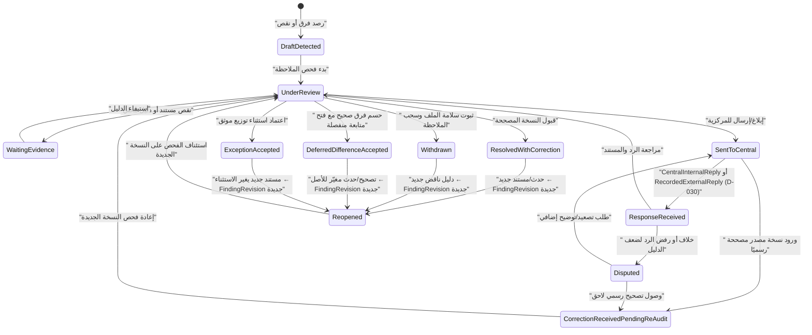
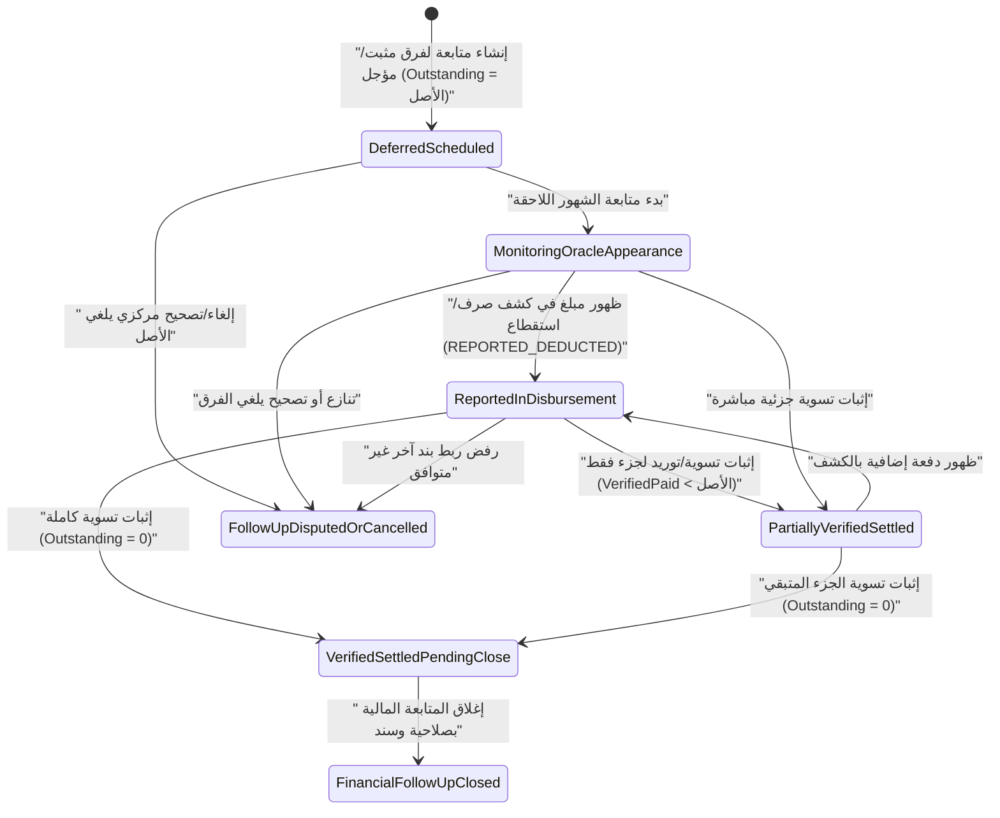

# مواصفة دورة الملاحظة والرد والحسم ومتابعة الفروق المالية (`D-029 / P-017 / D-030`)

> **المرجع والتكليف:** [`Issue #59 — SPEC-029-001`](https://github.com/AlexandriaDeveloper/PayrollReviewSystem/issues/59)، استنادًا إلى [قاعدة العمل الموحدة](../WORKING-BASELINE-AR.md)، [سجل القرارات](../governance/DECISION-REGISTER.md)، [مذكرة قرارات المراجعة](../domain/AUDIT-FINDINGS-AND-DECISIONS.md)، وقرار المالك المؤكد `D-030` في [`Issue #39`](https://github.com/AlexandriaDeveloper/PayrollReviewSystem/issues/39).  
> **الحالة:** `PROPOSED_SPECIFICATION / SPEC_DOCS_ONLY / BUSINESS_DECISIONS_PARTLY_OPEN / NO_CODE / NO_DDL / NO_SQL / NO_MERGE`  
> **المرجع المستودعي (`main`):** `913963ef6c28ca5be243cfa96b50bc413a9582ac`

---

## 1. نطاق الشريحة الأولى وحدودها

### 1.1 ما تغطيه المواصفة
تحدد هذه المواصفة السلوك التشغيلي والتصوري لأول شريحة عمل في الوحدة الحسابية المركزية للمجمع الطبي (`30200105`):
1. فتح الملاحظة المالية (`Finding`) ضمن `AuditCase` مرتبط بـ: مستفيد/علاقة صرف (`PayeeRelationshipId` / `EmploymentRelationshipId`)، ودورة استحقاق (`PayrollCycle` / `SalaryEntitlementMonth`)، وصرفية محددة (`PayrollDisbursement` — رئيسية ضمن `MonthlyMainSalarySlot` + `MainSalaryRevision` أو منفصلة `SEPARATE`)، ونسخة مصدر محددة (`SourceVersion`).
2. إرسال الملاحظة أو إبلاغ الاستحقاقات المركزية بها ومتابعة حالتها.
3. استقبال **قناتَي رد المركزية المؤكدتين بقرار المالك `D-030`** في [`Issue #39`](https://github.com/AlexandriaDeveloper/PayrollReviewSystem/issues/39):
   - **رد مركزي داخلي (`CentralInternalReply`):** يقدمه حساب مركزي مُصرَّح له داخل النظام بعد اعتماد صلاحياته.
   - **رد مركزي خارجي مسجَّل (`RecordedExternalReply`):** يسجله مستخدم الوحدة المخوّل نيابةً عن استلام رد رسمي/خارجي، مع فصل هوية المسجِّل (`RecordedBy`) عن صاحب الرد المنسوب (`AttributedRespondent`) وإرفاق دليل الإثبات.
4. حسم صحة الملاحظة (`ReviewDecision`) ضمن إحدى النتائج الخمس في [قاعدة العمل §3](../WORKING-BASELINE-AR.md#L20-L32): تصحيح رسمي وارد من المركزية وإعادة فحص نسخة المصدر؛ أو ثبوت سلامة الملف وخطأ المراجع مع **سحب الملاحظة (`Withdrawn`)**؛ أو اتفاق على **تأجيل فرق صحيح**؛ أو **تسوية كلية/جزئية مثبتة**؛ أو استبقاء **خلاف/نقص مستند** مفتوحًا؛ مع دعم إعادة الفتح بإنشاء نسخة جديدة تحفظ السابقة.
5. **فصل حسم الملاحظة عن متابعة الفرق المالي (`FollowUp`):** عند ثبوت فرق حقيقي مؤجل أو قابل للمتابعة، تُفتح له دورة متابعة مستقلة تراقب ظهوره في كشوف لاحقة (`REPORTED_DEDUCTED` / `Reporting of Deduction`) وتتحقق من تسويته الفعلية بدليل مستقل (`SETTLED_VERIFIED` / `Verified Settlement`) حتى إغلاق المتابعة المالية (`FinancialFollowUpClosed`).

### 1.2 ما يخرج عن نطاق هذه المواصفة
- **ليس نظام صرف أو `ERP` أو مقاصة بنكية:** لا يوقف البرنامج صرفًا في البنك، ولا يرسل استقطاعات إلى Oracle، ولا يعدّل ملفات الموظفين أو كشوف المصدر الأصلية، ولا يدفع أموالًا.
- **البيئة والتخزين مؤجلان:** لا تحدد هذه الوثيقة جداول `SQL Server 2014` أو `ORM` أو `DbContext` أو كود C#/Angular، وتلتزم بترتيب [`Issue #56`](https://github.com/AlexandriaDeveloper/PayrollReviewSystem/issues/56) وتأجيل `Phase B`.
- **مسائل حدودية تحتاج قرار مالك أو مراحل لاحقة:** حسم أثر تعليق صرفية `SEPARATE` على اعتماد `AuditCase` للمرتب الرئيسي، وضم استمارة `132 ع.ح` مع تسوية رعاية الطفل، ونقل الموظف بين وحدتين حسابيتين مختلفتين، والقوانين غير الموثقة السند.

---

## 2. قاموس المفاهيم والأدوار التصورية

> **تنبيه تعاقدي:** الأسماء أدناه مفاهيم مجال/تطبيق مرشحة تصوريًا وليست فئات C# منشأة ولا أسماء جداول قاعدة بيانات معتمدة.

### 2.1 المفاهيم الرئيسية
| المفهوم المرشح | الدور المالي والرقابي | ما يُمنع عليه |
| :--- | :--- | :--- |
| `AuditCase` | حاوية مراجعة مستفيد/صرفية في دورة ونسخة مصدر محددة، تجمع الملاحظات وتُصدر حالة فحص المستفيد دون أن تتطابق تلقائيًا مع حالة كل ملاحظة أو الدفع. | محو نسخ سابقة أو فرض `Approved` مع وجود نقص جوهري مانع. |
| `SourceVersion` | إشارة ثابتة (`Immutable`) إلى مستند المصدر ونسخته (`SourceDocument`، `SourceCaptureSession`، كشف رسمي مصحح، أو إدخال بديل Excel/شاشة) وبصمته/قناته. | التعديل المباشر في مكان السجل عند وصول تصحيح رسمي. |
| `Finding` | سجل ملاحظة مالية على بند أو مقارنة مجمّعة أو هوية/وعاء ضمن `AuditCase`، له معرف مستقل ونوع خطورة وقيمة مقارنة مرجعية. | أن ينشئ تلقائيًا مديونية أو استقطاعًا في Oracle. |
| `FindingRevision` | لقطة إصدارية مرقّمة للملاحظة تُحفظ عند فتح الملاحظة أو تعديل نطاقها أو **إعادة فتحها (`Reopened`)**، مع ربطها بالنسخة السابقة وسبب الفتح. | استبدال أو مسح `FindingRevision` السابقة. |
| `CentralResponse` | رد من الاستحقاقات المركزية مرتبط بإصدار ملاحظة محدد (`FindingRevisionId`) عبر إحدى القناتين المؤكدتين بـ `D-030`: `CentralInternalReply` أو `RecordedExternalReply`. | القبول الآلي للرد، أو اعتبار قناة الرد وحدها معادلة لقوة إثباته أو دليل توريد بنكي. |
| `ReviewDecision` | قرار الحسم الرقابي المسبب على الملاحظة (إعادة فحص نسخة مصححة، سحب الملاحظة، تأجيل فرق، اعتماد استثناء موثق، أو استبقاء خلاف/نقص دليل) مع المعتمد والوقت والأدلة. | تغيير `SourceAmount` أو `ExpectedAmount` التاريخي أو إغلاق `FollowUp` المالي ضمنيًا. |
| `FollowUp` | سجل متابعة مستقل لفرق مالي ثابت السند ومُرحّل/مؤجّل (`FollowUpObligation` / `FollowUpAllocation` كوصف متابعة غير تنفيذي)، يحفظ أصل الفرق والمخصصات والمتبقي. | تنفيذ مقاصة مالية تلقائية، أو إنشاؤه من مجرد فرق مصدر غير مثبت، أو إنشاؤه لملاحظة مسحوبة (`Withdrawn`). |
| `Evidence` | حزمة الإثبات المرجعية (`EvidenceRef`) المرتبطة بقناة التقاط ودرجة أصالة ودقة نقل (`EvidenceAuthenticity`, `TranscriptionAccuracy`, `SourceCoverage`). | ادعاء مستند Oracle رسمي لمدخل بديل، أو قبول غلاف مجمّع بدون نسبة صريحة للسطر كإثبات دفع. |

### 2.2 الأدوار والصلاحيات (`Actor / RBAC`)
| الدور التصوري (`Actor`) | المسؤوليات المسموحة تصوريًا | قيود الحوكمة وحالة الاعتماد |
| :--- | :--- | :--- |
| `UnitReviewer` | فتح `Finding` داخل مجموعته/نطاقه، إرسال طلب توضيح/تصحيح، تسجيل `RecordedExternalReply` مع تعيين `RecordedBy` (هويته) و`AttributedRespondent` (مصدر الرد المركزي المنسوب) ودليله، واقتراح الحسم أو طلب إعادة الفتح. | لا يعتمد قاعدة مالية عدّلها بمفرده؛ صلاحيته على الحسم النهائي والسحب في انتظار الحسم (`OWNER_DECISION_REQUIRED`). |
| `CentralAccountResponder` | إدخال `CentralInternalReply` وإرفاق مستندات أو إشعار تصحيح مركزي على الملاحظات المرسلة لجهته (`D-030`). | وجود القناة مؤكد (`OWNER_CONFIRMED` بـ `#39`)؛ **منح الحساب وصلاحياته ونطاق رؤيته ومهل رده: `OWNER_DECISION_REQUIRED`** (ولا يُعد حسابًا مُنشأً الآن). |
| `AuthorizingReviewer / UnitSupervisor` | مراجعة واعتماد سحب الملاحظة (`Withdrawn`)، إقرار الاستثناء الموثق، الموافقة على تأجيل فرق، واعتماد إعادة فتح نسخة سابقة أو إغلاق المتابعة المالية `FinancialFollowUpClosed`. | فصل المهام (`Separation of Duties`): نطاق الصلاحيات الدقيقة والحدود المالية لكل مستوى: **`OWNER_DECISION_REQUIRED`**. |
| `SourceIntakeOperator` | رفع واستيراد نسخ المصادر والتصحيحات الرسمية دون تعديل قرارات المراجعة أو منح اعتماد مالي لنفسه. | لا يغلق ملاحظة ولا يعتمد صرفية أو متابعة مالية. |

---

## 3. آلتا الحالات المنفصلتان وجداول الانتقالات

**مبدأ الفصل الإلزامي ([مذكرة المراجعة §2](../domain/AUDIT-FINDINGS-AND-DECISIONS.md#L30)):**  
`حالة الملاحظة` ≠ `حالة مراجعة المستفيد (AuditCase)` ≠ `حالة اعتماد الصرفية` ≠ `حالة إصدار المستند المركزي` ≠ `حالة متابعة الفرق وإثبات الدفع الفعلي`.

### 3.1 الآلة (أ): دورة الملاحظة والرد والحسم وإعادة الفتح (`FindingStateMachine`)

#### جدول انتقالات الآلة (أ) — الملاحظة والرد والحسم

| From | Event | Guard | Actor | To | Evidence | Failure |
| :--- | :--- | :--- | :--- | :--- | :--- | :--- |
| `[*]` | `CreateFinding` | `AuditCase` غير مغلق، بند/موضع محدد، `IdempotencyKey` غير مكرر | `UnitReviewer` | `DraftDetected` | ربط `SourceVersion` ونتيجة مقارنة (`Expected/Source`) | `DuplicateCommand` / `PermissionDenied` |
| `DraftDetected` | `StartFindingReview` | `ExpectedVersion` مطابق | `UnitReviewer` | `UnderReview` | تسجيل نسخة `FindingRevision = 1` | `VersionConflict` |
| `UnderReview` | `RequestEvidence` | تحديد المستند الناقص صراحةً | `UnitReviewer` | `WaitingEvidence` | وصف النقص المطلوب | `EvidenceRequired` / `InvalidTransition` |
| `WaitingEvidence` | `AttachEvidence` | إرفاق مرجع دليل صالح `EvidenceRef` | `UnitReviewer` | `UnderReview` | `EvidenceRef` وبصمة/تاريخ | `EvidenceRequired` |
| `UnderReview` | `SendToCentral` | توصيف الفجوة مسببًا، تحديد جهة/قناة الإبلاغ | `UnitReviewer` | `SentToCentral` | مرجع الإبلاغ والإصدار | `InvalidTransition` / `VersionConflict` |
| `SentToCentral` | `SubmitCentralInternalReply` | `D-030`: حساب مركزي مصرح له + نص رد + ربط `FindingRevisionId` | `CentralAccountResponder` | `ResponseReceived` | `CentralInternalReply` + `EvidenceRef` إن وجد | `PermissionDenied` / `DuplicateCommand` |
| `SentToCentral` | `RecordCentralExternalReply` | `D-030`: فصل `RecordedBy` عن `AttributedRespondent` + إثبات نسبة الرد | `UnitReviewer` (المخول) | `ResponseReceived` | `RecordedExternalReply` + مرجع/صورة الرد المنسوب | `EvidenceRequired` / `PermissionDenied` |
| `ResponseReceived` | `EvaluateCentralReply` | فحص المراجع لمحتوى الرد وسنده | `UnitReviewer` | `UnderReview` أو `Disputed` | محضر تقييم الرد (`Rationale`) | `InvalidTransition` / `VersionConflict` |
| `SentToCentral` / `Disputed` | `LinkOfficialCorrectionSource` | وصول `SourceVersion` جديدة مصححة رسميًا ومطابقة للهوية والفترة | `SourceIntakeOperator` / `UnitReviewer` | `CorrectionReceivedPendingReAudit` | `SourceVersionId` الجديد (`OfficialCorrectionAmount`) | `EvidenceRequired` / `InvalidTransition` |
| `CorrectionReceivedPendingReAudit` | `ReauditCorrectedSource` | إتمام إعادة المقارنة على النسخة الجديدة دون محو الأصل | `UnitReviewer` | `UnderReview` | لقطة مقارنة قبل/بعد | `VersionConflict` |
| `UnderReview` | `ResolveWithCorrection` | تطابق النسخة المصححة مع القرار، واستيفاء صلاحية الحسم (`OWNER_DECISION_REQUIRED`) | `AuthorizingReviewer` / `UnitReviewer`* | `ResolvedWithCorrection` | مرجع النسخة المصححة + قرار الحسم | `PermissionDenied` / `EvidenceRequired` |
| `UnderReview` | `WithdrawFinding` | إثبات سلامة الملف الأصلي وخطأ الملاحظة + سبب مكتوب + دليل + صلاحية سحب | `AuthorizingReviewer` (`OWNER_DECISION_REQUIRED`) | `Withdrawn` | `EvidenceRef` + سبب السحب + هوية المعتمد (لا ينشأ `FollowUp`) | `EvidenceRequired` / `PermissionDenied` |
| `UnderReview` | `ApproveDeferredDifference` | ثبوت أصل الفرق وسند التأجيل والجهة/الشهر المستهدف | `AuthorizingReviewer` (`OWNER_DECISION_REQUIRED`) | `DeferredDifferenceAccepted` | سند التأجيل (يحفّز فتح سجل `FollowUp` منفصل) | `EvidenceRequired` / `PermissionDenied` |
| `UnderReview` | `AcceptDocumentedException` | في نفس باب الصرف وشروط التجميع المعتمدة وبسند استثناء | `AuthorizingReviewer` (`OWNER_DECISION_REQUIRED`) | `ExceptionAccepted` | سند الاستثناء (لا يصبح «متطابقًا») | `PermissionDenied` / `InvalidTransition` |
| `Resolved*` / `Withdrawn` / `Deferred*` / `Exception*` | `ReopenFinding` | وجود مستند جديد أو تصحيح أو حدث بعد الاعتماد + سبب وإصدار جديد | `AuthorizingReviewer` (`OWNER_DECISION_REQUIRED`) | `Reopened` ← `UnderReview` | إنشاء `FindingRevision + 1` وحفظ الاعتماد السابق كاملًا | `EvidenceRequired` / `PermissionDenied` / `VersionConflict` |

*\* يُحدَّد نهائيًا في قرار المالك هل يحق للمراجع منفردًا ختم `ResolvedWithCorrection` أم يتطلب اعتمادًا أعلى (انظر القسم 7).*

### 3.2 الآلة (ب): دورة متابعة الفرق والتأجيل والتسوية والإغلاق (`FinancialFollowUpStateMachine`)

> **حاجز التفعيل الحتمي:** لا يُنشأ سجل `FollowUp` عند سحب الملاحظة (`Withdrawn`) ولا عند مجرد فرق مصدر غير مثبت؛ بل يُنشأ فقط عندما يُثبت قرار الحسم فرقًا حقيقيًا مستحق المتابعة (`DeferredDifferenceAccepted` أو فرق تسوية معتمد السند)، وتبقى `Reporting of Deduction` منفصلة تمامًا عن `Verified Settlement`، ولا يتحقق `FinancialFollowUpClosed` إلا بدليل تسوية مستقل وصلاحية إغلاق.

#### جدول انتقالات الآلة (ب) — متابعة الفرق والتسوية المالية

| From | Event | Guard | Actor | To | Evidence | Failure |
| :--- | :--- | :--- | :--- | :--- | :--- | :--- |
| `[*]` | `OpenFollowUpForApprovedDifference` | وجود `FindingRevision` محسوم بفرق مثبت أو تأجيل معتمد (محظور مع `Withdrawn` أو `CENTRAL_SOURCE_AMOUNT` بلا التزام ثابت) | `AuthorizingReviewer` / `Application` (بعد قرار الحسم) | `DeferredScheduled` | أصل الفرق + الشهر الأصلي والمستهدف + السند | `InvalidTransition` / `EvidenceRequired` |
| `DeferredScheduled` | `ActivateMonitoring` | تهيئة رصيد متابعة: `VerifiedPaid = 0`, `Outstanding = OriginalAmount` | `UnitReviewer` | `MonitoringOracleAppearance` | مرجع جدول المتابعة الدوري | `VersionConflict` |
| `MonitoringOracleAppearance` / `PartiallyVerifiedSettled` | `RecordReportedAppearance` | ربط `SourceFinancialOccurrence` ظهر في كشف لاحق؛ وإذا اختلف كود البند: تحقق `SettlementCompatibilityPolicy` + `CrossComponentAuthorization`، وعدم تجاوز الرصيد المتاح | `UnitReviewer` | `ReportedInDisbursement` (`REPORTED_DEDUCTED`) | `SourceFinancialOccurrenceId` + تحديث `ReportedDisbursementAmount` فقط (**لا يغلق المتابعة ولا يرفع `VerifiedPaidAmount`**) | `IncompatibleFollowUpAllocation` / `ExceededRemainingBalance` / `DuplicateCommand` |
| `ReportedInDisbursement` / `MonitoringOracleAppearance` | `VerifyPartialSettlement` | دليل توريد/تسوية مستقل يثبت تنفيذ جزء (`0 < Sum(VerifiedPaid) < OriginalAmount`) | `UnitReviewer` / `AuthorizingReviewer` | `PartiallyVerifiedSettled` (`SETTLED_VERIFIED` جزئي) | `DeductionSettlementEvidence` أو شهادة تسوية مستقلة + `OutstandingAmount > 0` | `EvidenceRequired` / `ExceededRemainingBalance` / `VersionConflict` |
| `ReportedInDisbursement` / `PartiallyVerifiedSettled` | `VerifyFullSettlement` | دليل تسوية مستقل يغطي كامل الرصيد المتبقي (`Sum(VerifiedPaid) == OriginalAmount` ← `OutstandingAmount = 0`) | `UnitReviewer` / `AuthorizingReviewer` | `VerifiedSettledPendingClose` | حزمة `SettlementEvidence` مكتملة | `EvidenceRequired` / `ExceededRemainingBalance` |
| `VerifiedSettledPendingClose` | `CloseFinancialFollowUp` | `OutstandingAmount == 0` + عدم وجود مراجعة تصحيح مفتوحة + صلاحية الإغلاق المعتمدة (`OWNER_DECISION_REQUIRED`) | `AuthorizingReviewer` (`OWNER_DECISION_REQUIRED`) | `FinancialFollowUpClosed` | اعتماد الإغلاق المالي وهوية المعتمد والتوقيت | `PermissionDenied` / `InvalidTransition` / `EvidenceRequired` |
| `DeferredScheduled` / `Monitoring*` / `ReportedInDisbursement` | `CancelOrAmendFollowUpOnCorrection` | وصول تصحيح مركزي رسمي أو قرار يلغي أصل الفرق أو إعادة فتح الملاحظة | `AuthorizingReviewer` (`OWNER_DECISION_REQUIRED`) | `FollowUpDisputedOrCancelled` | مستند الإلغاء/التصحيح + فتح نسخة متابعة جديدة عند إعادة التسوية | `EvidenceRequired` / `PermissionDenied` |

---

## 4. القواعد الثابتة غير قابلة للتجاوز (`Invariants`)

1. **عدم قابلية تغيير الأصل (`Immutability`):** سطور المصدر (`SourceFinancialOccurrence`)، وملفاته (`SourceDocument`)، ونسخ الملاحظات والقرارات المعتمدة السابقة (`FindingRevision`, `ReviewDecision`) لا تُعدّل أو تُمحى عند التعديل أو إعادة الفتح أو الاستيراد التصحيحي.
2. **فصل القيم السبع إلزاميًا:** لا يجوز دمج أو اختصار أي من الحقول المستقلة: `SourceAmount`، `ExpectedAmount`، `ReviewedAmount`، `OfficialCorrectionAmount`، `ReportedDisbursementAmount`، `VerifiedPaidAmount`، و`OutstandingAmount`.
3. **منع التسوية بتطابق المبلغ أو باب الصرف وحدهما:** وجود 200 جنيه ببند آخر في شهر لاحق داخل نفس باب الصرف **لا يكفي** لربطها بفرق 200 جنيه أصلي؛ يشترط تحقق `SettlementCompatibilityPolicy` وسند رسمي ينسب المبلغ للالتزام الأصلي.
4. **منع `UNKNOWN = 0` والاحتساب التقديري:** نقص مستند أو غياب قاعدة/درجة يؤدي لحفظ `UNKNOWN / INPUT_MISSING` على البند المتأثر فقط دون تصفيره أو اختراع مبلغ تقديري.
5. **التمييز الصارم بين الرد/الظهور وبين السداد الفعلي:** لا يُعتبر رد المركزية (داخليًا أم خارجيًا) ولا مجرد طباعة المبلغ في كشف الصرف/الاستقطاع دليلًا على وصول المال للبنك أو توريده (`VerifiedPaidAmount`).
6. **عدم التنفيذ المالي الآلي:** لا ينفذ البرنامج خصمًا في Oracle ولا يصدر إيقافًا بنكيًا ولا يحوّل فروقًا تلقائيًا إلى مديونية قانونية واجبة النفاذ.
7. **حماية التزامن والازدواج (`Concurrency & Idempotency`):** كل تعديل حالة أو تخصيص متابعة يفرض `ExpectedVersion` و`IdempotencyKey`، ويمنع تجاوز مجموع التخصيصات لأصل الفرق، ويعالج تعارض التزامن على مستوى `Finding` أو `FollowUp` حتى لا يصطدم مراجعان يعملان على بنود مختلفة بلا داعٍ (تصوريًا وفق ملاحظة `MIN-04`).

---

## 5. حدود عقود `Core / Application` التصورية (دون كود أو DDL)

تتسق العقود المقترحة مع `ADR-003` و`ADR-004` و`ADR-005` بحيث يظل **`Core`** نقيًا وخاليًا تمامًا من `SQL / ORM / PDFium / HTTP`:
- **`Core` (Domain Layer):** يمتلك الـ`Aggregates` (مثل `Finding` + `FindingRevision`, `FollowUp`), والـ`Value Objects` (مثل `MonetaryAmount` بـ`decimal`, `AuditActorsAttribution`, `DifferenceBalances`), وآلتَي الحالات (`FindingStateMachine`, `FinancialFollowUpStateMachine`) والحواجز النقية (`Guards`) والأحداث النطاقية (`DomainEvents`).
- **`Application` (Use Case Orchestration):** ينسق استرجاع الكيانات والتحقق من `ActorId` عبر `IAuthorizationPolicyPort`، والتأكد من `IdempotencyKey` عبر `IIdempotencyPort`، والتحقق من وجود الأدلة والمصادر عبر `IEvidenceRegistryPort` / `ISourceReadPort`، وحفظ التعديلات في معاملة منضبطة عبر `IFindingRepository` / `IFollowUpRepository` / `IUnitOfWorkPort`.
- **`Infrastructure` (مؤجلة):** محولات قواعد البيانات (`SQL Server 2014` لاحقًا بعد `Issue #30` وتفويض المالك) وقراءة PDF/Excel.

### 5.1 أمثلة عقود تصورية (`Commands / Queries / Ports`)

| النوع / الاسم المقترح | مدخلات العقد التصورية | المخرجات المتوقعة (`Result`) | الأحداث / الآثار (`Domain Events`) | حالات الخطأ القياسية |
| :--- | :--- | :--- | :--- | :--- |
| `Command: RegisterAuditFinding` | `AuditCaseId`, `PayrollDisbursementId`, `SourceVersionId`, `ComponentRef`, `DiscrepancyKind`, `ExpectedAmount?`, `SourceAmount?`, `Rationale`, `ActorId`, `IdempotencyKey` | `Result<FindingRevisionRef, ContractError>` | `FindingRegisteredEvent` | `PermissionDenied`, `DuplicateCommand`, `EvidenceRequired` |
| `Command: RecordCentralResponse` | `FindingId`, `FindingRevisionId`, `ExpectedVersion`, `Channel` (`CentralInternalReply` \| `RecordedExternalReply`), `ActorId` (`RecordedBy`), `AttributedRespondent` (إلزامي للخارجي), `SummaryText`, `EvidenceRef`, `OccurredAt`, `IdempotencyKey` | `Result<CentralResponseRef, ContractError>` | `CentralResponseRecordedEvent` | `PermissionDenied`, `VersionConflict`, `EvidenceRequired`, `InvalidTransition`, `DuplicateCommand` |
| `Command: ResolveFinding` | `FindingId`, `FindingRevisionId`, `ExpectedVersion`, `ResolutionKind` (`WithCorrection` \| `WithdrawFinding` \| `DeferDifference` \| `AcceptException`), `Rationale`, `EvidenceRef`, `OfficialCorrectionSourceVersionId?`, `FollowUpTargetPeriod?`, `ActorId`, `IdempotencyKey` | `Result<ReviewDecisionRef, ContractError>` | `FindingResolvedEvent` (+ `FollowUpRequiredEvent` عند `DeferDifference` فقط) | `PermissionDenied`, `VersionConflict`, `EvidenceRequired`, `InvalidTransition`, `DuplicateCommand` |
| `Command: ReopenFinding` | `FindingId`, `ExpectedVersion`, `ReopenReason`, `TriggeringEvidenceRef`, `ActorId`, `IdempotencyKey` | `Result<FindingRevisionRef, ContractError>` (نسخة جديدة تزيد بـ`+1`) | `FindingReopenedEvent` | `PermissionDenied`, `VersionConflict`, `EvidenceRequired`, `InvalidTransition` |
| `Command: RecordFollowUpAllocation` | `FollowUpId`, `ExpectedVersion`, `AllocationKind` (`ReportedAppearance` \| `VerifiedSettlement`), `SourceOccurrenceRef?`, `SettlementEvidenceRef?`, `Amount` (`decimal > 0`), `CrossComponentAuthRef?`, `ActorId`, `IdempotencyKey` | `Result<FollowUpBalancesSnapshot, ContractError>` | `FollowUpReportedEvent` أو `FollowUpVerifiedSettlementEvent` | `PermissionDenied`, `VersionConflict`, `EvidenceRequired`, `InvalidTransition`, `DuplicateCommand`, `IncompatibleFollowUpAllocation`, `ExceededRemainingBalance` |
| `Command: CloseFinancialFollowUp` | `FollowUpId`, `ExpectedVersion`, `ClosingRationale`, `ActorId`, `IdempotencyKey` | `Result<FollowUpClosedSnapshot, ContractError>` | `FinancialFollowUpClosedEvent` | `PermissionDenied`, `VersionConflict`, `InvalidTransition`, `EvidenceRequired` |
| `Query: GetAuditCaseFindingsAndFollowUps` | `AuditCaseId`, `ActorId`, `IncludeSupersededRevisions` | قائمة `Findings` مع آخر `ReviewDecision` والـ`FollowUp` المرتبط دون مزج القيم السبع | — *(قراءة محايدة لا تعدل الحالة)* | `PermissionDenied` |
| `Ports` (`Application` -> `Infra` لاحقًا) | `IFindingRepository`, `IFollowUpRepository`, `ISourceReadPort`, `IEvidenceRegistryPort`, `IAuthorizationPolicyPort`, `IIdempotencyPort` | حفظ ذري واسترجاع بالمعرف والنسخة (`ExpectedVersion`) | — | تعيد `VersionConflict` عند تغير النسخة |

---

## 6. حالات القبول الاصطناعية الخمس الأساسية وحالات الرفض (`Given / When / Then`)

> **ملاحظة حوكمة:** هذه سيناريوهات قبول تصميمية على مستوى المواصفة (**لم تُنفذ كاختبارات كود بعد**: `NOT_RUN`)؛ البيانات والأرقام الواردة اصطناعية تمامًا.

### 6.1 السيناريوهات الخمسة الأساسية (`SPEC-ACC-01..05`)

1. **`SPEC-ACC-01` — تصحيح رسمي وارد من المركزية مع إعادة فحص نسخة المصدر:**
   - **Given:** موظف في `AuditCase`، مصدر النسخة الأولى `SourceVersion = v1` يعرض حافزًا `SourceAmount = 1200` مقابل `ExpectedAmount = 1000`، وفتحت ملاحظة `Finding` في حالة `SentToCentral`.
   - **When:** يصل مستند مركزي مصحح رسميًا `SourceVersion = v2` (`OfficialCorrectionAmount = 1000`) ويُربط بالملاحظة فتُعاد مقارنتها ثم يصدر `ResolveFinding(WithCorrection)`.
   - **Then:** يبقى `SourceAmount = 1200` محفوظًا في `v1` دون تعديل؛ تُربط `v2` بـ`OfficialCorrectionAmount = 1000`؛ تنتقل الملاحظة إلى `ResolvedWithCorrection` مع حفظ `ReviewedAmount` وسبب الحسم ومن اعتمده؛ ولا يُنشأ خصم أو دفع بنكي آلي.

2. **`SPEC-ACC-02` — رد سليم يثبت خطأ المراجع وسحب الملاحظة:**
   - **Given:** ملاحظة مفتوحة في `SentToCentral` تزعم زيادة `SourceAmount = 1200` عن `ExpectedAmount = 1000`.
   - **When:** يرد الطرف المركزي (عبر `CentralInternalReply` أو `RecordedExternalReply` مستوفي النسبة والأدلة وفق `D-030`) مرفقًا قرار استحقاق رسميًا يثبت أن المستحق الصحيح `1200` وليس `1000`؛ ثم يُصدر المعتمد قرار `WithdrawFinding`.
   - **Then:** تنتقل الملاحظة إلى `Withdrawn` مع حفظ نص الملاحظة الأصلي والرد والدليل وسبب السحب وهوية المعتمد؛ **ولا يُنشأ أي `FollowUp` أو فرق مرحل**؛ ويظل سجل المراجعة التاريخي محتفظًا بأثر السحب.

3. **`SPEC-ACC-03` — فرق مؤكد متفق على تأجيله بقرار معتمد:**
   - **Given:** ملاحظة بفرق حقيقي مثبت `200` (مثل استقطاع معتمد `1000` مقابل ظهور `800` أو استحقاق مؤجل `200`) في حالة `UnderReview` / `ResponseReceived` مع وجود سند إقرار/تأجيل للوفاء في الشهر المستهدف التالي.
   - **When:** يصدر قرار `ApproveDeferredDifference` من ذي الصلاحية، ثم يُفتح سجل متابعة `OpenFollowUpForApprovedDifference`.
   - **Then:** تُحسم الملاحظة إلى `DeferredDifferenceAccepted`؛ وتُنشأ دورة `FollowUp` مستقلة في `DeferredScheduled` ← `MonitoringOracleAppearance` برصيد `OriginalAmount = 200`, `VerifiedPaidAmount = 0`, `OutstandingAmount = 200`؛ دون إرسال أي استقطاع إلى Oracle.

4. **`SPEC-ACC-04` — تسوية جزئية موثقة لفرق `200` (`100` مثبت و`100` متبقٍّ) دون اعتبار الظهور صرفًا:**
   - **Given:** سجل `FollowUp` مفتوح برصيد أصلي `200` في `MonitoringOracleAppearance`.
   - **When (الخطوة 1):** يظهر مبلغ `100` في كشف صرف/استقطاع لاحق (`RecordReportedAppearance`).  
     **Then (الخطوة 1):** يتحدث `ReportedDisbursementAmount = 100` وتنتقل الحالة إلى `ReportedInDisbursement` (`REPORTED_DEDUCTED`)، **ويبقى `VerifiedPaidAmount = 0` و`OutstandingAmount = 200`** ولا تُغلق المتابعة.  
     **When (الخطوة 2):** يُرفق دليل تسوية/توريد مستقل صالح للمبلغ `100` (`VerifyPartialSettlement`).  
     **Then (الخطوة 2):** يصبح `VerifiedPaidAmount = 100` و`OutstandingAmount = 100` وتنتقل المتابعة إلى `PartiallyVerifiedSettled` (`SETTLED_VERIFIED` جزئي)، وتظل مفتوحةً للـ`100` المتبقية.

5. **`SPEC-ACC-05` — خلاف أو نقص مستند يبقي الملاحظة مفتوحة:**
   - **Given:** ملاحظة مفتوحة في `SentToCentral`، ويرد رد خارجي يذكر شفهيًا استحقاق المبلغ دون إرفاق رقم القرار أو صورة المستند المطلوب، أو يختلف الطرفان على انطباق الدرجة/السند.
   - **When:** يقيّم المراجع الرد (`EvaluateCentralReply`) ويسجل استمرار النقص أو الخلاف.
   - **Then:** تنتقل الملاحظة إلى `Disputed` أو `WaitingEvidence`، **ويُرفض إغلاق الملاحظة أو اعتبار القيمة المجهولة صفرًا (`UNKNOWN ≠ 0`)**، وتبقى مفتوحةً مع توثيق المطلوب والطرف المسؤول.

### 6.2 سيناريوهات الرفض والحماية (`SPEC-NEG-01..08`)

| معرف الاختبار | سيناريو الرفض (`Given / When`) | النتيجة المتوقعة (`Then`) |
| :--- | :--- | :--- |
| `SPEC-NEG-01` | تكرار إرسال نفس الرد أو نفس أمر التخصيص بنفس `IdempotencyKey` (أو إعادة إرسال طلب مطابق معالج مسبقًا). | يُرفض التكرار كـ`DuplicateCommand` أو يُعاد نفس الأثر مرة واحدة (`Idempotent`) دون مضاعفة السجل أو خصم المبلغ مرتين. |
| `SPEC-NEG-02` | تنفيذ `ResolveFinding` أو `VerifyPartialSettlement` بنسخة `ExpectedVersion` قديمة بعد تعديل متزامن لآخرين. | فشل الطلب فورًا بخطأ `VersionConflict` دون الكتابة فوق التعديل الآخر أو تجاوز الرصيد المتبقي. |
| `SPEC-NEG-03` | محاولة تسجيل `RecordedExternalReply` دون `AttributedRespondent` أو دون `EvidenceRef`، أو محاولة `WithdrawFinding` دون سبب/دليل. | رفض الطلب بخطأ `EvidenceRequired` وعدم تغير الحالة. |
| `SPEC-NEG-04` | محاولة ربط `200` من كود بند مختلف في `FollowUp` لمجرد تطابق المبلغ أو باب الصرف، مع غياب `SettlementCompatibilityPolicy` و`CrossComponentAuthorization`، أو تقديم مستند إثبات مزيف/غير كافٍ. | رفض التخصيص بخطأ `IncompatibleFollowUpAllocation` أو `EvidenceRequired` وبقاء الرصيد `UNALLOCATED`. |
| `SPEC-NEG-05` | محاولة ربط رد مركزي أو `SourceFinancialOccurrence` تخص موظفًا/علاقة عمل أخرى (`PayeeRelationship` / `EmploymentRelationship` مختلف). | رفض الربط لحماية حدود علاقة العمل والمستفيد وعدم تلويث `AuditCase`. |
| `SPEC-NEG-06` | محاولة تعديل قرار حسم معتمد مباشرًا دون `ReopenFinding` أو إخفاء الاعتماد السابق عند إعادة الفتح. | رفض التعديل المباشر بـ`InvalidTransition`؛ واشتراط `ReopenFinding` لتوليد `FindingRevision + 1` مع بقاء النسخة السابقة محفوظة. |
| `SPEC-NEG-07` | محاولة تنفيذ قرار حسم/سحب/إغلاق متابعة بواسطة مستخدم خارج المجموعة أو يجمع بين تعديل المصدر/الرد واعتماده النهائي المخالف لصلاحياته. | رفض فوري بخطأ `PermissionDenied` مع تسجيل محاولة الوصول دون تغيير الحالة. |
| `SPEC-NEG-08` | محاولة إغلاق `FinancialFollowUpClosed` من حالة `ReportedInDisbursement` مباشرة، أو فتح `FollowUp` لملاحظة في حالة `Withdrawn`. | رفض حتمي بخطأ `InvalidTransition` / `EvidenceRequired`. |

---

## 7. مصفوفة قرارات المالك المفتوحة (مرتبطة بـ [`Issue #39`](https://github.com/AlexandriaDeveloper/PayrollReviewSystem/issues/39))

> **قرار مؤكد لا يُعاد سؤاله:** دعم قناتَي رد المركزية (`CentralInternalReply` داخل النظام و`RecordedExternalReply` المسجل بواسطة مستخدم الوحدة) **مؤكد بالفعل بالقرار `D-030` في `Issue #39`**. تتركز الأسئلة المتبقية في الضوابط الآتية:

| المعرف | الموضوع والسؤال الموجز للمالك | التصنيف | الأثر العملي على الشريحة الأولى (`Core/Application`) |
| :--- | :--- | :--- | :--- |
| `OD-01` | **صلاحيات الحسم وسحب الملاحظة وإغلاق المتابعة المالية:** من يملك سلطة اعتماد `Withdrawn`؟ وهل تكفي موافقة المراجع المختص لحسم `ResolvedWithCorrection` أم يلزم اعتماد مشرف/معتمد ثانٍ عند السحب وتأجيل الفرق وإغلاق `FinancialFollowUpClosed`؟ | `MUST_DECIDE_BEFORE_CODE` | يحدد قواعد `IAuthorizationPolicyPort` وأدوار `Separation of Duties` في شريحة التطبيق. |
| `OD-02` | **اعتماد حالة `AuditCase` مع بقاء `UNKNOWN` أو `FollowUpPending`:** هل يُسمح باعتماد مراجعة البنود السليمة للموظف بالشهر بينما تبقى متابعة فرق مالي أو بند استقطاع ثانوي بحالة `UNKNOWN` / `FollowUpPending`؟ | `MUST_DECIDE_BEFORE_CODE` | يحسم شروط قفل `AuditCase` مقابل استقلال `Finding` و`FollowUp` (يعالج `MAJ-02`/`DES-01-011` في EGM). |
| `OD-03` | **مستندات إثبات التسوية الفعلية (`VerifiedPaidAmount`):** ما المستند أو الشهادة الرسمية المعتمدة داخل الوحدة الحسابية لإثبات التوريد أو التسوية الفعلية للانتقال من `ReportedInDisbursement` إلى `PartiallyVerifiedSettled` / `VerifiedSettledPendingClose`؟ | `MUST_DECIDE_BEFORE_CODE` | يحدد أنواع `EvidenceRef` المقبولة لإغلاق `FollowUp` (يعالج `Q-04` دون ربط آلي بـ`GPS`). |
| `OD-04` | **نطاق الصرفيات المنفصلة ورعاية الطفل وعلاقتَي التعيين:** هل يظل تعليق بند في صرفية `SEPARATE` مستقلًا عن اعتماد `MAIN_SALARY`؟ وكيف تُضم استمارة `132 ع.ح` وتسوية رعاية الطفل في الشهر نفسه؟ وما القيد عند النقل أو علاقتي التعيين؟ | `MUST_DECIDE_BEFORE_CODE` *(للنطاق بين الصرفيات)* / يمكن بدء شريحة الملاحظة داخل صرفية مفردة أولًا ثم توسيعها | يعالج `BLK-02`, `BLK-04`, `BLK-12`, `MAJ-21` في سجل تحكيم EGM قبل نموذج الصرفيات الكامل. |
| `OD-05` | **حوكمة وتوقيتات قنوات رد المركزية (`D-030`):** ما سياسة إنشاء حسابات `CentralAccountResponder`، وما الحد الأدنى من الإثبات المطلوب لتسجيل `RecordedExternalReply`، وما هي مهل التصعيد الزمنية؟ | `DEFERRED_NONBLOCKING` *(على أصل القناتين)* / `MUST_DECIDE_BEFORE_CODE` *(لإنتاج RBAC الفعلي)* | نموذج `D-030` في المواصفة يدعم القناتين من الآن، بينما تُضبط القوائم والمهل كإعدادات صلاحيات عند التفعيل. |
| `OD-06` | **مصفوفة توافق التسوية بين بندين (`SettlementCompatibilityPolicy`):** ما البنود/الجهات الدائنة المسموح بترحيل فرق استقطاع إليها أو تسويته منها، ومن يعتمدها قانونيًا؟ | `DEFERRED_NONBLOCKING` *(للشريحة الأولى)* / `MUST_DECIDE_BEFORE_CODE` *(قبل تفعيل تسوية عبر البنود)* | تظل ميزة التخصيص بين بندين محظورة تلقائيًا (`UNALLOCATED`) حتى إيداع السياسة المعتمدة. |

---

## 8. مصفوفة التتبع (`D-029 / P-017 / D-030` وEGM والشريحة الأولى)

| المرجع / المطلب | الوصف المختصر | الحالة | مرجع EGM / المواصفة | سيناريو القبول | يدخل الشريحة الأولى (`Core/Application` عند التصريح)؟ |
| :--- | :--- | :--- | :--- | :--- | :--- |
| `D-029` + [قاعدة العمل §3](../WORKING-BASELINE-AR.md#L20-L32) | دورة الملاحظة ← الرد ← الحسم (تصحيح/سحب/تأجيل/تسوية/خلاف) وحفظ الأصل والرد والمعتمد | `OWNER_CONFIRMED` *(التفاصيل التشغيلية في المواصفة `PROPOSED`)* | [EGM Register §4.2](../egm/EGM-ADJUDICATION-REGISTER-AR.md) (`BLK-05`, `BLK-06`, `MIN-04`) | `SPEC-ACC-01..05`, `SPEC-NEG-01..08` | **نعم** — في حدود `Core/Application` `in-memory` بعد بوابة `EGM` واعتماد قرارات `OD-01..03` |
| `P-017` | إعطاء الأولوية لدورة الملاحظات والردود والحسم ومتابعة الفروق | `PROPOSED` *(مرتبط بأولوية `#56`)* | [DECISION-REGISTER](../governance/DECISION-REGISTER.md#L92) | `SPEC-ACC-01..05` | **نعم** — هي نطاق الشريحة الأولى المقترحة |
| `D-030` (`Issue #39`) | دعم `CentralInternalReply` و`RecordedExternalReply` مع فصل `RecordedBy` عن `AttributedRespondent` | `OWNER_CONFIRMED` *(تفاصيل الصلاحيات والمهل: `OWNER_DECISION_REQUIRED`)* | [`Issue #39`](https://github.com/AlexandriaDeveloper/PayrollReviewSystem/issues/39) + `OD-05` | `SPEC-ACC-02`, `SPEC-ACC-05`, `SPEC-NEG-03` | **نعم** — تمثيل القناتين وعقود الإسناد داخل `Core/Application` (بدون حسابات إنتاج فعلية الآن) |
| فصل القيم السبع وفصل `Reporting` عن `Verified Settlement` | منع الخلط بين الظهور في Oracle والتسوية/الدفع الفعلي، وعدم إغلاق المتابعة عند سحب الملاحظة | `OWNER_CONFIRMED` (ثوابت `AGENTS.md` + `D-028`) | `BLK-05` / `Q-04` (`EGM`) + [HISTORICAL-LEAVE](HISTORICAL-LEAVE-REVIEW-ADJUSTMENTS-AND-DEDUCTION-CARRY.md) | `SPEC-ACC-02`, `SPEC-ACC-04`, `SPEC-NEG-04`, `SPEC-NEG-08` | **نعم** — حواجز نقية إجبارية داخل `Core` |
| التزامن المتفائل و`IdempotencyKey` | حماية تعديل الملاحظات والردود وتخصيص الفروق ضد السباق والتكرار | `PROPOSED` *(انبثق عن معايير `ADR-005`)* | `BLK-06`, `MIN-04` (`EGM`) | `SPEC-NEG-01`, `SPEC-NEG-02` | **نعم** — حقول وعقود نتائج `Core/Application` |
| صلاحيات السحب/الإغلاق، سياسة `UNKNOWN`، مستند `VerifiedPaidAmount` | تحديد الأدوار المخولة وشروط قفل `AuditCase` ومستند التسوية المعتمد | `OWNER_DECISION_REQUIRED` | `OD-01..04`, `MAJ-02`, `MAJ-21` | `SPEC-ACC-04`, `SPEC-NEG-07` | **بوابة شرطية:** يلزم حسمها قبل تجميد منطق القفل والاعتماد النهائي |
| ربط `SQL Server 2014`، `ORM`، قراءة PDF/Excel، حساب قوانين غير موثقة، وربط `GPS` | الطبقة الفيزيائية للتخزين والاستخراج والمحركات القانونية والبنوك | مؤجل / خارج الشريحة | [Issue #56](https://github.com/AlexandriaDeveloper/PayrollReviewSystem/issues/56), [ADR-003/005](../decisions/ADR-003-ddd-modular-monolith-clean-architecture.md) | `NOT_IN_SLICE_1` | **لا** — خارج الشريحة الأولى تمامًا |
