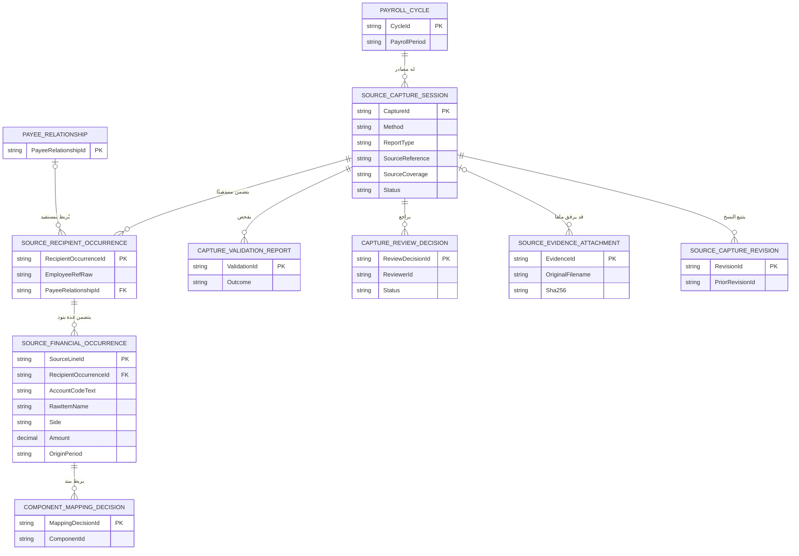
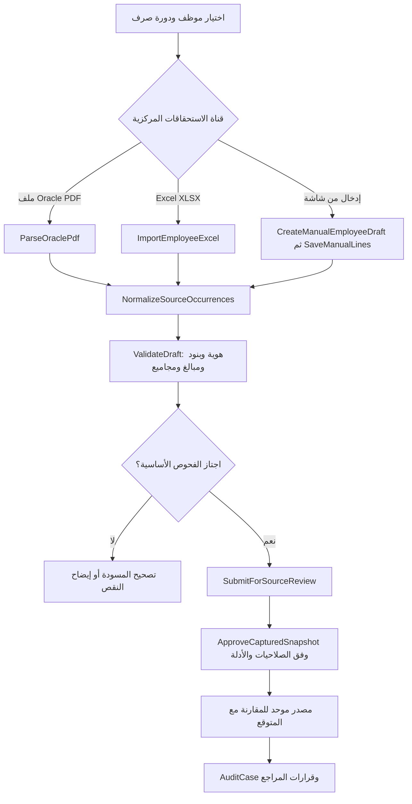
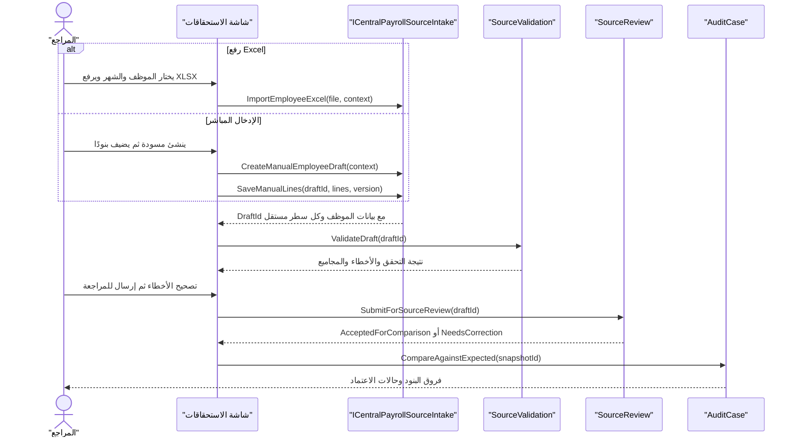

# تصميم إدخال الاستحقاقات المركزية عبر Excel أو شاشة إدخال مباشرة

> **حالة التصميم: متطلب مالك مؤكد مع تفاصيل تقنية مقترحة فقط.** هذا مستند هندسي وليس كودًا منفذًا أو Migration. المدخلات البديلة المطلوبة هي **Excel** أو **شاشة مباشرة**؛ **قراءة الصور وOCR ليست شرطًا ولا جزءًا من هذا المسار**. يستمر PDF كقناة موجودة، لكن تعذره لا يمنع المراجع من إدخال بيانات الصرفية بالطرق البديلة وبضوابط المصدر والمراجعة.

## 1. ما المقصود ببديل ملف الاستحقاقات؟

البديل **مصدر بيانات مراجعة** عن صرفية موظف محدد وفترة محددة وبنودها، لا «وثيقة رسمية من Oracle» تنشأ بمجرد الاستيراد. يستطيع النظام المقارنة مع الاستحقاق المتوقع حتى مع عدم وجود PDF، ولكن يسجل مصدر القيم: `EXCEL_IMPORT` أو `DIRECT_FORM`، والمراجع الذي نقلها، والمرجع الرسمي إن وُجد، وحالة اعتماد دقة النقل. إذا وصل تقرير Oracle رسمي لاحقًا فلا تُستبدل البيانات بصمت ولا تتضاعف البنود.

**القنوات الأساسية المقصودة:**
- `NATIVE_PDF`: يبقى مدعومًا عند توفر ملف صحيح.
- `EXCEL_IMPORT`: ملف `.xlsx` يحوي **صف موظف واحد** مع **أي عدد من سطور الاستحقاقات والاستقطاعات**، بما فيها أكواد متكررة. التوسع إلى عدة موظفين في ملف واحد تصميم لاحق، وليس افتراضًا عند تنفيذ الإصدار الأول.
- `DIRECT_FORM`: شاشة عربية RTL تسمح للمراجع بتحديد الموظف والشهر وكتابة مجموعة البنود دون رفع أي ملف.

الصور و`OCR` **ليست مسارًا مطلوبًا لتنفيذ هذا المتطلب**؛ وجود أفكارها التاريخية في توثيق آخر لا يجعلها تبعية للإدخال من Excel والشاشة.

## 2. عقد الدوال والواجهات المقترحة — تصميم فقط

| العقد | المدخل | المخرج |
| --- | --- | --- |
| `ICentralPayrollSourceIntake.ImportEmployeeExcel(workbook, context)` | ملف `xlsx`، دورة المرتبات، المراجع، مرجع المصدر | `CaptureDraft` مع سطور مستقلة وأخطاء صفوف |
| `ICentralPayrollSourceIntake.CreateManualEmployeeDraft(context)` | موظف/علاقة صرف، شهر، نوع تقرير، مستخدم | `CaptureDraftId` |
| `ICentralPayrollSourceIntake.SaveManualLines(draftId, lines, expectedVersion)` | سطور من شاشة البيانات | تحديث **المسودة فقط** وحالات التحقق |
| `ICentralPayrollSourceIntake.ValidateDraft(draftId)` | المسودة | `ValidationReport`: صحة الرأس والهوية والجانب والأرقام والمجاميع |
| `ICentralPayrollSourceIntake.SubmitForSourceReview(draftId)` | مسودة سليمة مبدئيًا | لقطة مقفلة للمراجعة مع نوع مصدر واضح |
| `ICentralPayrollSourceIntake.ApproveCapturedSnapshot(snapshotId, decision)` | مستخدم مخول، فحص نقل وقوة إثبات | `CapturedSourceSnapshot` بإصدار، صالحة للمقارنة وفق السياسة |
| `ICentralPayrollSourceIntake.MatchLaterOfficialSource(snapshotId, officialDocumentId)` | نسخة PDF رسمية تصل لاحقًا | تقرير اختلافات وربط إصدارات بلا حذف/ازدواج |

**لا** ينشئ `ImportEmployeeExcel` اعتمادًا تلقائيًا، ولا يغير `ApprovedFinancialFact` أو المرتب أو الموظف، ولا يرسل بيانات إلى Oracle. يمكن إنجاز `DIRECT_FORM` من دون ملف أو مرفق إطلاقًا؛ حينئذ توضح الشاشة مستوى الإثبات ويُطبّق اعتماد النقل المطلوب.

## 3. نموذج ملف Excel المقترح: ورقتان داخل مصنف واحد

### ورقة `Employee` — صف واحد للرأس
| `EmployeeRef` | `PayrollPeriod` | `ReportType` | `InstitutionalUnitCode` | `SourceReference` |
| --- | --- | --- | --- | --- |
| `EMP-TEST-01` | `2026-11` | `EMPLOYEE_ENTITLEMENTS` | `30200105` | `MANUAL-REPORT-TEST` |

`EmployeeRef` معرّف مؤسسي أو مرجع علاقة موظف **غير حساس في المثال فقط**؛ ربطه بالموظف الصحيح فحص منفصل. نوع التقرير يمكن تخصيصه لصرفية الفرد أو تسوية رعاية الطفل أو غيرهما عند التحقق من النموذج.

### ورقة `Items` — عدة صفوف للموظف نفسه
| `LineNo` | `Side` | `AccountCode` | `ItemName` | `Amount` | `OriginPeriod` |
| ---: | --- | --- | --- | ---: | --- |
| 1 | `EARNING` | `21110505` | العلاوة الخاصة 2014 (مثال) | 40.00 | `2026-11` |
| 2 | `EARNING` | `21110505` | العلاوة الخاصة 2015 (مثال) | 60.00 | `2026-11` |
| 3 | `EARNING` | `21110101` | الأجر الأساسي (مثال) | 1000.00 | `2026-11` |
| 4 | `DEDUCTION` | `41110104` | استقطاع افتراضي | 10.00 | `2026-11` |

**الأكواد والمبالغ أمثلة صناعية لا تُعد اعتمادًا للربط الرسمي.** الكود الواحد قد يظهر أكثر من مرة، وحتى الاسم نفسه قد يتكرر؛ المعرّف الفعلي للسطـر `SourceLineId` داخلي مستقل، و`LineNo` مجرد موضع في ملف Excel. لا تُجمّع الصفوف عند الإدخال.

**ملحوظات البيانات:**
- `AccountCode` نص لا رقم حتى لا تضيع الأصفار البادئة. والاسم العربي يُحفظ بالنص الأصلي مع ربط مُراجع ببند داخلي.
- `Amount` قيمة `decimal` مع تحقق الإشارة، لا عملية حساب معادلة Excel. يُحظر تنفيذ صيغ Excel أو الاعتماد على خلية فارغة باعتبارها صفرًا.
- صفوف `EARNING/DEDUCTION/EMPLOYER_SHARE/REFERENCE` تُميّز، وبند الحصة الحكومية/المرجع لا يُضاف لنقد الموظف.
- `OriginPeriod` اختياري إذا لا يوجد دليل لفترة مختلفة؛ لا تُخترع فترة متجمدات.
- الإجماليات المنشورة إن وجدت تُحفظ **متميزة** عن مجموع السطور الذي يحسبه البرنامج للتحقق؛ يمكن إضافة حقول اختيارية أو ورقة `Totals` بعد اعتماد صيغة النموذج.
- أي خطأ صف أو مبلغ أو جهة يؤدي إلى قائمة أخطاء مفصلة قابلة للتصحيح في مسودة أو رفضها، وليس تجاهل الصف بصمت.

## 4. الشاشة المباشرة: نفس بيانات Excel، بلا رفع ملف

المراجع يفتح `الاستحقاقات المركزية ← إضافة بيانات بديلة ← إدخال مباشر`. يُحدد الدورة والموظف وعلاقته المالية ونوع التقرير والجهة ثم يضيف صفوف البنود واحدًا واحدًا: الجانب، الكود النصي، الاسم بالعربية، المبلغ، فترة الأصل إن وجدت. يستطيع إضافة/حذف/تعديل **صف مسودة** قبل إرسالها.

بعد الإرسال، التصحيح يكون إصدارًا جديدًا وليس حذفًا لقيمة مدخلة سبق استخدامها في مراجعة. يعرض الجدول «المبلغ كما أُدخل»، و«مجموع السطور»، و«الإجمالي المثبت من المصدر إن وُجد»، وحالة الدليل لكل سطر؛ لا يُساوي الإجمالي المحسوب بالمنقول من Oracle دون مستند.

### حالات العملية
`DRAFT` → `VALIDATION_REQUIRED` → `READY_FOR_SOURCE_REVIEW` → `SOURCE_REVIEW_REQUIRED` → `ACCEPTED_FOR_COMPARISON` أو `NEEDS_CORRECTION`.

حالة `ACCEPTED_FOR_COMPARISON` **لا تعني** صدور نسخة Oracle رسمية أو اعتماد صحة استحقاق الموظف أو إثبات الدفع.

## 5. مخطط العلاقة ERD



هذا رسم **منطقي** يُكمل `ERD-IMPORT-AND-AUDIT.md`. لا تفترض أن `SourceCaptureSession` أو `SourceRecipientOccurrence` جدول جديد مختلف إذا كان هناك كيان مكافئ قائم؛ قبل Schema يلزم توحيد أسماء الحقول، ومعنى الـFK الاختياري لربط المستفيد غير المحسوم. إذا لم يُرفق Excel في الإدخال المباشر، تكون علاقة `SOURCE_EVIDENCE_ATTACHMENT` اختيارية بالفعل.

## 6. مخطط UML للتدفق والدوال





## 7. مثال Input/Output متكافئ عبر القناتين

بعد قراءة `Employee` و`Items` من Excel **أو** إدخال البيانات نفسها من الشاشة، تنتج المسودة نموذجًا واحدًا:

```json
{
  "captureMethod": "EXCEL_IMPORT",
  "employeeRef": "EMP-TEST-01",
  "payrollPeriod": "2026-11",
  "sourceReference": "MANUAL-REPORT-TEST",
  "lines": [
    {"lineNo": 1, "side": "EARNING", "accountCode": "21110505", "rawLabel": "العلاوة الخاصة 2014", "amount": "40.00"},
    {"lineNo": 2, "side": "EARNING", "accountCode": "21110505", "rawLabel": "العلاوة الخاصة 2015", "amount": "60.00"},
    {"lineNo": 3, "side": "EARNING", "accountCode": "21110101", "rawLabel": "الأجر الأساسي", "amount": "1000.00"},
    {"lineNo": 4, "side": "DEDUCTION", "accountCode": "41110104", "rawLabel": "استقطاع افتراضي", "amount": "10.00"}
  ]
}
```

في شاشة الإدخال تكون `captureMethod: "DIRECT_FORM"` وباقي البنية نفسها.

### تقرير معاينة محسوب داخليًا (مثال حسابي فقط)

```json
{
  "sourceLineCount": 4,
  "lineIdsDistinct": 4,
  "repeatedAccountCodeKept": true,
  "calculatedGrossFromEnteredLines": "1100.00",
  "calculatedDeductionsFromEnteredLines": "10.00",
  "calculatedNetFromEnteredLines": "1090.00",
  "officialPrintedNet": null,
  "status": "SOURCE_REVIEW_REQUIRED",
  "origin": "EXCEL_IMPORT",
  "canCompareWithExpectedAfterSourceReview": true,
  "isOfficialOracleDocument": false
}
```

**الحدود:** لا تضف تلقائيًا `SourceDocument` PDF وهميًا، ولا تجعل `officialPrintedNet=1090` لمجرد جمع السطور، ولا تخزن بيانات حقيقية في GitHub. تغيير أي مبلغ بعد الاعتماد ينشئ إصدارًا وتصحيحًا مع تسجيل المراجع.

## 8. اختبارات التصميم الجديدة

| الاختبار | المدخل | المتوقع |
| --- | --- | --- |
| EX-001 | XLSX بورقتي Employee/Items وصف موظف وأربعة بنود | إنشاء مسودة بسطر مستقل لكل بند |
| EX-002 | بندان بالكود نفسه واسمين مختلفين | لا دمج؛ معرفان مستقلان |
| EX-003 | كود بحرف أو صفر بادئ | حفظ الكود نصيًا كاملًا |
| EX-004 | مبلغ نصي غير صالح أو إشارة غامضة | خطأ صف، لا قيمة رقمية مخترعة |
| EX-005 | Formula في Amount | رفض/معالجة كقيمة غير موثوقة، وعدم تنفيذ الصيغة |
| EX-006 | ملف لموظف غير مطابق أو شهر مختلف | إيقاف القبول حتى المراجعة |
| EX-007 | ملف فيه عدة موظفين في إصدار الموظف الواحد | رفض واضح أو مسار متعدد موظفين معتمد لاحقًا |
| EX-008 | ملف يصل مرتين لنفس الدورة | كشف تكرار الإدخال دون مضاعفة السطور |
| EX-009 | صورة غير موجودة وPDF غير موجود ولكن Excel صالح | يدعم مراجعة مصدر Excel دون مطالبة بصورة |
| DF-001 | شاشة مباشرة تنشئ موظفًا وثلاثة بنود | مسودة قابلة للتعديل قبل الإرسال |
| DF-002 | إضافة/إزالة سطر من المسودة | تغير المسودة فقط، لا مصدر معتمد سابق |
| DF-003 | حفظ تعديلين متزامنين من مراجعين | رفض تعارض النسخ |
| DF-004 | إدخال بيانات من دون إرفاق ملف | مسار طبيعي مع إثبات نوع المصدر، لا إنشاء PDF وهمي |
| DF-005 | مراجع غير مخوّل لهذا الموظف | رفض API |
| DF-006 | مصدر لم يظهر منه إجمالي رسمي | `ReportedTotal=null` وإن كانت المجاميع الحسابية متاحة |
| DF-007 | وصول PDF أصلي بعد Excel أو إدخال مباشر | مقارنة وربط الإصدارات دون ازدواج |
| DF-008 | محاولة اعتماد النقل أو النتيجة المالية بمجرد الحفظ | منع الاعتماد، فصل مسؤولية المراجع |
| DF-009 | تسوية رعاية الطفل من Excel أو شاشة | نفس عقد المصدر مع نوع تقرير صحيح ودون أمر دفع تلقائي |

## 9. ما زال يحتاج حسمًا قبل الكود
- قالب Excel النهائي: عمود موظف واحد وورقتا `Employee/Items` مقترح أولي؛ هل تتاح لاحقًا ملفات تجمع موظفين؟
- معرّف الموظف الموثوق الذي سيُسمح به في Excel وطريقة التعامل مع تعدد علاقات الصرف.
- سياسة اعتماد إدخال من شاشة دون مستند مرفق، ومسؤول مراجعة النسخ عند غياب الأصل.
- أنواع تقارير Oracle التي يمكن نقل بياناتها يدويًا، وهل بعض النماذج تتطلب إجماليات منشورة أو أرقام مرجعية.
- هل يُسمح بتعديل بنود Excel داخل مسودة المعاينة، أم يقتصر التصحيح على إعادة رفع ملف صحيح؟ كلاهما ممكن تصميميًا مع سجل المصدر.

راجع [مواصفة الإدخال متعددة القنوات](MULTI-CHANNEL-CENTRAL-INTAKE.md) و[المثال السابق لرعاية الطفل](../examples/05-CHILDCARE-AND-MANUAL-INTAKE.md). **الاختيار التشغيلي لهذه المهمة هو Excel أو شاشة مباشرة، وليس OCR.**
