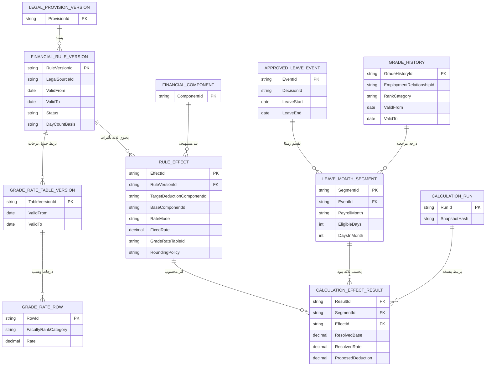
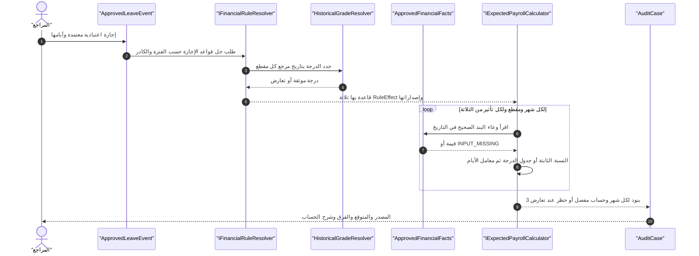

# محرك قرار إجازة اعتيادية لعضو هيئة تدريس — ثلاثة استقطاعات بأوعية ونسب متعددة

> **الحالة: مواصفة معمارية للاعتماد لاحقًا، وليست تنفيذًا ولا نسبة قانونية متحققًا منها.** المالك طرح نموذج قرار إجازة اعتيادية لعضو هيئة تدريس: **استقطاع أول 156% من بند معين، وثانٍ 91% من بند آخر، وثالث 48% أو 60% أو 200% حسب فئة الدرجة**. لا تفسر هذه النسب كاستقطاعات قانونية مطبّقة على أي فئة قبل إحضار مصدرها ونطاق سريانها والأوعية الدقيقة. وأكد أن الزمن المقصود عدد أيام الإجازة نسبة إلى **إجمالي أيام شهر الإجازة**؛ لا تستبدل ذلك بقسمة ثابتة على 30 دون تفعيل سياسة حساب الأيام الموثقة.

## 1. الفكرة: Event → RuleSet → three separate RuleEffects

الحدث الإداري `ANNUAL_LEAVE` هو **مشغّل واحد**. تُخزن نسخة قاعدة `FacultyAnnualLeaveDeductionRuleSet` لها ثلاثة تأثيرات مالية `RuleEffect`، كل واحد يشير إلى `TargetDeductionComponentId` و`BaseComponentId` ومصدر الوعاء والفترة وسياسة الأيام والتقريب:

| `EffectKey` | الوعاء | النسبة في المثال | شرط الانطباق | الناتج |
| --- | --- | --- | --- | --- |
| `LEAVE_DED_A` | `BASE_COMPONENT_A` | `1.56` = 156% | فئة عضو هيئة تدريس منصوص عليها | سطر استقطاع أول |
| `LEAVE_DED_B` | `BASE_COMPONENT_B` | `0.91` = 91% | فئة عضو هيئة تدريس منصوص عليها | سطر استقطاع ثانٍ |
| `LEAVE_DED_C` | `BASE_COMPONENT_C` | جدول نسبة مرتبط بالفئة التاريخية | درجة/فئة مستفيد بتاريخ مرجع **معتمد** | سطر استقطاع ثالث |

**مهم:** لا تجمع `156 + 91 + 60` لتستخدمها كنسبة واحدة على راتب الموظف. ولا تخلط بين **البند الذي يُستخدم كوعاء** و**بند الاستقطاع الناتج**؛ من الممكن أن يكونا مختلفين. لا تنشئ نوع بند من مجرد كود Oracle، بل اربطه بكاتالوج `FinancialComponent` مُعتمد ومعه فترة سريان.

## 2. إعدادات القرار التي يحررها المختص

| الحقل المنطقي | وظيفته |
| --- | --- |
| `RuleFamilyId` | مجموعة «استقطاعات إجازة اعتيادية لأعضاء هيئة التدريس» |
| `RuleVersionId` | إصدار ثابت بتاريخ اعتماد وسريان ومصدر قانوني |
| `EventType` | `ANNUAL_LEAVE` |
| `EmployeeRegime / FacultyRankCategory` | نطاق أعضاء هيئة التدريس وعلاقتهم بالعمل، لا الاعتماد على اسم الكلية |
| `RuleValidFrom/To` | فترة السريان القانوني للنسخة |
| `RequiredDecisionEvidence` | قرار الإجازة المعتمد والفترات والمستفيد |
| `DayCountBasis` | `ACTUAL_CALENDAR_DAYS_IN_MONTH` **إذا ثبت أنه الحساب المطبق**؛ أو سياسة أخرى معتمدة |
| `LeaveDayEligibilityPolicy` | هل تحسب كافة أيام الفترة التقويمية، أم أيامًا مستثناة، أم أيام عمل؛ لا افتراض عام |
| `GradeReferenceDatePolicy` | درجة يوم الإجازة، أو تاريخ ثابت يحدده النص، أو تقطيع يومي؛ لا تستخدم الدرجة الحالية بالضرورة |
| `BaseAmountReferenceDatePolicy` | تحديد الوعاء الفعلي لكل استقطاع بتاريخ صحيح |
| `RateTableVersion` | ربط الدرجة التاريخية بالنسبة الخاصة بالاستقطاع الثالث |
| `RoundingPolicy` | عدد الكسور وموضع التقريب (لكل يوم/مقطع/بند شهري/بعد الإجمالي) |
| `OverlapPolicy` | منع ازدواج الخصم عند تداخل إجازتين/قرار مصحح/جزاء |
| `EffectStatus` | `DRAFT/VERIFIED/APPROVED/ACTIVE/SUSPENDED` بحسب حوكمة القواعد |

### جدول نسبة الاستقطاع الثالث — لا نخترع فئة 200%

| `FacultyRankCategory` | النسبة المعلومة من **مثال المالك** | حالة ربط الدرجة |
| --- | --- | --- |
| مدرس `LECTURER` | 60% وفق سياق سابق | **مثال غير متحقق قانونيًا** |
| أستاذ مساعد `ASSISTANT_PROFESSOR` | 48% وفق سياق سابق | **مثال غير متحقق قانونيًا** |
| **الفئة الثالثة التي يقصدها المالك** | 200% | **اسم الفئة ونطاقها لم يُثبَتا بعد؛ لا تُخترع فئة بالاسم** |

أي درجة ليست في جدول إصدار القاعدة المعتمد أو تتعارض مع سجل الدرجات نتيجتها `GRADE_RATE_UNRESOLVED`، لا اختيار نسبة افتراضية أو أعلى نسبة.

## 3. الصيغة الحسابية للتمثيل المقترح

في كل **شهر مالي** `m` ولكل استقطاع `i`، وبعد تحديد الأيام المؤهلة `D(m,segment)` والوعاء المعتمد `Base_i(segment)` والنسبة `Rate_i(segment)`:

```text
RawDeduction_i_segment =
  Base_i(segment) × Rate_i(segment) ×
  EligibleLeaveDays(segment) / DaysInCalendarMonth(segment)

ProposedDeduction_i_month =
  ApplyApprovedRoundingPolicy(
    CombineSegmentsAccordingToRule(
      RawDeduction_i_segment for segments of same month and component
    )
  )
```

هذه **صيغة مقترحة مبنية على وصف المالك للتناسب الشهري**، وليست إثباتًا لطريقة خصم أيام الإجازة بالجامعات. `DaysInCalendarMonth` قد يساوي 28 أو 29 أو 30 أو 31 حسب الشهر؛ لا تكتب ثابتًا 30. ولا تُطبّق التجزئة اليومية على نسبة/وعاء لا يجيز سندها ذلك.

الوعاء المالي لكل استقطاع قد يختلف عن الآخرين وعن الأجر النقدي الحالي. يجوز ربط `BASE_COMPONENT_A` إلى `ApprovedFinancialFact` أو `ExpectedLine` إذا كان مصدره محكومًا، مع منع دورات الاعتماد (`A -> B -> A`) وقرارات تغيير درجة أو بدل في منتصف الشهر.

**هل نسبة 200% ممكنة؟** نعم *حسابيًا*: `Rate=2.00`. لا يوجد `Validation` يفترض أن النسبة لا تزيد عن 100% إلا إذا قانون هذا البند يحدد سقفًا صريحًا. لو تجاوز الخصم إجمالي المستحق النقدي لا تخصم تلقائيًا؛ اعرض عجزًا/استحقاق تسوية مع موافقة الجهة المختصة وسياسة الاستقطاع.

## 4. مثال متكامل بالأرقام الافتراضية

شهر نوفمبر 2026 (30 يومًا)، إجازة اعتيادية معتمدة من يوم 10 إلى 15 نوفمبر شاملًا (6 أيام)، والمراجع أدخل أو اعتمد أوعية الحساب: أ = 1000، ب = 800، ج = 500 جنيه. **فقط لأغراض المحاكاة** اعتبر أن الدرجة التاريخية مدرس ونسبتها الممثلة 60%، وأن الأيام التقويمية كلها مشمولة في حساب هذا المثال.

| البند | الوعاء | النسبة | أيام / شهر | ناتج رياضي |
| --- | ---: | ---: | ---: | ---: |
| `LEAVE_DED_A` | 1000 | 156% | 6/30 | 312.00 |
| `LEAVE_DED_B` | 800 | 91% | 6/30 | 145.60 |
| `LEAVE_DED_C` | 500 | 60% | 6/30 | 60.00 |
| **مجموع استقطاعات القرار في الاختبار** | | | | **517.60 جنيه** |

هذا لا يعني أن هذه الاستقطاعات صحيحة أو تُخصم من مرتب نوفمبر فعلًا. لا تحوّل 517.60 إلى `DeductionObligation` قانونية أو مبلغ Oracle مصدر لمجرد نجاح العمليات الرياضية.

## 5. تفصيل التداخلات الصعبة

**الإجازة تعبر شهرين:** 28 نوفمبر حتى 3 ديسمبر، فيُحسب نوفمبر عن ثلاثة أيام من 30 وديسمبر عن ثلاثة أيام من 31 إذا كانت الأيام كلها مؤهلة، ويُخرج النظام **ستة سطور** (ثلاثة لكل شهر)، مع حفظ قرار إجازة واحد ومصدره.

**تغيرت الدرجة وسط الإجازة:** إجازة من 29 نوفمبر إلى 4 ديسمبر وترقية سارية 1 ديسمبر؛ يُقسّم المحرك الفترات بمقطعَي الدرجة وفق `GradeReferenceDatePolicy` المعتمدة. لو حكم النسبة يحدد درجة يوم بداية الإجازة، لا تطبق نسبة ديسمبر تلقائيًا لمجرد تغير الدرجة.

**تغير الوعاء وسط الشهر:** يتبع `BaseAmountReferenceDatePolicy` لكل استقطاع، لا يعاد استخدام مبلغ يوم 1 على كل الفترة بغير سند.

**تداخل إجازتين اعتياديتين أو إجازة مع جزاء أو غياب:** يحسب `EligibleLeaveDays` من الأيام التي يغطيها القرار الإداري **دون تكرار اليوم نفسه**؛ وإذا كانت الوقائع متعارضة دون إلغاء/تصحيح يُنتج `EVENT_CONFLICT` للمقاطع المتأثرة لا استقطاعًا مزدوجًا.

**حالة بأثر رجعي:** لو ورد القرار لاحقًا، أنشئ `CalculationRun` جديدًا بتاريخ العلم ونسخ الوقائع مع الاحتفاظ بقرار المراجع السابق.

**الاستقطاعات المركزية خارج نطاق الحساب المستقل:** هذه القاعدة تستهدف فقط الاستقطاعات التي أجاز المالك حسابها مستقلاً؛ التأمينات وصندوق دعم المعاقين وصندوق الشهداء يظلون `CENTRAL_SOURCE_AMOUNT` ولا تطبّق عليهم نسب هذه القاعدة دون تغيير نطاق معتمد صريح.

**إشارة الخصم:** خزّن المبلغ المقترح كقيمة مع نوع مالي `Deduction` مستقل عن طريقة عرض السالب في مصدر Oracle؛ لا تخصم المبلغ مرتين بسبب `-Amount` في PDF.

**التقريب:** `decimal` وحسم ما إذا التقريب بعد كل مقطع أو لكل بند شهري وليس التقريب الافتراضي لكل ضربة. حساب 156% و91% و60% في المثال مقصود لعرض العمليات فقط.

## 6. ERD منطقي — قرار واحد إلى ثلاثة تأثيرات



**ملحوظة:** هذا ERD توضيحي. `APPROVED_LEAVE_EVENT`, `LEAVE_MONTH_SEGMENT` قد يترجمان إلى `AdministrativeDecision/EventEffect` و`RuleResolutionSegment` الموجودين بالفعل؛ لا تنشئ جداول مرادفة قبل مراجعة Schema. علاقات الوعاء والمستهدف ودرجات كل موظف يجب تحديد FK/تاريخها بدقة عند التصميم الفيزيائي.

## 7. UML — Resolver ثم حساب ثلاثة تأثيرات مستقلة



### Input/Output مقترحان (بيانات تدريبية لا قانون فعلي)

```json
{
  "decisionId": "LEAVE-TEST-001",
  "eventType": "ANNUAL_LEAVE",
  "employmentRelationshipId": "EMP-TEST-001",
  "leaveFrom": "2026-11-10",
  "leaveToExclusive": "2026-11-16",
  "payrollMonth": "2026-11",
  "historicalGrade": "LECTURER",
  "ruleVersion": "LEAVE-RULE-TEST-V1",
  "effectBaseAmounts": {"LEAVE_DED_A": "1000.00", "LEAVE_DED_B": "800.00", "LEAVE_DED_C": "500.00"},
  "dayCountBasis": "ACTUAL_CALENDAR_DAYS_IN_MONTH"
}
```

```json
{
  "status": "ILLUSTRATIVE_ONLY",
  "eligibleLeaveDays": 6,
  "daysInCalendarMonth": 30,
  "rateTableMatch": {"facultyRank": "LECTURER", "rate": "0.60"},
  "effectResults": [
    {"effectKey": "LEAVE_DED_A", "rate": "1.56", "base": "1000.00", "amount": "312.00"},
    {"effectKey": "LEAVE_DED_B", "rate": "0.91", "base": "800.00", "amount": "145.60"},
    {"effectKey": "LEAVE_DED_C", "rate": "0.60", "base": "500.00", "amount": "60.00"}
  ],
  "illustrativeTotal": "517.60",
  "isLegallyApprovedDeduction": false,
  "requires": ["LegalEvidence", "ApprovedGradeRateMapping", "EligibleLeaveDayPolicy", "ApprovedRoundingPolicy"]
}
```

## 8. اختبارات تصميم قبل إعطاء Gemini مهمة كود

| الرمز | الحالة | المخرج |
| --- | --- | --- |
| FL-001 | قاعدة واحدة وثلاثة آثار مستقلة | 3 أسطر حساب لا سطرًا مجمعًا |
| FL-002 | أوعية مختلفة للاستقطاعات الثلاثة | كل نسبة تُطبّق على وعائها وحده |
| FL-003 | نسبة 156% أو 200% مع سند تجريبي | يسمح بها المحرك رياضيًا دون حد 100% افتراضي |
| FL-004 | 6 أيام من شهر 30 يومًا | معامل أيام `6/30` |
| FL-005 | فبراير 28/29 يومًا أو شهر 31 يومًا | المقام الفعلي للشهر حسب سياسة الأيام |
| FL-006 | إجازة ممتدة عبر شهرين | 3 أسطر مستقلة لكل شهر وفترته |
| FL-007 | درجة مدرس في تاريخ الإجازة وأستاذ مساعد اليوم | جدول النسبة التاريخية وفق `GradeReferenceDatePolicy` |
| FL-008 | تغير درجة داخل الإجازة | تقسيم أو مرجع ثابت **وفق القاعدة فقط** |
| FL-009 | نسبة 200% دون ربط قانوني بفئة محددة | `GRADE_RATE_UNRESOLVED`، لا تخمين |
| FL-010 | وعاء بند مفقود أو متضارب | `INPUT_MISSING`، لا صفر |
| FL-011 | إجازتان متداخلتان | لا خصم لليوم مرتين؛ مراجعة إن تعارضتا |
| FL-012 | مصدر Oracle يحمل نفس الخصم بإشارة سالبة | لا خصم مزدوج عند المقارنة |
| FL-013 | اختلاف سياسة التقريب | الناتج محفوظ بأثر يوضح موضع التقريب |
| FL-014 | القرار وصل بعد اعتماد صرفية سابقة | تشغيل بإصدار جديد دون مسح السابق |
| FL-015 | بند من الصناديق المركزية ضمن جدول الاستقطاعات | لا حساب مستقل خارج السياسة المعتمدة |
| FL-016 | خصم إجمالي يتجاوز المبلغ النقدي الممكن | لا خصم تلقائي؛ قرار مراجعة/تسوية مشروط |
| FL-017 | مدرّس ببيانات الدرجة غير مؤكدة للفترة | `HISTORY_CONFLICT` أو `INPUT_MISSING` |
| FL-018 | محاولة تفعيل النسب دون سند وفترة معتمدة | منع تفعيل القاعدة `RULE_NOT_VERIFIED` |

## 9. ما الذي يحتاج اعتمادًا من الوحدة قبل التطبيق؟
1. **الأسماء الرسمية للأوعية أ وب وج** وارتباطها بالبند المالي/الرقم المرجعي وقرار الاستحقاق، لا مجرد كود Oracle.
2. **أسماء الاستقطاعات الثلاثة المستهدفة** وهل هي خصومات مستقلة أم تسويات/تغييرات استحقاق، ومن المختص باعتمادها.
3. **فئة الدرجة صاحبة نسبة 200%**، وهل 48% و60% محددتان كما في مثال المالك السابق لكل من الأستاذ المساعد والمدرس، وتواريخ سريان كل نسبة.
4. سند استعمال **عدد الأيام التقويمية الفعلية للشهر**، وهل تُحسب العطلات ونصف اليوم والإجازات الممتدة بطريقة مختلفة.
5. طريقة جلب وعاء كل بند وتاريخ مرجعه، وحدود التقريب والخصم والتوريد إن وجدت.
6. نص القاعدة بالنسبة للإجازة الاعتيادية لأعضاء هيئة التدريس في الكادر المعني؛ قد يختلف عن الموظفين الإداريين أو عن حالات غياب/إجازة دون أجر.

**مبدأ التصميم:** القاعدة متعددة التأثيرات وقابلة للإعداد والإصدار. يستقبل المحرك قرارًا واحدًا ثم يُنتج ثلاثة **مقترحات استقطاع** مستقلة مع الحساب والأدلة. لا ينفذ الخصم أو يعدل Oracle بنفسه.
