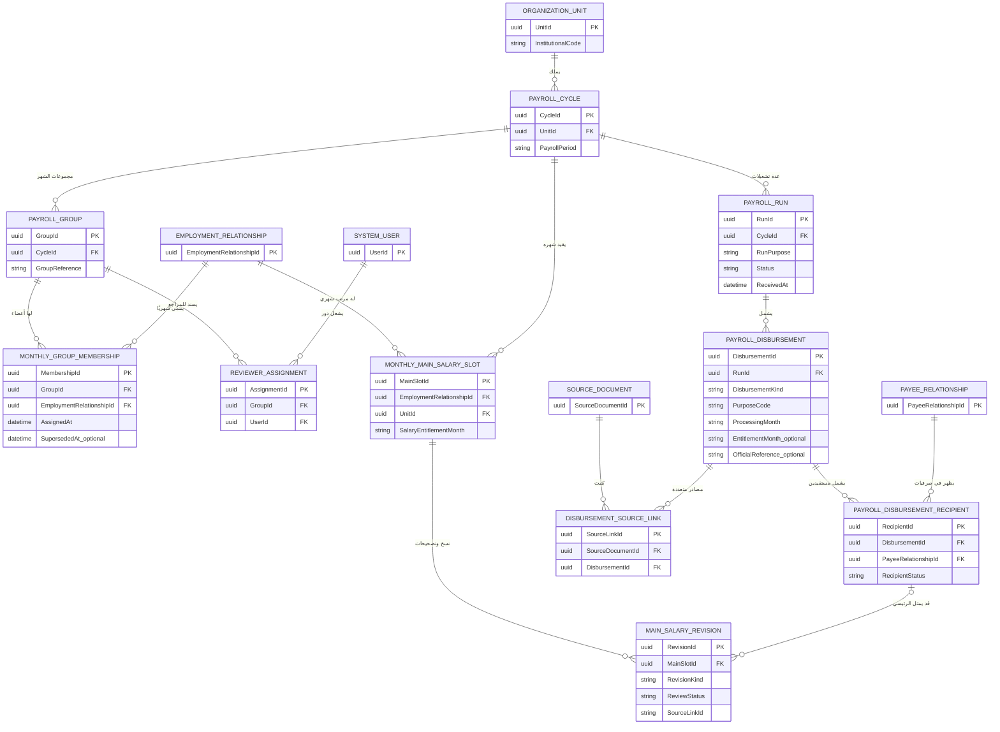

# هيكل تشغيلات الشهر ومجموعات الموظفين: مرتب رئيسي واحد وصرفيات منفصلة متعددة

> **حالة الوثيقة:** متطلبات أعمال أكدها المالك + تصميم تفصيلي مقترح، **لا SQL منفذ ولا كود**. تُستخدم أمثلة افتراضية فقط. هذا الهيكل يُكمل `PayrollCycle` و`PayrollGroup` و`ReviewerAssignment` الحالية ولا يقترح نسخًا مكررة منها.

## 1. القواعد التي أكدها المالك

- تُقسم الموظفون إلى **مجموعات مراجعة** في شهر المرتب، ويكون لكل مجموعة تكليف مراجع أو أكثر بحسب الصلاحيات والفترة.
- صرفيات الموظف نوعان منطقيان: **رئيسية** `MAIN_SALARY` تمثل راتب الشهر، و**منفصلة** `SEPARATE` تمثل أي دفعة مالية أخرى (مثل مكافأة أو حافز مستقل أو متجمدات، بحسب تصنيف الجهة المعتمد).
- **لا يجوز اعتماد أكثر من مرتب رئيسي منطقي واحد** لنفس الموظف عن **شهر المرتب نفسه** داخل نطاق الوحدة الحسابية.
- **يسمح بعدة صرفيات منفصلة** للموظف في شهر الصرف نفسه، حتى إن تكرر نوع المكافأة، إذا كانت كل صرفية حقيقية ولها هوية مصدر وسبب مختلفان. لا تطبق قاعدة فرادة المرتب على المنفصلة.
- **لا يمحو النظام أي سطر Oracle أو مصدر متكرر**؛ قيد الفرادة يخص **السجل المنطقي المعتمد للمرتب الرئيسي**، لا ظهور ملف أو سطر أو محاولة رفع.
- يمكن مراجعة مرتبات كل مجموعة بشكل مستقل؛ الصرفيات المنفصلة يراها المراجعون المصرح لهم وفق نوع الصرف ونطاق المجموعة/الوحدة، لا يُستنتج الإذن من نوعها فقط.

## 2. ثلاثة مستويات زمنية لا تخلطها

| المستوى | النموذج | المعنى |
| --- | --- | --- |
| شهر المرتب `SalaryEntitlementMonth` | `2026-11` | **المفتاح الشهري لقيد مرتب الموظف الرئيسي** |
| شهر ظهور/صرف الصرفية `PayrollProcessingPeriod` | `2026-11` أو `2026-12` | تاريخ إعداد كشف الصرف أو تقرير Oracle، وقد يختلف عن فترة الاستحقاق |
| تشغيلات وتجريات الشهر `PayrollRun` | تشغيل رقم 1، تصحيح رقم 2 | عدة عمليات أو دفعات ملفات في الشهر؛ **ليست حقوق راتب رئيسي متعددة** |

مثال: مكافأة وصلت في ديسمبر عن عمل في أكتوبر، فتسجل `ProcessingMonth=2026-12` و`EntitlementPeriod=2026-10`. أما صرفية مرتب نوفمبر فهي `MAIN_SALARY` عن `SalaryEntitlementMonth=2026-11` حتى لو وصل كشف تصحيحها في ديسمبر. ويجب التمييز بين **ظهورها بكشف** و**إثبات الدفع**.

## 3. عائلة الكيانات المقترحة (مع إعادة استخدام الموجودة)

| الكيان | الوظيفة | قيد/علاقة |
| --- | --- | --- |
| `PayrollCycle` **موجود تصوريًا** | دورة أو شهر العمل حسب المؤسسة | ترتبط بوحدة وحالة؛ لا تمثل تلقائيًا صرفية واحدة |
| `PayrollRun` **امتداد** | تشغيل/تجريّة شهر، وتاريخ استقبال ملفات/إعادة معالجة/تصحيح | العديد من التشغيلات داخل الدورة |
| `PayrollDisbursement` **مقترح** | هوية صرفية المصدر، ونوعها `MAIN_SALARY/SEPARATE`، والغرض والبنك/المستند/تاريخ الصرف | قد تندرج بها عدة موظفين، وتتعدد المنفصلة |
| `PayrollDisbursementRecipient` **مقترح** | ظهور المستفيد داخل صرفية معينة | لا تُفرَد منفصلة حسب الموظف والشهر |
| `MonthlyMainSalarySlot` **مقترح** | **هوية رئيسية ثابتة** للمرتب المستحق للموظف عن شهر ووحدة | `UNIQUE(UnitId, EmploymentRelationshipId, SalaryEntitlementMonth)` *للسجل الرئيسي المنطقي فقط* |
| `MainSalaryRevision` **مقترح** | نسخة أساس/تصحيح/اعتماد للسجل الرئيسي | عدة نسخ ولكن **نسخة فعالة واحدة** مع التدقيق |
| `PayrollGroup` **موجود تصوريًا** | مجموعة موظفين في سياق دورة المرتب | المجموعة ليست بنكًا بالضرورة |
| `MonthlyGroupMembership` **مقترح** | انتماء علاقة الموظف لمجموعة مرتبه في الشهر، وتواريخ التغيير | قيد عضوية رئيسية **فعالة واحدة** لكل علاقة وشهر في السياق نفسه |
| `ReviewerAssignment` **موجود تصوريًا** | المراجع المكلف بمجموعة في الدورة وتاريخ التكليف والتغيير | صلاحيات شهرية على المرتب الرئيسي، والآخر وفق RBAC |

**حد هوية الموظف:** القيد الأساسي يطبَّق على `EmploymentRelationshipId` داخل `OrganizationUnitId` وشهر الاستحقاق، بعد **حسم هوية علاقة العمل**. لا تجعل الرقم القومي وحده مفتاح فرادة؛ قد توجد علاقات تعاقد أو مكافأة مستقلة، أما حالة **علاقتَي تعيين فعليتين لنفس الشخص** فتحتاج قرار عمل صريحًا قبل السماح بمرتبين رئيسيين. **القاعدة المؤكدة:** لا يتكرر مرتب رئيسي للعلاقة الوظيفية نفسها في الشهر؛ وسياسة اختلاف العلاقات لنفس الشخص تُرفع للمسؤول بدل افتراض إباحتها.

### لا تجعل `PayrollDisbursement` بديلًا عن `SourceDocument`
الصرفية هي **هوية عمل/صرف** قد تظهر في كافر وصرفية أفراد وكشوف بنك أو Excel ونسخة مصححة. الملف والمستند وحسابات الأسطر الأصلية **طبقة أدلة مستقلة**. قد يُستورد المصدر نفسه مرتين أو يصل تصحيح رسمي؛ يتم كشفه وربطه بالصرفية المنطقية دون إضافة صرفية رئيسية ثانية.

## 4. ERD المقترح — شهر واحد، مجموعات، صرفيات متعددة

هذه الكيانات إضافات **تصورية**؛ عند التصميم الفيزيائي راجع `ERD-IMPORT-AND-AUDIT` لتوحيد `PayrollCycle` و`PayrollGroup` و`SourceCaptureSession` و`ImportBatch`. العلاقة من `PayrollDisbursementRecipient` إلى `MainSalaryRevision` خاصة بالرئيسية فقط، ولا تنشئ `MainSlot` لصرفية منفصلة.

## 5. سياسة فرادة المرتب: ضمان معماري على الخادم وقاعدة البيانات

### مفتاح السجل الرئيسي
`MonthlyMainSalarySlot(UnitId, EmploymentRelationshipId, SalaryEntitlementMonth)` **فريد**. الإصدارات والاعتمادات وتصحيحات Oracle تشير إلى `MainSlotId` نفسه، ولا تنشئ `MainSlot` آخر. يمكن وجود عدد كبير من مستندات المصدر/المراجعة للمرتب ذاته دون ازدواج.

### عند الاستيراد أو الإدخال المباشر
- لو جاءت صرفية `MAIN_SALARY` للموظف في نوفمبر ولا يوجد `MainSlot`، يمكن إنشاء **مسودة مرتب رئيسي واحدة** بعد مطابقة الهوية.
- لو جاءت أخرى لنفس الموظف/الوحدة/شهر المرتب ولو من **مجموعة أخرى**، لا تُقبل كمرتب رئيسي ثانٍ؛ تُعرض `DUPLICATE_MAIN_CANDIDATE` للتحقق: نسخة مكررة؟ مستند مكمل لنفس الصرفية؟ تصحيح رسمي؟ خطأ تصنيف؟
- لو ثبت أنه **تصحيح**، ينشأ `MainSalaryRevision` جديدة تحت `MainSlot` نفسها، مع `SupersedesRevisionId` دون طمس الإصدار السابق.
- لو كان **جزء ملف** يحوي سطورًا أخرى من المرتب الرئيسي نفسه، يُربط بنفس الصرفية/السجل مع تحقق الصفوف والمجاميع؛ لا يُعتبر «مرتبًا آخر»، ولا يُدمج بلا دليل.
- لو كان **صرفية منفصلة**، لا تُطبّق فرادة المرتب عليها؛ يُحفظ `DisbursementId` مستقل مع `PurposeCode` والجهة والفترة والمستند.
- لو هوية الموظف ملتبسة أو الشهر غير مؤكد، تُحفظ ملاحظة المصدر دون قبول مرتب رئيسي جديد أو افتراض أنها منفصلة.

### قيد قاعدة البيانات — تمثيل منطقي لا SQL نهائي
`UNIQUE(OrganizationUnitId, EmploymentRelationshipId, SalaryEntitlementMonth)` على جدول `MonthlyMainSalarySlot` فقط، و`UNIQUE(MainSlotId, RevisionNumber)` للإصدارات، مع حارس نسخة فعالة واحدة وسياسة اعتماد. لا تضع `UNIQUE(PersonId, Month)` على **كل الصرفيات**؛ سيمنع المكافآت المتعددة خطأً. لا تحذف القيود لمجرد التعامل مع `Cancelled`؛ أبقِ هوية المرتب مستقرة، وأرفق التصحيح والإلغاء بحالتها وسجلها.

قبل نقل هذه القاعدة إلى SQL، يجب اعتماد كيفية تعامل الوحدة مع موظف له أكثر من علاقة عمل موثقة أو نقله بين وحدتين في شهر واحد. **القيود هنا خاصة بوحدة العمل المعتمدة ولا تعد حكمًا قانونيًا عامًا**.

## 6. المجموعات: مسؤولية مراجعة لا تعني ملكية الموظف الدائمة

- `PayrollGroup` هي **مجموعة الموظفين للمراجعة الشهرية**، وليست بالضرورة `SourceGroupSummary` البنكية في كافر Oracle.
- الموظف قد ينتقل بين المجموعات عبر الشهور. يسمح بتعديل إسناده أثناء الشهر مع توثيق النسخة السابقة والمراجع السابق وتوقيت النقل؛ لا تنشأ صرفية مرتب ثانية عند نقله.
- للمرتب الرئيسي: يعالج `MonthlyGroupMembership` العضوية **الفعالة الواحدة** للمستفيد في دورة الشهر، ويجوز سجل تاريخي بتكليفات سابقة.
- للمنفصلة: قد تكون صرفية خاصة بمستفيدين من مجموعات مختلفة أو صنف مستحقين غير موظفين. صلاحية المراجعة لها **مستقلة بنطاق نوع الصرف والوحدة والمستخدم**؛ لا تُفرض عضوية مجموعة المرتبات بشكل أعمى.
- `Bank/Branch/PaymentGroup` للكافر تظل **هوية مصادر دفع**، غير `ReviewerGroup`؛ يمكن الربط بينها بالتقارير إن ثبتت العلاقة.
- يجب أن تُحسب إحصاءات "عدد الموظفين بمرتب رئيسي" **مرة واحدة لكل MainSlot**، و"عدد الصرفيات المنفصلة" **بعدد DisbursementIds المرتبطة بالمستفيد**؛ لا تعدّ السطور المالية أو ملفات PDF عدد صرفيات.

## 7. مثال 3 مجموعات داخل شهر واحد

نوفمبر 2026 لوحدة `30200105`، 3 مجموعات `G-A/G-B/G-C`. الموظف `EMP-TEST-01` في `G-B` وصرفيته الرئيسية `MAIN-NOV-1`.

| تاريخ الإدخال | الصرفية | النوع | المستفيد | نتيجة الإدخال |
| --- | --- | --- | --- | --- |
| 5 نوفمبر | مرتب نوفمبر `MAIN-NOV-1` | `MAIN_SALARY` | `EMP-TEST-01` | السجل الرئيسي الوحيد لشهر نوفمبر |
| 12 نوفمبر | مكافأة `BON-11-01` | `SEPARATE` | نفس الموظف | مقبولة كصرفية منفصلة مستقلة |
| 19 نوفمبر | حافز `INC-11-03` | `SEPARATE` | نفس الموظف | مقبولة كصرفية منفصلة ثانية |
| 23 نوفمبر | متجمد `RET-11-05` | `SEPARATE` | نفس الموظف | صرفية منفصلة ثالثة، لها شهر استحقاق أصلي |
| 25 نوفمبر | ملف مرتب نوفمبر الثاني `MAIN-NOV-2` | `MAIN_SALARY` | نفس الموظف | **مرشح تكرار**؛ يمنع قبول مرتب ثانٍ |
| 28 نوفمبر | تصحيح رسمي لمرتب نوفمبر | `MAIN_SALARY` تصحيح | نفس الموظف | `Revision` على `MainSlot` نفسها، لا مرتب جديد |

النتيجة: **صرفية رئيسية واحدة + ثلاث صرفيات منفصلة** لهذا الموظف. الملفات الإضافية أو التصحيحات لا تغير العدد المنطقي.

## 8. API / قواعد الكلاسات المقترحة

| العقد | وظيفة الواجهة |
| --- | --- |
| `IPayrollCycleService.OpenMonth(unit,month)` | فتح دورة مراجعة الشهر للوحدة |
| `IPayrollGroupService.AssignEmployee(month,employee,group)` | إسناد الموظف لمجموعة شهرية مع التوثيق |
| `IPayrollRunService.RegisterRun(cycle,sourceInfo)` | تسجيل تشغيل أو دفعة داخل الشهر |
| `IPayrollDisbursementClassifier.Classify(source)` | تصنيف MAIN أو SEPARATE أو UNKNOWN من محتوى المصدر وسياقه |
| `IMainSalaryRegistry.GetOrCreateMainSlot(unit,employment,entitlementMonth)` | منع مرتب رئيسي منطقي مكرر |
| `IMainSalaryRegistry.AttachCorrection(mainSlot,officialEvidence)` | ربط تصحيح رسمي بإصدار رئيسي جديد |
| `ISeparateDisbursementService.RegisterSeparate(disbursement,source)` | إضافة صرفيات منفصلة متعددة مع كشف تكرار **المستند نفسه** |
| `IReviewerAccessPolicy.CanReview(user,disbursement,group,month)` | اختيار الصلاحية المسموحة للمرتب والمنفصلة |
| `IDisbursementReconciler.Reconcile(disbursement,sourceLines)` | مطابقة المبالغ والأفراد والكافر والمستندات الصحيحة |

## 9. بوابات الالتباس والتقارير

الحالات المطلوبة: `UNKNOWN_DISBURSEMENT_TYPE`، `MAIN_SALARY_DUPLICATE_CANDIDATE`، `MAIN_SALARY_IDENTITY_PENDING`، `MAIN_SALARY_CORRECTION_PENDING`، `MAIN_SALARY_REVIEWED`، `SEPARATE_DISBURSEMENT_REVIEWED`، `GROUP_MEMBERSHIP_CONFLICT`.

التقارير المقترحة: كشف الموظفين الذين ليس لهم مرتب رئيسي في شهر، وموظف به أكثر من **مصدر مرشح** لمرتب رئيسي، والصرفيات المنفصلة بحسب الغرض، واختلاف مجموعات المراجعين عن مجموعات البنوك، وعدد الموظفين في كل مجموعة، وصرفيات المنفصلة المعلقة. **عدم وجود مرتب رئيسي قد يكون صحيحًا** (مثل إنهاء خدمة أو توقف استحقاق موثق) فيعرض حالة تحقق لا خطأ آليًا.

## 10. اختبارات التصميم

| المعرف | سيناريو | النتيجة |
| --- | --- | --- |
| PG-001 | موظف في مجموعة واحدة نوفمبر ويظهر في ملف رئيسي | قبول مرتب رئيسي واحد |
| PG-002 | نفس موظف ونفس شهر من ملف MAIN آخر | `MAIN_SALARY_DUPLICATE_CANDIDATE`، لا قبول مرتب ثانٍ |
| PG-003 | ملفان يخصان المرتب نفسه أحدهما مكمل | مصدران لنفس `MainSlot` بعد إثبات الربط |
| PG-004 | مصدر تصحيح رسمي لمرتب نوفمبر | `MainSalaryRevision` جديدة، لا `MainSlot` جديد |
| PG-005 | MAIN نوفمبر وصرفيات مكافأة وحافز ومتجمدات 3 مرات | 1 MAIN و3 SEPARATE |
| PG-006 | صرفيتان منفصلتان من الغرض نفسه لكن بمستندين مختلفين | تُحفظان، ولا قيد فريد للموظف/الشهر/الغرض |
| PG-007 | إعادة استيراد ملف منفصل مطابق حرفيًا | كشف تكرار المصدر دون إسقاط صرفية مختلفة |
| PG-008 | الموظف نقل من مجموعة أ إلى ب داخل الشهر | نسخة إسناد جديدة، لا MAIN ثانية |
| PG-009 | موظف MAIN في مجموعة غير مجموعة مراجع المستخدم | رفض المراجعة في API |
| PG-010 | موظف في صرفية منفصلة مشتركة بين المجموعات | وصول المراجع المخول بنطاق الصرف المنفصل دون صلاحية عامة على المرتب |
| PG-011 | تصنيف نوع الصرفية غير معروف من PDF/Excel/الشاشة | `UNKNOWN_DISBURSEMENT_TYPE` يحتاج تأكيد، لا MAIN افتراضي |
| PG-012 | صرفية منفصلة نوفمبر عن استحقاق أكتوبر | حفظ `ProcessingMonth` و`EntitlementPeriod` منفصلين |
| PG-013 | مصدر MAIN مكرر في مجموعتين داخل الوحدة والشهر | منع اعتماد تكرار منطقي حتى لو كان GroupId مختلفًا |
| PG-014 | هوية الشخص لم تُحسم | حفظ المصدر وعدم تجاوز قيد الرئيسية |
| PG-015 | مرتبان رئيسيان يتسابق اعتمادُهما على خادمين | قيد قاعدة بيانات/معاملة يمنع الازدواج |
| PG-016 | ظهور موظف في مجموعة بنك مختلفة عن مجموعة المراجع | لا افتراض التطابق أو تغيير GroupMembership |
| PG-017 | صرفية رعاية طفل كتسوية لا أمر دفع رئيسي | تصنيف مستقل بحسب نموذج Oracle الرسمي، لا MAIN تلقائيًا |
| PG-018 | نسخة رئيسية ألغيت أو صُححت | حفظ `MainSlot` وإصداراتها وتاريخ الاعتماد |
| PG-019 | موظف لم يستحق مرتبًا رئيسيًا في شهر | حالة استحقاق/توقف تحتاج إثباتًا لا إنشاء صرفية صفرية |
| PG-020 | علاقة عمل مزدوجة للشخص نفسه | سياسة تصعيد قبل اعتماد أي استثناء عن قيد المرتب الرئيسي |
| PG-021 | أكثر من `PayrollRun` لنفس شهر الراتب | لا تتكرر الصرفية الرئيسية لمجرد تعدد التشغيلات |
| PG-022 | كود بند يتكرر مرتين في صرفية منفصلة | حفظ كل سطر وإجماليات صحيحة دون دمج |

## 11. قرارات متبقية قبل التنفيذ
1. مصدر الحقيقة لتعريف "الموظف" عند قيد المرتب الرئيسي إذا كان لنفس الشخص علاقتا عمل.
2. هل `SalaryEntitlementMonth` يساوي دائمًا شهر Oracle المدون أم يحتاج تاريخ استحقاق مستقل لتصحيح الشهر؟
3. حدود مجموعات الموظفين للمرتبات: هل العضوية واحدة فعالة لكل شهر أم يجوز توزيع موظف داخل الشهر على مراجعين مختلفين بقرار؟
4. هل تجريات/تشغيلات الشهر تمثل ملفات دفع منفصلة أم إعادة تشغيل للصرفية نفسها؟ التصميم يحفظ الاثنين.
5. صلاحية مراجعة الصرفيات المنفصلة: هل هي للجميع المخولين بالوحدة أم وفق نوع الصرف/المجموعة؟
6. هل هناك حالات «مرتّب رئيسي واحد في جهتين» تستلزم استثناءً لا يصح تطبيق قيد الوحدة عليها دون فحص؟

**ملفات مكملة:** [أمثلة ERD/UML والمدخلات والمخرجات](../examples/06-MONTHLY-PAYROLL-GROUPS-AND-DISBURSEMENTS.md)، [ERD الاستيراد](../architecture/ERD-IMPORT-AND-AUDIT.md)، [شروط القواعد الزمنية](TEMPORAL-RULE-RESOLUTION-AND-CONFLICTS.md).
