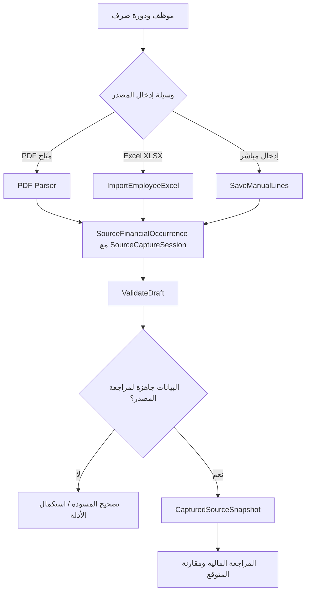

# الاستحقاقات المركزية: PDF أو Excel أو شاشة مباشرة ضمن نموذج إثبات موحد

> **الحالة: تصميم مقترح لا كود منفذ.** **اختيار المالك التشغيلي الأحدث:** عندما يتعذر PDF يستقبل النظام ملف **Excel XLSX بموظف وبنوده** أو يستقبل البنود من **شاشة إدخال مباشرة دون ملف**؛ لا يعتمد مسار هذا الطلب على صور أو OCR. القنوات القديمة التي ذُكرت في التوثيق البحثي ليست متطلبات لتنفيذ البديل الحالي. **الإدخال اليدوي ليس نسخة Oracle رسمية**، ولا يخلق مستندًا أو مبلغًا سبق إثباته لدى المركزية دون دليل.

## 1. القنوات ذات الأولوية في التصميم الحالي

| `CaptureMethod` | وظيفة القناة | ملحوظة الإثبات |
| --- | --- | --- |
| `NATIVE_PDF` | قراءة ملف PDF رسمي عند توفره | يحتفظ بالأصل والبصمة والتحقق من القراءة |
| `EXCEL_IMPORT` | ملف `xlsx` فيه **موظف واحد ومجموعة بنود** | بديل مستندي للبيانات في المراجعة، وليس ملف Oracle رسميًا |
| `DIRECT_FORM` | إدخال الموظف والشهر والبنود مباشرة من الشاشة دون رفع ملف | بديل مستقل، مع مراجع وسبب ومرجع أصل إن وجد |

**البدائل المطلوبة حاليًا هي Excel والشاشة فقط.** الصور وOCR والتعامل مع PDF ممسوح كانت تصورات سابقة خارج نطاق تنفيذ هذين البديلين، ولا يجوز جعلها شرطًا أو خطوة إجبارية.

[العقد التفصيلي وERD وUML والقالب المقترح](EXCEL-AND-DIRECT-EMPLOYEE-PAYROLL-INTAKE.md).

### لماذا هذا الفصل؟
`SourceDocument` = ما احتُفظ به فعلاً: PDF/صورة/ملف بيانات أو **سجل مرجعي إلى أصل خارجي لم يمكن رفعه**.
`SourceCaptureSession` = طريقة التقاط القيم والمراجع، ووثيقة السبب.
`SourceFinancialOccurrence` = سطر/ظهور أصل مالي مستقل، سواء استُخرج آليًا أو كُتب يدويًا.
`SourceReportedTotal` = الإجمالي المطبوع أو المكتوب من مصدر ثابت، وليس إجماليًا أعاد النظام حسابه.
`CaptureReview` = تدقيق شخص آخر أو صاحب صلاحية في **دقة النسخ**؛ لا يثبت في حد ذاته مشروعية الاستحقاق أو التوريد.
`AuditCase/ReviewedOverlay` = القرار المالي المستقل بعد القبول المصدري.

**ممنوع** تسمية سجل `MANUAL_WITHOUT_DOCUMENT` باسم `OfficialPdf` أو إظهاره بمؤشر `SOURCE_VERIFIED` لمجرد إدخال المستخدم.

## 2. نموذج إدخال يدوي كامل — نفس حقول Oracle الأساسية

### رأس المصدر
`SourceCaptureId`, `PayrollCycleId`, `SourceReportType` (صرفية فرد/كافر/132/تسوية رعاية الطفل/أخرى)، `InstitutionalUnitCode`, `ReportPeriod`, `ReportReferenceNo`, `ReportIssueDate?`, `OriginalDocumentRef?`, `EvidenceKind`, `CaptureMethod`, `ReasonPdfUnavailable`, `EnteredBy`, `EnteredAt`, `IndependentWitnessBy?`, `SourceStatus`.

### هوية المستفيد
`SourceRecipientOccurrenceId`, الاسم الخام كما هو، رقم صرف/عامل بحسب المستند، مرجع هوية ملائم ومحمي، الجهة/الكلية، البنك/الفرع/المجموعة **إذا وردت فعلاً**؛ الربط بـ`PayeeRelationshipId` الداخلي قرار منفصل.

### سطر مالي مستقل
`SourceLineId`, `OccurrenceOrder`, `Page/Row/Pane/Cell?`, `FinancialSide` (Earning/Deduction/EmployerShare/Reference/Total/Unknown)، `RawCode?`, `RawLabel?`, `RawAmountToken`, `SignedAmount(decimal)?`, `EntryOrigin`, `ExtractionConfidence?`, `VerificationStatus`, `EvidenceLocation?`.

قد يتكرر الكود أو الاسم أو المبلغ؛ **كل سطر منفصل**، بما فيه السطر اليدوي، ولا `UNIQUE(Code,Name)`. إذا نقص الكود، لا تخترعه؛ استخدم `null` وحالة `CODE_UNKNOWN`.

### المجاميع والتغطية
`ReportedGross?`, `ReportedDeduction?`, `ReportedNet?`, `ReportedEmployerShares?`, `ReportedRecipientCount?`, `SourceCoverage` = `FULL_DOCUMENT` أو `SELECTED_PAGES` أو `SELECTED_RECIPIENT` أو `SELECTED_LINES` أو `UNVERIFIED`.

إذا لم يظهر إجمالي في المستند، اترك `ReportedTotal=null`، واحسب `EnteredLinesTotal` **كمعلومة محسوبة مستقلة**؛ لا تنقلها إلى حقل الإجمالي المطبوع.

## 3. خطوات المراجع لمساري Excel والإدخال المباشر

1. تحديد الموظف وعلاقة الصرف والدورة والشهر ونوع التقرير.
2. اختيار `EXCEL_IMPORT` لرفع مصنف `Employee/Items`، أو `DIRECT_FORM` لإضافة صفوف من شاشة عربية بدون أي ملف.
3. إنشاء `SourceCaptureSession` وحفظ معرف الموظف الخام وبيانات الجهة والفترة والكود والاسم والمبلغ والجانب لكل سطر.
4. فحص صحة `decimal` وإشارة المبلغ، وتكرار السطور والأكواد **دون حذفها**، وإجمالي السطور المنقول والإجمالي المنشور إن كان موجودًا.
5. معاينة مسودة كاملة؛ التصحيح مسموح للمسودة فقط، والنسخة التي دخلت مراجعة مالية لا تُمسح.
6. تقديم المسودة لبوابة تحقق دقة الإدخال وصلاحية المراجع ومستند المصدر إن وجد؛ غياب المستند لا يخلق شهادة رسمية زائفة.
7. عند اعتماد لقطة المصدر للمقارنة تُغذّي محرك المراجعة نفسه المستخدم لبيانات PDF.
8. إذا وصل PDF رسمي لاحقًا، تُعرض فروق النسختين وتحفظان دون تكرار المبالغ.

**لا يوجد استخراج نص من صور، ولا ضرورة لرفع Excel عند اختيار الشاشة، ولا استبدال للوقائع المالية المعتمدة داخليًا ببيانات مركزية مدخلة.**

## 4. سلسلة الإثبات والدرجات
استخدم **محورين مستقلين**:
- `EvidenceAuthenticity`: `OFFICIAL_ORIGINAL_PRESENT`, `OFFICIAL_VIEW_ATTESTED`, `IMAGE_UNCONFIRMED`, `NO_ORIGINAL_EVIDENCE`.
- `TranscriptionAccuracy`: `AUTO_UNCHECKED`, `USER_ENTERED`, `SECOND_CHECK_PENDING`, `SECOND_CHECK_PASSED`, `DISPUTED`.

يمكن أن يكون النقل دقيقًا من صورة مزيفة أو ناقصة، ويمكن أن يكون المستند رسميًا لكن OCR يخطئ. **لا تدمج المحورين في حقل `Verified=true`**. ضوابط القبول تحددها فئة التقرير وسياق الحالة والمراجع النهائي.

## 5. مبدأ «استبدال القناة لا استبدال المصدر»
أي قناة إدخال تنتج `SourceObservationSnapshot` بنفس عقد المستند المطبوع، مع تمييز `CaptureMethod` و`EvidenceAuthenticity` وحالة التغطية. المحرك المالي لا يقرأ مباشرة من صورة أو TextBox؛ يقرأ **لقطة مصدر خاضعة للبوابة نفسها**.

## 6. دورة التصحيح والخصوصية
- كل صورة/لقطة شاشة أصلية محفوظة في أرشيف خاص مشفر إن سُمح بذلك، مع بصمة، تاريخ، المستخدم، مسار استدلال الصفحة/القصّ؛ لا رفع بيانات موظفين لـGitHub.
- OCR اختياري ونتيجته محلية/مقيدة بموافقة حماية البيانات؛ لا ترسل رواتب إلى مزود OCR خارجي دون اعتماد قانوني وأمني.
- للصورة الملتقطة بالهاتف خطر اقتصاص بيانات الحقول أو إخفاء أصفار أو ضغط يقلل الوضوح؛ تُعلّم الخانة بغير مؤكدة عند الشك.
- الإدخال اليدوي بدون صورة لا يُستخدم لتجاوز `SOURCE_REJECTED` أو لإسقاط ملاحظات قارئ PDF.
- طلب تعديل مبلغ مصدر **بعد اعتماده للالتقاط** ينتج `SourceCorrectionDecision` وإصدارًا جديدًا، لا تغييرًا صامتًا. لا تخلط `SourceCorrection` مع `ReviewedAmountOverride`.
- تدقيق ممن لديه صلاحية الوصول إلى بيانات الموظف والمجموعة؛ لا شهادات تحقق ذاتي بلا ضوابط عند الحالات عالية الأثر.

## 7. اختبارات التصميم — `MI-`
| الرمز | الحالة | المتوقع |
| --- | --- | --- |
| MI-001 | PDF أصلي | مسار مصدر نصي مع حفظ المستند والبصمة |
| MI-002 | صورة أو لقطة شاشة واضحة | حفظ الصورة، OCR مرشح، مراجعة اسم/جانب/مبلغ |
| MI-003 | سالب عربي أو سنة بند تشبه المبلغ | لا سقوط سالب أو استخراج سنة كمبلغ؛ `ReviewRequired` |
| MI-004 | إدخال يدوي لصفين بنفس الكود | `SourceLineId` مستقل لكل سطر |
| MI-005 | تصحيح مستخدم لمبلغ كتبه بعد اعتماده | إصدار مصدر جديد مع سجل كامل |
| MI-006 | إدخال يدوي بلا أصل ولا شاهد | `UNSUPPORTED_PROVISIONAL`، لا `OfficialSourceVerified` |
| MI-007 | صورة ناقصة لا تُظهر الإجمالي | `ReportedTotal=null`، لا استنتاج أنه مجموع الأسطر المطبوع |
| MI-008 | إدخال بند في تقرير 132 كأنه تسوية رعاية | اختلاف نوع التقرير، طلب تصحيح |
| MI-009 | تقرير رسمي PDF يصل لاحقًا بعد الإدخال اليدوي | ربط النسختين ومقارنة الاختلاف دون مضاعفة المستحق |
| MI-010 | إدخال يدوي خاطئ رغم وجود مستند صحيح | مراجعة ثانية تكشف الاختلاف، لا اعتماد تلقائي |
| MI-011 | المستخدم أدخل مستفيدًا خارج مجموعته | رفض من API لا الواجهة فقط |
| MI-012 | صورة كافر وإدخال فرد يدوي في الدورة نفسها | مطابقة بالجهة والفترة والمجموعة مع حالات التغطية |
| MI-013 | غياب هوية المستفيد أو رقم رسمي | عدم اختراع رقم قومي أو درجة، والحالة `IDENTITY_REVIEW` |
| MI-014 | إعادة إرسال نفس الصورة أو طلب الإدخال | إعادة استخدام الإشارة/Idempotency دون مضاعفة المصدر المالي |
| MI-015 | اعتماد من مستخدمين مختلفين بنفس اللحظة | حارس نسخ وتزامن وإثبات مسؤولية |
| MI-016 | تقرير رعاية الطفل وارد كصورة مع بنود مساهمة حكومة | عدم تحويل حصة الجهة إلى استحقاق نقدي |

## 8. مسائل حاكمة قبل كتابة البرنامج
- مصنف الموظف الواحد المكوّن من ورقتي `Employee` و`Items` هو القالب المقترح؛ تصميم تعدد الموظفين في ملف واحد يحتاج قرارًا آخر.
- لا يُطلب من المراجع صورة للمصدر؛ الإدخال من Excel والشاشة وظيفتان مستقلتان عن OCR.
- يلزم تحديد سياسة إقرار نقل أرقام المركزية من الشاشة بلا مستند مرفق، مع إظهار حالة الأدلة.
- هل تسمح سياسة الوحدة بإدخال قيم من **شاشة Oracle الرسمية دون صورة/ملف**؟ من المخول بالشهادة الثانية؟
- ما أنواع المستندات التي يكفي فيها `MANUAL_FROM_OFFICIAL_SOURCE` للتقدم بالمراجعة، وأيها يستلزم الأصل الرسمي؟
- هل يمكن للمراجع امتلاك صور من الاستحقاقات المركزية ومكان تخزينها المصرح به؟
- هل نستخدم OCR محليًا على جهاز الخادم أو لا؟ وما دقة العربية والقيود والتكاليف؟
- لو لم يظهر إجمالي على صورة، هل نتعامل مع مراجعة جزئية أم نرفض أصل الملف؟
- ما رقم/إصدار قالب استمارة تسوية رعاية الطفل المطلوب مطابقتها؟

**راجع:** [رعاية الطفل](CHILD-CARE-LEAVE-AND-CENTRAL-SETTLEMENT.md)، [أمثلة مفصلة](../examples/05-CHILDCARE-AND-MANUAL-INTAKE.md)، و[سياسة جودة Oracle](ORACLE-PDF-ADAPTER-DESIGN.md).
