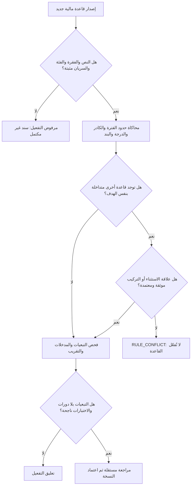

# بوابة صلاحية قواعد المرتبات: كشف التعارض وتركيب الآثار قبل الحساب

**الحالة: مواصفة ضبط إضافية (DRAFT)، وليست قرارًا قانونيًا أو Migration.** تستكمل [محرك القواعد الزمنية](TEMPORAL-RULE-RESOLUTION-AND-CONFLICTS.md) و[مثال الغياب والترقية والإجازة](../examples/03-TEMPORAL-RULE-CONFLICT-EXAMPLE.md). كل الأرقام والرموز هنا اصطناعية.

## 1 — الحقيقة الأساسية: الشروط ليست Yes/No فقط

كل شرط انطباق يُقيّم إلى إحدى ثلاث نتائج:
- `TRUE`: الدليل المعتمد يثبت تحقق الشرط خلال الفترة المحددة.
- `FALSE`: الدليل المعتمد يثبت عدم تحقق الشرط.
- `UNKNOWN`: المستند أو الدرجة أو التاريخ أو الوعاء غير متاح أو غير كافٍ أو متعارض.

**ممنوع** تحويل `UNKNOWN` إلى `FALSE` ثم اختيار قاعدة بديلة تلقائيًا. إذا كان الشرط المجهول مؤثرًا في بند محدد، يُنتج `EVIDENCE_REQUIRED` أو `HISTORY_CONFLICT` ويوقف **ذلك البند والمقطع**؛ لا يعطّل دون داعٍ بنودًا مستقلة معلومة.

مثال: مستفيد من مكافأة خارج إطار التعيين لا تُفرض عليه درجة وظيفية مختلقة؛ إذا كانت القاعدة تخص مكافأته دون شرط درجة يمكن تقييمها رغم عدم وجود `GradeHistory`.

## 2 — فرق بين تراكب الحالات وتعارض الآثار

| التصنيف | ماذا يعني؟ | التصرف |
| --- | --- | --- |
| `ALLOWED_PARALLEL` | قراران يخصان بندين مختلفين أو خصائص غير حصرية | طبّق كليهما مع حفظ سند كل أثر |
| `COMPOSED_EFFECTS` | قراران يؤثران على بند واحد، لكن **طريقة اجتماعهما وترتيبهما** موثقة | نفّذ `CompositionPlanVersion` المعتمدة |
| `PARTIAL_SUPERSESSION` | قرار يلغي أو يصحح **جزءًا محددًا** من أيام قرار سابق | احذف الأثر في النطاق المحدد من الحساب الجديد فقط؛ حفظ التاريخ |
| `MUTUALLY_EXCLUSIVE` | سجل درجتين مختلفتين **لنفس علاقة العمل والحقل الحصري واللحظة** | `HISTORY_CONFLICT` إذا لم توجد علاقة تصحيح معتمدة |
| `RULE_OVERRIDE` | نص قانوني موثق يخصص أو يعدّل قاعدة أخرى داخل نطاقه | حدد القاعدة المستبعدة **في هذا النطاق فقط** مع المادة والسريان |
| `RULE_AMBIGUOUS` | حكمان لذات البند والفترة ولا توجد علاقة معتبرة تبين اجتماعهما | `RULE_CONFLICT` حتى حسم المسؤول المختص |

لا تستخدم `MAX(Amount)` أو اختيار `Latest(IssuedAt)` أو `Priority=999` أو أول قاعدة مطابقة لحل تعارض قانوني. **صلاحية ترقية الموظف لا تثبت وحدها كيفية تأثيرها على الحافز أو الخصم.**

## 3 — جدول خطة تركيب الآثار (Effect Composition Plan)

لكل `FinancialComponentId` وأثرين يحتمل اجتماعهما، نحتاج قرارًا مستقلاً بالنطاق الزمني/الكادر/الجهة ونوع العلاقة القانونية:

| الحقل | مثال اختبار فقط |
| --- | --- |
| `TargetComponentId` | `COMP-ALLOW-TEST` |
| `LeftEffectType` | `GRADE_REPLACEMENT` |
| `RightEffectType` | `PART_TIME_ADJUSTMENT` |
| `CombinationPolicy` | `COMPOSED_EFFECTS` أو `BLOCKED` |
| `ComputationDependency` | `GradeBasedAmount` ← `WorkTimeProportion`، **إذا أجاز المصدر** |
| `ValidFrom/To` | نطاق سريان علاقة التركيب |
| `LegalRelationEvidence` | المادة/القرار الذي أجاز الأثر وطريقة تركيبه |
| `ApprovedBy/ApprovedAt` | جهة الاعتماد وتاريخه |
| `CompositionPlanVersion` | رقم إصدار لا يتغير بعد الاعتماد |

**مثال رياضي مختلق:** إذا حسب بند اختبار وفق الدرجة `100`، ثم كان له معامل دوام معتمد `0.65`، قد تعطي خطة تركيب مصرح بها `100 × 0.65 = 65`. لكن لا تعمم ذلك على **كل بند** أو على **وعاء الاشتراك التأميني** أو على أي خصم غياب، لأن قانون/قرار كل بند قد يضع صيغة مختلفة. إذا لا توجد خطة معتمدة، الحالة `RULE_CONFLICT` أو `COMPOSITION_UNDEFINED` وليست `65`.

**منع الازدواج:** `ABSENCE_NON_ENTITLEMENT` و`DISCIPLINARY_PENALTY` أثران مختلفان؛ لا ينشأ الجزاء من واقعة الغياب وحدها، ولا يجمعان في بند واحد بلا سند يحدد العلاقة بينهما.

## 4 — صلاحية الدرجات عبر الزمن

لا يوجد `CurrentGrade` واحد يُطبق على الماضي. لكل `EmploymentRelationshipId` و`GradeFacet` ونسخة تاريخ معرفة:
- قائمة فترات `[ValidFrom,ValidTo)` موثقة؛ لا تداخل **إذا كانت طبيعة هذا الحقل حصرية فعلًا**.
- يمكن أن تكون للشخص نفسه درجتان في **علاقتين وظيفيتين مختلفتين**؛ لا تُعاملان كتعارض تلقائي.
- قرار تصحيح بأثر رجعي يُحفظ كنسخة جديدة مع `SupersedesId` و`RecordedAt`، ولا يمحو الدرجة التي بُني عليها اعتماد سابق.
- إذا كانت درجتان متزامنتان دون إلغاء موثق، امنع حساب **البنود المعتمدة على الدرجة** أثناء المقطع المتضارب، ويمكن متابعة البنود المستقلة.

## 5 — بوابة فحص القواعد قبل التفعيل

عند تفعيل قاعدتين متنافستين بالتزامن، يجب فحص قيود التعارض داخل **معاملة قاعدة بيانات ذرية ذات عزل مناسب** بحسب محرك SQL الذي نعتمده، لا الاكتفاء بفحص الواجهة. `System-versioned temporal tables` في SQL Server يسجل تاريخ تعديل الصفوف، لكنه لا يغني عن `Business Valid Time` أو اختبار تداخل القواعد. التصميم الفيزيائي يحتاج ADR واختبارات تزامن.

## 6 — لقطة المعرفة التاريخية: نفس أكتوبر، نتيجتان صحيحتان بحسب تاريخ العلم

| Snapshot | المعلومات المعتمدة عنده | النتيجة |
| --- | --- | --- |
| `SNAP-OLD` بتاريخ 20 أكتوبر | لا يوجد بعد قرار ترقية وصل لاحقًا | يحتفظ بحساب الموافقة القديم حسب الوقائع المعتمدة آنذاك |
| `SNAP-NEW` بتاريخ 11 نوفمبر | القرار السابق وصل وأثبت ترقية بأثر أكتوبر؛ وإجازة متعارضة مع غياب يوم 13 | إعادة حل الفترات، لكن يوم 13 يظل `EVENT_CONFLICT` |
| `SNAP-CORRECTED` بتاريخ 12 نوفمبر | وصل سند يلغي الغياب في 13 فقط | يُرفع تعارض **13 أكتوبر فقط**، وتظل 12 و14 أكتوبر كما هما |

الغرض من النظام ليس القول إن الحساب القديم «صار صحيحًا قانونيًا نهائيًا»، بل القدرة على تفسير **ما كان المراجع يعرفه عند توقيع ذلك الاعتماد**، ثم بيان أثر المستند المتأخر دون طمس القرار القديم.

## 7 — الاختبارات الإضافية المطلوبة

| المعرف | سيناريو إدخال اصطناعي | المتوقع |
| --- | --- | --- |
| TR-021 | شرط انطباق الدرجة `UNKNOWN` مع وجود بديل لا يحتاج درجة | لا اختيار بديل يحتمل عدم انطباقه؛ أثر البند يعتمد الشروط كلها |
| TR-022 | مستفيد مكافأة لا يتطلب حكمه درجة وظيفية | لا مطالبة بدرجة بلا داع |
| TR-023 | قراران مستقلان لبندين مختلفين | كلاهما مسموح دون إنذار تعارض كاذب |
| TR-024 | تغيير درجة + جزء وقت على البند نفسه بلا خطة تركيب | `COMPOSITION_UNDEFINED`، لا ضرب 65% آليًا |
| TR-025 | قرار تصحيح يلغي يومًا واحدًا من غياب متعدد | تُصحح تلك الفترة فقط ويحفظ القرار السابق |
| TR-026 | تعارض درجات على علاقة واحدة، وبند مركزي مستقل | منع البند المرتبط بالدرجة، واستمرار فحص قراءة البند المركزي |
| TR-027 | قاعدتان متداخلتان تُعتمدان في نفس اللحظة | قاعدة بيانات تمنع اعتمادًا متناقضًا أو توثّق علاقة تداخل صريحة |
| TR-028 | إعادة حساب قبل/بعد وصول قرار ترقية بأثر قديم | نتيجتان محفوظتان مع `KnownAt` و`SnapshotHash` مستقلين |
| TR-029 | AST فيه `A -> B -> A` | رفض تفعيل التبعيات |
| TR-030 | قاعدة لها طريقة تقسيم اليوم غير معتمدة | `INPUT_MISSING` أو `RULE_NOT_CONFIGURED`، لا قسمة على 30 أو عدد أيام الشهر تلقائيًا |

## 8 — ما المطلوب من Gemini قبل كتابة الكود؟

1. عرض تصميم `RuleInteraction` و`CompositionPlanVersion` وربطهما بجدول `FinancialRuleVersion` الموجود **دون جداول مرادفة مكررة**.
2. تقديم ADR عن المفاتيح، والعلاقات والحذف، وعزل المعاملات، وحدود الفترات، وتخزين `KnownAt` والإصدارات.
3. اختبارات اصطناعية تفشل قبل الإصلاح وتنجح بعده، تغطي `TR-001..TR-030` والتعارض والتزامن.
4. تحديد كل بند سيُحسب مستقلًا، وسنده الأصلي وفترته والكادر والتبعيات والتقريب؛ عدم كتابة نسبة أو شرط قانوني من مثال تعليمي.
5. لا تنفيذ قبل اعتماد Issue برمجية منفصلة؛ هذه مواصفة تصميم توثيقية فقط.

**مرجع صناعي إرشادي وليس قانونًا مصريًا:** [OMG DMN 1.5](https://www.omg.org/spec/DMN/1.5) يميز بين سياسة «تطابق قاعدة واحدة» وسياسات تعدد القواعد؛ لا نستخدم ترتيب «أول قاعدة» لحسم تعارض قانوني بلا سند.
